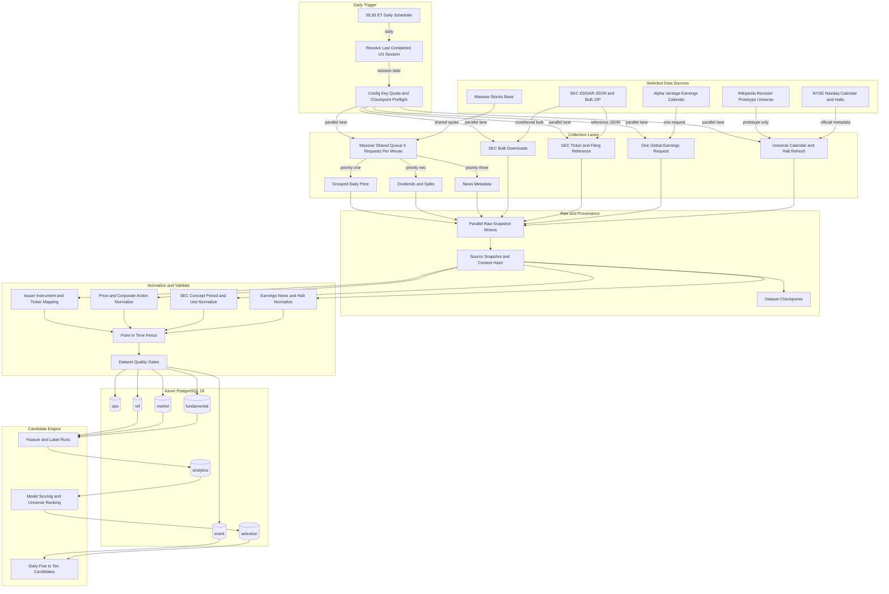

# 프로젝트 전체 아키텍처

갱신일: 2026-10-11

이 문서는 개발과 함께 갱신하는 후보 선정 엔진의 기준 아키텍처다. 실선은 현재 구현 또는 이번 재설계에서 선택한 경로, 점선은 아직 구현하지 않은 경로다.

## 설계 전제

- 스케줄러는 매일 한 번 `05:30 America/New_York`에 실행한다.
- 거래일에는 직전 완료 세션을 처리하고, 비거래일에는 reference·event refresh만 수행한다.
- 시장 데이터는 Massive Stocks Basic을 사용한다.
- Massive 호출은 전체 collector가 공유하는 단일 limiter에서 분당 5회로 제한한다.
- SEC EDGAR와 Alpha Vantage는 Massive와 quota가 독립이므로 병렬 실행한다.
- Alpha Vantage earnings calendar는 ticker별 호출이 아니라 전체 목록을 하루 1회 받는다.
- SEC는 JSON API와 nightly bulk ZIP을 사용하고, 재무 fact는 정규화 후에만 분석 입력으로 사용한다.
- 현재 Wikipedia·Yahoo 경로는 prototype 이력 재현용으로만 남기며 신규 운영 경로에서는 Massive·SEC·Alpha Vantage를 사용한다.

## 전체 애플리케이션 흐름

<!-- mermaid-checked: no \n, no em-dash/en-dash, no {} in labels, subgraphs are id["label"], arrows are -->|"label"|, all subgraphs closed by end, ids unique -->

## 파이프라인 실행 아키텍처

```mermaid
flowchart LR
    subgraph Phase0["Phase 0 Preflight"]
        P0A["Resolve Session"]
        P0B["Validate Keys and Source Policies"]
        P0C["Load Checkpoints"]
    end

    subgraph Phase1["Phase 1 Parallel Network Lanes"]
        MQueue["Massive Token Bucket"]
        M1["Grouped Price One Request"]
        M2["Dividend Pages"]
        M3["Split Pages"]
        M4["News Pages"]
        S1["SEC Ticker JSON"]
        S2["SEC Submissions ZIP"]
        S3["SEC Company Facts ZIP"]
        A1["Alpha Earnings All Symbols"]
        R1["Calendar Universe and Halts"]
    end

    subgraph Phase2["Phase 2 Parallel Local Work"]
        RawWrite["Atomic Raw Writes"]
        ParseMarket["Parse Market"]
        ParseSec["Parse and Normalize SEC"]
        ParseEvents["Parse Events"]
        ParseReference["Parse Reference"]
    end

    subgraph Phase3["Phase 3 Gates"]
        TimeGate["Cutoff and Manifest Gate"]
        DataGate["Completeness and Schema Gate"]
        CoreDecision["Core Dataset Ready"]
    end

    subgraph Phase4["Phase 4 Persistence"]
        DatasetTx["Dataset Transactions"]
        Manifest["Final Input Manifest"]
        Log["One Line Stage Logs"]
    end

    subgraph Phase5["Phase 5 Candidate Run"]
        Features["Features"]
        Scores["Scores"]
        Candidates["Candidates"]
    end

    P0A --> P0B
    P0B --> P0C
    P0C --> MQueue
    P0C --> S1
    P0C --> S2
    P0C --> S3
    P0C --> A1
    P0C --> R1

    MQueue --> M1
    M1 --> M2
    M2 --> M3
    M3 --> M4

    M1 --> RawWrite
    M2 --> RawWrite
    M3 --> RawWrite
    M4 --> RawWrite
    S1 --> RawWrite
    S2 --> RawWrite
    S3 --> RawWrite
    A1 --> RawWrite
    R1 --> RawWrite

    RawWrite --> ParseMarket
    RawWrite --> ParseSec
    RawWrite --> ParseEvents
    RawWrite --> ParseReference
    ParseMarket --> TimeGate
    ParseSec --> TimeGate
    ParseEvents --> TimeGate
    ParseReference --> TimeGate
    TimeGate --> DataGate
    DataGate --> DatasetTx
    DatasetTx --> CoreDecision
    CoreDecision --> Manifest
    Manifest --> Features
    Features --> Scores
    Scores --> Candidates

    P0B --> Log
    M4 --> Log
    S3 --> Log
    A1 --> Log
    R1 --> Log
    DataGate --> Log
    DatasetTx --> Log
    Manifest --> Log
```

<!-- mermaid-checked: no \n, no em-dash/en-dash, no {} in labels, subgraphs are id["label"], arrows are -->|"label"|, all subgraphs closed by end, ids unique -->

## 병렬화 원칙

| 영역 | 실행 방식 | 근거 |
|---|---|---|
| Massive 네트워크 | 단일 shared queue, 12초당 최대 1회 | Stocks Basic 분당 5회 제한을 collector 전체에서 지키기 위함 |
| Massive 응답 parsing | dataset별 병렬 | 네트워크 quota와 무관한 CPU·I/O 작업 |
| SEC bulk 3종 | 최대 2개 동시 다운로드 | SEC 10 req/s보다 보수적이며 대용량 ZIP 동시 부하 제한 |
| Alpha Vantage | SEC·Massive와 병렬, 하루 1회 | 독립 quota이며 전체 earnings 목록 한 번으로 충분 |
| 공식 calendar·halt·universe | 다른 공급자와 병렬 | 독립 원천이며 candidate core 이전에만 완료하면 됨 |
| raw snapshot 쓰기 | dataset별 병렬 atomic write | 서로 다른 파일이고 content hash로 멱등 |
| normalize·quality | dataset별 병렬 | schema별 독립 처리 후 final manifest에서 결합 |
| PostgreSQL | dataset별 transaction 후 manifest 직렬 확정 | 부분 성공을 보존하되 불완전 core로 후보 생성을 막기 위함 |

## 데이터 완전성 상태

| 목표 데이터 | 현재 | 재설계 경로 | 남는 한계 |
|---|---|---|---|
| 현재 S&P 500 종목군 | Wikipedia 503 securities | Wikipedia revision + SEC identity 보강 | 공식 S&P 구성·weight 아님 |
| 과거 구성·GICS | 없음 | S&P DJI 계약 필요 | 현재 선택 공급자로 수집 불가 |
| 일봉 OHLCV | Yahoo 2026-10-01만 | Massive grouped daily | Basic은 장 마감·과거 2년 |
| 3~5년 가격 | 없음 | Massive 상위 플랜 또는 별도 backfill | Basic으로 목표 미충족 |
| 분할·배당 | 없음 | Massive corporate actions | 무료 플랜 과거 범위 제한 |
| CIK·공시·재무 | CIK 일부 | SEC JSON + bulk ZIP | concept·기간·단위 정규화 필요 |
| 실적 일정 | 없음 | Alpha Vantage 전체 목록 하루 1회 | 과거 revision history 없음 |
| 뉴스 metadata | 없음 | Massive News | 무료 플랜 과거 범위와 콘텐츠 권리 제한 |
| 거래 달력·조기 폐장 | 없음 | 공식 일정 + exchange calendar baseline | 비정상 휴장 archive 필요 |
| 거래정지 | 없음 | Nasdaq halt feed | 별도 collector 필요 |
| 특징·점수·후보 | 구현 | Qlib Alpha158·LightGBM·selection | 현재 모델은 SHADOW, 승격 기준 미통과 |

## 기술 구성

| 계층 | 선택 기술 |
|---|---|
| 스케줄·CLI | Python 3.13, 일 1회 |
| 비동기 HTTP | HTTPX |
| Massive 제한 | shared token bucket, 5 req/min |
| SEC 제한 | global limiter 5 req/s, 최대 동시 2 bulk downloads |
| Alpha 제한 | 1 global earnings request/day, 최대 25/day guard |
| 구조화 저장 | Azure PostgreSQL Flexible Server 16 |
| DB 인증 | Microsoft Entra, passwordless |
| 원문 저장 | MVP local gzip, 운영 Azure Blob planned |
| 시점 통제 | source snapshot, input manifest, execution context |
| 로깅 | `logs/YYYY-MM-DD.log` JSONL |

## 구현 상태

현재 구현·실행 완료:

- Massive grouped daily price, dividend, split, news collector
- Massive shared 5회/분 limiter와 pagination
- SEC company ticker·exchange reference collector
- SEC submissions/companyfacts bulk ZIP downloader·normalizer·filing/fact persistence
- Alpha Vantage 전체 earnings calendar collector
- event·corporate-action·instrument-state production schema와 persistence
- raw snapshot 7종, final manifest와 operational execution context
- Yahoo/Wikipedia prototype, temporal fence, 변경분 upsert와 JSONL 로그
- XNYS backfill, range action/news, SEC fact cutoff, 자동·수동 재처리와 process 진행 로그

아직 미구현 또는 운영 검증 대기:

- 공식 calendar·halt collector
- dataset checkpoint 실제 전진 로직
- staging COPY·set-based merge 최적화
- 양의 Rank IC champion과 20-session live shadow

후보 저장이 이 저장소의 마지막 단계다. 후보 이후 분석, agent 실행, report, 비용과 재평가는 별도 프로젝트에서 관리한다.
