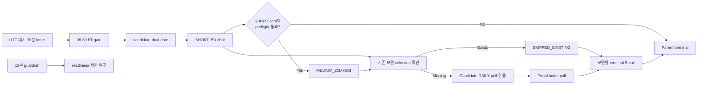
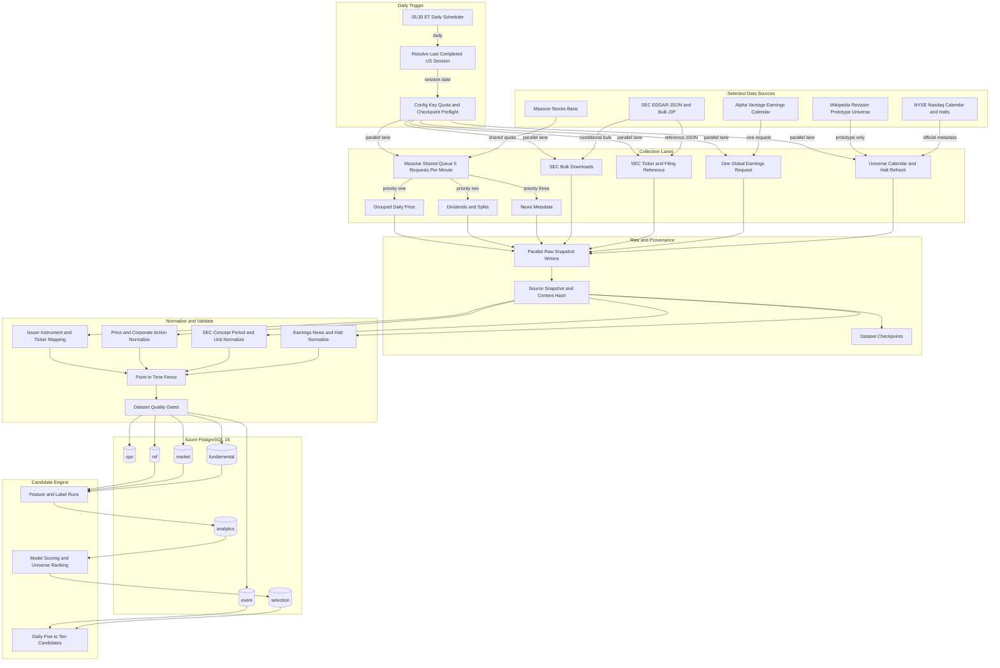

# 프로젝트 전체 아키텍처

갱신일: 2026-10-14

이 문서는 개발과 함께 갱신하는 `candidate_engine`과 운영 자동화의 기준
아키텍처다. **이 프로젝트와 저장소의 제품 범위는 아래 다이어그램의
`candidate_engine` 영역**이며, 원천 수집부터 전처리·점수·후보 통합·검증과
5~10개 후보 API 제공까지를 책임진다.

포털·TradingAgents·외부 분석 데이터·MySQL·분석 보고서 Blob은 전체 시스템의 연동
맥락을 보여주기 위해 표시하지만 이 프로젝트의 구현 범위가 아니다. 현재 후보 원본과
파이프라인 실행 기록의 단일 원본은 Candidate PostgreSQL이다.

다이어그램의 LLM 상위 20 경로는 **candidate_engine의 계획된 확장**이다. 현재 구현된
운영 후보는 Qlib Alpha158·LightGBM 점수와 selection policy로 생성하며, 현행
`PROJECT-HARNESS.md`가 후보 LLM 분석을 제외하므로 LLM 경로를 활성화하려면 먼저
하네스·입력 시점·출력 schema·검증 기준을 versioned 계약으로 변경해야 한다.

오케스트레이터의 replay·멱등성·상태 전이·보안·배포 상세는
[Durable Functions 오케스트레이터 아키텍처](orchestrator-architecture.md)를 기준으로 한다.

## 설계 전제

- 05:30 ET timer는 날짜별 dual 부모를 시작하고, 별도 resource guardian은 15분마다
  readiness와 승인된 제한 복구를 수행한다.
- 거래일에는 직전 완료 세션을 처리하고, 비거래일에는 reference·event refresh만 수행한다.
- 시장 데이터는 Massive Stocks Basic을 사용한다.
- Massive 호출은 전체 collector가 공유하는 단일 limiter에서 분당 5회로 제한한다.
- SEC EDGAR와 Alpha Vantage는 Massive와 quota가 독립이므로 병렬 실행한다.
- Alpha Vantage earnings calendar는 ticker별 호출이 아니라 전체 목록을 하루 1회 받는다.
- SEC는 JSON API와 nightly bulk ZIP을 사용하고, 재무 fact는 정규화 후에만 분석 입력으로 사용한다.
- 현재 Wikipedia·Yahoo 경로는 prototype 이력 재현용으로만 남기며 신규 운영 경로에서는 Massive·SEC·Alpha Vantage를 사용한다.
- Candidate API의 기본 조회 모델은 `MEDIUM_20D`다. 일일 Durable 부모는
  `SHORT_5D` child 종료 후 `MEDIUM_20D` child를 시작한다. 단일 모델 endpoint는
  one-off 진단 경로이며 모델 간 자동 fallback은 없다.
- 운영 스케줄은 Python Durable Functions가 담당한다. Candidate Engine은 포털이나
  TradingAgents의 분석 결과를 저장하지 않는다.

## 슬라이드 1 기준 전체 아키텍처

| 영역 | 상태 | 이 저장소의 책임 |
|---|---|---|
| 원천 수집·Data Spine·Qlib Alpha158·LightGBM·selection·Candidate API | CURRENT | 포함 |
| LLM 기업·뉴스 평가 상위 20과 수치 Top 20 통합 | PLANNED | 계약 승인 후 포함 예정 |
| Portal·TradingAgents·외부 분석 data/state·report | EXTERNAL | 제외, API 연동만 유지 |

```mermaid
flowchart LR
    subgraph CandidateScope["PROJECT SCOPE · candidate_engine"]
        subgraph Daily["Daily Orchestration · 05:30 ET"]
            subgraph Inputs["S&P 500 Universe and Source Data"]
                Reference["Wikipedia and SEC<br/>S&P 500 · GICS · CIK · ticker · exchange"]
                Massive["Massive<br/>OHLCV · VWAP · SPY · actions · news"]
                Sec["SEC EDGAR<br/>filing · submissions · normalized XBRL"]
                Alpha["Alpha Vantage<br/>earnings calendar · estimate · reported EPS"]
            end

            DataSpine[("Candidate PostgreSQL<br/>immutable snapshot · manifest · execution context")]

            subgraph Quant["Microsoft Qlib · Numeric Top 20 · CURRENT"]
                Export["Qlib export<br/>adjusted OHLCV · calendar · span"]
                Features["Alpha158 RAW<br/>158 features · max 60 sessions"]
                WalkForward["Purged walk-forward<br/>time split · train-only fit"]
                LightGBM["LightGBM<br/>SHORT_5D · MEDIUM_20D"]
                NumericTop["Predicted return rank<br/>numeric top 20"]
            end

            LlmTop["LLM company and news evaluation<br/>top 20 · PLANNED"]
            Merge["Candidate merge and validation<br/>deduplication · risk factors · sector diversification"]
            CandidateApi["Final candidates 5 to 10<br/>Candidate API · not an order"]

            Reference --> DataSpine
            Massive --> DataSpine
            Sec --> DataSpine
            Alpha --> DataSpine
            DataSpine --> Export --> Features --> WalkForward --> LightGBM --> NumericTop
            DataSpine -.-> LlmTop
            NumericTop --> Merge
            LlmTop -.-> Merge
            Merge --> CandidateApi
        end

        Durable["Python Durable Functions<br/>SHORT_5D then MEDIUM_20D · idempotent control plane"]
        CandidateState["Private Storage · Key Vault · App Insights · ACS Email"]
        Durable --> Daily
        CandidateState --> Durable
    end

    subgraph External["EXTERNAL · jongmok-toronbang and TradingAgents"]
        Portal["Portal and Analysis API<br/>selection validation · idempotent dispatch"]

        subgraph Agents["Agents Layer"]
            Analysts["Analysts<br/>market · fundamentals · news · sentiment"]
            Debate["Bull and Bear<br/>evidence debate"]
            Research["Research Manager<br/>debate synthesis"]
            Trader["Trader<br/>proposal"]
            Risk["Risk and Portfolio<br/>final rating"]
            Analysts --> Debate --> Research --> Trader --> Risk
        end

        subgraph ExternalData["Data and State Layer"]
            YFinance["yfinance<br/>OHLCV · fundamentals · news"]
            Macro["FRED and Polymarket<br/>macro · prediction"]
            PortalState[("MySQL and private Blob<br/>job · decision · report")]
        end

        PortalUi["Portal UI<br/>DailyAnalysis · Job status · report retrieval"]
        Portal --> Agents
        YFinance --> Analysts
        Macro --> Analysts
        Agents --> PortalState
        PortalState --> PortalUi
    end

    CandidateApi -->|"selection run batch"| Portal
```

<!-- mermaid-checked: no braces in labels, all subgraphs closed, unique ids -->

### 05:30 ET 실행 계약

1. Functions timer는 UTC 매시 30분 실행되지만 뉴욕 현지 시각이 정확히 05:30일
   때만 `candidate-dual-YYYY-MM-DD` Durable 부모를 시작한다. DST는
   `America/New_York` 변환으로 처리한다.
2. 대상은 직전 달력 날짜이며 Candidate의 XNYS session API에서 거래일을 확인한다.
   비거래일은 외부 실행 없이 `SUCCEEDED`와 `skipped=true`로 끝난다.
3. 부모는 `SHORT_5D` child를 terminal까지 실행하고 허용된 결과에서만
   `MEDIUM_20D` child를 시작한다. SHORT의 core·preflight 실패/timeout은 sequence를
   중단하고, Portal 실패/timeout·`PARTIAL_FAILED`·`SKIPPED_EXISTING`은 계속한다.
4. 각 child는 Candidate·Portal App Service의 ARM 상태와 Candidate `/health/ready`, Portal 및
   TradingAgents `/readyz`를 확인한다.
5. Candidate 제출 전에 날짜·모델별 기존 terminal selection을 확인한다. 있으면
   `SKIPPED_EXISTING`으로 종료하고 Candidate·Portal·TradingAgents 신규 실행을 하지
   않는다. 없으면 모델 목적을 포함한 `Idempotency-Key`로 접수하고 durable timer로
   polling한다.
6. Portal service API에는 후보 row를 복제하지 않고 `analysis_date`,
   `selection_run_id`, `model_purpose`를 일괄 제출한다. Portal이 MySQL에 외부 분석
   job·결과를 저장하고 TradingAgents Container App 실행을 중개한다.
7. 외부 I/O, 모델별 ACS Email, 구조화 telemetry는 activity에서만 실행한다. 모델
   종결 상태는 `SUCCEEDED`, `SKIPPED_EXISTING`, `PARTIAL_FAILED`, `TIMED_OUT`,
   `FAILED`다.
8. `resource_guardian_timer`는 15분마다 readiness와 제한 복구를 수행하지만 부모
   orchestration을 시작하거나 terminal 실행을 재시작하지 않는다.

### Candidate API 멱등성

`POST /api/v1/pipeline-runs`는 `X-API-Key`와 `Idempotency-Key`를 요구한다. API는
null을 제외하고 key를 정렬한 canonical JSON의 SHA-256을 PostgreSQL에 저장한다.
같은 key와 같은 hash는 원래 `process_run_id`를 반환해 gateway 또는 activity replay가
중복 수집·후보 생성을 만들지 않는다. 같은 key를 다른 payload에 재사용하면 `409`다.
이 계약은 API 접수 멱등성이고 Durable instance ID의 날짜별 중복 방지와 별개로 함께
적용된다.

### FC1 Bicep 경계

`infra/orchestrator.bicep`은 Linux FC1 Function App, 관리 ID 기반 표준 Durable
Storage, 배포 Blob container, FC1 VNet 통합, Blob·Queue·Table private endpoint와
private DNS, Key Vault, Application Insights·Log Analytics, ACS Email, 예외·실패
alert를 만든다. Storage public network/shared key/anonymous Blob access는 차단한다.
Durable Task Scheduler는 사용하지 않는다. API key와 email 주소 값은 만들지 않고
배포 후 안전한 앱 설정 경로로 주입한다. 기존 Candidate·Portal App Service에는 Reader
역할을 별도로 부여하며, Portal·TradingAgents·PostgreSQL·MySQL 자체는 이 Bicep의
소유 범위가 아니다.

### 오케스트레이터 제어 흐름

오케스트레이터는 control plane이며 Candidate PostgreSQL이나 Portal MySQL에 직접
연결하지 않는다. Candidate API가 파이프라인과 후보 원본을 소유하고 Portal API가 외부
분석 job을 소유한다. Durable Storage에는 업무 데이터가 아니라 orchestration history와
task state만 저장한다.

Candidate 단계의 `PARTIAL_SUCCESS`는 terminal이지만 다음 단계로 진행할 수 있는 성공이
아니다. Portal 단계는 모든 job이 terminal일 때 `has_result`를 함께 확인해 전체 성공,
부분 실패, 전체 실패를 구분한다. 상세 상태도와 재실행 계약은
[오케스트레이터 아키텍처](orchestrator-architecture.md)에 정의한다.

## 전체 애플리케이션 흐름

<!-- mermaid-checked: no \n, no em-dash/en-dash, no {} in labels, subgraphs are id["label"], arrows are -->|"label"|, all subgraphs closed by end, ids unique -->

## 파이프라인 실행 아키텍처

```mermaid
flowchart LR
    subgraph Phase0["Phase 0 Preflight"]
        P0A["Resolve Session"]
        P0B["Validate Keys and Source Policies"]
        P0C["Load Checkpoints"]
    end

    subgraph Phase1["Phase 1 Parallel Network Lanes"]
        MQueue["Massive Token Bucket"]
        M1["Grouped Price One Request"]
        M2["Dividend Pages"]
        M3["Split Pages"]
        M4["News Pages"]
        S1["SEC Ticker JSON"]
        S2["SEC Submissions ZIP"]
        S3["SEC Company Facts ZIP"]
        A1["Alpha Earnings All Symbols"]
        R1["Calendar Universe and Halts"]
    end

    subgraph Phase2["Phase 2 Parallel Local Work"]
        RawWrite["Atomic Raw Writes"]
        ParseMarket["Parse Market"]
        ParseSec["Parse and Normalize SEC"]
        ParseEvents["Parse Events"]
        ParseReference["Parse Reference"]
    end

    subgraph Phase3["Phase 3 Gates"]
        TimeGate["Cutoff and Manifest Gate"]
        DataGate["Completeness and Schema Gate"]
        CoreDecision["Core Dataset Ready"]
    end

    subgraph Phase4["Phase 4 Persistence"]
        DatasetTx["Dataset Transactions"]
        Manifest["Final Input Manifest"]
        Log["One Line Stage Logs"]
    end

    subgraph Phase5["Phase 5 Candidate Run"]
        Features["Features"]
        Scores["Scores"]
        Candidates["Candidates"]
    end

    P0A --> P0B
    P0B --> P0C
    P0C --> MQueue
    P0C --> S1
    P0C --> S2
    P0C --> S3
    P0C --> A1
    P0C --> R1

    MQueue --> M1
    M1 --> M2
    M2 --> M3
    M3 --> M4

    M1 --> RawWrite
    M2 --> RawWrite
    M3 --> RawWrite
    M4 --> RawWrite
    S1 --> RawWrite
    S2 --> RawWrite
    S3 --> RawWrite
    A1 --> RawWrite
    R1 --> RawWrite

    RawWrite --> ParseMarket
    RawWrite --> ParseSec
    RawWrite --> ParseEvents
    RawWrite --> ParseReference
    ParseMarket --> TimeGate
    ParseSec --> TimeGate
    ParseEvents --> TimeGate
    ParseReference --> TimeGate
    TimeGate --> DataGate
    DataGate --> DatasetTx
    DatasetTx --> CoreDecision
    CoreDecision --> Manifest
    Manifest --> Features
    Features --> Scores
    Scores --> Candidates

    P0B --> Log
    M4 --> Log
    S3 --> Log
    A1 --> Log
    R1 --> Log
    DataGate --> Log
    DatasetTx --> Log
    Manifest --> Log
```

<!-- mermaid-checked: no \n, no em-dash/en-dash, no {} in labels, subgraphs are id["label"], arrows are -->|"label"|, all subgraphs closed by end, ids unique -->

## 병렬화 원칙

| 영역 | 실행 방식 | 근거 |
|---|---|---|
| Massive 네트워크 | 단일 shared queue, 12초당 최대 1회 | Stocks Basic 분당 5회 제한을 collector 전체에서 지키기 위함 |
| Massive 응답 parsing | dataset별 병렬 | 네트워크 quota와 무관한 CPU·I/O 작업 |
| SEC bulk 3종 | 최대 2개 동시 다운로드 | SEC 10 req/s보다 보수적이며 대용량 ZIP 동시 부하 제한 |
| Alpha Vantage | SEC·Massive와 병렬, 하루 1회 | 독립 quota이며 전체 earnings 목록 한 번으로 충분 |
| 공식 calendar·halt·universe | 다른 공급자와 병렬 | 독립 원천이며 candidate core 이전에만 완료하면 됨 |
| raw snapshot 쓰기 | dataset별 병렬 atomic write | 서로 다른 파일이고 content hash로 멱등 |
| normalize·quality | dataset별 병렬 | schema별 독립 처리 후 final manifest에서 결합 |
| PostgreSQL | dataset별 transaction 후 manifest 직렬 확정 | 부분 성공을 보존하되 불완전 core로 후보 생성을 막기 위함 |

## 데이터 완전성 상태

| 목표 데이터 | 현재 | 재설계 경로 | 남는 한계 |
|---|---|---|---|
| 현재 S&P 500 종목군 | Wikipedia 503 securities·500 issuers, SEC identity 보강 | versioned universe와 identifier 유지 | 공식 S&P 구성·weight 아님 |
| 과거 구성·GICS | 없음 | S&P DJI 계약 필요 | 현재 선택 공급자로 수집 불가 |
| 일봉 OHLCV | Massive 당일 503개, historical 500 sessions·251,471 rows | grouped daily와 ticker fallback | Basic은 장 마감·과거 약 2년 |
| 3~5년 가격 | 약 2년·500 sessions 확보 | Massive 상위 플랜 또는 별도 licensed backfill | 현재 플랜으로 3~5년 목표 미충족 |
| 분할·배당 | Massive corporate actions 99개 적재 | revision·factor lineage 유지 | 무료 플랜 과거 범위 제한 |
| CIK·공시·재무 | SEC state 503개, filing 8,452개, allowlist fact 50,582개 | JSON·bulk ZIP point-in-time observation | allowlist 밖 concept와 원천 revision 한계 |
| 실적 일정 | Alpha Vantage 467개 적재 | 전체 목록 하루 1회와 revision 저장 | 과거 revision history 없음 |
| 뉴스 metadata | Massive 291개 적재 | event observation과 instrument mapping | 무료 플랜 과거 범위와 콘텐츠 권리 제한 |
| 거래 달력·조기 폐장 | `exchange_calendars` XNYS 기준선 | NYSE/Nasdaq 공식 collector 추가 | 비정상 휴장 archive·공식 검증 필요 |
| 거래정지 | 없음 | Nasdaq halt feed | 별도 collector 필요 |
| 특징·점수·후보 | Alpha158 158개, SHORT_5D·MEDIUM_20D 후보 각 10개 | Qlib export·LightGBM·selection | 두 모델 모두 SHADOW, champion 승격 기준 미통과 |

## 기술 구성

| 계층 | 선택 기술 |
|---|---|
| 엔진 스케줄·CLI | Python 3.13, 일 1회 |
| 운영 조정 | Python 3.11 Azure Durable Functions, Linux FC1 |
| 실행 상태 | Azure Storage Blob·Queue·Table, 관리 ID 인증 |
| secret·알림 | Key Vault reference, ACS Email |
| 운영 관측 | Application Insights, Log Analytics, allowlist JSON trace, KQL runbook |
| 비동기 HTTP | HTTPX |
| Massive 제한 | shared token bucket, 5 req/min |
| SEC 제한 | global limiter 5 req/s, 최대 동시 2 bulk downloads |
| Alpha 제한 | 1 global earnings request/day, 최대 25/day guard |
| 구조화 저장 | Azure PostgreSQL Flexible Server 16 |
| DB 인증 | Microsoft Entra, passwordless |
| 원문 저장 | MVP local gzip, 운영 Azure Blob planned |
| 시점 통제 | source snapshot, input manifest, execution context |
| 로깅 | `logs/YYYY-MM-DD.log` JSONL |

## 구현 상태

현재 구현·실행 완료:

- Massive grouped daily price, dividend, split, news collector
- Massive shared 5회/분 limiter와 pagination
- SEC company ticker·exchange reference collector
- SEC submissions/companyfacts bulk ZIP downloader·normalizer·filing/fact persistence
- Alpha Vantage 전체 earnings calendar collector
- event·corporate-action·instrument-state production schema와 persistence
- raw snapshot 7종, final manifest와 operational execution context
- Yahoo/Wikipedia prototype, temporal fence, 변경분 upsert와 JSONL 로그
- XNYS backfill, range action/news, SEC fact cutoff, 자동·수동 재처리와 process 진행 로그
- private Storage 기반 FC1 Durable Functions와 managed identity data plane
- `SHORT_5D` 후 `MEDIUM_20D` 순차 부모, 모델별 결정적 child ID
- 날짜·모델별 `SKIPPED_EXISTING` short circuit와 Portal 미제출
- 15분 resource guardian, 모델별 Email, replay-safe telemetry와 KQL runbook

아직 미구현 또는 운영 검증 대기:

- 공식 calendar·halt collector
- dataset checkpoint 실제 전진 로직
- staging COPY·set-based merge 최적화
- 양의 Rank IC를 충족하는 champion 승격
- dual 코드의 Bicep/전체 회귀 검증, 비파괴 배포, 수동·정시 E2E와 KQL 확인

후보 저장이 이 저장소의 마지막 단계다. 후보 이후 분석, agent 실행, report, 비용과 재평가는 별도 프로젝트에서 관리한다.
