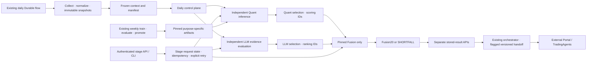
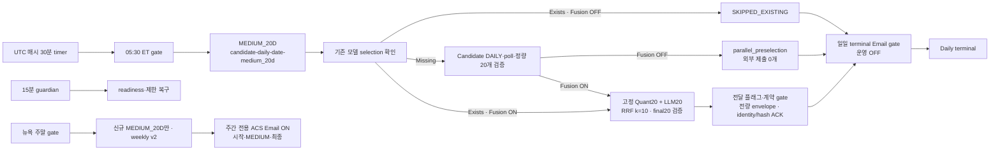
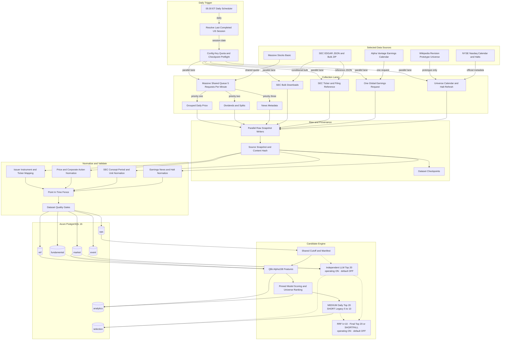

# 프로젝트 전체 아키텍처

갱신일: 2026-10-23

## 독립 후보 파이프라인 구조 (2026-10-17)

독립 API/CLI·상태·retry와 PostgreSQL migration 025까지 운영 배포됐다.
모델·rubric·RRF k=10을 유지하며 공통 입력 이후 Quant·LLM을 독립 실행한다.
상세 설계는 [정량](./quantitative-pipeline-architecture.md),
[LLM](./llm-pipeline-architecture.md), [Fusion](./fusion-pipeline-architecture.md)으로 나눈다.
이 설계는 TradingAgents 분석이 아니라 후보 선정까지의 설계다.

- 일일 입력 수집·병렬 분기·Fusion·외부 전달은 기존 자동 계약을 유지한다.
- 현재 Quant·LLM 병렬성은 Backend 프로세스 안의 논리적 실행과 독립 stage API/CLI다.
  수집·Quant·LLM·Fusion을 각각 Container Apps Job으로 물리 분리하는 구조는 제안이며
  아직 운영 구현이 아니다. 실제 주간 학습용 Job의 존재로 일일 분리가 완료됐다고 표현하지 않는다.
- 독립 stage는 기존 context를 명시해 한 단계만 실행한다. 수집·학습·다른 branch·외부 전달을
  암묵적으로 실행하지 않는다. Fusion은 두 실제 source selection ID를 필수로 받는다.
- 새 ops.candidate_stage_run은 실행 제어이며 immutable 사업 결과 run을 대체하지 않는다.
  PENDING/RUNNING/SUCCEEDED/SHORTFALL/FAILED, retry 원본 ID, 고정 계약 hash·결과 ID를 갖는다.
- API는 X-API-Key·Idempotency-Key, 입력 차이 409, 상태·재시도를 제공한다.
  CLI도 같은 service를 사용하고 별도 선정 알고리즘을 만들지 않는다.
- Quant는 artifact/model purpose, LLM은 policy/deployment를 고정한다.
  LLM-only 실행에 Quant 모델이나 Qlib의 정상 상태를 요구하지 않는다.
- 독립 CLI는 API worker 재시작 복구 대상에서 분리한다. API BackgroundTasks는 영속 queue가
  아니며 중단을 명시적 FAILED로 저장하고 retry를 제공하는 한계를 기록한다.
- 배포는 additive migration·최소 ops 권한·Backend를 대상으로 한다.
  현재 실행 중인 외부 분석이나 Portal UI를 중단·수정하지 않는다.

이 문서는 개발과 함께 갱신하는 `candidate_engine`과 운영 자동화의 기준
아키텍처다. **이 프로젝트와 저장소의 제품 범위는 아래 다이어그램의
`candidate_engine` 영역**이며, 원천 수집부터 전처리·점수·후보 선정·검증과
20개 후보 API 제공까지를 책임진다. 최종 통합은 기본 비활성 선택 기능이다.

포털·TradingAgents·외부 분석 데이터·MySQL·분석 보고서 Blob은 전체 시스템의 연동
맥락을 보여주기 위해 표시하지만 이 프로젝트의 구현 범위가 아니다. 현재 후보 원본과
파이프라인 실행 기록의 단일 원본은 Candidate PostgreSQL이다.

독립 LLM Top 20은 구현된 선택 경로이며 `LLM_PRESELECTION_ENABLED=false`가 기본값이다.
공통 manifest·cutoff를 준비한 뒤 Qlib Alpha158·LightGBM 정량 Top 20과 병렬 실행한다.
신규 이벤트 LLM v2·RRF·최종 20개 전달 어댑터는 구현됐으나 기본 비활성이다.
Fusion 비활성 MEDIUM은 `parallel_preselection`에서 외부 제출 없이 종료한다.
신규 정책과 조회 계약의 운영 활성화는 별도 승인·배포 작업이다.
SHORT_5D 레거시 5~10개 실행 기능은 유지한다.

2026-10-23 확인된 운영은 PostgreSQL025·독립 stage API/CLI까지 배포됐고
event v2·Fusion k=10·전량 handoff가 승인 활성화돼 있다. 코드 기본 OFF와 구분한다.
세 독립 stage의 고정 성공20개 재사용·인증·멱등성을 검증했으며 추가 LLM 호출은0건이다.
실행·재시도는 [오케스트레이터 가이드](../../../../../orchestrator/README.md),
오류 조회는 [Telemetry·KQL 런북](orchestrator-telemetry-runbook.md)을 따른다.

### 운영과 로컬 변경의 경계

| 기능 | 현재 상태 |
|---|---|
| 독립 Quant·LLM·Fusion stage, event v2·RRF k=10·전량 handoff | 운영 활성, 코드·설정 예제의 기본값은 OFF |
| event v2 한국어 prompt·관리 ID 평가 | 운영 `llm-event-preselection-v3-ko`·`gpt-6.1-sol`·API `2024-10-21`, timeout180초 |
| v4 strict 검색·v5 기간 검색·v6 선택적 기간 검색 | 별도 명시 선택 경로; v6 과거 연구 실행과 정규 운영 v2 활성화를 구분 |
| Fusion 근거 snapshot·v2 설명/결과 통합 API·회사명 | 운영 배포, legacy snapshot 부재는 `NOT_RECORDED` |
| 정규 정량 serving model | LightGBM MEDIUM v1 `74c367e9-bd84-58ab-b933-19a36dae35c4`, SHADOW; 연구용 Ridge 승격 아님 |
| 신규 주말 모델 업데이트 | MEDIUM_20D만·weekly v2, 성능 임계값 유예와 데이터/무결성 gate 유지 |
| 유니버스 cutoff·정량 cache fence | 10월22일 배포, 같은 manifest의 eligible version과 성공 결과 재사용 일치 |
| DB·외부 인용 설명 결합 | 10월23일 운영 단일 함수 패치; 추가 LLM 호출·점수 변경 없음 |
| 주간 모델 업데이트 이메일 | 오케스트레이터 배포·주간 전용 활성, 승인된 단일 수신처 사용 |
| 일일 파이프라인·resource guardian 이메일 | 비활성, 실행·관측 기능은 유지 |

일일 병렬 분기는 성공한 형제 결과를 보존한다. 둘 다 성공하면 `SUCCEEDED`, 한쪽만
성공하면 `PARTIAL_SUCCESS`, 둘 다 실패하면 `FAILED`다. 부분 성공을 Fusion 입력이나
외부 전달 성공으로 취급하지 않으며 Fusion은 고정된 성공 Top 20 두 개를 요구한다.

현재 serving artifact는 purpose별 assignment가 있으면 이를 고정하고, 없으면 설정된
manifest/hash를 명시적으로 고정한다. assignment 부재가 모델 부재는 아니다.
10월23일 결과 lineage는 RAW Alpha158 158차원·20D 개별 종목 가격수익률을 예측하는
위 LightGBM을 확인한다. schema-v3 Ridge·주말 challenger는 별도 연구/SHADOW이며
모델 weight가 교체됐거나 새 CHAMPION이 승격됐다는 의미가 아니다.

최신 거래일 D의 cutoff는 D+1 달력일 NY 05:30이며 복구도 원래 context/cutoff를 쓴다.
이는 명시적 과거 backfill의 기존 계약을 바꾸지 않는다. Quant와 LLM은 manifest 안에서
공개·적용·원천 가용 시각을 모두 통과한 동일 universe version을 선택한다.

LLM v2는 manifest-fenced DB packet만 평가한다. 별도 v4는 공개 회사 metadata로
native `web_search`를 호출하고 전체 출처·공개 시점·고정 원문 버전을 검증한다.
승인된 발췌만 새 평가 대화에 넘기며 검색 대화·추론·response ID는 넘기지 않는다.
모델 이름·버전은 감사 metadata이며 자료 승인 기준은 아니다. 자세한 gate와 저장 경계는
[LLM 아키텍처](llm-pipeline-architecture.md)를 따른다.

정량 원본 근거와 LLM rationale·criterion 인용은 DB에 존재하지만, 과거 Fusion 결과에는
통합 snapshot이 없을 수 있다. 조회 시 새 분석으로 꾸미거나 원본 근거 부재로 단정하지 않는다.
실제 관계는 [후보 테이블·ER 문서](../../../../../SELECTION-DATABASE-ER.md)에 정리한다.
설명 변환은 동일 `(evidence_link_id, criterion, is_external)`의 서로 다른 이유를
bounded 요약으로 결합하되 원본 assessment는 유지한다. 점수·RRF·선정은 다시 계산하지 않는다.
10월22일 DAILY의 부분 실패 기록과 별도 복구 Fusion의 후보/설명20개·ACK20은 공존한다.
ACK는 외부 접수이며 외부 보고서20개 완료를 의미하지 않는다.
2026-10-17 SHORT 후보·근거·연결 리포트 정리는 모델·점수·일정 제거와 별개다.

오케스트레이터의 replay·멱등성·상태 전이·보안·배포 상세는
[Durable Functions 오케스트레이터 아키텍처](orchestrator-architecture.md)를 기준으로 한다.

## 설계 전제

- 05:30 ET timer는 날짜별 MEDIUM_20D 단일 실행을 시작하고, 별도 resource guardian은 15분마다
  readiness와 승인된 제한 복구를 수행한다.
- gate는 직전 달력 날짜를 대상일로 삼고 비거래일이면 skip한다. 이 timer가 비거래일
  reference·event refresh나 직전 거래일 후보 재생성을 암묵 실행하지 않는다.
- 시장 데이터는 Massive Stocks Basic을 사용한다.
- Massive 호출은 전체 collector가 공유하는 단일 limiter에서 분당 5회로 제한한다.
- SEC EDGAR와 Alpha Vantage는 Massive와 quota가 독립이므로 병렬 실행한다.
- Alpha Vantage earnings calendar는 ticker별 호출이 아니라 전체 목록을 하루 1회 받는다.
- SEC는 JSON API와 nightly bulk ZIP을 사용하고, 재무 fact는 정규화 후에만 분석 입력으로 사용한다.
- 현재 Wikipedia·Yahoo 경로는 prototype 이력 재현용으로만 남기며 신규 운영 경로에서는 Massive·SEC·Alpha Vantage를 사용한다.
- Candidate API의 기본 조회와 정기 일일 실행 모델은 `MEDIUM_20D`다.
  `SHORT_5D`·명시적 API 모델 선택·기존 dual/주간 history는 유지하되 새 주간은 MEDIUM만이며
  모델 간 자동 fallback은 없다.
- 운영 스케줄은 Python Durable Functions가 담당한다. Candidate Engine은 포털이나
  TradingAgents의 분석 결과를 저장하지 않는다.

## 슬라이드 1 기준 전체 아키텍처

| 영역 | 상태 | 이 저장소의 책임 |
|---|---|---|
| 원천 수집·Data Spine·Qlib Alpha158·LightGBM·selection·Candidate API | CURRENT | 포함 |
| 독립 LLM 기업·이벤트 Top 20 | 운영 ON / 기본 OFF | manifest-fenced evidence·평가·별도 저장·API |
| 이벤트 LLM v2·두 Top 20 RRF·최종 Top 20 | 운영 ON / 기본 OFF | k=10·instrument union·issuer·섹터 2/4·SHORTFALL |
| Portal·TradingAgents·외부 분석 data/state·report | EXTERNAL | 제외, API 연동만 유지 |

```mermaid
flowchart LR
    subgraph CandidateScope["PROJECT SCOPE · candidate_engine"]
        subgraph Daily["Daily Orchestration · 05:30 ET"]
            subgraph Inputs["S&P 500 Universe and Source Data"]
                Reference["Wikipedia and SEC<br/>S&P 500 · GICS · CIK · ticker · exchange"]
                Massive["Massive<br/>OHLCV · VWAP · SPY · actions · news"]
                Sec["SEC EDGAR<br/>filing · submissions · normalized XBRL"]
                Alpha["Alpha Vantage<br/>earnings calendar · estimate · reported EPS"]
            end

            DataSpine[("Candidate PostgreSQL<br/>immutable snapshot · manifest · execution context")]

            subgraph Quant["Microsoft Qlib · Numeric Top 20 · CURRENT"]
                Export["Qlib export<br/>adjusted OHLCV · calendar · span"]
                Features["Alpha158 RAW<br/>158 features · max 60 sessions"]
                Artifact["Pinned artifact<br/>daily inference only"]
                LightGBM["LightGBM<br/>daily MEDIUM_20D · legacy SHORT_5D"]
                NumericTop["Predicted return rank<br/>numeric top 20"]
            end

            LlmTop["Independent LLM evidence evaluation<br/>top 20 · optional · default OFF"]
            QuantApi["Quant Top 20 Store and API"]
            LlmApi["LLM Top 20 Store and API"]
            Merge["RRF k=10 · operating ON · default OFF<br/>issuer · hard gate · sector 2/4"]
            CandidateApi["Final Top 20 API<br/>no secondary trim · not an order"]

            Reference --> DataSpine
            Massive --> DataSpine
            Sec --> DataSpine
            Alpha --> DataSpine
            DataSpine --> Export --> Features --> Artifact --> LightGBM --> NumericTop
            DataSpine -.-> LlmTop
            NumericTop --> QuantApi
            LlmTop -.-> LlmApi
            QuantApi -.-> Merge
            LlmApi -.-> Merge
            Merge -.-> CandidateApi
        end

        Durable["Python Durable Functions<br/>daily MEDIUM_20D only · idempotent control plane"]
        CandidateState["Private Storage · Key Vault · App Insights · ACS Email"]
        Durable --> Daily
        CandidateState --> Durable
        Weekly["New weekly MEDIUM_20D only<br/>integrity gates · performance suspended"] --> Artifact
    end

    subgraph External["EXTERNAL · jongmok-toronbang and TradingAgents"]
        Portal["Portal and Analysis API<br/>selection validation · idempotent dispatch"]

        subgraph Agents["Agents Layer"]
            Analysts["Analysts<br/>market · fundamentals · news · sentiment"]
            Debate["Bull and Bear<br/>evidence debate"]
            Research["Research Manager<br/>debate synthesis"]
            Trader["Trader<br/>proposal"]
            Risk["Risk and Portfolio<br/>final rating"]
            Analysts --> Debate --> Research --> Trader --> Risk
        end

        subgraph ExternalData["Data and State Layer"]
            YFinance["yfinance<br/>OHLCV · fundamentals · news"]
            Macro["FRED and Polymarket<br/>macro · prediction"]
            PortalState[("MySQL and private Blob<br/>job · decision · report")]
        end

        PortalUi["Portal UI<br/>DailyAnalysis · Job status · report retrieval"]
        Portal --> Agents
        YFinance --> Analysts
        Macro --> Analysts
        Agents --> PortalState
        PortalState --> PortalUi
    end

    CandidateApi -.->|"flagged full Top20 envelope · exact ACK"| Portal
```

<!-- mermaid-checked: no braces in labels, all subgraphs closed, unique ids -->

### 05:30 ET 실행 계약

1. Functions timer는 UTC 매시 30분 실행되지만 뉴욕 현지 시각이 정확히 05:30일
   때만 `candidate-daily-YYYY-MM-DD-medium_20d` 단일 실행을 시작한다. DST는
   `America/New_York` 변환으로 처리한다.
2. 대상은 직전 달력 날짜이며 Candidate의 XNYS session API에서 거래일을 확인한다.
   비거래일은 외부 실행 없이 `SUCCEEDED`와 `skipped=true`로 끝난다.
3. 활성 MEDIUM instance 또는 전환 전 dual 부모가 있으면 새 실행을 시작하지 않는다.
   정기 실행은 SHORT 결과에 의존하지 않으며 기존 selection 검사가 업무 중복을 차단한다.
4. 일일 실행은 Candidate·Portal App Service의 ARM 상태와 Candidate `/health/ready`, Portal 및
   TradingAgents `/readyz`를 확인한다.
5. Candidate 제출 전에 날짜·모델별 기존 terminal selection을 확인한다. 기본 경로는
   `SKIPPED_EXISTING`으로 종료한다. Fusion 활성 시에는 같은 원천 run·정책/hash의
   성공 Fusion까지 확인한 뒤 미완료 전달 단계로 재개한다. 없으면 stage별
   `Idempotency-Key`로 접수하고 durable timer로 polling한다.
6. Fusion 비활성 MEDIUM은 정량 20개 검증 후 `parallel_preselection`에서 제출 0개로 종료한다.
   Fusion·전달 플래그와 수신 계약 검증을 충족하면 성공 최종 20개 전량 envelope를
   전달하고 정확한 identity·hash ACK에서 종료한다. Portal 분석 poll은 SHORT만 유지한다.
7. 외부 I/O, 모델별 ACS Email, 구조화 telemetry는 activity에서만 실행한다. 모델
   종결 상태는 `SUCCEEDED`, `SKIPPED_EXISTING`, `PARTIAL_FAILED`, `TIMED_OUT`,
   `FAILED`다.
8. `resource_guardian_timer`는 15분마다 readiness와 제한 복구를 수행하지만 부모
   orchestration을 시작하거나 terminal 실행을 재시작하지 않는다.

### Candidate API 멱등성

`POST /api/v1/pipeline-runs`는 `X-API-Key`와 `Idempotency-Key`를 요구한다. API는
null을 제외하고 key를 정렬한 canonical JSON의 SHA-256을 PostgreSQL에 저장한다.
같은 key와 같은 hash는 원래 `process_run_id`를 반환해 gateway 또는 activity replay가
중복 수집·후보 생성을 만들지 않는다. 같은 key를 다른 payload에 재사용하면 `409`다.
이 계약은 API 접수 멱등성이고 Durable instance ID의 날짜별 중복 방지와 별개로 함께
적용된다.

### FC1 Bicep 경계

`infra/orchestrator.bicep`은 Linux FC1 Function App, 관리 ID 기반 표준 Durable
Storage, 배포 Blob container, FC1 VNet 통합, Blob·Queue·Table private endpoint와
private DNS, Key Vault, Application Insights·Log Analytics, ACS Email, 예외·실패
alert를 만든다. Storage public network/shared key/anonymous Blob access는 차단한다.
Durable Task Scheduler는 사용하지 않는다. API key와 email 주소 값은 만들지 않고
배포 후 안전한 앱 설정 경로로 주입한다. 기존 Candidate·Portal App Service에는 Reader
역할을 별도로 부여하며, Portal·TradingAgents·PostgreSQL·MySQL 자체는 이 Bicep의
소유 범위가 아니다.

### 오케스트레이터 제어 흐름

오케스트레이터는 control plane이며 Candidate PostgreSQL이나 Portal MySQL에 직접
연결하지 않는다. Candidate API가 파이프라인과 후보 원본을 소유하고 Portal API가 외부
분석 job을 소유한다. Durable Storage에는 업무 데이터가 아니라 orchestration history와
task state만 저장한다.

Candidate 단계의 `PARTIAL_SUCCESS`는 terminal이지만 다음 단계로 진행할 수 있는 성공이
아니다. Portal 단계는 모든 job이 terminal일 때 `has_result`를 함께 확인해 전체 성공,
부분 실패, 전체 실패를 구분한다. 상세 상태도와 재실행 계약은
[오케스트레이터 아키텍처](orchestrator-architecture.md)에 정의한다.

## 전체 애플리케이션 흐름

<!-- mermaid-checked: no \n, no em-dash/en-dash, no {} in labels, subgraphs are id["label"], arrows are -->|"label"|, all subgraphs closed by end, ids unique -->

## 파이프라인 실행 아키텍처

```mermaid
flowchart LR
    subgraph Phase0["Phase 0 Preflight"]
        P0A["Resolve Session"]
        P0B["Validate Keys and Source Policies"]
        P0C["Load Checkpoints"]
    end

    subgraph Phase1["Phase 1 Parallel Network Lanes"]
        MQueue["Massive Token Bucket"]
        M1["Grouped Price One Request"]
        M2["Dividend Pages"]
        M3["Split Pages"]
        M4["News Pages"]
        S1["SEC Ticker JSON"]
        S2["SEC Submissions ZIP"]
        S3["SEC Company Facts ZIP"]
        A1["Alpha Earnings All Symbols"]
        R1["Calendar Universe and Halts"]
    end

    subgraph Phase2["Phase 2 Parallel Local Work"]
        RawWrite["Atomic Raw Writes"]
        ParseMarket["Parse Market"]
        ParseSec["Parse and Normalize SEC"]
        ParseEvents["Parse Events"]
        ParseReference["Parse Reference"]
    end

    subgraph Phase3["Phase 3 Gates"]
        TimeGate["Cutoff and Manifest Gate"]
        DataGate["Completeness and Schema Gate"]
        CoreDecision["Core Dataset Ready"]
    end

    subgraph Phase4["Phase 4 Persistence"]
        DatasetTx["Dataset Transactions"]
        Manifest["Final Input Manifest"]
        Log["One Line Stage Logs"]
    end

    subgraph Phase5["Phase 5 Candidate Run"]
        Features["Features"]
        Scores["Scores"]
        Candidates["Quant Top 20"]
        LlmCandidates["Independent LLM Top 20<br/>operating ON · default OFF"]
        FusionCandidates["RRF k=10 · Final Top 20 or SHORTFALL<br/>operating ON · default OFF"]
    end

    P0A --> P0B
    P0B --> P0C
    P0C --> MQueue
    P0C --> S1
    P0C --> S2
    P0C --> S3
    P0C --> A1
    P0C --> R1

    MQueue --> M1
    M1 --> M2
    M2 --> M3
    M3 --> M4

    M1 --> RawWrite
    M2 --> RawWrite
    M3 --> RawWrite
    M4 --> RawWrite
    S1 --> RawWrite
    S2 --> RawWrite
    S3 --> RawWrite
    A1 --> RawWrite
    R1 --> RawWrite

    RawWrite --> ParseMarket
    RawWrite --> ParseSec
    RawWrite --> ParseEvents
    RawWrite --> ParseReference
    ParseMarket --> TimeGate
    ParseSec --> TimeGate
    ParseEvents --> TimeGate
    ParseReference --> TimeGate
    TimeGate --> DataGate
    DataGate --> DatasetTx
    DatasetTx --> CoreDecision
    CoreDecision --> Manifest
    Manifest --> Features
    Features --> Scores
    Scores --> Candidates
    Manifest -.-> LlmCandidates
    Candidates -.-> FusionCandidates
    LlmCandidates -.-> FusionCandidates

    P0B --> Log
    M4 --> Log
    S3 --> Log
    A1 --> Log
    R1 --> Log
    DataGate --> Log
    DatasetTx --> Log
    Manifest --> Log
```

<!-- mermaid-checked: no \n, no em-dash/en-dash, no {} in labels, subgraphs are id["label"], arrows are -->|"label"|, all subgraphs closed by end, ids unique -->

## 병렬화 원칙

| 영역 | 실행 방식 | 근거 |
|---|---|---|
| Massive 네트워크 | 단일 shared queue, 12초당 최대 1회 | Stocks Basic 분당 5회 제한을 collector 전체에서 지키기 위함 |
| Massive 응답 parsing | dataset별 병렬 | 네트워크 quota와 무관한 CPU·I/O 작업 |
| SEC bulk 3종 | 최대 2개 동시 다운로드 | SEC 10 req/s보다 보수적이며 대용량 ZIP 동시 부하 제한 |
| Alpha Vantage | SEC·Massive와 병렬, 하루 1회 | 독립 quota이며 전체 earnings 목록 한 번으로 충분 |
| 공식 calendar·halt·universe | 다른 공급자와 병렬 | 독립 원천이며 candidate core 이전에만 완료하면 됨 |
| raw snapshot 쓰기 | dataset별 병렬 atomic write | 서로 다른 파일이고 content hash로 멱등 |
| normalize·quality | dataset별 병렬 | schema별 독립 처리 후 final manifest에서 결합 |
| PostgreSQL | dataset별 transaction 후 manifest 직렬 확정 | 부분 성공을 보존하되 불완전 core로 후보 생성을 막기 위함 |

## 데이터 완전성 상태

| 목표 데이터 | 현재 | 재설계 경로 | 남는 한계 |
|---|---|---|---|
| 현재 S&P 500 종목군 | Wikipedia 503 securities·500 issuers, SEC identity 보강 | versioned universe와 identifier 유지 | 공식 S&P 구성·weight 아님 |
| 과거 구성·GICS | 없음 | S&P DJI 계약 필요 | 현재 선택 공급자로 수집 불가 |
| 일봉 OHLCV | Massive 당일 503개, historical 500 sessions·251,471 rows | grouped daily와 ticker fallback | Basic은 장 마감·과거 약 2년 |
| 3~5년 가격 | 약 2년·500 sessions 확보 | Massive 상위 플랜 또는 별도 licensed backfill | 현재 플랜으로 3~5년 목표 미충족 |
| 분할·배당 | Massive corporate actions 99개 적재 | revision·factor lineage 유지 | 무료 플랜 과거 범위 제한 |
| CIK·공시·재무 | SEC state 503개, filing 8,452개, allowlist fact 50,582개 | JSON·bulk ZIP point-in-time observation | allowlist 밖 concept와 원천 revision 한계 |
| 실적 일정 | Alpha Vantage 467개 적재 | 전체 목록 하루 1회와 revision 저장 | 과거 revision history 없음 |
| 뉴스 metadata | Massive 291개 적재 | event observation과 instrument mapping | 무료 플랜 과거 범위와 콘텐츠 권리 제한 |
| 거래 달력·조기 폐장 | `exchange_calendars` XNYS 기준선 | NYSE/Nasdaq 공식 collector 추가 | 비정상 휴장 archive·공식 검증 필요 |
| 거래정지 | 없음 | Nasdaq halt feed | 별도 collector 필요 |
| 특징·점수·후보 | Alpha158 158개, MEDIUM Top 20·SHORT 레거시 5~10개 | Qlib export·LightGBM·selection | 후보 정책 변경은 모델 승격·성능 검증이 아님 |

## 기술 구성

| 계층 | 선택 기술 |
|---|---|
| 엔진 스케줄·CLI | Python 3.11+, Qlib analytics는 3.11/3.12, 일 1회 |
| 운영 조정 | Python 3.11 Azure Durable Functions, Linux FC1 |
| 실행 상태 | Azure Storage Blob·Queue·Table, 관리 ID 인증 |
| secret·알림 | Key Vault reference, ACS Email |
| 운영 관측 | Application Insights, Log Analytics, allowlist JSON trace, KQL runbook |
| 비동기 HTTP | HTTPX |
| Massive 제한 | shared token bucket, 5 req/min |
| SEC 제한 | global limiter 5 req/s, 최대 동시 2 bulk downloads |
| Alpha 제한 | 1 global earnings request/day, 최대 25/day guard |
| 구조화 저장 | Azure PostgreSQL Flexible Server 16 |
| DB 인증 | Microsoft Entra, passwordless |
| 원문 저장 | MVP local gzip, 운영 Azure Blob planned |
| 시점 통제 | source snapshot, input manifest, execution context |
| 로깅 | `logs/YYYY-MM-DD.log` JSONL |

## 구현 상태

현재 구현·실행 완료:

- Massive grouped daily price, dividend, split, news collector
- Massive shared 5회/분 limiter와 pagination
- SEC company ticker·exchange reference collector
- SEC submissions/companyfacts bulk ZIP downloader·normalizer·filing/fact persistence
- Alpha Vantage 전체 earnings calendar collector
- event·corporate-action·instrument-state production schema와 persistence
- raw snapshot 7종, final manifest와 operational execution context
- Yahoo/Wikipedia prototype, temporal fence, 변경분 upsert와 JSONL 로그
- XNYS backfill, range action/news, SEC fact cutoff, 자동·수동 재처리와 process 진행 로그
- private Storage 기반 FC1 Durable Functions와 managed identity data plane
- 정기 일일 MEDIUM_20D 단일 실행, 모델별 결정적 ID와 legacy SHORT_5D·dual 흐름 보존
- 기본 경로의 `SKIPPED_EXISTING`, Fusion 활성 시 고정 결과 확인 후 전달 재개
- 독립 stage 실행·상태·retry·고정 계약·소유권별 중단 복구
- 15분 resource guardian, replay-safe telemetry와 KQL runbook
- 주간 전용 모델 업데이트 Email, 일일·guardian 메일은 비활성

아직 미구현 또는 운영 검증 대기:

- 공식 calendar·halt collector
- dataset checkpoint 실제 전진 로직
- staging COPY·set-based merge 최적화
- 성능 기준을 충족하는 새 champion 및 실제 자동 승격 E2E 증명
- 다음 정규 실행의 terminal·전량 ACK 확인(과거 성공·복구를 다음 실행 보장으로 취급하지 않음)

후보 저장이 이 저장소의 마지막 단계다. 후보 이후 분석, agent 실행, report, 비용과 재평가는 별도 프로젝트에서 관리한다.
