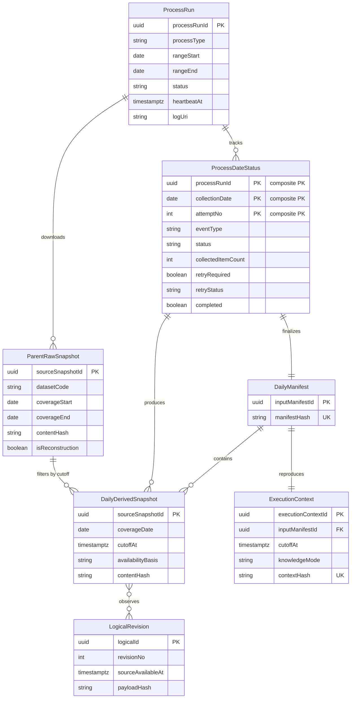

# 데이터 아키텍처 및 PostgreSQL 수집 설계

이 문서는 S&P 500 전체 가격을 매일 적재하고 전처리·모델 점수를 거쳐 5~10개 후보를 선정·저장하기 위한 목표 데이터 모델이다. 현재 저장소에는 구현 코드나 기존 데이터 접근 계층이 없으므로 아래 내용은 PostgreSQL 16 이상을 기준으로 한 설계안이며, ORM과 마이그레이션 도구는 구현 시 확정한다.

> 설계 상태: 문서 검토 반영본이다. 실제 DDL·조회 하네스·수집기 검증 전에는 아래 기능을 구현 완료 또는 분석 적합으로 간주하지 않는다.

후보 선정 엔진의 쓰기 책임은 `selection` 스키마까지다. 후보 이후 분석·agent 실행·report·비용·재평가는 별도 프로젝트의 책임이며 이 데이터 모델에 포함하지 않는다. 공통 불변식은 루트 `PROJECT-HARNESS.md`를 따른다.

### 설계 검토 반영 요약

| 검토 항목 | 반영 결과 |
|---|---|
| 특징·점수 재계산 키 충돌 | `feature_run`·`scoring_run`과 `(run_id, instrument_id)` 결과 키로 변경 |
| snapshot과 실제 조회 불일치 | `input_manifest` membership을 모든 조회의 필수 범위로 지정하고 FULL/DELTA lineage 정의 |
| 시점 정의 부족 | 유효 시점, 원천 공개 시점, 시스템 관찰 시점과 두 재현 mode를 분리 |
| 프로젝트 경계 불명확 | 수집·전처리·모델 점수·후보 선정까지만 포함하고 이후 분석 schema 제거 |
| 후보·사유 고유키 충돌 | scoring run·정책 기반 idempotency와 event revision 기반 reason fingerprint 추가 |
| SEC 정규화 과대 판정 | 계약 미확정으로 변경하고 MVP concept·기간·수정 규칙 초안 추가 |
| Qlib 전처리·라벨 누락 | RAW/PROCESSED run, processor artifact, label run, split·경계·결측 정책 추가 |
| 유료 데이터·용량 과대 선행 | MVP 운영, 연구, 이벤트 고도화를 분리하고 run 배수 기반 용량식으로 변경 |

## 현재 구현 및 적재 상태

기준 시각은 2026-10-11이며, 아래는 목표 설계가 아니라 Azure PostgreSQL과 코드에서 확인한 실제 상태다.

### 실제 데이터 보유 현황

| 데이터 영역 | 상태 | 실제 보유량·범위 | 아직 없는 데이터 또는 한계 |
|---|---|---|---|
| 기업·증권 마스터 | 부분 수집 | issuer 500, instrument 503, ticker identifier 503 | 거래소, 상장 상태, FIGI, ticker 변경 이력, 복수 시점 state 없음 |
| S&P 500 구성 | 부분 수집 | Wikipedia revision `1376729338` 기반 version 1개, member 503 | S&P DJI 공식·라이선스 구성 이력, 편입/편출 history, weight 없음 |
| 업종 | 부분 수집 | Wikipedia의 현재 GICS sector·sub-industry | industry group, industry code, 역사적 GICS revision 없음 |
| 일봉 OHLCV | 수집 | 2025-10-09~2026-10-09, 252 sessions, Qlib export 126,736행 | 3~5년 bootstrap 없음; Massive Basic은 과거 2년 |
| adjusted close | 수집 | Yahoo adjusted close를 별도 컬럼에 저장 | 공식 corporate action lineage로 재계산한 값 아님 |
| 분할·배당 | 수집 시작 | Massive corporate-action revision 99 | 무료 플랜 과거 범위 제한, 장기 backfill 미완료 |
| 거래 달력 | 부분 구현 | Qlib XNYS calendar 252 sessions | 공식 NYSE/Nasdaq snapshot collector 없음 |
| SEC 공시 | 수집 | bulk submissions parser와 filing observation 적재 | 1년 backfill 기준 filing 8,452건 |
| SEC 재무 fact | 수집 | allowlist fact 50,582건 | custom taxonomy와 원문 XBRL 확장 필요 |
| 실적 일정 | 수집 시작 | Alpha Vantage earnings 467 events | 오늘 이후 snapshot 축적만 가능, 과거 revision 없음 |
| 뉴스·거래정지 | 부분 수집 | Massive news 31,252 events | Nasdaq halt 미구현, 뉴스 무료 과거 범위 제한 |
| 특징·라벨·점수 | 구현 | Alpha158 158차원, 3개 모델 walk-forward, 503개 일일 score | Rank IC 음수로 model은 SHADOW |
| 후보 선정 | 구현 | 2026-10-09 후보 10개와 reason 저장 | 20-session live shadow 관찰 필요 |
| 운영 provenance | 수집 | production run 1, source snapshot 7, manifest/context 생성 | checkpoint 테이블은 있으나 cursor 전진 로직 미연결 |
| 품질 이슈 | 수집 | ACTIVE 2건, PSKY·WBD | 재실행 시 동일 이슈 중복 방지와 ACTIVE/RESOLVED 상태 구현 |
| 실행 로그 | 수집 | `logs/2026-10-09.log` | 파일 로그이며 중앙 로그 수집은 미구현 |

장기 데이터는 과거 자료를 현재 원천으로 재구성한 `HISTORICAL_RECONSTRUCTION`이며 당시 실제 관찰 입력인 `OPERATIONAL_REPLAY`가 아니다. 2026-10-09 production session은 별도 일일 수집으로 추가됐다.

### 실제 구현 스키마

| 스키마 | 구현된 테이블 | 상태 |
|---|---|---|
| `ops` | `schema_migration`, `data_source`, `ingestion_run`, `source_snapshot`, `input_manifest`, `input_manifest_member`, `execution_context`, `data_quality_issue` | 구현 |
| `ref` | `issuer`, `instrument`, `instrument_identifier`, `instrument_state`, `universe`, `universe_version`, `universe_member` | production reference 포함 |
| `market` | `daily_bar`, `daily_bar_observation`, `benchmark_daily_bar`, `corporate_action`, `corporate_action_observation` | production price/action과 SPY benchmark 포함 |
| `fundamental` | `sec_filing`, `sec_filing_observation`, `fact`, `fact_observation` | 1년 backfill 적재 완료, filing 8,452건·fact 50,582건 |
| `event` | `market_event`, `event_revision`, `event_revision_observation`, `event_instrument` | Massive news와 Alpha earnings 적재 |
| `analytics` | Qlib export, feature·label, model, scoring tables | 구현·실제 run 적재 |
| `selection` | selection run, candidate, candidate reason | 구현·2026-10-09 후보 10개 적재 |

따라서 아래 Entity Model은 **목표 모델**이며 현재 DB에 모두 생성된 DDL로 읽으면 안 된다.

## Database Configuration

| 서비스/모듈 | DB 유형 | 환경 | 드라이버 | 연결 및 풀링 | 마이그레이션 도구 |
|---|---|---|---|---|---|
| 전체 운영 모듈 | PostgreSQL 16+ | local/test | 구현 언어의 PostgreSQL 드라이버 | 단일 DB, 모듈별 논리 스키마, 작은 연결 풀 | Alembic 권장, 구현 언어 확정 후 동등 도구 사용 가능 |
| 전체 운영 모듈 | PostgreSQL 16+ | production | 구현 언어의 PostgreSQL 드라이버 | 관리형 PostgreSQL, TLS, 애플리케이션과 수집 작업의 역할 분리, PgBouncer 선택 | 모든 DDL을 버전 마이그레이션으로 관리 |
| 대용량 원문 보관 | 객체 저장소 권장 | production | S3 호환 SDK | PostgreSQL에는 URI, 해시, 크기, 라이선스 등급만 저장 | DB 마이그레이션 대상 아님 |

운영 원칙:

- PostgreSQL을 종목 마스터, 시점 이력, 일봉, 이벤트 메타데이터, 특징 실행, 점수 실행과 후보 결과의 기준 저장소로 사용한다.
- API 원문과 기사 본문을 매일 PostgreSQL JSONB로 복제하지 않는다. 재현에 필요한 원문은 라이선스가 허용할 때 압축 객체로 저장하고 `source_snapshot`에서 참조한다.
- 500여 종목의 일봉은 TimescaleDB나 초기 파티셔닝이 필수일 정도의 규모가 아니다. 단순 테이블과 인덱스로 시작하고 실측 행 수·vacuum·쿼리 지연을 기준으로 네이티브 `RANGE` 파티셔닝을 도입한다.
- 운영 SQL은 UTC `timestamptz`를 사용하고 거래일은 거래소 현지 달력의 `date`로 저장한다.
- 금액은 `numeric`, 가격은 `numeric(20,8)`, 모델 특징과 점수는 `real`을 기본으로 한다. 학습 재현에 더 높은 정밀도가 필요할 때만 `double precision`을 사용한다.

## Data Ownership per Service

| 서비스 | 소유 테이블 | ORM/접근 방식 | 캐싱 | 비고 |
|---|---|---|---|---|
| reference-data | `ref.data_source`, `ref.exchange_session`, `ref.issuer`, `ref.instrument`, `ref.instrument_state`, `ref.instrument_identifier`, `ref.issuer_classification`, `ref.universe`, `ref.universe_version`, `ref.universe_member` | 명시적 SQL 또는 얇은 repository 권장 | 현재 종목군·거래 달력 프로세스 캐시 | 상태·식별자·분류는 유효 시점과 인지 시점을 함께 보존 |
| market-data | `market.daily_bar`, `market.daily_bar_observation`, `market.corporate_action` | 배치 upsert와 `COPY` 권장 | 최근 60거래일 읽기 캐시 선택 | 논리 revision과 snapshot별 관찰 관계를 분리 |
| fundamentals | `fundamental.sec_filing`, `fundamental.fact` | accession 단위 트랜잭션 | SEC ETag 및 원문 해시 | 원문 XBRL과 정규화 fact를 분리 |
| events | `event.market_event`, `event.event_revision`, `event.event_instrument` | 공급자 event ID 기반 멱등 적재 | HTTP 조건부 요청 | 뉴스 본문은 기본 저장하지 않음 |
| analytics | `analytics.feature_definition_version`, `analytics.processor_version`, `analytics.feature_run`, `analytics.feature_value`, `analytics.label_definition_version`, `analytics.label_run`, `analytics.daily_label`, `analytics.model_version`, `analytics.scoring_run`, `analytics.daily_score` | 실행 단위 벌크 쓰기 | 실행 중 특징 프레임 캐시 | 입력·정의·processor·코드가 같을 때만 같은 실행으로 취급 |
| selection | `selection.selection_run`, `selection.candidate`, `selection.candidate_reason` | 한 실행을 단일 트랜잭션으로 저장 | 캐시 불필요 | scoring run·정책·selection type을 고정 |
| operations | `ops.ingestion_run`, `ops.ingestion_checkpoint`, `ops.source_snapshot`, `ops.input_manifest`, `ops.input_manifest_member`, `ops.execution_context`, `ops.data_quality_issue`, `ops.process_run`, `ops.process_date_status` | append 중심 | 없음 | 데이터 묶음, 실행 설정, process 진행·재처리 상태를 분리 |

## 수집 출처

가입·API 키·라이선스 범위와 공급자 문의 항목은 [데이터 수집 원천 및 라이선스 카탈로그](./data-source-license-catalog.md)에 별도로 정리한다.

### 실제 연결된 수집 출처

| 데이터셋 | 실제 출처 | 수집 방식 | 상태 | 주의사항 |
|---|---|---|---|---|
| `sp500_universe` | Wikipedia revision API와 고정 oldid HTML | cutoff 이전 최신 revision 1개 선택 | 구현·적재 완료 | 공식 S&P DJI 데이터가 아니며 현재 prototype/reference 용도 |
| `daily_bar` | Yahoo Chart API | 503 provider symbols 제한 병렬 요청 | 논리 bar 502건; 최신 snapshot 501건 관찰 | 공급자 이용조건 확인 필요; publication timestamp가 없어 16:15 ET를 가정해 기록 |
| raw snapshot | 위 두 응답의 정규화·sanitized payload | gzip JSON과 SHA-256 | 구현·파일 3개, universe 1과 market revision 2 | 원 응답 byte 전체가 아니라 재현에 필요한 sanitized payload |

SEC, S&P DJI, MSCI GICS, NYSE/Nasdaq 공식 달력, Massive, Alpha Vantage는 아래 목표 출처일 뿐 아직 운영 collector에서 호출하지 않는다. OpenFIGI는 현재 단계에서 제외한다.

### 권장 출처 매트릭스

| 데이터 영역 | 운영 권장 출처 | 보조/개발 출처 | 주요 필드 | 갱신 | 핵심 제약 |
|---|---|---|---|---|---|
| S&P 500 현재 구성·편입/편출 이력 | [S&P DJI S&P 500](https://www.spglobal.com/spdji/en/indices/equity/sp-500/) 라이선스 데이터와 [Index Announcements](https://www.spglobal.com/spdji/en/index-announcements/) | 공개 발표 기반 자체 재구성은 검증용만 사용 | 구성 종목 ID, 발표 시각, 효력일, 편입/편출, 가중치 | 발표 이벤트 및 일일 스냅샷 | point-in-time 과거 이력과 필요한 이용권을 함께 충족하는 무료 공식 피드는 확인하지 못함 |
| GICS 분류 이력 | S&P DJI 또는 MSCI 라이선스 데이터, [GICS 자료](https://www.msci.com/indexes/index-resources/gics) | 현재 분류만 제공하는 데이터는 프로토타입 한정 | sector, industry_group, industry, sub_industry, 효력 기간 | 변경 이벤트 | 회사별 과거 GICS는 독점 데이터 |
| CIK·상장 티커·회사 기본정보 | [SEC company_tickers_exchange.json](https://www.sec.gov/files/company_tickers_exchange.json), [SEC Submissions API](https://www.sec.gov/search-filings/edgar-application-programming-interfaces) | [Nasdaq Symbol Directory](https://www.nasdaqtrader.com/Trader.aspx?id=SymbolDirDefs) | CIK, 이름, ticker, exchange, SIC, fiscal year end, former name | SEC 수시, 심볼 파일 일일 | 현재 스냅샷만으로 과거 ticker 이력을 만들 수 없음 |
| 현재 식별자 매핑 | SEC company ticker·submissions | Nasdaq Symbol Directory 보조 검증 | CIK, ticker, exchange, 회사명, former name | 일 1회 | FIGI·CUSIP는 현재 범위 밖이며 과거 ticker 이력은 별도 데이터 필요 |
| 일봉 OHLCV | SIP 라이선스 벤더의 조정 전 일봉, 예: [Massive Aggregates](https://massive.com/docs/rest/stocks/aggregates/custom-bars) | [NYSE Daily TAQ](https://www.nyse.com/data-products/catalog/daily-taq)로 표본 검증 | open, high, low, close, volume, VWAP, 거래 수, session date | 매 거래일 장 마감 후 | 요구 기간·통합 범위·정정 이력·비표시 이용권을 모두 충족하는 무료 공식 출처는 확인하지 못함 |
| 분할·배당 | 시장 데이터 벤더의 corporate actions, 예: [Massive Dividends](https://massive.com/docs/rest/stocks/corporate-actions/dividends), [Massive Splits](https://massive.com/docs/rest/stocks/corporate-actions/splits) | 거래소 공지 표본 검증 | action type, ex/record/pay date, 금액, 비율, 통화 | 일일 및 정정 시 | 원가격을 유지하고 조정계수는 별도로 계산 |
| SEC 공시 | [SEC EDGAR APIs](https://www.sec.gov/search-filings/edgar-application-programming-interfaces) | SEC bulk submissions/companyfacts | accession, form, filed/accepted time, primary document, XBRL 여부 | 수시, bulk는 야간 | 선언된 User-Agent 필요, 최대 10 req/s |
| 재무 facts | SEC Company Facts, Frames, [Financial Statement Data Sets](https://www.sec.gov/data-research/sec-markets-data/financial-statement-data-sets) | 정규화 상용 재무 데이터는 교차 검증용 | taxonomy, concept, unit, period, value, accession, filed time, frame | 공시 후 수분 이내 또는 야간 bulk | custom tag, 단위, 수정공시, 중복 기간을 정규화해야 함 |
| 예정 실적 발표 | Wall Street Horizon, FactSet, LSEG, Bloomberg 등 revision 이력 제공 피드 | [Alpha Vantage Earnings Calendar](https://www.alphavantage.co/documentation/#earnings-calendar) | 예정일/시각, 확인 상태, revision, EPS estimate, source | 일일 스냅샷과 변경 이벤트 | 확인 상태와 revision 이력을 포함하는 무료 통합 공식 피드는 확인하지 못함; Alpha Vantage 무료 25회/일 |
| 중요 이벤트 | SEC 8-K/6-K 등, 발행사 IR, [Nasdaq Trade Halt RSS](https://www.nasdaqtrader.com/Trader.aspx?id=TradeHaltRSS) | 상용 뉴스 메타데이터, 예: [Massive News](https://massive.com/docs/rest/stocks/news) | event type, title, URL, published/available time, halt code | 수시 또는 1분~1시간 | 기사 본문 저작권 및 재배포 권한 확인 |
| 거래 달력 | [NYSE Hours and Calendars](https://www.nyse.com/markets/hours-calendars), [Nasdaq Calendar](https://www.nasdaqtrader.com/Trader.aspx?id=Calendar) | [exchange_calendars](https://github.com/gerrymanoim/exchange_calendars) | session date, open/close, early close, holiday, timezone | 연간 생성 후 공지로 보정 | 공개 페이지는 내구성 있는 과거 API가 아니므로 버전 저장 |

### 단계별 최소 출처

1. **MVP 운영:** 현재 종목군, SEC 식별자, 거래소 달력, 사용 권리가 확인된 일봉·분할·배당으로 오늘부터 축적한다. 역사적 구성·광범위 뉴스 계약을 선행 조건으로 두지 않는다.
2. **Qlib:** MVP 데이터에 3~5년 연속 일봉, 확정된 corporate action, benchmark 일봉을 추가한다.
3. **생존편향 통제 연구:** S&P DJI point-in-time 구성 및 GICS 이력을 확보한다. 확보 전 백테스트는 현재 종목군 기반 프로토타입으로 표시한다.
4. **이벤트 고도화:** SEC 공시와 거래정지부터 시작하고, 미래 실적 일정과 광범위 뉴스는 revision 이력을 제공하는 유료 피드를 추가한다.
5. **연구 평가:** 실제 각 시점에 이용 가능했던 snapshot만 사용한다. 현재 API로 다시 받은 과거값을 당시 입력처럼 사용하지 않는다.

### 일일 적재 순서

매일 05:30 America/New_York에 실행한다. 직전 완료 거래 세션을 처리하고 비거래일에는 event/reference refresh만 수행한다. 상세 quota·병렬화는 [일 1회 후보 선정 수집 파이프라인](./ingestion-pipeline.md)을 따른다.

| 순서 | 적재 단위 | 정상 일일 규모 | 완료 조건 |
|---|---|---:|---|
| 1 | preflight·session·key·quota·checkpoint | 1 run | source harness와 advisory lock 통과 |
| 2 | Massive, SEC, Alpha, reference 병렬 lane | 공급자별 독립 | Massive만 shared 5회/분 queue 적용 |
| 3 | raw snapshot atomic write | 성공 dataset별 1개 이상 | hash·coverage·source time 기록 |
| 4 | reference·market·SEC·event 병렬 정규화 | 입력 행 수 의존 | SEC 정규화 계약과 schema 통과 |
| 5 | temporal·quality gate | dataset별 | core blocking 오류 없음 |
| 6 | dataset transaction과 checkpoint | dataset별 | commit 성공 후에만 checkpoint 전진 |
| 7 | final manifest와 execution context | 실행당 각 1개 | core snapshot 집합과 optional 상태 고정 |
| 8 | feature·score·candidate | 미구현 | 5~10개 후보 batch commit |

각 수집기는 `(source_id, dataset_code, partition_key)`별 `ingestion_checkpoint`를 성공한 트랜잭션 이후에만 전진시킨다. 실패한 실행은 checkpoint를 움직이지 않고 같은 구간을 멱등 재시도한다.

## Entity Model

### PostgreSQL 논리 스키마

| 논리 스키마 | 테이블 | 핵심 컬럼 | 기본키·고유키 | 파티셔닝·주요 인덱스 |
|---|---|---|---|---|
| `ref` | `data_source` | `source_id`, `code`, `name`, `license_class`, `base_url`, `active` | PK `source_id`, UK `code` | 소형 dimension |
| `ref` | `exchange_session` | `exchange_mic`, `session_date`, `open_at`, `close_at`, `is_early_close`, `status`, `source_snapshot_id` | PK `(exchange_mic, session_date)` | `session_date`, `status` |
| `ref` | `issuer` | `issuer_id`, `legal_name`, `cik`, `lei`, `sic_code`, `fiscal_year_end`, `active_from`, `active_to` | PK `issuer_id`, partial UK `cik` | `cik`, `legal_name` trigram 선택 |
| `ref` | `instrument` | `instrument_id`, `issuer_id`, `instrument_type`, `share_class`, `currency`, `created_at` | PK `instrument_id` | `(issuer_id, instrument_type)` |
| `ref` | `instrument_state` | `instrument_state_id`, `instrument_id`, `primary_exchange_mic`, `status`, `valid_from`, `valid_to`, `source_available_at`, `observed_at`, `source_snapshot_id`, `revision_no` | PK `instrument_state_id`, UK `(instrument_id, valid_from, revision_no)` | `(instrument_id, valid_from desc, observed_at desc)` |
| `ref` | `instrument_identifier` | `identifier_id`, `instrument_id`, `id_type`, `id_value`, `valid_from`, `valid_to`, `source_available_at`, `observed_at`, `source_id`, `source_snapshot_id`, `revision_no` | PK `identifier_id`, UK `(id_type, id_value, valid_from, revision_no)` | `(instrument_id, id_type, valid_from desc, observed_at desc)` |
| `ref` | `issuer_classification` | `classification_id`, `issuer_id`, `scheme`, `sector_code`, `industry_group_code`, `industry_code`, `sub_industry_code`, `valid_from`, `valid_to`, `source_available_at`, `observed_at`, `source_snapshot_id`, `revision_no` | PK `classification_id`, UK `(issuer_id, scheme, valid_from, revision_no)` | `(issuer_id, valid_from desc, observed_at desc)` |
| `ref` | `universe` | `universe_id`, `code`, `name`, `provider_source_id` | PK `universe_id`, UK `code` | 소형 dimension |
| `ref` | `universe_version` | `universe_version_id`, `universe_id`, `as_of_date`, `announced_at`, `effective_at`, `source_snapshot_id`, `rule_version` | PK `universe_version_id`, UK `(universe_id, as_of_date, source_snapshot_id)` | `(universe_id, effective_at desc)` |
| `ref` | `universe_member` | `universe_version_id`, `instrument_id`, `weight`, `member_action`, `selection_reason`, `effective_from`, `effective_to` | PK `(universe_version_id, instrument_id)` | `(instrument_id, effective_from, effective_to)` |
| `market` | `daily_bar` | `instrument_id`, `session_date`, `source_id`, `revision_no`, raw OHLCV, `vwap`, `price_adjustment_status`, `volume_adjustment_status`, `currency`, `source_available_at`, `observed_at`, `source_snapshot_id` | PK `(instrument_id, session_date, source_id, revision_no)` | 초기 비파티션; `(instrument_id, session_date desc)` |
| `market` | `daily_bar_observation` | `source_snapshot_id`, `instrument_id`, `session_date`, `source_id`, `revision_no`, `observed_at` | PK `(source_snapshot_id, instrument_id, session_date, source_id, revision_no)`, FK logical bar | `(source_snapshot_id, session_date)` |
| `market` | `benchmark_daily_bar` | `benchmark_code`, `session_date`, `source_id`, `revision_no`, OHLCV, `vwap`, `return_basis`, adjustment status, `source_available_at`, `observed_at`, `source_snapshot_id` | PK `(benchmark_code, session_date, source_id, revision_no)` | `(benchmark_code, session_date desc)` |
| `market` | `corporate_action` | `action_id`, `instrument_id`, `source_id`, `source_action_id`, `action_type`, `announced_at`, `ex_date`, `record_date`, `pay_date`, `cash_amount`, `currency`, `split_from`, `split_to`, `source_available_at`, `observed_at`, `source_snapshot_id`, `revision_no`, `metadata` | PK `action_id`, UK `(source_id, source_action_id, revision_no)` | 비파티션, `(instrument_id, ex_date desc)` |
| `fundamental` | `sec_filing` | `filing_id`, `issuer_id`, `accession_no`, `form_type`, `period_end`, `filed_date`, `accepted_at`, `primary_document_url`, `is_amendment`, `source_snapshot_id` | PK `filing_id`, UK `(issuer_id, accession_no)` | `(issuer_id, accepted_at desc)`, `form_type` |
| `fundamental` | `sec_filing_observation` | `source_snapshot_id`, `filing_id`, `observed_at` | PK `(source_snapshot_id, filing_id)` | snapshot별 filing 관찰 |
| `fundamental` | `fact` | `fact_id`, `filing_id`, `issuer_id`, `taxonomy`, `concept`, `unit`, `period_start`, `period_end`, `value_numeric`, `decimals`, `fiscal_year`, `fiscal_period`, `frame`, `context_hash`, `source_snapshot_id`, `source_available_at`, `observed_at` | PK `fact_id`, UK `context_hash` 또는 `NULLS NOT DISTINCT` 계약 | 비파티션으로 시작; `(issuer_id, concept, period_end desc, source_available_at desc)` |
| `fundamental` | `fact_observation` | `source_snapshot_id`, `fact_id`, `observed_at` | PK `(source_snapshot_id, fact_id)` | snapshot별 fact 관찰 |
| `event` | `market_event` | `event_id`, `source_id`, `source_event_id`, `event_type`, `canonical_key`, `created_at` | PK `event_id`, UK `(source_id, source_event_id)` | `(event_type, created_at desc)` |
| `event` | `event_revision` | `event_revision_id`, `event_id`, `revision_no`, `title`, `source_url`, `status`, `scheduled_at`, `published_at`, `source_available_at`, `observed_at`, `source_snapshot_id`, `payload_hash`, `metadata` | PK `event_revision_id`, UK `(event_id, revision_no)` | 비파티션으로 시작; `(source_available_at desc)`, `(event_id, source_available_at desc)` |
| `event` | `event_instrument` | `event_id`, `instrument_id`, `relation_type`, `confidence` | PK `(event_id, instrument_id)` | `(instrument_id, event_id)` |
| `analytics` | `feature_definition_version` | `feature_definition_version_id`, `name`, `version`, `stage`, `feature_names`, `expected_dimension`, `expression_hash`, `lookback_sessions`, `handler_config`, `created_at` | PK `feature_definition_version_id`, UK `(name, version, stage)` | 소형 dimension |
| `analytics` | `processor_version` | `processor_version_id`, `name`, `version`, `processor_kind`, `config`, `fit_execution_context_id`, `fit_start`, `fit_end`, `artifact_uri`, `artifact_hash` | PK `processor_version_id`, UK `(name, version)` | 소형 dimension |
| `analytics` | `feature_run` | `feature_run_id`, `session_date`, `execution_context_id`, `universe_version_id`, `feature_definition_version_id`, `processor_version_id`, `parent_feature_run_id`, `stage`, `code_version`, `exporter_version`, `adjustment_policy`, `value_count`, `status`, `idempotency_key`, `computed_at` | PK `feature_run_id`, UK `idempotency_key` | `(session_date desc, universe_version_id)` |
| `analytics` | `feature_value` | `feature_run_id`, `instrument_id`, `values_real`, `value_count`, `missing_count`, `missing_bitmap`, `quality_status` | PK `(feature_run_id, instrument_id)` | `(instrument_id, feature_run_id)` |
| `analytics` | `label_definition_version` | `label_definition_version_id`, `name`, `version`, `entry_rule`, `exit_rule`, `corporate_action_policy`, `boundary_policy` | PK `label_definition_version_id`, UK `(name, version)` | 소형 dimension |
| `analytics` | `label_run` | `label_run_id`, `execution_context_id`, `universe_version_id`, `label_definition_version_id`, `code_version`, `status`, `idempotency_key` | PK `label_run_id`, UK `idempotency_key` | `(label_definition_version_id, label_run_id)` |
| `analytics` | `daily_label` | `label_run_id`, `instrument_id`, `anchor_session_date`, `label_value`, `entry_session_date`, `exit_session_date`, `quality_status` | PK `(label_run_id, instrument_id, anchor_session_date)` | `(instrument_id, anchor_session_date)` |
| `analytics` | `model_version` | `model_version_id`, `model_name`, `version`, `training_feature_run_id`, `processor_version_id`, `label_run_id`, `split_spec`, `artifact_uri`, `artifact_hash`, `metrics`, `created_at` | PK `model_version_id`, UK `(model_name, version)` | 소형 dimension |
| `analytics` | `scoring_run` | `scoring_run_id`, `session_date`, `execution_context_id`, `feature_run_id`, `model_version_id`, `universe_version_id`, `config_hash`, `status`, `idempotency_key`, `computed_at` | PK `scoring_run_id`, UK `idempotency_key` | `(session_date desc, model_version_id, universe_version_id)` |
| `analytics` | `daily_score` | `scoring_run_id`, `instrument_id`, `score`, `rank_overall`, `score_percentile`, `rank_sector`, `prediction_horizon`, `quality_status` | PK `(scoring_run_id, instrument_id)` | `(scoring_run_id, rank_overall)`, `(instrument_id, scoring_run_id)` |
| `selection` | `selection_run` | `selection_run_id`, `selection_type`, `price_session_date`, `cutoff_at`, `generated_at`, `valid_until`, `scoring_run_id`, `policy_version`, `requested_count`, `selected_count`, `status`, `shortfall_reason`, `idempotency_key` | PK `selection_run_id`, UK `idempotency_key` | `(price_session_date desc)`, `status` |
| `selection` | `candidate` | `selection_run_id`, `instrument_id`, `position`, `score`, `rank_overall`, `score_percentile`, `rank_sector`, `quality_status`, `latest_data_at` | PK `(selection_run_id, instrument_id)`, UK `(selection_run_id, position)` | `(instrument_id, selection_run_id)` |
| `selection` | `candidate_reason` | `candidate_reason_id`, `selection_run_id`, `instrument_id`, `reason_code`, `priority`, `event_revision_id`, `reason_fingerprint`, `reason_detail` | PK `candidate_reason_id`, UK `(selection_run_id, instrument_id, reason_fingerprint)` | `(reason_code, selection_run_id)` |
| `ops` | `ingestion_run` | `ingestion_run_id`, `source_id`, `dataset_code`, `started_at`, `finished_at`, `status`, `requested_count`, `received_count`, `inserted_count`, `updated_count`, `error_count` | PK `ingestion_run_id` | `(dataset_code, started_at desc)`, `status` |
| `ops` | `ingestion_checkpoint` | `source_id`, `dataset_code`, `partition_key`, `cursor_value`, `last_source_at`, `last_success_at`, `updated_by_run_id` | PK `(source_id, dataset_code, partition_key)` | 소형 운영 상태 |
| `ops` | `source_snapshot` | `source_snapshot_id`, `ingestion_run_id`, `source_id`, `dataset_code`, `snapshot_kind`, `parent_snapshot_id`, `coverage_start`, `coverage_end`, `sequence_no`, `as_of_at`, `fetched_at`, `source_available_at`, `availability_basis`, `storage_uri`, `content_hash`, `byte_size`, `license_class`, `is_reconstruction`, `retain_until`, `object_deleted_at` | PK `source_snapshot_id`, UK `(source_id, dataset_code, coverage_start, coverage_end, content_hash)` | 비파티션, `(dataset_code, as_of_at desc)` |
| `ops` | `input_manifest` | `input_manifest_id`, `manifest_hash`, `root_snapshot_count`, `created_at` | PK `input_manifest_id`, UK `manifest_hash` | 소형 immutable manifest |
| `ops` | `input_manifest_member` | `input_manifest_id`, `source_snapshot_id`, `dataset_code`, `precedence`, `lineage_role` | PK `(input_manifest_id, source_snapshot_id)` | `(source_snapshot_id, input_manifest_id)` |
| `ops` | `execution_context` | `execution_context_id`, `input_manifest_id`, `cutoff_at`, `knowledge_mode`, `code_version`, `config_version`, `context_hash`, `created_at` | PK `execution_context_id`, UK `context_hash` | `(cutoff_at desc, knowledge_mode)` |
| `ops` | `data_quality_issue` | `issue_id`, `ingestion_run_id`, `dataset_code`, `entity_type`, `entity_key`, `session_date`, `rule_code`, `severity`, `status`, `details`, `detected_at`, `resolved_at` | PK `issue_id` | `(status, severity, detected_at desc)`, `(entity_type, entity_key)` |
| `ops` | `process_run` | `process_run_id`, `process_type`, `status`, `range_start`, `range_end`, 날짜 집계, `heartbeat_at`, `log_uri`, `metadata` | PK `process_run_id` | `(status, heartbeat_at)` |
| `ops` | `process_date_status` | `process_run_id`, `collection_date`, `attempt_no`, `event_type`, `status`, 수집량, 실패·retry·완료 상태 | PK `(process_run_id, collection_date, attempt_no)` | retry partial index |

`fundamental.fact`는 `filing_id`를 통해 accession을 참조한다. dedupe는 `(filing_id, taxonomy, concept, unit, normalized_context_hash)`를 기준으로 하며 `normalized_context_hash`는 NULL을 만들지 않는다. 대안으로 자연키를 사용한다면 PostgreSQL 16의 `UNIQUE NULLS NOT DISTINCT`를 명시한다.

### 핵심 타입 및 제약

- 모든 외부 시간은 원문 timezone을 함께 기록하되 DB 시간은 UTC `timestamptz`로 정규화한다.
- `valid_from/to`는 시장에서 사실이 적용된 기간, `source_available_at`은 공급자 또는 공개 원천에서 알려진 시각, `observed_at`은 이 시스템이 처음 수집한 시각이다.
- 수정 일봉, 기업행위, 이벤트는 기존 행을 삭제하지 않고 `revision_no`를 증가시킨다.
- 모든 분석 조회는 먼저 `execution_context`를 받고, 그 context의 `input_manifest_member`에 포함된 `source_snapshot_id`만 조인한다. cutoff 조건만으로 임의의 최신 revision을 고르지 않는다.
- `source_snapshot.snapshot_kind`는 `FULL` 또는 `DELTA`다. DELTA는 `parent_snapshot_id`로 직전 snapshot을 가리키며 manifest는 필요한 FULL 기준점부터 모든 DELTA lineage를 빠짐없이 포함한다. 동일 자연키가 여러 member에 있으면 높은 `precedence`, 높은 `revision_no` 순으로 선택한다.
- `input_manifest.manifest_hash`는 정렬된 `(dataset_code, source_snapshot_id, content_hash, snapshot_kind, parent_snapshot_id, coverage_start, coverage_end, precedence)`의 canonical serialization으로 계산한다.
- `execution_context.context_hash`는 `manifest_hash`, `cutoff_at`, `knowledge_mode`, `code_version`, `config_version`을 포함한다. 같은 데이터 묶음이라도 cutoff나 설정이 다르면 별도 context다.
- `knowledge_mode=OPERATIONAL_REPLAY`는 `source_available_at <= cutoff_at AND observed_at <= cutoff_at AND is_reconstruction=false`를 요구한다.
- `knowledge_mode=HISTORICAL_RECONSTRUCTION`은 manifest에 명시된 reconstruction snapshot에서 `source_available_at <= cutoff_at`을 적용한다. `observed_at`은 cutoff 이후일 수 있으며 결과를 실운영 재현이라고 표시할 수 없다.
- `feature_value.values_real`의 순서는 `feature_definition_version.feature_names`와 일치한다. 같은 행의 `value_count = array_length(values_real, 1)`은 CHECK로 검증하고, run의 `expected_dimension`과 일치는 적재 애플리케이션 및 deferred constraint trigger로 검증한다. 다른 테이블을 조회하는 일반 CHECK를 가정하지 않는다.
- `reason_detail`과 `metadata`는 변경 가능성이 큰 부가 필드에만 JSONB를 사용한다. 검색·조인에 필요한 필드는 정규 컬럼으로 둔다.
- `selection_run.idempotency_key`는 `price_session_date`, `scoring_run_id`, `policy_version`, `selection_type`, 정책 설정 hash를 포함한다.
- `candidate_reason.reason_fingerprint`는 `reason_code`, `event_revision_id`, source row key, 정책 버전을 포함한다. 동일 reason code의 복수 이벤트를 별도 행으로 저장한다.

### 원본 및 재현 보존 정책

- 운영 또는 논문 실험에서 참조한 raw object는 해당 run의 재현 보존 기간 동안 immutable/WORM으로 보존한다. 기본 제안은 운영 7년, 출판 실험은 프로젝트 종료 후 10년이며 실제 계약과 비용 정책으로 확정한다.
- raw object를 삭제할 수밖에 없는 데이터는 정규화 행, content hash, parser version, schema version, source URL, HTTP provenance를 영구 보존한다. 이 경우 결과 재조회는 가능해도 원문 재파싱의 byte-for-byte 재현은 불가능하다고 표시한다.
- `source_snapshot` 삭제는 FK로 막고, 참조 중인 manifest가 없는 snapshot만 lifecycle 대상으로 삼는다. object 삭제 상태와 시각을 별도 컬럼으로 기록한다.
- manifest 생성 시 FULL 기준점과 DELTA chain의 연속성, coverage gap, content hash 존재 여부를 검증한다.

### 데이터 관계 다이어그램

가독성을 위해 일부 dimension과 연결 테이블은 생략하고 재현성 경로와 실행 이력을 중심으로 표시한다.

```mermaid
erDiagram
    IngestionRun ||--o{ SourceSnapshot : "produces"
    SourceSnapshot }o--o{ InputManifest : "forms"
    InputManifest ||--o{ ExecutionContext : "used by"
    Issuer ||--o{ Instrument : "issues"
    Instrument ||--o{ InstrumentState : "has states"
    Instrument ||--o{ InstrumentIdentifier : "has identifiers"
    Issuer ||--o{ IssuerClassification : "has classifications"
    Universe ||--o{ UniverseVersion : "versioned as"
    UniverseVersion ||--o{ UniverseMember : "contains"
    Instrument ||--o{ UniverseMember : "included in"
    Instrument ||--o{ DailyBar : "priced by"
    Instrument ||--o{ CorporateAction : "affected by"
    DailyBar ||--o{ DailyBarObservation : "observed as"
    SourceSnapshot ||--o{ DailyBarObservation : "contains"
    SourceSnapshot ||--o{ CorporateAction : "provenance"
    Issuer ||--o{ SecFiling : "files"
    SecFiling ||--o{ FundamentalFact : "reports"
    SourceSnapshot ||--o{ FundamentalFact : "provenance"
    MarketEvent ||--o{ EventRevision : "revised as"
    SourceSnapshot ||--o{ EventRevision : "provenance"
    FeatureDefinitionVersion ||--o{ FeatureRun : "defines"
    ProcessorVersion |o--o{ FeatureRun : "processes"
    ExecutionContext ||--o{ FeatureRun : "reproduces"
    UniverseVersion ||--o{ FeatureRun : "scopes"
    FeatureRun ||--o{ FeatureValue : "contains"
    Instrument ||--o{ FeatureValue : "described by"
    LabelDefinitionVersion ||--o{ LabelRun : "defines"
    ExecutionContext ||--o{ LabelRun : "reproduces"
    LabelRun ||--o{ DailyLabel : "contains"
    FeatureRun ||--o{ ModelVersion : "trains"
    LabelRun ||--o{ ModelVersion : "supervises"
    ModelVersion ||--o{ ScoringRun : "scores"
    FeatureRun ||--o{ ScoringRun : "feeds"
    UniverseVersion ||--o{ ScoringRun : "ranks within"
    ScoringRun ||--o{ DailyScore : "contains"
    ScoringRun ||--o{ SelectionRun : "feeds"
    SelectionRun ||--o{ SelectionCandidate : "selects"
    SelectionCandidate ||--o{ CandidateReason : "explained by"
    EventRevision |o--o{ CandidateReason : "supports"

    SourceSnapshot {
        uuid sourceSnapshotId PK
        string snapshotKind
        uuid parentSnapshotId FK
        string contentHash
        boolean isReconstruction
    }
    InputManifest {
        uuid inputManifestId PK
        string manifestHash UK
    }
    ExecutionContext {
        uuid executionContextId PK
        uuid inputManifestId FK
        timestamptz cutoffAt
        string knowledgeMode
        string contextHash UK
    }
    Issuer {
        uuid issuerId PK
        string cik UK
        string legalName
    }
    Instrument {
        uuid instrumentId PK
        uuid issuerId FK
        string instrumentType
    }
    InstrumentState {
        uuid instrumentStateId PK
        uuid instrumentId FK
        string exchangeMic
        string status
        date validFrom
        timestamptz observedAt
    }
    InstrumentIdentifier {
        uuid identifierId PK
        uuid instrumentId FK
        string idType
        string idValue
        date validFrom
        timestamptz observedAt
    }
    IssuerClassification {
        uuid classificationId PK
        uuid issuerId FK
        string sectorCode
        date validFrom
        timestamptz observedAt
    }
    Universe {
        uuid universeId PK
        string code UK
    }
    UniverseVersion {
        uuid universeVersionId PK
        uuid universeId FK
        timestamptz effectiveAt
    }
    UniverseMember {
        uuid universeVersionId PK "composite PK"
        uuid instrumentId PK "composite PK"
        decimal weight
    }
    DailyBar {
        uuid instrumentId PK "composite PK"
        date sessionDate PK "composite PK"
        int revisionNo PK "composite PK"
        uuid sourceSnapshotId FK
        decimal close
    }
    DailyBarObservation {
        uuid sourceSnapshotId PK "composite PK"
        uuid instrumentId PK "composite PK"
        date sessionDate PK "composite PK"
        int revisionNo PK "composite PK"
        timestamptz observedAt
    }
    CorporateAction {
        uuid actionId PK
        uuid instrumentId FK
        uuid sourceSnapshotId FK
        string actionType
        int revisionNo
    }
    SecFiling {
        uuid filingId PK
        uuid issuerId FK
        string accessionNo
        timestamptz acceptedAt
    }
    FundamentalFact {
        uuid factId PK
        uuid filingId FK
        uuid sourceSnapshotId FK
        string concept
        string contextHash UK
    }
    MarketEvent {
        uuid eventId PK
        string eventType
    }
    EventRevision {
        uuid eventRevisionId PK
        uuid eventId FK
        uuid sourceSnapshotId FK
        int revisionNo
        timestamptz sourceAvailableAt
    }
    FeatureDefinitionVersion {
        uuid featureDefinitionVersionId PK
        string version
        int expectedDimension
    }
    ProcessorVersion {
        uuid processorVersionId PK
        string version
        string artifactHash
    }
    FeatureRun {
        uuid featureRunId PK
        uuid executionContextId FK
        uuid universeVersionId FK
        string stage
        string idempotencyKey UK
    }
    FeatureValue {
        uuid featureRunId PK "composite PK"
        uuid instrumentId PK "composite PK"
        float4_array valuesReal
        int missingCount
    }
    LabelDefinitionVersion {
        uuid labelDefinitionVersionId PK
        string version
        jsonb boundaryPolicy
    }
    LabelRun {
        uuid labelRunId PK
        uuid executionContextId FK
        string idempotencyKey UK
    }
    DailyLabel {
        uuid labelRunId PK "composite PK"
        uuid instrumentId PK "composite PK"
        date anchorSessionDate PK "composite PK"
        float labelValue
    }
    ModelVersion {
        uuid modelVersionId PK
        uuid featureRunId FK
        uuid labelRunId FK
        string artifactHash
    }
    ScoringRun {
        uuid scoringRunId PK
        uuid featureRunId FK
        uuid modelVersionId FK
        uuid universeVersionId FK
        string idempotencyKey UK
    }
    DailyScore {
        uuid scoringRunId PK "composite PK"
        uuid instrumentId PK "composite PK"
        float score
        int rankOverall
    }
    SelectionRun {
        uuid selectionRunId PK
        uuid scoringRunId FK
        string selectionType
        string policyVersion
        string idempotencyKey UK
    }
    SelectionCandidate {
        uuid selectionRunId PK "composite PK"
        uuid instrumentId PK "composite PK"
        int position
    }
    CandidateReason {
        uuid candidateReasonId PK
        uuid eventRevisionId FK
        string reasonCode
        string reasonFingerprint
    }
```

<!-- mermaid-checked: every attribute is `<type> <name> [<key>] ["<description>"]` with at most one of PK/FK/UK, no \n in descriptions, no {} in descriptions, every relationship label is double-quoted -->

## Key Repository Methods

현재 구현된 repository는 없다. 아래는 구현 시 필요한 최소 영속성 계약이다.

| 서비스 | Repository | 주요 메서드 | 목적 |
|---|---|---|---|
| reference-data | `InstrumentRepository` | `resolve(identifier_type, identifier_value, execution_context_id)` | manifest, 유효 시점, 인지 시점을 모두 적용해 instrument 해석 |
| reference-data | `UniverseRepository` | `members(universe_code, execution_context_id)` | 실행 mode와 manifest에 고정된 종목군 반환 |
| reference-data | `CalendarRepository` | `sessions_between(exchange_mic, start, end)` | 미국 거래일과 조기 폐장 적용 |
| market-data | `DailyBarRepository` | `bulk_insert_revisions(rows)`, `read_for_context(instrument_ids, dates, execution_context_id)` | manifest 밖의 revision을 원천 차단 |
| market-data | `CorporateActionRepository` | `actions_for_context(instrument_ids, start, end, execution_context_id)` | 고정 snapshot의 기업행위만 조회 |
| fundamentals | `FilingRepository` | `insert_accession_with_facts(filing, facts)`, `facts_for_context(issuer_ids, concepts, execution_context_id)` | accession 원자 적재와 manifest 기반 재무 조회 |
| events | `EventRepository` | `upsert_revision(source_event_id, payload_hash)`, `events_for_context(instrument_ids, start, execution_context_id)` | 일정 변경과 뉴스 정정 이력 보존 |
| analytics | `FeatureRepository` | `create_run(run_spec)`, `write_values(feature_run_id, rows)`, `load_training_matrix(...)` | 입력·정의·processor별 특징 실행 보존 |
| analytics | `LabelRepository` | `create_run(label_spec)`, `write_labels(label_run_id, rows)` | 가격·기업행위 manifest와 경계 정책이 고정된 라벨 생성 |
| analytics | `ScoreRepository` | `create_run(run_spec)`, `write_scores(scoring_run_id, rows)`, `top_ranked(scoring_run_id)` | 종목군별 순위를 scoring run에 귀속 |
| selection | `SelectionRepository` | `create_run_with_candidates(run, candidates, reasons)`, `get_result(selection_run_id)` | 후보 배치 저장과 외부 소비자 독립적인 결과 조회 |
| operations | `QualityRepository` | `record_issues(run_id, issues)`, `blocking_issues(dataset, entity_keys)` | 품질 실패 종목의 격리 |
| operations | `SnapshotRepository` | `create_manifest(source_snapshot_ids)`, `validate_lineage(input_manifest_id)`, `create_execution_context(...)` | 데이터 묶음과 cutoff·모드·코드·설정을 분리해 고정 |
| operations | `CheckpointRepository` | `lock_for_update(source, dataset, partition)`, `advance_after_success(...)` | 증분 cursor의 동시 실행과 실패 시 유실 방지 |

## Caching Strategy

초기 규모에서는 Redis를 기본 의존성으로 두지 않는다.

| 대상 | 방식 | TTL/무효화 | 근거 |
|---|---|---|---|
| 거래 달력 | 프로세스 메모리 cache-aside | 달력 snapshot 변경 시 무효화 | 작고 반복 조회가 많음 |
| 현재 universe와 식별자 | 프로세스 메모리 cache-aside | 새 `universe_version` 또는 identifier 변경 시 무효화 | 일일 실행 동안 불변 |
| 공급자 응답 | ETag, Last-Modified, content hash | 공급자 정책에 따름 | 중복 다운로드와 동일 payload 적재 방지 |
| 최근 60거래일 일봉 | 실행 단위 DataFrame 캐시 | 실행 종료 시 폐기 | 특징 계산 중 반복 SQL 방지 |
| 영구 분석 결과 | 캐시가 아니라 run-keyed table | 새 execution context, feature/scoring run 또는 정책이면 새 행 | 재현성과 감사 가능성 확보 |

PostgreSQL의 shared buffers와 적절한 인덱스로 500종목 일봉 조회는 충분하다. Redis는 다수의 동시 API 소비자가 생기거나 동일 결과를 고빈도로 제공할 때만 추가한다.

## SEC 재무 정규화 계약

현재 판정은 **정규화 계약 미확정**이다. Company Facts와 Frames만으로 custom tag와 세부 context를 복원하지 않는다. SEC API의 범위는 [EDGAR Application Programming Interfaces](https://www.sec.gov/search-filings/edgar-application-programming-interfaces)를 기준으로 한다.

### MVP concept allowlist 초안

| 분석 의미 | 우선 표준 concept | 기간 유형 | 비고 |
|---|---|---|---|
| 매출 | `Revenues`, `SalesRevenueNet` | duration | issuer별 동시 사용 시 우선순위 규칙 필요 |
| 영업이익 | `OperatingIncomeLoss` | duration | 단일 분기와 누적을 분리 |
| 순이익 | `NetIncomeLoss` | duration | 귀속 주체 context 확인 |
| 희석 EPS | `EarningsPerShareDiluted` | duration | 단위 `USD/shares` 고정 |
| 희석 주식 수 | `WeightedAverageNumberOfDilutedSharesOutstanding` | duration | EPS 검증에 사용 |
| 총자산 | `Assets` | instant | period end 시점 |
| 총부채 | `Liabilities` | instant | 분리 표시가 없으면 equity와 조합 검증 |
| 자기자본 | `StockholdersEquity` | instant | noncontrolling interest 정책 별도 |
| 현금 | `CashAndCashEquivalentsAtCarryingValue` | instant | 대체 concept 매핑 필요 |
| 영업현금흐름 | `NetCashProvidedByUsedInOperatingActivities` | duration | 10-Q 누적값 처리 필요 |
| 자본적지출 | `PaymentsToAcquirePropertyPlantAndEquipment` | duration | 부호와 대체 concept 정책 필요 |

allowlist는 실제 100개 종목의 10-K/10-Q 표본으로 coverage를 측정한 뒤 확정한다. Company Facts로 coverage가 충분한 표준 concept는 집계 API를 사용하고, custom tag·dimension·segment가 필요한 항목은 accession 원본 XBRL parser 경로로 보낸다. Frames는 횡단면 보조 조회에만 사용하고 point-in-time fact의 기준 원천으로 사용하지 않는다.

### 기간 및 수정 규칙

- duration fact는 `period_start/end`, form, fiscal period, duration days로 연간·누적·단일 분기를 구분한다.
- 손익과 현금흐름의 단일 분기 값은 동일 taxonomy·concept·unit·context에서 현재 YTD와 직전 YTD를 차감할 수 있을 때만 파생한다. 파생식과 입력 fact ID를 별도 lineage로 보존한다.
- 10-K/10-Q/A와 재공시는 `accepted_at` 이후 실행에만 적용한다. 기존 fact를 덮어쓰지 않고 새 filing/context로 추가한다.
- 같은 경제적 fact의 우선순위는 cutoff 시점에 이용 가능한 최신 accepted filing, 표준 concept, exact context, 단위 일치 순으로 버전 관리한다.
- `context_hash`는 accession, entity, taxonomy, concept, unit, start/end, instant/duration, dimensions, frame을 canonical serialization해 계산한다.

## Qlib 특징·전처리·라벨 계약

현재 판정은 **Alpha158·processor·5-session 초과수익 label 계약 구현 완료**다. 설정은 `config/analytics`의 versioned YAML과 config hash로 고정한다.

- `feature_run.stage=RAW`는 조정 정책이 적용된 원시 Alpha158 계산 결과를 저장한다.
- `processor_version.processor_kind=LEARN`은 학습 구간에서만 fit한 processor artifact를 저장한다. 검증·테스트·운영 추론은 같은 artifact를 사용한다.
- `feature_run.stage=PROCESSED`는 `parent_feature_run_id`로 RAW run을, `processor_version_id`로 fit artifact를 참조한다.
- processor config에는 handler class, learn/infer processor 순서와 파라미터, fit 기간, Qlib 버전, exporter 버전, 코드 hash를 포함한다.
- `label_run`은 label 정의, execution context, 가격·기업행위 snapshot, 진입·청산 거래일, 경계에 걸친 label 제거 정책을 고정한다.
- `model_version.split_spec`은 train/validation/test 기간과 purge/embargo 규칙을 기록한다. 경계를 넘는 label은 학습·검증 표본에서 제거한다.
- RAW 특징의 NaN은 feature별 정책 범위에서 허용한다. 필수 입력 누락, infinity, 배열 차원 불일치는 차단한다. PROCESSED 특징은 선택한 모델의 허용 결측 정책을 적용하며 NaN 하나만으로 종목 전체를 자동 차단하지 않는다.
- 배열 차원은 행 내부 CHECK, 적재 코드, deferred constraint trigger의 3단계로 검증한다.

## 적재량 및 용량 계획

### 산정 가정

- 계산 예시에서는 복수 주식 클래스를 포함한 **503 instruments**를 사용한다. 이는 고정 구성원 수가 아니라 용량 산정을 위한 변수다.
- 연간 **252 거래일**, 최초 **5년 bootstrap**, 이후 매일 증분 적재한다.
- Alpha158 특징은 158개 `float4` 값을 한 배열에 저장한다.
- 점수는 기준 모멘텀과 Qlib 두 모델을 매일 보관한다.
- 기본 표는 거래일별 RAW feature run 1회, scoring run 2회를 가정한다. 가격 정정, 재계산, 실험이 늘면 run 배수만큼 증가한다.
- 이벤트는 종목당 거래일 평균 3건의 메타데이터를 가정한다. 기사 본문과 SEC 원문은 제외한다.
- 이벤트 용량은 최종 단계의 503종목 전체 감시를 가정한다. 우선 감시 100종목만 수집하는 단계는 약 20%다.
- 아래 용량은 테이블과 일반 B-tree 인덱스를 포함한 계획치이며 WAL, 백업, 임시 작업 공간은 별도다.

### 기본 시나리오

| 데이터 | 연간 행 수 계산 | 연간 행 수 | 5년 행 수 | 5년 예상 용량 |
|---|---:|---:|---:|---:|
| `daily_bar` | 503 × 252 | 126,756 | 633,780 | 0.3~0.5 GB |
| `corporate_action` | 경험적 1,000~3,000 | 1,000~3,000 | 5,000~15,000 | 0.02 GB 미만 |
| `sec_filing` | 종목당 연 10~20건 | 5,000~10,000 | 25,000~50,000 | 0.05 GB 미만 |
| `fundamental.fact` | 선택 concept 기준 | 300,000~700,000 | 1.5~3.5 million | 1~2.5 GB |
| `event_revision` | 503 × 252 × 3 | 약 380,000 | 약 1.9 million | 1.5~3 GB |
| `feature_value` | 503 × 252 × feature runs | 126,756 × Rf | 633,780 × Rf | Rf=1일 때 0.5~0.8 GB |
| `daily_score` | 503 × 252 × scoring runs | 126,756 × Rs | 633,780 × Rs | Rs=2일 때 0.2~0.4 GB |
| 후보와 사유 | 10 × 252, 사유 평균 2개 | 7,560 내외 | 37,800 내외 | 0.02 GB 미만 |
| 운영·품질·snapshot 메타데이터 | 실행 방식 의존 | 20,000~100,000 | 0.1~0.5 million | 0.2~0.8 GB |

**5년 구조화 데이터 기준 가정:** Rf=1, Rs=2, event 가정이 맞을 때 약 **4~8 GB**다. 이는 예산 기준값이지 상한이 아니다. 정정·재계산·실험 run 보존에 따라 증가한다. PostgreSQL 운영 여유, WAL, PITR, 백업과 인덱스 재구성 공간을 포함한 초기 계획치는 **30~50 GB**로 두되, 최초 90일의 `pg_total_relation_size` 실측으로 재산정한다.

### 범위를 바꿀 때의 계산식

- 일봉 행 수 = `instrument_count × trading_sessions × source_count × 평균 revision 수`.
- 특징 행 수 = `instrument_count × trading_sessions × feature_run 수`.
- 점수 행 수 = `instrument_count × trading_sessions × scoring_run 수`.
- EAV 특징 행 수 = 위 특징 행 수 × feature 수. Alpha158을 EAV로 저장하면 연간 약 **20 million rows**가 되어 배열 방식보다 불필요하게 커지므로 사용하지 않는다.
- MVP 100종목의 instrument 기반 데이터는 위 수치의 약 20%다.

### 용량 위험

- 뉴스 본문 5 KB를 종목당 일평균 3건 저장하면 본문만 연 1.9 GB이며 인덱스·JSONB overhead가 추가된다. 다중 공급자와 원문 HTML까지 저장하면 5년 수십~수백 GB가 될 수 있다.
- SEC `companyfacts` 전체 JSON을 매일 스냅샷으로 복제하면 동일 과거 fact가 계속 중복된다. accession 또는 content hash 기반 증분만 저장한다.
- 모든 SEC taxonomy/custom tag를 무제한 적재하면 `fundamental.fact`가 가장 큰 테이블이 된다. 원문은 외부 보관하고 분석 concept allowlist와 raw provenance를 함께 운영한다.
- 모델을 매월 재학습하더라도 과거 전 종목 점수를 모든 모델 버전으로 다시 저장하지 않는다. 운영 시점에 실제 사용한 모델 점수와 명시적 실험 결과만 보관한다.

### 파티셔닝 및 보존

| 테이블 | 권장 파티션 | 보존 |
|---|---|---|
| `market.daily_bar` | 초기 비파티션; 10 million rows 또는 실측 성능 기준 초과 시 `session_date` 연도별 | 영구 |
| `fundamental.fact` | 비파티션으로 시작, 10 million rows 이상에서 `period_end` 연도별 재검토 | 영구 |
| `event.event_revision` | 비파티션으로 시작, 10 million rows 이상에서 `source_available_at` 연도별 재검토 | 메타데이터 영구, 본문은 라이선스에 따름 |
| `analytics.feature_value` | 초기 비파티션; run/종목 인덱스, 10 million rows 이상에서 hash partition 검토 | 참조 run의 재현 기간 동안 보존 |
| `analytics.daily_score` | 초기 비파티션; scoring run/rank 인덱스, 10 million rows 이상에서 분할 검토 | 영구 또는 연구 정책에 따라 10년 |
| `ops.source_snapshot` | 비파티션, dataset과 시각 인덱스 | 메타데이터 영구, 원문 객체 lifecycle 별도 |

초기에는 파티션을 필수로 만들지 않는다. 파티션을 도입하면 다음 파티션을 사전에 생성하되 500종목 규모에서 월별 일봉 파티션처럼 지나치게 잘게 나누지 않는다.

## 분석 적합성 재검토

### 단계별 검토 결과

| 요구 단계 | 필요한 데이터 | 스키마 충족 여부 | 검토 결과와 보완 |
|---|---|---|---|
| 현재 종목군 기반 MVP 선정 | 현재 구성, 60일 가격·거래량, share-class 식별 | 구현·shadow 검증 | 과거 생존편향 통제와 분리 |
| point-in-time 우선 감시 100개 | 당시 구성·GICS·식별자·상태의 이중 시점 | 계약 의존 | `instrument_state`, identifier/classification history와 source snapshot 필요 |
| MVP 모멘텀 | 조정 전 OHLCV, corporate action, 거래 달력, 품질 상태 | 구현·검증 | manifest-constrained split-adjusted export 사용 |
| Qlib Alpha158 | RAW/PROCESSED 특징, processor artifact, benchmark, label, split | 계약 미확정 | handler·processor·missingness·label 설정 확정 후 검증 |
| 월간 재학습·일일 추론 | feature/label/model/scoring run, artifact, 종목군 순위 | 기본 구현 | 28일 challenger gate와 명시적 date scoring, live 운영 검증 필요 |
| SEC 재무 | accession, 표준/custom concept, context, 기간, 수정공시 | 정규화 계약 미확정 | MVP allowlist 표본 coverage와 원본 XBRL 경계 확정 필요 |
| 이벤트 후보 | SEC 공시, 일정 revision, 거래정지, 뉴스 메타데이터 | 공급자 범위 의존 | event revision과 snapshot provenance는 설계됨 |
| 후보 배치 | scoring run, 정책, selection type, 복수 이벤트 사유 | 구현·실제 적재 | 2026-10-09 10개 후보, model status SHADOW |
| 실운영 재현 | 당시 실제 관찰한 snapshot과 코드·설정 | 원본 보존 정책 의존 | OPERATIONAL_REPLAY 조건과 raw 보존을 충족해야 함 |
| 과거 재구성 연구 | 역사적 공개 시각과 reconstruction snapshot | 데이터 계약 의존 | 운영 재현과 별도 표기·평가 |
| 운영 복구 | checkpoint, lineage, 원문 hash, 품질 문제, 재시도 | 설계 가능, 구현 미검증 | FULL/DELTA gap과 멱등 재시도 테스트 필요 |

### 품질 차단 기준

| 데이터 | blocking 검사 | 격리 또는 복구 |
|---|---|---|
| 거래 달력 | session 중복, open이 close 이후, 공식 조기 폐장 불일치 | 해당 거래일 전체 후보 실행 중단 |
| 종목군 | 동일 issuer의 복수 대표 class, 유효기간 중첩, 예상 범위 밖 구성원 수 | universe version 승인 보류 |
| 일봉 | 필수 종목 누락, 음수 가격·거래량, `low > high`, open/close가 high-low 범위 밖, 중복 current revision | 종목 격리; 임의 forward fill 금지 |
| 기업행위 | split ratio 0 이하, 통화 누락, action revision 충돌 | 해당 종목 조정 특징 계산 차단 |
| SEC fact | accession 불일치, 단위 미지원, period 역전, cutoff 이후 fact 혼입 | fact 제외와 품질 이슈 기록 |
| 이벤트 | source ID 중복, `source_available_at` 또는 snapshot 누락, 예정일 revision 역전 | 이벤트 후보 신호에서 제외 |
| RAW 특징 | 배열 길이 불일치, Infinity, 필수 입력 누락, feature별 허용치를 넘은 결측 | 정책에 따라 feature/종목 격리 |
| PROCESSED 특징 | processor artifact 불일치, 모델 허용치를 넘은 결측, 차원 불일치 | scoring run 차단 또는 종목 격리 |
| 점수·후보 | score 수와 적격 종목 수 불일치, 순위 중복, 후보 중복 | selection transaction rollback |

### 반드시 지켜야 할 시점 규칙

1. 모든 실행은 `execution_context_id`를 필수로 받고 manifest 밖의 snapshot을 읽지 않는다.
2. OPERATIONAL_REPLAY는 `source_available_at`과 `observed_at`이 모두 cutoff 이하여야 한다.
3. HISTORICAL_RECONSTRUCTION은 `source_available_at <= cutoff_at`과 reconstruction manifest를 요구하며 운영 재현으로 표시하지 않는다.
4. SEC 재무는 `period_end`가 아니라 `accepted_at` 이후부터 사용할 수 있다.
5. 예정 실적일은 현재 최신값이 아니라 manifest에 포함된 당시 revision을 사용한다.
6. S&P 편입 발표 시각과 효력일을 모두 저장한다. 발표 후 또는 효력일부터 포함하는 정책을 버전으로 고정한다.
7. 분할·배당 정정은 raw bar를 덮어쓰지 않는다. 조정 시계열 생성 코드와 action snapshot을 버전 관리한다.
8. 후보 선정·분석·리포트는 자신이 사용한 scoring run 또는 execution context를 직접 참조한다.

### 최종 적합성 판정

**구현 전 설계 보완 완료, 분석 적합성은 아직 미검증.** 실행 키 충돌, manifest 범위 조회와 이중 시점의 구조적 빈틈은 문서상 보완했다. 그러나 실제 적합 판정은 DDL 제약, manifest 조회 하네스, 정정 재계산, SEC 표본 정규화와 Qlib handler 실험이 통과한 뒤 내린다.

- **MVP 운영 선행 조건:** 현재 종목군, 사용 권리가 확인된 일봉·기업행위, 거래 달력, manifest 조회 및 cutoff 하네스.
- **Qlib 선행 조건:** handler·processor·label 계약, feature/scoring run DDL, 정정 재계산 테스트.
- **생존편향 통제 연구 선행 조건:** 역사적 S&P 구성·GICS와 과거 source availability.
- **이벤트 고도화 선행 조건:** 필요한 범위의 일정·뉴스 revision과 저장 권리.

현재 종목군 MVP 결과를 생존편향 없는 과거 성능 또는 당시 실운영 재현으로 표현하지 않는다.

## Data Ownership Boundaries

모든 모듈은 하나의 PostgreSQL 인스턴스를 공유하되 `ref`, `market`, `fundamental`, `event`, `analytics`, `selection`, `ops` 스키마로 쓰기 권한을 분리한다. 각 수집기는 자신이 소유한 스키마와 `ops` 기록만 쓰며, analytics·selection은 원천 스키마를 읽기 전용으로 사용한다.

교차 모듈 조회는 직접 테이블을 임의 조인하기보다 `execution_context_id`를 필수로 받는 repository 또는 SQL function을 통해 수행한다. current row만 반환하는 운영 편의 view는 재현·연구 조회에 사용할 수 없다. 후보 선정 쓰기는 단일 writer가 담당하며 분석 소비자는 `selection`과 승인된 context 조회 API만 사용한다.

CQRS를 별도 인프라로 도입할 필요는 없다. 원천·revision 테이블은 append 중심 command model, 최신 일봉·최신 이벤트·현재 종목군 view는 query model로 구성한다. 데이터 양이 증가하면 read replica를 먼저 고려하고 서비스별 DB 분리는 나중에 검토한다.

### Data Classification & Sensitivity

| 엔터티 | 민감 필드 | 분류 | 적용 통제 |
|---|---|---|---|
| 종목·가격·공시·재무·이벤트 | 개인 식별 정보 없음 | PII/PHI/PCI 아님 | 공급자 라이선스와 재배포 권한에 따른 접근 제어 |
| `data_source`, `source_snapshot` | 공급자 계약 등급, 저장 URI | 상업적 제한 데이터 | 역할 기반 접근, TLS, 저장 암호화, URI 비공개 |
| 수집 인증정보 | DB 테이블에 저장하지 않음 | secret | 환경 변수 또는 secret manager, 로그 마스킹 |
| 실행 로그 | 오류 메시지에 URL/query가 포함될 수 있음 | 운영 민감정보 | API key 제거, 구조화 로그, 제한된 보존 |

PII, PHI, PCI 데이터는 목표 엔터티 모델에서 발견되지 않는다. 다만 시장 데이터와 뉴스는 공개 여부와 별개로 계약상 재배포 제한이 있을 수 있으므로 `license_class`를 데이터 접근 통제에 사용한다.

## Backfill 데이터 구조

### 저장 계층

| 계층 | 엔터티 | 역할 |
|---|---|---|
| process | `ops.process_run` | 일일·backfill·수동 retry 실행 1건 |
| process date | `ops.process_date_status` | 날짜별 attempt, 수집량, 실패, retry, 완료 |
| parent raw | `ops.source_snapshot` | 전체 기간 actions·news·SEC bulk 원문 |
| daily derived | `ops.source_snapshot` | 해당 날짜 cutoff 이하 항목만 포함한 재구성 snapshot |
| logical data | `market.daily_bar`, `market.corporate_action`, `event.event_revision`, `fundamental.fact` | 자연키·revision 단위 중복 없는 데이터 |
| observation | bar/action/event observation tables | 어떤 snapshot에서 해당 revision을 관찰했는지 기록 |
| daily manifest | `ops.input_manifest` | 날짜별 universe·price·derived event·fact snapshot 묶음 |
| context | `ops.execution_context` | cutoff, reconstruction mode, code/config version |

### 구조도

<!-- mermaid-checked: every attribute is `<type> <name> [<key>] ["<description>"]` with at most one of PK/FK/UK, no \n in descriptions, no {} in descriptions, every relationship label is double-quoted -->

### 중복 방지 불변식

1. 동일 provider 자연키와 동일 payload hash는 기존 logical revision을 재사용한다.
2. payload가 바뀐 경우에만 `revision_no + 1`을 생성한다.
3. 동일 raw payload와 coverage는 같은 `source_snapshot`을 재사용한다.
4. 동일 snapshot과 logical revision 연결은 observation PK로 한 번만 저장한다.
5. 동일 ticker·exchange state는 날짜별로 복제하지 않고 validity interval을 유지한다.
6. process retry는 새 attempt를 만들지만 동일 논리 데이터의 중복 revision을 만들지 않는다.

### 미래 누수 방지 불변식

1. 거래 세션 D의 cutoff는 D 다음 날 05:30 America/New_York다.
2. 뉴스는 `published_at <= cutoff`만 derived snapshot에 포함한다.
3. 배당은 `declaration_date <= cutoff`만 포함한다.
4. 분할은 보수적으로 `execution_date <= cutoff date`부터 포함한다.
5. SEC filing과 fact는 연결 filing의 `accepted_at <= cutoff`를 요구한다.
6. Alpha historical earnings schedule은 당시 revision을 증명할 수 없어 제외한다.
7. parent raw snapshot은 분석 query에서 직접 읽지 않고 daily derived snapshot을 통해서만 사용한다.
8. backfill context는 항상 `HISTORICAL_RECONSTRUCTION`이다.
