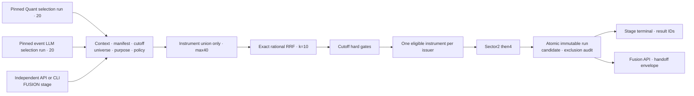

# Fusion 후보 통합 아키텍처·상세 설계

기준: [공통 하네스](../../../../../PROJECT-HARNESS.md).
Fusion은 새 예측 모델이 아니라 MEDIUM 정량·LLM 후보의 선정 방식이다.
개별 분기와 전체 연결은 [전체 아키텍처](./architecture-diagram.md)를 따른다.

## 1. 현행 점검·독립화 목표

FusionService·저장·read API·전달 계약은 구현돼 있다. 독립 실행 수락·상태·retry
API/CLI를 추가하되 기존 일일 DAG와 선정 정책은 유지한다.
독립 Fusion은 수집·학습·정량 추론·LLM 호출·외부 전달을 시작하지 않는다.
진행 순서는 계획 점검 → 상세 문서 → 구현·검증 → 배포다.

## 2. 아키텍처

## 3. 입력·identity·API

- `stage=FUSION`, target session, execution context,
  quant_selection_run_id·llm_preselection_run_id를 필수로 받는다.
- model purpose는 MEDIUM_20D 고정이며 SHORT Fusion은 제공하지 않는다.
- 두 run은 성공20개·row20개·position1~20이고 context·manifest·universe·session·
  cutoff·knowledge mode가 같아야 한다.
- 기존 FusionService가 Quant model/scoring/artifact·policy hash,
  event v2 LLM policy·prompt·deployment/evidence schema를 검증한다.
- 날짜별 최신 run을 두 번 따로 조회해 암묵 결합하지 않는다.
- stage run ID와 실제 fusion_run_id는 다르다. 실제 selection identity는 Fusion UUID다.
  기존 Quant UUID로 위장하거나 결과를 덮어쓰지 않는다.
- `/api/v1/candidates`는 정량 전용, `/api/v1/fusion-selections`·`/{id}`·`/{id}/handoff`는
  Fusion 전용으로 유지한다. Portal UI·DB 변경은 이번 실행 독립화 범위에서 제외한다.

## 4. 파라미터·선정 방법

설정 원본은 [fusion_v1.yaml](../../../../../config/analytics/fusion_v1.yaml).

| 항목 | 값 | 설계 방법 |
|---|---|---|
| 입력 수량 | Quant20·LLM20 | 성공 목록의 위치를 사용 |
| rank | 목록 내1~20 | 전체 universe rank는 별도 감사값 |
| RRF k | 10 | 단독 상위 후보도 공통 하위보다 앞설 수 있음 |
| 합산 | 동일 instrument만 | 같은 issuer의 다른 share class는 비합산 |
| issuer 중복 | 적격 RRF 최고 하나 | hard gate 이후, 다른 주식의 예측값 복사 금지 |
| 동점 | instrument_id ASC | Quant·LLM 어느 쪽도 우대하지 않음 |
| sector cap | 2→부족 시4 | 한 번 soft 완화, UNCLASSIFIED도 한 그룹 |
| 최종 수량 | 정확히20 | 부족하면 SHORTFALL |
| 후보 풀 | 두 목록 union만 | 후순위·과거 결과·부적격 종목으로 보충 금지 |

식은 `sum(1/(k+source_list_position))`이며 없는 쪽 기여도는0이다.
Fraction으로 정확히 비교하고 표시 float 반올림으로 가짜 동점을 만들지 않는다.
단독1위=1/11, 양쪽20위=2/30이므로 단독1위가 높다.
선정 집합을 마지막에 RRF 순서로 재정렬해 최종 position을 정한다.

RRF는 예측 수익률·확률·confidence가 아니다. Quant-only/LLM-only의 반대 source 값은
null로 보존한다. cutoff 당시 사실만으로 품질·기업행위·거래 상태를 gate하고
주관적 LLM risk_score 임계값은 도입하지 않는다.
정책 비교는 같은 context·label·비용 가정으로 별도 version에서만 수행한다.

## 5. 독립 상태·재시도

- `POST /api/v1/candidate-stage-runs`에서 FUSION만 실행한다.
- source ID·context·policy hash를 수락 시 고정한다.
- 동일 key·요청은 재사용, 다른 payload는409, 동일 입력 동시 실행은 DB로 차단한다.
- `PENDING → RUNNING → SUCCEEDED|SHORTFALL|FAILED`.
- 입력 불일치는 FAILED, 적격 union·issuer·sector 부족은 SHORTFALL이다.
- 실패·SHORTFALL만 새 stage ID로 명시적 retry하며 원래 run·result는 보존한다.
  변경한 정책은 같은 retry에 섞지 않고 새 요청을 사용한다.
- Fusion run·candidate·audit는 단일 transaction·append-only로 저장한다.
- API 재시작으로 잃은 stage는 INTERRUPTED 실패로 기록하며 자동 전송·성공 처리하지 않는다.

## 6. 일일·외부 제어와 연결

일일 DAG는 공통 manifest 후 Quant/LLM을 병렬 실행하고 두 성공 결과를 Fusion으로 넘긴다.
독립 진입점은 같은 Fusion 사업 로직만 재사용한다.
독립 Fusion 성공이 외부 분석을 자동 시작하지 않는다.
전달은 기존 orchestrator의 별도 flag·엄격 ACK·동일 payload idempotency 계약으로 수행한다.
외부 전송 실패로 후보 성공을 덮어쓰거나 외부 job/report 상태를 Candidate DB에 추가하지 않는다.

## 7. 검증·도입

원래 rank 보존·정확한 RRF·share class·gate·20미만·union 밖 미사용·source 불일치,
source ID 고정·payload 충돌·동시 claim·retry lineage·재시작 실패,
Quant/LLM/외부 전달 비호출을 검증한다.
새 stage DDL·최소 권한 → Backend → health·auth·OpenAPI·비과금 replay 순서로 배포하며
현재 운영 분석 worker·Portal UI는 재배포하지 않는다.

## 8. 구현·검증 증거

독립 Fusion API/CLI·별도 stage 상태·고정 source ID·retry 연결을 구현했다.
전체 테스트533건·타입 검사·Ruff가 통과했고 격리 PostgreSQL에서24개 migration 및
실제 standalone Fusion 성공·동일 key 재사용·성공 retry 차단·실패 retry·중단 복구·
terminal 보호를 실행해 검증했다. 새 모델 호출·외부 제출 비호출도 테스트했다.
운영 health·auth·결과 재사용 증거는 [운영 점검서](../../../../../DAILY-PIPELINE-RUNBOOK.md)에 남긴다.
