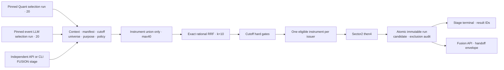
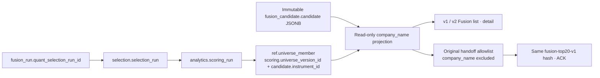

# Fusion 후보 통합 아키텍처·상세 설계

기준: [공통 하네스](../../../../../PROJECT-HARNESS.md).
Fusion은 새 예측 모델이 아니라 MEDIUM 정량·LLM 후보의 선정 방식이다.
개별 분기와 전체 연결은 [전체 아키텍처](./architecture-diagram.md)를 따른다.

갱신일: 2026-10-23

## 1. 현행 독립 실행 구조

FusionService·저장·read API·전달 계약과 독립 실행 수락·상태·retry API/CLI는 운영 배포됐다.
기존 일일 DAG와 선정 정책은 유지한다.
독립 Fusion은 수집·학습·정량 추론·LLM 호출·외부 전달을 시작하지 않는다.
운영은 event v2·RRF k=10·전량 handoff 활성 상태이며 코드·설정 기본값 OFF와 구분한다.
2026-10-18 과거 연구 재처리는 별도로 승인된 연구 context·주차별 실제 모델과
선택적 검색 v6를 사용했다. 정규 일일 설정이나 과거 immutable 결과를 이 정책으로
일괄 변경했다는 의미가 아니다.

## 2. 아키텍처

## 3. 입력·identity·API

- `stage=FUSION`, target session, execution context,
  quant_selection_run_id·llm_preselection_run_id를 필수로 받는다.
- model purpose는 MEDIUM_20D 고정이며 SHORT Fusion은 제공하지 않는다.
- 두 run은 성공20개·row20개·position1~20이고 context·manifest·universe·session·
  cutoff·knowledge mode가 같아야 한다.
- 기존 FusionService가 Quant model/scoring/artifact·policy hash,
  event v2 LLM policy·prompt·deployment/evidence schema를 검증한다.
- 날짜별 최신 run을 두 번 따로 조회해 암묵 결합하지 않는다.
- stage run ID와 실제 fusion_run_id는 다르다. 실제 selection identity는 Fusion UUID다.
  기존 Quant UUID로 위장하거나 결과를 덮어쓰지 않는다.
- `/api/v1/candidates`는 정량 전용, `/api/v1/fusion-selections`·`/{id}`·`/{id}/handoff`는
  Fusion 전용으로 유지한다. Portal UI·DB 변경은 이번 실행 독립화 범위에서 제외한다.

## 4. 파라미터·선정 방법

설정 원본은 [fusion_v1.yaml](../../../../../config/analytics/fusion_v1.yaml).

| 항목 | 값 | 설계 방법 |
|---|---|---|
| 입력 수량 | Quant20·LLM20 | 성공 목록의 위치를 사용 |
| rank | 목록 내1~20 | 전체 universe rank는 별도 감사값 |
| RRF k | 10 | 단독 상위 후보도 공통 하위보다 앞설 수 있음 |
| 합산 | 동일 instrument만 | 같은 issuer의 다른 share class는 비합산 |
| issuer 중복 | 적격 RRF 최고 하나 | hard gate 이후, 다른 주식의 예측값 복사 금지 |
| 동점 | instrument_id ASC | Quant·LLM 어느 쪽도 우대하지 않음 |
| sector cap | 2→부족 시4 | 한 번 soft 완화, UNCLASSIFIED도 한 그룹 |
| 최종 수량 | 정확히20 | 부족하면 SHORTFALL |
| 후보 풀 | 두 목록 union만 | 후순위·과거 결과·부적격 종목으로 보충 금지 |

식은 `sum(1/(k+source_list_position))`이며 없는 쪽 기여도는0이다.
Fraction으로 정확히 비교하고 표시 float 반올림으로 가짜 동점을 만들지 않는다.
단독1위=1/11, 양쪽20위=2/30이므로 단독1위가 높다.
선정 집합을 마지막에 RRF 순서로 재정렬해 최종 position을 정한다.

RRF는 예측 수익률·확률·confidence가 아니다. Quant-only/LLM-only의 반대 source 값은
null로 보존한다. cutoff 당시 사실만으로 품질·기업행위·거래 상태를 gate하고
주관적 LLM risk_score 임계값은 도입하지 않는다.
정책 비교는 같은 context·label·비용 가정으로 별도 version에서만 수행한다.

## 5. 독립 상태·재시도

- `POST /api/v1/candidate-stage-runs`에서 FUSION만 실행한다.
- source ID·context·policy hash를 수락 시 고정한다.
- 동일 key·요청은 재사용, 다른 payload는409, 동일 입력 동시 실행은 DB로 차단한다.
- `PENDING → RUNNING → SUCCEEDED|SHORTFALL|FAILED`.
- 입력 불일치는 FAILED, 적격 union·issuer·sector 부족은 SHORTFALL이다.
- 실패·SHORTFALL만 새 stage ID로 명시적 retry하며 원래 run·result는 보존한다.
  변경한 정책은 같은 retry에 섞지 않고 새 요청을 사용한다.
- Fusion run·candidate·audit는 단일 transaction·append-only로 저장한다.
- API 재시작으로 잃은 stage는 INTERRUPTED 실패로 기록하며 자동 전송·성공 처리하지 않는다.

## 6. 일일·외부 제어와 연결

일일 DAG는 공통 manifest 후 Quant/LLM을 병렬 실행하고 두 성공 결과를 Fusion으로 넘긴다.
독립 진입점은 같은 Fusion 사업 로직만 재사용한다.
독립 Fusion 성공이 외부 분석을 자동 시작하지 않는다.
전달은 기존 orchestrator의 별도 flag·엄격 ACK·동일 payload idempotency 계약으로 수행한다.
외부 전송 실패로 후보 성공을 덮어쓰거나 외부 job/report 상태를 Candidate DB에 추가하지 않는다.

## 7. 검증·도입

원래 rank 보존·정확한 RRF·share class·gate·20미만·union 밖 미사용·source 불일치,
source ID 고정·payload 충돌·동시 claim·retry lineage·재시작 실패,
Quant/LLM/외부 전달 비호출을 검증한다.
새 stage DDL·최소 권한 → Backend → health·auth·OpenAPI·비과금 replay 순서로 배포하며
현재 운영 분석 worker·Portal UI는 재배포하지 않는다.

## 8. 구현·검증 증거

독립 Fusion API/CLI·별도 stage 상태·고정 source ID·retry 연결을 구현했다.
전체 테스트533건·타입 검사·Ruff가 통과했고 격리 PostgreSQL에서24개 migration 및
실제 standalone Fusion 성공·동일 key 재사용·성공 retry 차단·실패 retry·중단 복구·
terminal 보호를 실행해 검증했다. 새 모델 호출·외부 제출 비호출도 테스트했다.
실행·재시도는 [오케스트레이터 가이드](../../../../../orchestrator/README.md),
운영 오류 조회는 [Telemetry·KQL 런북](orchestrator-telemetry-runbook.md)을 따른다.

## 9. 선정 근거·검색 확장의 배포 경계

### 9.1 동일 근거 설명 결합 — 2026-10-23 운영 패치

설명 builder `_project_evidence`는 `(evidence_link_id, criterion, is_external)`를
key로 DB·검색 인용을 각각 그룹화한다. 같은 근거와 평가항목의 **서로 다른 유효 이유**는
서버가 결정적으로 하나의 이유에 결합한다. 원래 assessment·인용·점수·RRF·rank는
수정하지 않으며 LLM에게 다시 합치라고 요청하거나 추가 호출하지 않는다.
이전 외부 검색 인용 전용 결합을 DB_PACKET에도 일관되게 적용한 수정이다.

완전히 같은 이유의 반복·같은 key의 provenance 충돌은 여전히 실패한다.
600문자 bounded 요약이므로 임의 길이의 두 이유를 항상 원문 그대로 반환한다고 보장하지
않는다. 전체 원문은 pinned assessment에 남는다. DB/검색 source layer를 섞거나
시점·evidence hash·원문 revision gate·최종 인용 수/중복 검증을 완화하지 않는다.

### 9.2 10월22일 결과와 복구 계보

| 항목 | 실제 결과 / UUID |
|---|---|
| 정규 process | `c7a20b67-09a9-4060-852f-384185175c73`, 수집 성공 후 `PARTIAL_SUCCESS` |
| 고정 context / cutoff | `acbf5ed6-5c3c-56ae-aa5f-8f32185869b9` / `2026-10-23T09:30:00Z`(NY05:30) |
| Quant20 / LLM20 | `72e5deb5-f25d-54fb-88b8-293540d5f531` / `ecdc489e-4b63-40d3-b904-c3f89265eb2b`, 모두 성공·재사용 |
| 원래 실패 Fusion | `55fbca42-73a3-4bbd-a769-2da695fcf05f`, `FUSION_EXPLANATION_VALIDATION_FAILED` |
| 별도 복구 stage / Fusion | `71a4fadf-b1f2-4d75-a062-7894fca9353a` / `a98a70fe-1d1c-427a-af92-d0562d2bbc2b` |
| 확인 | 새 후보20·설명20·전량 ACK20, 최초 process/실패/성공 원천 보존 |

PG는 인용6개 중 evidence/criterion/layer 고유 조합이5개였다. `business`의 동일 DB
근거에 두 **서로 다른** 이유가 있어 최종 설명 검증에 거부됐으며 인용10개 초과 문제가 아니다.
운영 baseline의 함수 하나만 패치한 배포
`1e61ecc3-921d-4b25-98fa-7a0c63f72cbd` 후 두 PG 이유가 결합 설명에 원문 그대로
포함됨을 확인했다. 실제 패치54회귀·전체 source hash·설정·기존 결과 보존도 확인했다.
이 결과를 LLM 재평가·모델 교체·원래 DAILY 성공으로 바꿔쓰기라고 해석하지 않는다.
ACK는 외부 접수만 의미하며 외부 LLY 보고서 실패 등 분석 상태를 성공으로 덮지 않는다.

### 9.3 저장·조회·검색 활성 경계

Quant 이유와 LLM rationale·criterion 인용은 원천 테이블에 저장된다.
통합 설명은 기존 `fusion_candidate.candidate` JSONB와 `fusion_run.provenance`를
사용하며 추가 DDL·요약용 LLM 호출은 없다. v2 설명/결과 통합 API는 운영 배포됐으나
과거 run에는 snapshot이 없을 수 있다. 조회 때 과거 snapshot을
새로 생성하거나 서로 다른 최신 run을 합쳐 근거로 표시하지 않는다.

검색 확장의 설명 v3 witness와 기간검색 출처의 조회 호환도 운영에 반영됐다.
검색 출처·공개 시점·원문 버전·증거 hash를 재검증하며 모델 metadata는 감사용이다.
아래 회사명 추가는 읽기 응답의 표시 필드만 확장한다.
`fusion-top20-v1` allowlist·hash·ACK는 변경하지 않는다.
저장 위치·관계는 [후보 테이블·ER 문서](../../../../../SELECTION-DATABASE-ER.md)를 따른다.

## 10. 후보 API 회사명 계약

### 10.1 반환 범위와 원천

| API | 회사명 필드 | 고정 원천 |
|---|---|---|
| `/api/v1/candidates` | `items[].company_name` | 해당 scoring run의 universe member `security_name` |
| `/api/v1/llm-preselections`·`/{id}` | `candidates[].company_name` | 저장된 LLM candidate 회사명 |
| `/api/v1/fusion-selections`·`/{id}` | `candidates[].company_name` | pinned Quant scoring run의 universe member `security_name` |
| `/api/v2/fusion-selections`·`/{id}` | `candidates[].company_name` | v1과 같은 역사적 universe projection |
| `/{id}/handoff` | 기존 계약에 없음 | `fusion-top20-v1` 원래 필드만 전달 |

목록 API의 Fusion 후보 경로는 `items[].candidates[].company_name`이고
단건 API는 `candidates[].company_name`이다. 정량·LLM의 기존 회사명은 유지하고
누락돼 있던 Fusion 표시 계약에 필수 문자열 필드를 추가했다.
`/{id}/explanations`의 별도 근거 전용 schema는 변경하지 않는다.

현재 회사명이나 최근 수집값으로 과거 후보를 표시하지 않는다. 조회는 pinned
`quant_selection_run_id → scoring_run_id → universe_version_id`를 따라가며
`instrument_id`로 해당 member를 결합한다. 같은 issuer의 다른 share class 회사명을
복사하지 않는다. Quant 후보 테이블 자체에 이름을 한정하지 않으므로
**LLM-only Fusion 후보도** 공통 역사적 universe에서 회사명을 얻는다.

구현은 [Fusion read repository](../../../../../backend/app/repositories/fusions.py)의
공통 SQL projection과 [응답 schema](../../../../../backend/app/schemas/fusions.py)에 있다.
회사명은 조회 시 JSONB 객체에 합성할 뿐 저장 행·예측값·RRF·position·근거 snapshot·
provenance·원래 `payload_hash`를 UPDATE하지 않는다. 역사적 원천 누락은 필수 응답
검증 실패이며 ticker를 회사명으로 대신하거나 현재 공급자에 재질의하지 않는다.
정량 결과의 삭제 표시는 아래와 같이 독립 조회만 숨기므로 회사명 결합을 막지 않는다.

### 10.2 외부 전달 호환

외부 소비자는 `fusion-top20-v1`의 엄격한 필드 allowlist·payload hash·전량 ACK를
검증한다. API 표시 필드 추가를 기존 전달 계약 변경으로 전파하지 않는다.
`handoff()`는 회사명을 제외한 원래 후보 필드만 직렬화하고 같은 payload hash를
계산한다. 회사명이 달라져도 같은 기존 run의 전달 envelope·멱등성 identity는 같다.
회사명을 외부 전달에도 넣으려면 소비자와 합의한 별도 versioned 계약이 필요하다.

## 11. Fusion 보존형 독립 정량 결과 삭제

### 11.1 삭제와 보존의 구분

Fusion은 Quant selection/scoring UUID를 고정하고, v2 근거 조회는 해당 run의
후보·점수·reason을 재검증한다. 따라서 Fusion이 참조하는 Quant 원천을 물리적으로
삭제하면 Fusion 설명과 회사명 조회까지 깨진다.

사용자가 독립 정량 결과 삭제와 Fusion 보존을 함께 요청할 때는 기존
[migration 025](../../../../../sql/025_quant_result_deletion.sql)의
`selection.quant_result_deletion(selection_run_id, deleted_at, reason)`을 사용한다.

| 대상 | 처리 |
|---|---|
| 범위 안 MEDIUM_20D 독립 정량 run | run 단위 삭제 표시 추가 |
| 정량 공개 날짜·범위·전체·명시적 run ID 조회 | 삭제 표시 run 제외 |
| `include_deleted=true` 등 공개 우회 요청 | 우회 기능 없음; 삭제 결과를 반환하지 않음 |
| Fusion pinned Quant 후보·사유·scoring 원천 | 물리 보존, 정확한 고정 run의 내부 조회만 허용 |
| Fusion run·candidate·audit·설명·외부 handoff | 변경·재생성·재전송 없이 보존 |
| 독립 LLM 결과·모델·수집 원본·범위 밖 결과 | 보존 |

`CandidateRepository`는 최신 성공 run을 고르기 **전에** 삭제 표식을 제외한다.
그러므로 날짜에 여러 run이 있으면 요청 범위의 대상 run 모두를 식별해야 한다.
최신 run 하나만 숨기고 이전 정량 결과가 다시 나타나도록 두지 않는다.
날짜는 `price_session_date` 양 끝 포함이며 생성 시각이나 외부 보고서 생성일로
대상 날짜를 바꾸지 않는다. 모델 목적은 실제 scoring/model join으로 확인한다.

`FusionReadRepository.with_reasons()`만 정확한
`quant_selection_run_id`에 대해 `include_deleted=True` 내부 조회를 한다.
성공·20개·목적·context/session/cutoff·instrument/issuer·원천 순위·점수·인용
검증은 그대로다. 이 옵션을 공개 query parameter로 노출하지 않는다.

### 11.2 외부 정량 분석 리포트의 운영 정리

리포트 실행·저장·관리는 Candidate Engine 구현 범위가 아니다. 사용자 승인에 따른
이번 운영 정리는 저장소 밖 세션 도구에서 수행하고 Candidate DB에 report/job
schema나 삭제 API를 추가하지 않았다.

Portal에서 `analysis_date` 범위와 `candidate_model_purpose=MEDIUM_20D`를
확인하고 실제 기존 정량 run identity를 고정했다. `rrf_fusion` 분석 및 handoff
receipt가 있는 분석은 삭제 대상에 포함하지 않는다. ticker가 같거나 날짜가 같다는
이유만으로 Fusion 리포트를 함께 삭제하지 않는다.

정확한 daily/job ID별 DB 행을 백업하고 외부 참조·공유 report locator·활성 job·
미지원 FK를 검사한다. 원본 Blob과 기존 복구본의 byte 수·SHA-256을 대조한 뒤
`job_events → analysis_dispatches → jobs → daily_analyses`를 한 MySQL
transaction으로 삭제한다. 삭제 개수와 보존 행 fingerprint가 다르면 rollback한다.
그 다음 **백업한 정확한 원본 Blob 이름만** ETag 조건부 삭제한다.
`_recovery` 복구본과 Fusion/다른 리포트는 삭제하지 않는다.
DB와 Blob 간 전역 transaction은 없으므로 단계별 영수증·원본 ID·백업을 보존한다.

## 12. 2026-10-18 실행 결과와 검증 기준

사용자 승인 대상은 **2026-09-30~2026-10-14의 MEDIUM_20D 정량 결과와
연결된 정량 분석 리포트**이며 Fusion은 유지한다. 11거래일은 9/30,
10/1·2·5·6·7·8·9·12·13·14다. 주말은 포함되지 않고 10/12는 거래일이다.

| 항목 | 처리한 수량과 보존 결과 |
|---|---|
| 독립 정량 결과 | 11개 성공 run·220개 후보를 논리 삭제 |
| pinned 정량 원천 | 위 11개 run·220개 candidate·600개 reason 물리 보존 |
| 남아 있던 기존 정량 분석 | 8개 daily analysis·80개 job 삭제 |
| 연결 운영 데이터 | 800개 job event·80개 dispatch 삭제 |
| 정량 원본 리포트 | 80개 Blob 삭제, 검증한 복구본 유지 |
| 다른 리포트 | 472개 원본 Blob의 properties fingerprint 불변 |
| Fusion | 전체 18개 run·260개 candidate·509개 audit fingerprint 불변 |
| LLM·scoring·모델 | 기존 행 수와 전체 fingerprint 불변 |

정량 보고서 80건은 9/30·10/1·2·5·6·7·8·9에 남아 있던 기존 10개씩이다.
10/12~14의 기존 정량 보고서는 앞선 교체에서 이미 정리돼 이번에 다시 삭제하지 않았다.
새 Fusion 11일치 분석 220개 job은 그대로 남긴다. 실패한 Fusion 분석을 성공으로
바꾸거나 리포트를 새로 생성하지 않는다. 앞선 가상 손익 자료도 재계산하지 않는다.

회사명 API는 운영 source bundle과 일치 여부를 확인한 뒤 read repository·응답
schema **두 Python 파일만** 교체해 배포했다.
배포 ID는 `b75b3bdb-c404-4241-b1f3-244d103d147a`다.
다른 미배포 연구/학습 변경을 묶어 배포하지 않았으며 추가 migration·모델 실행·
외부 분석·worker/DB SKU 변경도 없었다. Portal·Candidate의 기존 B2 플랜·
인스턴스 수·네트워크·App Settings가 배포 전후 동일함을 확인했다.

검증은 다음 불변식을 대상으로 한다.

- 날짜·범위·명시적 run ID·우회 시도의 정량 공개 응답이 모두 0건.
- Fusion v1/v2 목록·단건의 회사명이 pinned 역사적 universe와 일치.
- Quant-only·LLM-only·양쪽 선정의 기존 RRF·점수·20개 identity 유지.
- 기존 13개 성공 Fusion/260개 후보의 handoff가 배포 전과 완전히 동일.
- v2 선정 근거·저장 설명을 삭제된 정확한 Quant 원천에서도 조회 가능.
- Fusion/LLM/scoring/모델 DB fingerprint와 다른 Portal DB 행·472개 Blob 불변.
- API health·기존 B2·운영 설정 보존과 관련 API/외부 계약 회귀 검증.

운영에서 13개 성공 Fusion의 회사명 260개·기존 handoff 전체 일치·v2 근거/
설명 조회와 삭제된 11개 Quant의 날짜·명시 ID·우회 및 범위 조회 0건을 확인했다.
Portal의 해당 기간 독립 정량 분석은 0개이며 Fusion 11회·220개 job은 그대로다.
관련 Backend·Fusion·오케스트레이터 회귀는 428개 통과·6개 skip이고 변경 Python
파일 Ruff 검사도 통과했다. skip을 실제 외부 실행 검증 성공으로 계산하지 않는다.

백업·실행 영수증·전체 비교 데이터·임시 운영 script는 Git에 넣지 않고 세션
artifact로 보존한다. 변경 로그에는 처리 범위·수량·불변식만 기록한다.
