# LLM 후보 파이프라인 아키텍처·상세 설계

기준: [공통 하네스](../../../../../PROJECT-HARNESS.md).
고정 evidence로 후속 분석 후보를 선정하며 검증되지 않은 외부 지식·임의 웹 검색·투자 의견은 금지한다.
v2는 DB-only, 명시 선택하는 v4는 native LLM 검색·시점 gate·격리 평가를 사용한다.
[LLM 전용 하네스](../../../../../src/sp500_candidate_engine/llm_preselection/LLM-HARNESS.md)를
실행·프롬프트·cache·인용·미래 정보 차단의 필수 계약으로 적용한다.
[전체 아키텍처](./architecture-diagram.md)에서 수집·정량·통합·외부 소비자 경계를 다룬다.

## 1. 현행 점검과 구현 목표

독립 stage 수락 API·상태·retry ID와 기존 CLI는 구현돼 있다.
기존 v1/v2와 일일 DAG는 보존하고 검색 보강은 별도 v4 policy/schema로 선택한다.
같은 rubric·Top20·RRF를 유지하지만 승인된 새 사실이 점수/선정을 바꿀 수 있으므로
구 정책의 성공 결과를 새 정책의 결과로 재사용하지 않는다.

운영은 event v2·독립 stage가 활성화된 상태다. 한국어 event prompt, native 검색 v4,
검색 witness와 신규 근거 API는 로컬 변경이며 이 문서 갱신만으로 배포되지 않는다.
v4 정책 파일·구현은 이번 문서 커밋에 포함하지 않는다.

## 2. 아키텍처

```mermaid
flowchart LR
    Request["API or CLI · LLM_PRESELECTION"] --> Stage["Stage request · frozen context"]
    Stage --> Evidence["Manifest-fenced evidence<br/>SEC · facts · news · earnings · actions"]
    Evidence --> Screen["Event types and controls<br/>up to 90 + 10 issuers"]
    Screen --> Mode{"Policy"}
    Mode -->|"v1/v2"| Assess["Azure OpenAI strict structured output"]
    Mode -->|"v4"| Search["LLM native web_search · public metadata only"]
    Search --> Quarantine["Quarantine full tool response and reasoning"]
    Quarantine --> Proof["All consulted sources · publication · original versions"]
    Proof -->|"reject"| Fail["Explicit failure · no scoring"]
    Proof -->|"admit"| Clean["Only cited past passages"]
    Clean --> Assess
    Assess --> Validate["Per-instrument citations<br/>criterion and null validation"]
    Validate --> Score["Application weighted score"]
    Score --> Select["Top 20 or SHORTFALL"]
    Select --> Store["Immutable packets · screening<br/>calls · assessments · selection"]
    Store --> Status["Stage status and result IDs"]
```

Qlib export·Alpha158·LightGBM artifact·Quant 성공을 필요로 하지 않는다.
가격은 hard gate로만 검증하고 event v2 LLM 입력에는 포함하지 않는다.
공통 context는 실행 전제이며 LLM 실행이 수집이나 Quant를 시작하지 않는다.

## 3. 입력·버전 고정

- stage·target session·execution context를 명시하며 Quant/Fusion source ID는 받지 않는다.
- 수락 시 policy path/hash·prompt/evidence schema·deployment/API version을 고정한다.
- 실행 시 설정이 고정 계약과 다르면 `FAILED/CONTRACT_CHANGED`다.
  다른 deployment fallback이나 이전 후보의 자동 재사용은 금지한다.
- `LLM_PRESELECTION_ENABLED`는 실제 모델 호출 gate다. standalone 실행은 Fusion
  활성화를 요구하지 않으며 선택한 LLM 정책만 검증한다.
- v1 전체 universe·가격 context·2단계 재정렬은 보존하고 v2로 위장하지 않는다.
- 결과는 llm_ranking_run_id·selection_run_id·후보 수·failure code를 반환한다.
  `/api/v1/llm-preselections` 조회 의미는 유지한다.

## 4. event v2 파라미터·설계 방법

설정 원본은 [policy_event_v2.yaml](../../../../../config/llm_preselection/policy_event_v2.yaml).

| 항목 | 값 | 의미·설계 근거 |
|---|---|---|
| 이벤트 기간 | 최근 7달력일 | cutoff까지 새로 이용 가능해진 revision |
| 이벤트 점수 | 유형별 1점 | 공시·재무·실적·뉴스·기업 이벤트, 반복 건수 가산 없음 |
| 실적 일정 | cutoff 전후 7일 | 당시 알려진 일정만, 미래 실제 실적은 금지 |
| 평가 예산 | EVENT 최대90·CONTROL 최대10 | quota 이전·강제 충원 없음 |
| control | context·policy·issuer hash 순서 | 재실행 시 새 random 표본을 만들지 않음 |
| 대표 share class | instrument ID 오름차순 | Quant score에 의존하지 않음 |
| batch size | 5 issuer | bounded packet과 context window 양립 |
| 뉴스 | 30일·최대30개 | 선별 기간과 평가 이력을 구분 |
| 실적/공시 | 2개 / 365일·20개 | cutoff·manifest·revision 고정 |
| 재무/기업행위 | 8분기·80개 / 365일·20개 | 기간·단위·원천 lineage 보존 |
| packet | 최대48,000문자 | 오래된 항목 결정적 축소, 잘림·근거 링크 일치 |
| 전체 입력 | 추정2,500,000 tokens | 초과는 명시적 실패 |
| RPM/TPM | 60 / 250,000 | policy 상한과 실제 deployment quota 모두 준수 |
| output reserve | 4,096 tokens | token 예산 예약값 |
| 시도 | batch 최대3회 | transport와 의미검증 repair의 공통 예산 |
| base delay | 1초·지수 backoff | Retry-After도 유한 delay budget 검증 |
| 설명 | 최대600문자 | 제공 evidence에 기반한 bounded 설명 |
| 최종 수량 | 정확히20 | 부족은 SHORTFALL, 다른 branch로 보충하지 않음 |

rubric은 실적25·사업25·이벤트20·재무15·산업15이며 각 항목 0~100이다.
근거 있는 최소3개 항목의 `sum(score*weight)/sum(supported_weight)`를 앱이 계산한다.
Decimal 소수4자리 ROUND_HALF_EVEN 결과를 저장·정렬에 같이 사용한다.
결측은 null·사유를 보존하고 0점·중립값·외부 지식으로 채우지 않는다.
v4는 승인된 검색 발췌를 인용해 평가할 수 있지만 모델 기억으로 지원을 늘리지 않는다.
null 항목의 한계를 설명한 유효 인용은 남기되 coverage·분모·점수에 포함하지 않는다.
최종 정렬은 `score DESC, instrument_id ASC`이며 v2는 60개 pool 재정렬을 하지 않는다.

초기 가중치·window를 최적값으로 가정하지 않는다. 같은 session·universe·cutoff·
label·비용으로 비교하고 coverage·CONTROL 선정·SHORTFALL·token 사용도 평가한다.
변경 실험은 새 policy/prompt/evidence schema version으로 관리한다.

## 5. 재현·상태·재시도

- immutable packet hash·lineage·screening 집합을 검증 후 재사용한다.
- 재구성은 과거 row 공개 시각과 늦은 container 재관찰을 구분한다.
  운영 재현은 snapshot·row·observed 시각도 cutoff 이내여야 한다.
- cache도 실제 instrument의 evidence로 재검증한다. 과거 실패 raw 응답을 다시
  검증할 수 있지만 repair에서는 성공 cache만 사용해 실패 응답 반복 재생을 막는다.
- 실행 잠금·RPM/TPM·attempt ID·response hash·usage를 보존한다.
  원문·secret을 로그나 외부 handoff로 출력하지 않는다.
- 독립 stage는 PENDING/RUNNING과 SUCCEEDED/SHORTFALL/FAILED, retry 원본 ID를 갖는다.
- retry는 동일 context·policy·deployment를 유지하고 Quant/Fusion을 재실행하지 않는다.
- 일부 batch 성공만으로 run을 성공 처리하지 않고 실패 시에도 call audit를 보존한다.

## 6. API·CLI·검증·배포

공통 진입점은 `POST /api/v1/candidate-stage-runs`, `stage=LLM_PRESELECTION`.
상태는 run ID로 조회하고 retry는 `/{run_id}/retry`와 새 Idempotency-Key를 사용한다.
CLI는 `run-stage --stage LLM_PRESELECTION`, `show-stage`, `retry-stage`다.

Quant/Qlib 비호출, cutoff·manifest, 미래 일정/실적 구분, 90/10·control 결정성,
대표 class, packet 축소·link, 3/4/5항목 정규화, repair·cache·rate limit,
NaN/null·동시 claim·retry lineage·재시작 복구를 검증한다.
새 stage migration·최소 앱 권한·Backend 배포 순서이며 운영 LLM 호출은 별도 기록한다.

## 7. 구현·검증 증거

LLM-only 독립 수락·상태·retry와 client 정리를 구현하고 Quant/Qlib 비호출을 테스트했다.
standalone legacy LLM이 Fusion flag에 묶이지 않으며 event v2 선정 계약은 유지된다.
전체 테스트533건·신규 stage 타입 검사·Ruff가 통과했다.
운영 검증은 같은 context의 성공 run 재사용을 우선해 새 LLM 호출을 발생시키지 않는다.
실행·재시도는 [오케스트레이터 가이드](../../../../../orchestrator/README.md),
운영 오류 조회는 [Telemetry·KQL 런북](orchestrator-telemetry-runbook.md)을 따른다.

## 8. 실제 LLM 입력과 외부 보강의 분리

### v5 기간 검색·NY 날짜 정책 추가

[v5 설정](../../../../../config/llm_preselection/policy_event_period_v5.yaml)은
Foundry project endpoint와 승인된 Bing connection을 사용한다.
`freshness=시작일..종료일`은 모델 문장이 아니라 실제 Bing tool 설정에 들어간다.
종료일은 NY 기준 cutoff 날짜이며 정확한 당일 시각 검증은 별도로 수행한다.
Bing의 발견일 제한은 공개일/원문 version 검증을 대체하지 않는다.

LLM만 전일 이전 공개/버전 자료는 **일자 정밀도**로 허용한다.
당일 날짜만 있거나 05:30 정각/이후이면 사용하지 않는다. DST와 source timezone을
`America/New_York`로 변환하며 수집·정량의 시간 하네스에는 이 예외를 적용하지 않는다.
metadata의 시각은 실제 source 선언값으로 보존하고 DAY bound는 실제 생성 시각과 구분한다.

현재 Bing tool 응답이 전체 original-version ledger를 노출하지 않으면
`PERIOD_SEARCH_ORIGINAL_VERSION_PROOF_NOT_EXPOSED`로 평가를 차단한다.
검색 후보가 존재하는 것과 평가 사용 가능 자료가 확보된 것은 다른 상태다.
결과는 [VLO 실측 보고서](../../../../../VLO-2026-10-16-PERIOD-SEARCH-VALIDATION.md)를 따른다.

| 입력 | 내용 | 한계 |
|---|---|---|
| 기업 식별 | instrument/issuer·symbol·업종·상태; v4에서 CIK 추가 | 검색에는 공개 회사 metadata만 전달 |
| 뉴스 | 제목·공개 시각·description/author/keywords/publisher/insights | 기사 전문 아님; 관련도와 잘림을 고려 |
| 공시 | filing ID·accession·form·기간·접수일 | metadata만으로 본문을 읽었다고 주장 금지 |
| 재무 | 기존 표준 fact의 concept·기간·unit·값 | 누락된 비교값·segment·수치를 추정 금지 |
| 실적/기업행위 | 알려진 일정·예상치·배당·분할 | 미래 실제 결과와 구분 |
| v4 검색 발췌 | provider-hosted web_search의 인용 문단 중 시점 gate 통과분 | 모델 생성 요약이며 원문 자체/사실성 보증은 아님 |

데이터 물리 모델은 [데이터 아키텍처](./data-architecture.md)의 2026-10-17 계약을 따른다.
LLM은 DB에 직접 연결하지 않는다. 서버의 SEC 추가 다운로드·HTML 파싱 경로는 제거했다.
검색 모델이 Azure Responses API의 native web_search를 호출해 추가 자료를 취득한다.
이 모델에는 내부 UUID·전체 DB packet·계약 payload를 주지 않는다.
검색 결과 전체를 검사하고 승인된 문단만 새 평가 대화에 전달한다. 평가 모델은 검색 도구나
검색 대화·reasoning·previous_response_id를 받지 않는다.
초기 source gate(`web_search` v4)는 고정 공시 원문 버전만 승인한다. 기간 검색(Bing, v5)은
Python이 인용 URL·페이지에서 읽은 게시일/시각으로 승인한다(전일 이전 일자, 당일 05:30 이전 시각).
날짜·시각을 읽지 못한 출처와 본문 미확보 결과는 보강 성공이 아니다.

## 9. v4 검색 정책·인용·저장 계약

로컬 설정: `config/llm_preselection/policy_event_search_v4.yaml`.

| 항목 | 계약 |
|---|---|
| 정책 | `daily-llm-search-preselection:4`, 기존 v2와 별도 |
| prompt/schema | `llm-event-preselection-v7-ko-search` / evidence schema 4 |
| 검색 | Azure `/openai/v1/responses`, native `web_search`, store=false |
| 예산 | 종목당 tool call 최대2·원문 버전 최대2·응답1 MiB·출력4,096tokens |
| projection | 최대8개·각600자 이하 인용 문단; uncited/refusal 문단 제외 |
| 입력 예산 | 총48,000문자 중8,192자 예약; 새 검색 input usage도 전체 token 예산에 포함 |
| 인용 | 같은 종목 공시의 evidence_link_id + LLM_SEARCH_VERIFIED + search_evidence_hash |
| 부족 정보 | 한국어 `information_gaps` 최대 5개; 근거 없는 rubric은 계속 null |
| 보존 | raw tool response는 격리 artifact; 승인 문단/proof만 입력 JSONB |
| replay | context/base/lineage/policy/prompt/model/endpoint 및 tool trace 재검증 |
| 실패 | 도구 미실행·미래/미확인 출처·본문 미확보·해시 오류는 실패; fallback 없음 |

`source_layer=DB_PACKET`은 검색 hash가 null이다. `LLM_SEARCH_VERIFIED`는 같은 공시의
`search_evidence.evidence_hash`와 일치해야 한다. 공개 시점은 고정 DB metadata로 검증한다.
검색 모델의 자기신고 날짜·현재 페이지의 옛 날짜를 신뢰하지 않는다.
tool 응답 hash를 원문 hash나 의미적 사실성 보증으로 표현하지 않는다.
정량 수치·가격·확률·위험 점수를 외부 보강으로 채우지 않는다.

기존 LLM packet/assessment/call JSONB를 이용하며 새 정규화 수집 테이블·DDL은 없다.
새 source layer/hash는 항목별 근거에 보존하고 information_gaps는 원본 structured response에 남긴다.
Fusion은 v4의 검색 manifest를 재검증하고 `candidate-explanation-v3`에서
검색 증거·모델 metadata witness를 반환하는 로컬 계약이다. 기존 v1/handoff와 설명 v1은 유지한다.

선정 근거는 기존 `analytics.llm_instrument_assessment`의 rationale·uncertainty·criterion
인용에 저장된다. 최종 Fusion snapshot은 별도다. 과거 snapshot 부재가 LLM 원본 근거
부재를 뜻하지 않으며, API의 설명 미노출과도 구분한다.
테이블·키·관계는 [후보 DB·ER 문서](../../../../../SELECTION-DATABASE-ER.md)를 따른다.

## 10. 미래 정보 차단과 운영 gate

- `source_available_at <= cutoff_at`은 외부 보강에도 예외 없이 적용한다.
- 늦은 취득은 재구성에서만 허용하며, 운영 replay는 취득도 cutoff 이내여야 한다.
  운영 cutoff 뒤의 새 다운로드로 과거 운영 관찰을 가장하지 않는다.
- 전체 consulted source 중 미래/현재/미확인 버전이 하나라도 있으면 검색 전체를 거부한다.
  모델 이름/버전은 기록용이며 alias·날짜 metadata 부재·모델 변경으로 자료를 거부하지 않는다.
  자료 공개일·원문 버전 검증을 모델 metadata 판단으로 대체하지 않는다.
- 한국어 prompt는 모델 기억·현재 웹·미래 사건/실적 결과를 이용한 보강을 금지한다.
  일정/계획과 실제 결과, 원천 사실과 해석을 분리하고 부족하면 null을 유지한다.
- 명시적 v4 정책 선택과 지속적인 artifact 저장소·권한·공개 시점 검증 없이 운영을 켜지 않는다.
  기존 운영 배포와 이번 로컬 구현/단건 실호출 증거를 구분한다.
- 새 점수를 이전 점수와 비교할 때 입력 예산/잘림도 달라질 수 있으므로
  차이를 외부 보강만의 인과 효과나 성능 개선으로 단정하지 않는다.
