# LLM 후보 파이프라인 아키텍처·상세 설계

기준: [공통 하네스](../../../../../PROJECT-HARNESS.md).
고정 evidence로 후속 분석 후보를 선정하며 외부 지식·웹 검색·투자 의견을 사용하지 않는다.
[전체 아키텍처](./architecture-diagram.md)에서 수집·정량·통합·외부 소비자 경계를 다룬다.

## 1. 현행 점검과 구현 목표

LLM 모듈·단독 CLI·조회 API는 있지만 독립 실행의 수락 API·상태·명시적 retry ID
계약은 공통화돼 있지 않다. 기존 CLI를 보존하면서 독립 stage control plane을 추가한다.
순서는 계획 점검 → 문서 작성 → 구현·검증 → 배포이며 선정 정책은 변경하지 않는다.

## 2. 아키텍처

```mermaid
flowchart LR
    Request["API or CLI · LLM_PRESELECTION"] --> Stage["Stage request · frozen context"]
    Stage --> Evidence["Manifest-fenced evidence<br/>SEC · facts · news · earnings · actions"]
    Evidence --> Screen["Event types and controls<br/>up to 90 + 10 issuers"]
    Screen --> Assess["Azure OpenAI strict structured output"]
    Assess --> Validate["Per-instrument citations<br/>criterion and null validation"]
    Validate --> Score["Application weighted score"]
    Score --> Select["Top 20 or SHORTFALL"]
    Select --> Store["Immutable packets · screening<br/>calls · assessments · selection"]
    Store --> Status["Stage status and result IDs"]
```

Qlib export·Alpha158·LightGBM artifact·Quant 성공을 필요로 하지 않는다.
가격은 hard gate로만 검증하고 event v2 LLM 입력에는 포함하지 않는다.
공통 context는 실행 전제이며 LLM 실행이 수집이나 Quant를 시작하지 않는다.

## 3. 입력·버전 고정

- stage·target session·execution context를 명시하며 Quant/Fusion source ID는 받지 않는다.
- 수락 시 policy path/hash·prompt/evidence schema·deployment/API version을 고정한다.
- 실행 시 설정이 고정 계약과 다르면 `FAILED/CONTRACT_CHANGED`다.
  다른 deployment fallback이나 이전 후보의 자동 재사용은 금지한다.
- `LLM_PRESELECTION_ENABLED`는 실제 모델 호출 gate다. standalone 실행은 Fusion
  활성화를 요구하지 않으며 선택한 LLM 정책만 검증한다.
- v1 전체 universe·가격 context·2단계 재정렬은 보존하고 v2로 위장하지 않는다.
- 결과는 llm_ranking_run_id·selection_run_id·후보 수·failure code를 반환한다.
  `/api/v1/llm-preselections` 조회 의미는 유지한다.

## 4. event v2 파라미터·설계 방법

설정 원본은 [policy_event_v2.yaml](../../../../../config/llm_preselection/policy_event_v2.yaml).

| 항목 | 값 | 의미·설계 근거 |
|---|---|---|
| 이벤트 기간 | 최근 7달력일 | cutoff까지 새로 이용 가능해진 revision |
| 이벤트 점수 | 유형별 1점 | 공시·재무·실적·뉴스·기업 이벤트, 반복 건수 가산 없음 |
| 실적 일정 | cutoff 전후 7일 | 당시 알려진 일정만, 미래 실제 실적은 금지 |
| 평가 예산 | EVENT 최대90·CONTROL 최대10 | quota 이전·강제 충원 없음 |
| control | context·policy·issuer hash 순서 | 재실행 시 새 random 표본을 만들지 않음 |
| 대표 share class | instrument ID 오름차순 | Quant score에 의존하지 않음 |
| batch size | 5 issuer | bounded packet과 context window 양립 |
| 뉴스 | 30일·최대30개 | 선별 기간과 평가 이력을 구분 |
| 실적/공시 | 2개 / 365일·20개 | cutoff·manifest·revision 고정 |
| 재무/기업행위 | 8분기·80개 / 365일·20개 | 기간·단위·원천 lineage 보존 |
| packet | 최대48,000문자 | 오래된 항목 결정적 축소, 잘림·근거 링크 일치 |
| 전체 입력 | 추정2,500,000 tokens | 초과는 명시적 실패 |
| RPM/TPM | 60 / 250,000 | policy 상한과 실제 deployment quota 모두 준수 |
| output reserve | 4,096 tokens | token 예산 예약값 |
| 시도 | batch 최대3회 | transport와 의미검증 repair의 공통 예산 |
| base delay | 1초·지수 backoff | Retry-After도 유한 delay budget 검증 |
| 설명 | 최대600문자 | 제공 evidence에 기반한 bounded 설명 |
| 최종 수량 | 정확히20 | 부족은 SHORTFALL, 다른 branch로 보충하지 않음 |

rubric은 실적25·사업25·이벤트20·재무15·산업15이며 각 항목 0~100이다.
근거 있는 최소3개 항목의 `sum(score*weight)/sum(supported_weight)`를 앱이 계산한다.
Decimal 소수4자리 ROUND_HALF_EVEN 결과를 저장·정렬에 같이 사용한다.
결측은 null·사유를 보존하고 0점·중립값·외부 지식으로 채우지 않는다.
null 항목의 한계를 설명한 유효 인용은 남기되 coverage·분모·점수에 포함하지 않는다.
최종 정렬은 `score DESC, instrument_id ASC`이며 v2는 60개 pool 재정렬을 하지 않는다.

초기 가중치·window를 최적값으로 가정하지 않는다. 같은 session·universe·cutoff·
label·비용으로 비교하고 coverage·CONTROL 선정·SHORTFALL·token 사용도 평가한다.
변경 실험은 새 policy/prompt/evidence schema version으로 관리한다.

## 5. 재현·상태·재시도

- immutable packet hash·lineage·screening 집합을 검증 후 재사용한다.
- 재구성은 과거 row 공개 시각과 늦은 container 재관찰을 구분한다.
  운영 재현은 snapshot·row·observed 시각도 cutoff 이내여야 한다.
- cache도 실제 instrument의 evidence로 재검증한다. 과거 실패 raw 응답을 다시
  검증할 수 있지만 repair에서는 성공 cache만 사용해 실패 응답 반복 재생을 막는다.
- 실행 잠금·RPM/TPM·attempt ID·response hash·usage를 보존한다.
  원문·secret을 로그나 외부 handoff로 출력하지 않는다.
- 독립 stage는 PENDING/RUNNING과 SUCCEEDED/SHORTFALL/FAILED, retry 원본 ID를 갖는다.
- retry는 동일 context·policy·deployment를 유지하고 Quant/Fusion을 재실행하지 않는다.
- 일부 batch 성공만으로 run을 성공 처리하지 않고 실패 시에도 call audit를 보존한다.

## 6. API·CLI·검증·배포

공통 진입점은 `POST /api/v1/candidate-stage-runs`, `stage=LLM_PRESELECTION`.
상태는 run ID로 조회하고 retry는 `/{run_id}/retry`와 새 Idempotency-Key를 사용한다.
CLI는 `run-stage --stage LLM_PRESELECTION`, `show-stage`, `retry-stage`다.

Quant/Qlib 비호출, cutoff·manifest, 미래 일정/실적 구분, 90/10·control 결정성,
대표 class, packet 축소·link, 3/4/5항목 정규화, repair·cache·rate limit,
NaN/null·동시 claim·retry lineage·재시작 복구를 검증한다.
새 stage migration·최소 앱 권한·Backend 배포 순서이며 운영 LLM 호출은 별도 기록한다.

## 7. 구현·검증 증거

LLM-only 독립 수락·상태·retry와 client 정리를 구현하고 Quant/Qlib 비호출을 테스트했다.
standalone legacy LLM이 Fusion flag에 묶이지 않으며 event v2 선정 계약은 유지된다.
전체 테스트533건·신규 stage 타입 검사·Ruff가 통과했다.
운영 검증은 같은 context의 성공 run 재사용을 우선해 새 LLM 호출을 발생시키지 않는다.
실제 배포 증거는 [운영 점검서](../../../../../DAILY-PIPELINE-RUNBOOK.md)를 따른다.
