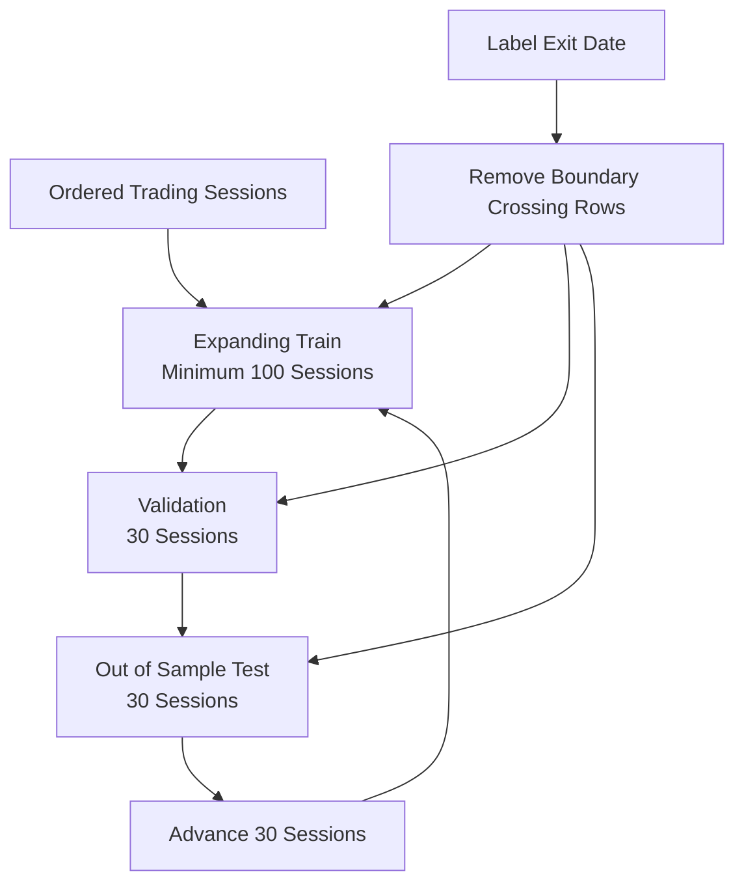
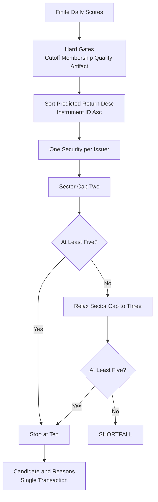

# 후보 선정 모델 아키텍처

갱신일: 2026-10-11

이 문서는 point-in-time 원천 데이터가 Qlib 특징, label, 모델 평가, 일일 score와 5~10개 후보로 변환되는 계약을 정의한다. 후보는 후속 상세 분석 대상이며 매수 신호나 수익 보장이 아니다.

## 설계 원칙

- 모든 입력은 `execution_context_id`와 immutable export manifest에 고정한다.
- raw OHLCV를 덮어쓰지 않고 corporate-action lineage가 있는 조정 시계열을 파생한다.
- 특징 계산용 가격 이력과 날짜별 후보 membership을 분리한다.
- 학습·검증·테스트는 시간 순서대로 분리하고 label exit가 경계를 넘는 표본은 purge한다.
- Label, model, processor, score semantics와 selection policy를 독립 version으로 관리한다.
- 동일 export·config·artifact는 동일 run identity를 재사용한다.
- 점수는 확률이나 confidence가 아니다.

## 전체 모델 흐름

```mermaid
flowchart LR
    Context["Execution Context<br/>Manifest and Cutoff"] --> Source["Manifest Scoped<br/>OHLCV Actions Universe"]
    Source --> Adjust["Split Adjustment<br/>Price Factor Volume"]
    Adjust --> Export["Qlib Export<br/>Calendar Spans Binaries"]
    Export --> Features["Alpha158 RAW<br/>158 Features"]
    Adjust --> Label["Raw 5 Session Return<br/>D plus 1 Open to D plus 5 Close"]
    Features --> Split["Purged Walk Forward<br/>Train Valid Test"]
    Label --> Split
    Split --> Baseline["Momentum and Ridge"]
    Split --> LightGBM["Qlib LightGBM"]
    Baseline --> Evaluate["IC Rank IC<br/>Top 5 and 10 Return<br/>Cost and Drawdown"]
    LightGBM --> Evaluate
    Evaluate --> Registry["Model Registry<br/>Artifact Hash SHADOW"]
    Registry --> Score["Daily Prediction<br/>Predicted 5D Return"]
    Score --> Rank["Overall Rank<br/>Sector Rank Percentile"]
    Rank --> Select["Full Universe Selection<br/>Issuer and Sector Limits"]
    Select --> Candidates["Five to Ten Candidates<br/>Reasons and Temporal Identity"]
```

<!-- mermaid-checked: no \n, no em-dash/en-dash, arrows are -->|"label"| -->


## 1. 전처리와 Qlib export

### 입력 제한

```text
execution_context
  -> input_manifest
    -> source_snapshot
      -> observation
        -> logical revision
```

- manifest에 없는 snapshot은 사용하지 않는다.
- `source_available_at <= cutoff_at`을 적용한다.
- `OPERATIONAL_REPLAY`에서는 `observed_at <= cutoff_at`도 적용한다.
- `HISTORICAL_RECONSTRUCTION`은 당시 운영 재현으로 표현하지 않는다.

### 조정 계약

| Field | 변환 |
|---|---|
| adjusted open/high/low/close | `raw_price * factor` |
| adjusted VWAP | `raw_vwap * factor` |
| adjusted volume | `raw_volume / split_factor` |
| factor | export 기준일 1.0인 누적 split factor |
| change | 직전 거래 session adjusted close 대비 수익률 |

현재 model v2는 `SPLIT_ONLY` 정책이다. 배당을 포함하는 total-return 정책과 혼용하지 않는다.

### Export artifact

```text
data/output/qlib/<export_run_id>/
├── manifest.json
├── staging/<instrument>.csv
└── qlib_data/
    ├── calendars/day.txt
    ├── instruments/all.txt
    └── features/<instrument>/*.day.bin
```

`manifest.json`은 export context, 기간, row 수, schema/exporter version과 artifact별 SHA-256을 보존한다.

## 2. 특징

### Alpha158

- Qlib `Alpha158`
- RAW 특징 158차원
- 최대 lookback 60 sessions
- RAW run에서는 infer/learn processor를 적용하지 않는다.
- dimension 불일치, 중복 index와 Infinity는 blocking이다.
- warm-up·rolling window·원천 결측 NaN은 보존한다.

### 특징 처리

LightGBM은 NaN을 직접 처리한다. Ridge baseline은 train data로 fit한 median imputer와 standard scaler를 사용한다. Validation, test와 daily inference에서 processor를 다시 fit하지 않는다.

시장 관련 특징은 입력으로 사용할 수 있지만 SPY 수익률을 label에서 차감하지 않는다.

## 3. Label v2

```text
anchor = 거래일 D의 장 마감 데이터 확정 시점
entry = D 다음 거래 session의 adjusted open
exit = entry를 포함한 5번째 거래 session, 즉 D plus 5 adjusted close
label = exit / entry - 1
```

| 항목 | 계약 |
|---|---|
| 이름 | `forward-return-next-open-5d-close` |
| Version | 2 |
| 의미 | `RAW_STOCK_5D_RETURN` |
| Benchmark | SPY optional evaluation only |
| Transform | 없음 |
| Boundary | label exit가 segment 안에 있어야 함 |
| Corporate action | `SPLIT_ONLY` |

SPY row가 없어도 stock entry/exit가 있으면 label을 생성한다. SPY는 선택적인 성과 비교값으로만 저장한다.

## 4. 학습과 walk-forward

<!-- mermaid-checked: no \n, no em-dash/en-dash, arrows are -->|"label"| -->


현재 v2 설정:

```text
minimum train: 100 sessions
validation: 30 sessions
test: 30 sessions
step: 30 sessions
minimum final test: 20 sessions
seed: 42
```

겹치는 test window가 생기면 날짜·instrument·model별 가장 이른 fold의 예측만 운영 성과에 사용한다.

## 5. 모델

| 모델 | 역할 | 주요 처리 |
|---|---|---|
| Momentum 20 | 단순 가격 baseline | 20-session adjusted close return |
| Ridge | 선형 baseline | train-only median imputation과 scaling |
| Qlib LightGBM | 비선형 shadow model | Alpha158, MSE regression, deterministic seed |

LightGBM 주요 설정:

```text
learning_rate: 0.03
num_leaves: 31
max_depth: 6
feature_fraction: 0.8
bagging_fraction: 0.8
num_boost_round: 300
early_stopping_rounds: 30
```

모델 artifact와 config hash, export run, split spec, metric은 `analytics.model_version`에 저장한다. v1 초과수익 모델은 `LEGACY_EXCESS_RETURN`, v2는 `RAW_STOCK_5D_RETURN`으로 분리 보존한다.

## 6. 평가

주요 지표:

- 일별 Pearson IC
- 일별 Spearman Rank IC와 비연율화 ICIR
- Top-5/10 실제 5-session 평균 수익률
- Top-5/10 개별 종목 양의 수익률 비율
- 10 bps round-trip cost 차감 평균 수익률
- 매일 새 cohort에 자본 20%를 배정한 5개 중첩 cohort max drawdown
- prediction coverage

현재 model v2는 Top-5/10 raw·net return이 양수지만 Rank IC가 음수이므로 `SHADOW` 상태다. `CHAMPION` 승격에는 양의 out-of-sample Rank IC와 추가 regime 검증이 필요하다.

## 7. 일일 scoring

```text
score semantics = PREDICTED_5D_RETURN
```

1. 명시적 `price_session_date`의 적격 universe를 결정한다.
2. 저장된 model artifact로 5일 수익률을 예측한다.
3. `score DESC, instrument_id ASC`로 결정적으로 정렬한다.
4. overall rank, sector rank와 percentile을 저장한다.
5. score·rank·percentile·model/export/context identity를 scoring run에 귀속한다.

예측 수익률은 상승 확률이나 confidence가 아니다.

## 8. 후보 선정

<!-- mermaid-checked: no \n, no em-dash/en-dash, arrows are -->|"label"| -->


- `predicted_return > 0`은 hard gate가 아니다.
- 음수 예측도 순위가 높으면 후보가 될 수 있으며 `NON_POSITIVE_PREDICTION` reason을 기록한다.
- 품질·시점·artifact gate는 후보 수를 채우기 위해 완화하지 않는다.
- 동일 issuer 중복 제거와 sector cap을 적용한다.
- sector cap만 2에서 3으로 명시적으로 완화할 수 있다.
- 적격 후보가 5개 미만이면 `SHORTFALL`이다.

## 9. 결과 계약

후보 결과 최소 필드:

```text
selection_run_id
price_session_date
cutoff_at
generated_at
execution_context_id
model_version_id
score_semantics
model_status
promotion_gate_passed
instrument_id
symbol
predicted_return
predicted_return_positive
rank_overall
rank_sector
score_percentile
position
reason_codes
soft_constraints_relaxed
```

## 10. 재현 환경

- Python 3.11 `.venv-alpha158`
- `config/analytics/feature_alpha158_v1.yaml`
- `config/analytics/label_forward_return_5d_v2.yaml`
- `config/analytics/model_lightgbm_v2.yaml`
- `config/analytics/selection_v1.yaml`
- `notebooks/phase4_5_training_selection.ipynb`
- `MODEL_CHANGELOG.md`

Notebook은 공용 Python service를 호출하는 얇은 실행 계층이며 동일 export/config hash에서 동일 model·scoring·selection identity를 생성한다.

