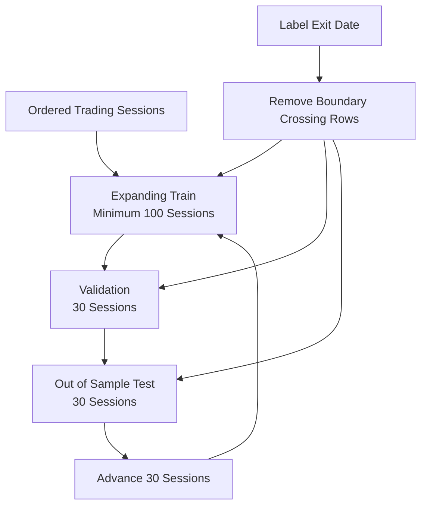
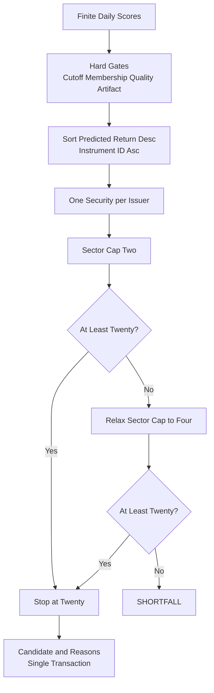

# 후보 선정 모델 아키텍처

갱신일: 2026-10-23

이 문서는 point-in-time 원천 데이터가 Qlib 특징, label, 모델 평가, 일일 score와
MEDIUM 정량 후보 20개로 변환되는 계약을 정의한다. SHORT_5D 레거시 5~10개는 유지한다.
외부 전달은 기존 5~10개에서 20개로 변경하며 최종 통합·전달 어댑터는 구현·기본 비활성이다.
후보는 후속 상세 분석 대상이며 매수 신호나 수익 보장이 아니다.

## 현재 serving·연구·승격 구분

| 구분 | 2026-10-23 확인 내용 |
|---|---|
| 정규 serving | MEDIUM_20D LightGBM v1 `74c367e9-bd84-58ab-b933-19a36dae35c4`, SHADOW, Alpha158 RAW 158차원 |
| label / score | `RAW_STOCK_20D_RETURN` / `PREDICTED_20D_RETURN`, 20 sessions·PRICE_RETURN |
| manifest SHA-256 | `09f163099a3f5d63b018a2c136962624d4990dbc604c2d3ba962e9ef4f1ba5b1` |
| registry artifact hash | `834826154ed3083601fd590191edb69efc316aee1b1d5b52e57507810f58205e` |
| 공급 | purpose별 active assignment 우선; 없으면 명시 provision된 manifest/hash pin |
| 10월18일 challenger | `301785d6-8512-514a-972c-b4a734e7c3b5`, 별도 역사 재구성 SHADOW |
| 연구용 Ridge winner | Sep25 `861b5f38-f10c-565f-989d-7253d34c13f5`, Oct2 `3fc6ebf4-03ee-5624-bfab-cd259fe2accb`; 정규 serving 교체 아님 |

Ridge schema-v3 numeric JSON은 fitted median imputer·StandardScaler·계수·feature 순서를
보존한다. serving에서 pickle을 읽거나 processor를 refit하지 않는다. 기존 LightGBM
schema-v2와 정규 weekly packaging 기본값은 바꾸지 않았고, 연구 binder만 `allow_ridge=True`를 쓴다.
`historical-membership-price-research-v1`은 9issuer 제외·공식 역사 상태 미인증인
`EXPERIMENTAL_RESEARCH_ELIGIBILITY`이며 정규 DAILY의 적격성 정책이 아니다.

10월22일 공유 universe selector/cache fence와 23일 Fusion 설명 변환 수정은 모델 weight·
20D horizon·label·성능 개선이 아니다. 실제 연구 학습·artifact 이력은
[모델 변경 이력](../../../../../MODEL_CHANGELOG.md)을 따른다.

## 적용 범위와 상태 표기

이 문서는 현재 설계 설명과 미구현 제안을 분리한다. 문서 자체는 코드·DB·학습 결과를 검증한 보고서가 아니다.

- **CURRENT**: 최신 모델 문서에서 확인한 계약.
- **VERIFY**: 문서만으로 확정할 수 없어 코드·artifact 확인이 필요한 항목.
- **PROPOSED**: 새로 구현·검증할 계약. 구현 완료로 기술하지 않는다.
- 기존 시점 통제, manifest, artifact hash, 멱등성, issuer 중복 제거 정책을 유지한다.
- 이전 `qlib-historical-data-schema.md`의 1년 데이터·학습 미구현 상태보다 최신 `data-architecture.md`의 2년 가격 이력 및 모델 구현 현황을 우선한다. 실제 사용 범위는 export manifest로 확정한다.
- 본 저장소의 책임은 후보 저장까지다. 후보 이후 LLM 분석·매매 실행은 별도 프로젝트의 책임이다.

## 설계 원칙

- 모든 입력은 `execution_context_id`와 immutable export manifest에 고정한다.
- raw OHLCV를 덮어쓰지 않고 corporate-action lineage가 있는 조정 시계열을 파생한다.
- 특징 계산용 가격 이력과 날짜별 후보 membership을 분리한다.
- 학습·검증·테스트는 시간 순서대로 분리하고 label exit가 경계를 넘는 표본은 purge한다.
- Label, model, processor, score semantics와 selection policy를 독립 version으로 관리한다.
- 동일 export·config·artifact는 동일 run identity를 재사용한다.
- 점수는 확률이나 confidence가 아니다.

## 전체 모델 흐름

```mermaid
flowchart LR
    Context["Execution Context<br/>Manifest and Cutoff"] --> Source["Manifest Scoped<br/>OHLCV Actions Universe"]
    Source --> Adjust["Split Adjustment<br/>Price Factor Volume"]
    Adjust --> Export["Qlib Export<br/>Calendar Spans Binaries"]
    Export --> Features["Alpha158 RAW<br/>158 Features"]
    Adjust --> ShortLabel["SHORT 5D Raw Return<br/>D plus 1 Open to D plus 5 Close"]
    Adjust --> MediumLabel["MEDIUM 20D Raw Return<br/>D plus 1 Open to D plus 20 Close"]
    Features --> Split["Purged Walk Forward<br/>Train Valid Test"]
    ShortLabel --> Split
    MediumLabel --> Split
    Split --> Baseline["Momentum and Ridge"]
    Split --> LightGBM["Qlib LightGBM"]
    Baseline --> Evaluate["IC Rank IC<br/>Top 5 and 10 Return<br/>Cost and Drawdown"]
    LightGBM --> Evaluate
    Evaluate --> Registry["Model Registry<br/>Artifact Hash SHADOW"]
    Registry --> Score["Daily Prediction<br/>Predicted 5D or 20D Return"]
    Score --> Rank["Overall Rank<br/>Sector Rank Percentile"]
    Rank --> Select["Full Universe Selection<br/>Issuer and Sector Limits"]
    Select --> Candidates["MEDIUM Top 20 · SHORT Legacy 5 to 10<br/>Reasons and Temporal Identity"]
```

<!-- mermaid-checked: no \n, no em-dash/en-dash, arrows are -->|"label"| -->


## 1. 전처리와 Qlib export

### 입력 제한

```text
execution_context
  -> input_manifest
    -> source_snapshot
      -> observation
        -> logical revision
```

- manifest에 없는 snapshot은 사용하지 않는다.
- `source_available_at <= cutoff_at`을 적용한다.
- `OPERATIONAL_REPLAY`에서는 `observed_at <= cutoff_at`도 적용한다.
- `HISTORICAL_RECONSTRUCTION`은 당시 운영 재현으로 표현하지 않는다.

### 조정 계약

| Field | 변환 |
|---|---|
| adjusted open/high/low/close | `raw_price * factor` |
| adjusted VWAP | `raw_vwap * factor` |
| adjusted volume | `raw_volume / split_factor` |
| factor | export 기준일 1.0인 누적 split factor |
| change | 직전 거래 session adjusted close 대비 수익률 |

현재 model v2는 `SPLIT_ONLY` 정책이다. 배당을 포함하는 total-return 정책과 혼용하지 않는다.

### Export artifact

```text
data/output/qlib/<export_run_id>/
├── manifest.json
├── staging/<instrument>.csv
└── qlib_data/
    ├── calendars/day.txt
    ├── instruments/all.txt
    └── features/<instrument>/*.day.bin
```

`manifest.json`은 export context, 기간, row 수, schema/exporter version과 artifact별 SHA-256을 보존한다.

## 2. 특징

### 현재 모델 판단 항목 [CURRENT]

현재 `SHORT_5D`와 `MEDIUM_20D` 모델은 조정 OHLCV·VWAP에서 계산한
Alpha158을 사용해 각각 다음 5거래일과 20거래일 가격 수익률을 예측한다.
기업 내재가치, 상승 확률, 투자 신뢰도를 직접 예측하는 모델은 아니다.

| 판단 영역 | 사용 정보 | Alpha158 특징 예시 | 현재 해석 |
|---|---|---|---|
| 당일 가격 형태 | 시가·고가·저가·종가 | KMID, KLEN, KUP, KLOW, KSFT 계열 | 몸통·꼬리·일중 가격 범위 |
| 당일 가격 관계 | 시가·고가·저가·VWAP와 종가 | OPEN0, HIGH0, LOW0, VWAP0 | 종가 대비 당일 가격 위치 |
| 최근 가격 변화 | 과거 종가 | ROC5~60, MA5~60 | 과거 가격과 현재 가격의 관계 |
| 추세 | 종가 시계열 | BETA, RSQR, RESI | 가격 추세 기울기·적합도·잔차 |
| 가격 분포·위치 | 종가·고가·저가 이력 | STD, MAX, MIN, QTLU, QTLD, RANK, RSV | 가격 분포와 현재 위치 |
| 고저점 발생 시점 | 고가·저가 이력 | IMAX, IMIN, IMXD | 최근 고저점 위치의 시간 정보 |
| 상승·하락 지속성 | 종가 변화 | CNTP, CNTN, CNTD, SUMP, SUMN, SUMD | 상승일·하락일 및 변화량 구성 |
| 거래량 변화 | 거래량 이력 | VMA, VSTD, VSUMP, VSUMN, VSUMD | 거래량 수준·변동·증감 |
| 가격·거래량 관계 | 가격과 거래량 | CORR, CORD, WVMA | 가격과 거래량의 동행 관계 |

### Alpha158

- Qlib `Alpha158`
- RAW 특징 158차원
- 최대 lookback 60 sessions
- RAW run에서는 infer/learn processor를 적용하지 않는다.
- dimension 불일치, 중복 index와 Infinity는 blocking이다.
- warm-up·rolling window·원천 결측 NaN은 보존한다.
- Alpha158은 평가 점수표가 아니라 모델 입력 특징 집합이다.
- 기본 158차원 = 캔들 9개 + 당일 가격 비율 4개 + rolling 특징 29종 × 기간 5개.
- rolling 기간은 5·10·20·30·60거래일이다.
- 특징별 고정 가중치나 ‘높으면 좋은 값’ 규칙은 없다.
- SEC 재무 fact, 뉴스, 예정 실적 발표일은 수집 상태와 무관하게 현재 Alpha158 입력에 자동 포함되지 않는다.
- sector rank·sector cap은 현재 후보 순위와 선정 정책이다. 섹터 정보가 모델 특징으로 사용된다고 추정하지 않는다.

#### 대표 특징의 정확한 계산

아래 C, O, H, L, V, W는 각각 조정 종가·시가·고가·저가·거래량·VWAP다. t−d는 d번째 이전 거래 세션이다.

| 특징 | 계산식 | 주의점 |
|---|---|---|
| KMID | `(C_t - O_t) / O_t` | 당일 시가 대비 종가 변화 |
| KLEN | `(H_t - L_t) / O_t` | 일중 범위 |
| VWAP0 | `W_t / C_t` | 거래량 가중 평균 가격의 상대 위치 |
| ROCd | `C_(t-d) / C_t` | 일반 수익률 `C_t/C_(t-d)-1`과 다름 |
| MAd | `Mean(C, d) / C_t` | 평균 대비 현재 종가 관계 |
| STDd | `Std(C, d) / C_t` | 일별 수익률 변동성이 아님 |
| BETAd | `Slope(C, d) / C_t` | SPY 대비 시장 베타가 아님 |
| VMAd | `Mean(V, d) / (V_t + epsilon)` | 현재 거래량 대비 과거 평균 |

정확한 158개 식·순서·epsilon은 설치된 Qlib 버전의 feature configuration을 추출해 고정한다. 온라인 main 브랜치와 설치 버전이 같다고 가정하지 않는다.

### Alpha158 전처리 [CURRENT / VERIFY]

#### 시점과 원천 입력

1. `execution_context_id`와 immutable input manifest로 입력 snapshot을 고정한다.
2. `source_available_at <= cutoff_at`인 데이터만 사용한다.
3. `OPERATIONAL_REPLAY`에서는 `observed_at <= cutoff_at`도 적용한다.
4. `HISTORICAL_RECONSTRUCTION`을 당시 운영 입력의 완전 재현으로 표현하지 않는다.
5. 특징 계산용 가격 이력과 해당 날짜의 후보 membership을 분리한다.
6. 가격 특징 기준일은 완료된 거래 세션 D다. 일일 실행은 다음 날 05:30 ET이므로 향후 이벤트 특징에는 실제 cutoff를 명시한다. 장 마감 기준 실험과 05:30 ET 기준 실험을 혼용하지 않는다.

#### 기업행동 조정

현재 모델 v2는 `SPLIT_ONLY` 정책이다.

```text
adjusted_open   = raw_open   * price_factor
adjusted_high   = raw_high   * price_factor
adjusted_low    = raw_low    * price_factor
adjusted_close  = raw_close  * price_factor
adjusted_vwap   = raw_vwap   * price_factor
adjusted_volume = raw_volume / split_factor
change         = adjusted_close / previous_session_adjusted_close - 1
```

- factor는 export 기준일에 1.0이 되도록 정규화된 누적 분할 factor다.
- raw 데이터를 덮어쓰지 않고 corporate-action lineage를 보존한다.
- 배당 포함 총수익률 조정과 혼용하지 않는다.
- VERIFY: 실제 exporter에서 factor 방향, 분할 전후 가격·거래량 연속성, VWAP 조정 여부를 확인한다.

#### 특징 계산과 결측 처리

LightGBM은 NaN을 직접 처리한다. Ridge baseline은 train data로 fit한 median imputer와 standard scaler를 사용한다. Validation, test와 daily inference에서 processor를 다시 fit하지 않는다.

시장 관련 특징은 입력으로 사용할 수 있지만 SPY 수익률을 label에서 차감하지 않는다.

| 단계 | 현재 계약 |
|---|---|
| Export | 거래 달력·instrument span·Qlib binary·manifest 생성 |
| 특징 계산 | Alpha158 RAW 158차원 |
| infer / learn processor | 현재 RAW run에서는 적용하지 않음 |
| 특징 내부 정규화 | `가격/현재 종가` 등 Alpha158 식에 내장된 비율 계산은 수행 |
| 별도 표준화 | 현재 LightGBM 경로에 z-score·standard scaler를 추가하지 않음 |
| 특징 NaN | warm-up·rolling·원천 결측 NaN 보존, LightGBM이 처리 |
| 차원·index·Infinity | 158차원 불일치, 중복 index, Infinity는 blocking |
| Ridge baseline | train에서만 median imputer·standard scaler fit; 이후 같은 artifact 재사용 |
| Label 변환 | 현재 v2는 수익률 원값, 횡단면 z-score·rank 변환 없음 |

RAW는 ‘아무 계산도 하지 않은 원시 OHLCV’가 아니라 **별도 processor를 적용하지 않은 Alpha158 계산 결과**를 뜻한다.

VERIFY:

- Qlib 기본 learn processor가 암묵적으로 활성화되지 않는지 확인한다. 기본 label 정규화가 개입하면 출력의 수익률 의미가 달라진다.
- 학습 label이 미완성·NaN인 행은 학습에서 제외해야 한다. 특징 NaN 보존과 label 결측 허용을 혼동하지 않는다.
- 문서상 warm-up NaN 보존과 후보 제외 규칙은 다르다. 실제 신규 종목·짧은 이력의 선정 정책을 확인한다.
- 60일 rolling 안의 `Ref(..., 1)` 등 추가 지연까지 포함해 필요한 사전 세션 수를 연산식에서 산정한다.
- 실제 feature 이름·순서·dtype·Qlib 버전·feature config hash를 artifact에 보존한다.

## 3. Label v2 [CURRENT]

```text
anchor = 거래일 D의 장 마감 데이터 확정 시점
entry = D 다음 거래 session의 adjusted open
exit = entry를 포함한 5번째 거래 session, 즉 D plus 5 adjusted close
label = exit / entry - 1
```

- t는 가격 기준 거래일이며 +n은 달력일이 아닌 거래 세션 이동이다.

$$
y_{i,t}^{(5)} = \frac{C^{adj}_{i,t+5}}{O^{adj}_{i,t+1}} - 1
$$

| 항목 | 계약 |
|---|---|
| 이름 | `forward-return-next-open-5d-close` |
| Version | 2 |
| 의미 | `RAW_STOCK_5D_RETURN` |
| Benchmark | SPY optional evaluation only |
| Transform | 없음 |
| Boundary | label exit가 segment 안에 있어야 함 |
| Corporate action | `SPLIT_ONLY` |

SPY row가 없어도 stock entry/exit가 있으면 label을 생성한다. SPY는 선택적인 성과 비교값으로만 저장한다.
`RAW_STOCK_5D_RETURN`의 RAW는 벤치마크를 차감하지 않은 개별 종목 수익률을 뜻한다. 비조정 raw price를 쓴다는 의미가 아니다.

## 4. 학습과 walk-forward

<!-- mermaid-checked: no \n, no em-dash/en-dash, arrows are -->|"label"| -->


현재 v2 설정:

```text
minimum train: 100 sessions
validation: 30 sessions
test: 30 sessions
step: 30 sessions
minimum final test: 20 sessions
seed: 42
```

겹치는 test window가 생기면 날짜·instrument·model별 가장 이른 fold의 예측만 운영 성과에 사용한다.

## 5. 모델

| 모델 | 역할 | 주요 처리 |
|---|---|---|
| Momentum 20 | 단순 가격 baseline | 20-session adjusted close return |
| Ridge | 선형 baseline | train-only median imputation과 scaling |
| Qlib LightGBM | 비선형 shadow model | Alpha158, MSE regression, deterministic seed |

LightGBM 주요 설정:

```text
learning_rate: 0.03
num_leaves: 31
max_depth: 6
feature_fraction: 0.8
bagging_fraction: 0.8
num_boost_round: 300
early_stopping_rounds: 30
```

모델 artifact와 config hash, export run, split spec, metric은 `analytics.model_version`에 저장한다. v1 초과수익 모델은 `LEGACY_EXCESS_RETURN`, v2는 `RAW_STOCK_5D_RETURN`으로 분리 보존한다.

### LightGBM 학습 목표와 예측식 [CURRENT]

#### 학습 목적함수

학습 가능한 종목·날짜 집합을 T, Alpha158 벡터를 X라고 하면 현재 MSE 회귀의 데이터 적합 목표는 다음과 같다.

$$
\mathcal{L}_{MSE}=\frac{1}{|T|}\sum_{(i,t)\in T}\left[f_{\theta}(X_{i,t})-y_{i,t}^{(5)}\right]^2
$$

이는 실제 구현의 tree split·leaf 제약·정규화까지 모두 전개한 식이 아니라, 문서에서 확인한 **예측 오차 최소화 목표**다. sample weight·추가 정규화는 실제 config를 확인하기 전 사용한다고 단정하지 않는다.

#### Boosting 예측식

$$
\hat y_{i,t}^{(5)} = b + \eta\sum_{m=1}^{M^*}h_m(X_{i,t})
$$

- b: 초기 예측값.
- h_m: m번째 의사결정나무가 산출하는 leaf 값.
- eta: 학습률, 문서 설정 0.03.
- M*: early stopping으로 결정된 사용 iteration. 문서상 최대 300 rounds.
- 일반적인 개념식이며 저장된 모델의 leaf 값에는 shrinkage가 이미 반영될 수 있다. inference에서 학습률을 다시 곱하지 않고 artifact의 predict를 호출한다.

```yaml
# CURRENT: 문서에 기재된 설정. 실제 코드/config와 대조한다.
objective: regression
learning_rate: 0.03
num_leaves: 31
max_depth: 6
feature_fraction: 0.8
bagging_fraction: 0.8
num_boost_round: 300
early_stopping_rounds: 30
seed: 42
```

VERIFY: 실제 `bagging_freq`, regularization, sample weights, deterministic 설정, best iteration을 확인하고 저장한다. `bagging_fraction < 1`만으로 bagging 활성화를 단정하지 않는다.

## 6. 평가

주요 지표:

- 일별 Pearson IC
- 일별 Spearman Rank IC와 비연율화 ICIR
- Top-5/10 실제 5-session 평균 수익률
- Top-5/10 개별 종목 양의 수익률 비율
- 10 bps round-trip cost 차감 평균 수익률
- 매일 새 cohort에 자본 20%를 배정한 5개 중첩 cohort max drawdown
- prediction coverage

`SHORT_5D` model v2는 Rank IC가 음수여서 `SHADOW`다. `MEDIUM_20D` v1은
16개 test block에서 coverage 100%, Rank IC 0.006072였지만 2년
historical reconstruction만 검증했으므로 역시 `SHADOW`다.

## 6.1 주간 재학습·artifact binding [CURRENT]

상세 계약은 루트의 `weekly_retraining_model_design.md`를 기준으로 한다. 여기서
**구현**은 저장소 코드 존재, **검증**은 자동 테스트 또는 명시된 PostgreSQL 검증
통과, **배포**는 운영 Azure resource에 적용하고 실행을 확인한 상태를 뜻한다.

| 항목 | 구현 | 검증 | 배포 |
|---|---|---|---|
| production selection을 쓰지 않는 training-only workflow | 완료 | 단위·별도 역사 학습 검증 | 주간 runtime 배포, 실제 신규 자동 승격과 구분 |
| absolute/relative promotion evaluator | weekly job과 통합 | finite·경계·목적 단위 테스트 | 신규 weekly v2 성능 threshold만 비강제 |
| schema-v2 immutable manifest packaging/loader | upload/activation 경로 통합 | hash·purpose·Blob metadata·cache 테스트 | 코드 배포와 실제 승격 E2E 구분 |
| active assignment schema와 generation CAS | 완료 | PostgreSQL 16.15 적용·rollback·CAS 검증 | DB migration 적용 |
| DAILY process metadata pinning | 완료 | pointer 변경·fallback·실제 일일 lineage 확인 | Backend 운영 적용 |
| 자동 activation smoke/rollback | 서비스·Job·orchestrator 연결 구현 | 회귀·CAS 검증 | 운영 코드 배포, 실제 자동 승격 E2E 미주장 |

### Training-only 경계

`run_training_only_workflow()`는 기존 시간순 walk-forward 학습·평가와 `SHADOW`
registry 등록을 재사용하지만 `persist_selection=false`로 production scoring 및
selection 저장을 실행하지 않는다. `WeeklyTrainingJob`은 `PENDING -> RUNNING ->
EVALUATED -> PROMOTED|REJECTED` 또는 `FAILED` 상태를 관리한다.
현재 weekly job에는 promotion evaluator·artifact upload·`model_promotion_decision`
저장·assignment CAS가 연결됐고 orchestrator가 승격 시 activation smoke를 호출한다.
smoke 실패의 rollback도 구현돼 있으나 코드 배포만으로 실제 새 승격 완료를 주장하지 않는다.
주간 export는 cutoff 이전 snapshot을 제한하지만 run의 `input_manifest_id`와 생성
export manifest의 명시적 동일성 fence·별도 pre-activation serving smoke는 보완 과제다.
이를 DAILY의 배포된 binding pinning이나 승격 후 activation-smoke와 혼동하지 않는다.

### Promotion policy

기존 `weekly_retraining_v1.yaml`은 두 model purpose마다 coverage, test block 수,
Rank IC mean, fold Rank IC median, net Top-10 return, Top-10 max drawdown의 absolute
gate와 incumbent-relative delta gate를 정의한다. gate 입력이 누락되거나 NaN/Infinity
등 non-finite이면 `REJECT`한다. incumbent가 없는 최초 bootstrap은 absolute gate를
통과해야 하며 relative gate는 `no_incumbent`로 기록된다.

신규 주말은 MEDIUM_20D만 `weekly_retraining_v2.yaml`의
`weekly-v2-20d-performance-suspended`로 실행한다. Rank IC·fold median·net Top10·
max drawdown의 absolute/relative threshold는 계산·저장하되 `enforced=false`다.
coverage≥0.80·test blocks≥3·finite·PIT/목적/artifact·CAS·smoke·rollback은 유지한다.
과거 v1 run의 판정·history를 변경하거나 SHORT를 새로 자동 예약하지 않는다.

이 evaluator의 구현·테스트는 model 승격 사실을 의미하지 않는다. 현재 문서에 기록된
`SHORT_5D` v2와 `MEDIUM_20D` v1은 계속 `SHADOW`이며 새 `CHAMPION`을 선언하지 않는다.

### Immutable artifact와 active assignment

schema-v2 manifest는 model purpose, label/prediction semantics, horizon,
`model_version_id`, feature 이름·순서, feature/config hash와 **model weight SHA-256**을
고정한다. manifest 파일 자체의 SHA-256은 model weight SHA-256과 구분하여
assignment의 `artifact_hash`로 저장한다.

`analytics.active_model_assignment`는 purpose별 authoritative pointer이며 manifest
URI/hash, Blob ETag 또는 version ID, generation, weekly run과 model version을
보존한다. 갱신은 row lock과 expected-generation CAS를 사용하고 activation/rollback
history를 append한다. 운영 assignment는 private Azure Blob HTTPS를 전제로 하며,
`file://`은 로컬 검증·migration fallback용 loader 계약이다.

### DAILY pinning

DAILY 실행은 purpose별 assignment를 최초 한 번 읽고 전체 binding을
`ops.process_run.metadata.model_bindings`에 저장한다. 이후 retry는 active pointer를
다시 선택하지 않고 pinned URI, manifest hash, ETag/version, generation,
`model_version_id`와 weekly run identity를 재사용한다. loader는 content-addressed
local cache에서 manifest/model hash를 재검증하며 manifest의 model version과 pin이
다르면 scoring 전에 실패한다.

assignment가 없을 때만 기존 App Settings manifest fallback을 사용할 수 있다.
`SHORT_5D`와 `MEDIUM_20D` 사이의 fallback은 금지한다. 이 pinning 경로는 코드와
운영 Backend에 적용됐고 10월22일 결과의 모델 ID·artifact lineage를 확인했다.
assignment가 없을 때 provision된 manifest로 정상 serving하는 것을 새 승격과 혼동하지 않는다.

### PostgreSQL 16 검증 범위

2026-10-16 Azure PostgreSQL 16.15에서 migration 전체 transaction rollback과 실제
적용을 확인했다. 실제 FK를 사용해 초기 generation 0→1, stale generation 차단,
purpose 일치 제약과 rollback history를 rollback transaction 안에서 검증했다.
이는 weekly schema의 DB 적용·동시성 계약 검증이며, artifact가 업로드되었거나 모델이
승격되었다는 증거가 아니다.

## 7. 일일 scoring [CURRENT]

```text
SHORT_5D score semantics = PREDICTED_5D_RETURN
MEDIUM_20D score semantics = PREDICTED_20D_RETURN
```

### 모델 원점수 [CURRENT]

$$
score_{i,t}^{(h)}=\hat y_{i,t}^{(h)}=f_{\theta,h}(X_{i,t}),\quad h\in\{5,20\}
$$

```text
score_semantics = PREDICTED_5D_RETURN or PREDICTED_20D_RETURN
predicted_return = score
display_percent = 100 * predicted_return
```

예: `predicted_return = 0.009`는 예측 수익률 0.9%다. 상승 확률 90%도, 신뢰도 0.9도 아니다. 모델 예측값과 실현 수익률의 보정 검증은 별도다.

### 순위 [CURRENT]

1. 명시적 `price_session_date`의 적격 universe를 결정한다.
2. 명시적 model purpose의 artifact로 5일 또는 20일 수익률을 예측한다.
3. `score DESC, instrument_id ASC`로 결정적으로 정렬한다.
4. overall rank, sector rank와 percentile을 저장한다.
5. score·rank·percentile·model/export/context identity를 scoring run에 귀속한다.

issuer 중복 제거 및 sector cap은 순위 산출 이후 선정 단계에서 적용한다. 동일 점수에서는 instrument ID가 결정적 tie-breaker다. 후보에서 제외되더라도 원래 전체 순위는 다시 번호를 매기지 않는다. 최종 후보 순서는 `position`으로 별도 저장한다.

예측 수익률은 상승 확률이나 confidence가 아니다.

### 0~100 표시 점수 [PROPOSED: 기존 구현 확인 후 version 적용]

현재 문서는 percentile 저장만 명시하고 **정확한 기존 산식과 단위를 명시하지 않는다**. 아래 식을 현재 구현 사실로 기술하거나 기존 컬럼에 무조건 덮어쓰지 않는다.

N을 해당 scoring run의 finite·적격 종목 수, r을 1부터 시작하는 전체 순위로 정의한다.

$$
score\_percentile_{i,t}=100\frac{N-r_{i,t}}{N-1}\quad(N>1)
$$

- 1위는 100, 마지막은 0.
- N=1이면 50으로 정의한다.
- N=0이면 score 결과를 만들지 않고 선정 실패 상태를 기록한다.
- 동일 예측값도 결정적 순위에 따라 표시 점수가 달라진다. 수익률 차이나 확률 차이를 의미하지 않는다.
- `percentile_policy_version = ordinal_linear_0_100_v1`을 추가 제안한다.
- 기존 DB 단위가 0~1이면 명시적 migration 또는 새 필드를 사용한다.

예: N=503, r=26이면 `100 × 477/502 ≈ 95.02`다. ‘당일 universe에서 상위 약 5%’라는 상대 위치다.

## 8. 후보 선정

<!-- mermaid-checked: no \n, no em-dash/en-dash, arrows are -->|"label"| -->


- `predicted_return > 0`은 hard gate가 아니다.
- 음수 예측도 순위가 높으면 후보가 될 수 있으며 `NON_POSITIVE_PREDICTION` reason을 기록한다.
- 품질·시점·artifact gate는 후보 수를 채우기 위해 완화하지 않는다.
- 동일 issuer 중복 제거와 sector cap을 적용한다.
- MEDIUM은 sector cap만 2에서 4로 명시적으로 완화할 수 있다.
- MEDIUM 적격 후보가 20개 미만이면 `SHORTFALL`이며 성공 전달하지 않는다.
- 모델 원점수 내림차순으로 전체 적격 universe를 검토하며 상위 20개를 먼저 자른 뒤 제약을 적용하지 않는다.
- issuer당 하나의 증권만 선정한다.
- MEDIUM은 `medium-20d-top20-v1` 정책으로 정확히 20개를 선정한다.
- 위 도식은 MEDIUM이다. SHORT는 기존 최소 5·최대 10개, sector cap 2→3을 유지한다.
- 별도의 가중합 최종 점수는 현재 계약에 없다. sector cap도 점수 가산·감산이 아니다.

## 9. 결과 계약

### 현재 후보 결과 [CURRENT]

| 필드 | 의미 |
|---|---|
| selection_run_id | 후보 선정 실행 ID |
| price_session_date | 가격 특징의 기준 거래일 |
| cutoff_at | 입력 지식 cutoff |
| generated_at | 결과 생성 시각 |
| execution_context_id | 실행·manifest 연결 |
| model_version_id | 학습 모델 artifact 식별자 |
| model_purpose | SHORT_5D 또는 MEDIUM_20D |
| prediction_horizon_sessions | 5 또는 20 |
| return_policy | PRICE_RETURN 등 수익률 정책 |
| score_semantics | PREDICTED_5D_RETURN 또는 PREDICTED_20D_RETURN |
| model_status | SHADOW / CHAMPION 등 |
| promotion_gate_passed | 승격 gate 통과 여부 |
| instrument_id, symbol | 증권 식별자와 표기 ticker |
| predicted_return | 소수 단위 예측 수익률 |
| predicted_return_positive | predicted_return > 0 |
| rank_overall, rank_sector | 전체·섹터 내 순위 |
| score_percentile | 상대 위치; 기존 단위·산식 VERIFY |
| position | 제약 적용 후 후보 목록 내 순서 |
| reason_codes | 선정·위험·비양수 예측 등의 사유 |
| soft_constraints_relaxed | 완화한 soft constraint |

score·rank·percentile은 scoring run에, 후보 position·선정 사유는 selection run에 귀속한다. 두 run의 연결과 model/export/context identity를 유지한다.

## 10. 다중 기간 모델 [CURRENT]

저장 계약은 기간별 독립 model·scoring·selection run을 사용한다. 후보 API의
기본 목적은 `MEDIUM_20D`이며 `model_purpose=SHORT_5D`로 기존 모델을
조회한다. 정기 일일 Durable은 `MEDIUM_20D`만 실행한다. 기존 SHORT 수동/API 선택과
dual 호환 흐름은 유지하며 각 목적의 scoring/selection identity를 분리한다.
한 목적의 결과가 없으면 다른 모델로 자동 대체하지 않는다.

DAILY inference도 조회 필터만 바꾸지 않는다. `SHORT_5D`와 `MEDIUM_20D`는 각각
schema v2 manifest path/hash, model config, label config, prediction semantics와
horizon을 가진다. backend는 요청의 model purpose와 registry row·artifact hash가 모두
일치할 때만 해당 모델을 실행하며 다른 purpose의 pinned artifact를 재사용하지 않는다.

같은 `analysis_date + model_purpose`의 완전한 terminal selection이 이미 있으면 해당
child는 `SKIPPED_EXISTING`으로 끝난다. 이는 모델 결과 재계산이나 fallback이 아니며
Candidate POST와 Portal/TradingAgents 신규 분석을 모두 생략한다. 단일 모델 수동
endpoint는 one-off 진단·호환 경로로 유지된다.

코드 기본 OFF인 수동/호환 MEDIUM은 `parallel_preselection`에서 종료하며 Portal 제출을 하지 않는다.
승인된 정규 일일은 Fusion ON·성공20개 전달 경로이고 신규 timer는 Fusion OFF 시 차단한다.
기존 v1 LLM과 신규 비가격 이벤트 v2는 별도 policy로 유지한다. 신규 정책은 90/10
이벤트·운영 대조 표본 및 최소 3개 근거 항목의 재정규화 점수로 독립 Top 20을 만든다.
기본 비활성 Fusion은 MEDIUM 전용 k=10·목록 position·동일 instrument 합산·issuer 중복
제거·섹터 2/4를 적용하고 두 목록 밖으로 후보를 확장하지 않는다. 부족하면 SHORTFALL이다.
성공한 최종 20개만 별도 전달 플래그·수신처 검증 후 축소 없이 전달한다.
공통 manifest 이후 두 분기는 병렬 실행하며 정량 완료는 LLM·Fusion에 의존하지 않는다.
이 외부 Portal 전달은 orchestration control-plane 계약이다. 모델 학습,
점수, 후보 저장까지가 Candidate Engine의 범위이고 외부 분석·리포트·비용·재평가는
모델 아키텍처와 Candidate PostgreSQL의 범위 밖이다.

| 필드 | 추가 목적 |
|---|---|
| horizon_sessions | 5 또는 20 |
| label_version_id | label 정의·진입·청산 계약 |
| feature_set_version | alpha158 또는 alpha158_plus_medium_v1 등 |
| return_basis | SPLIT_ONLY_PRICE / TOTAL_RETURN_CASH 등 명시적 정책 |
| benchmark_code | 초과수익 모델인 경우에만 SPY 등 |
| percentile_policy_version | 표시 점수 식·단위 계약 |
| selection_policy_version | 단기/중기 선정 정책 구분 |
| feature_contributions | 선택적 SHAP 설명, 원인·인과로 표현하지 않음 |
| risk_flags | 변동성·이력 부족·이벤트·재무 결측 사유 |

20일 후보는 당시 cutoff까지 성숙한 label로 학습한 뒤 target session 특징을
점수화한다. 실제 20일 결과는 이후에만 평가할 수 있다. 과거 실행에 현재 확보한
snapshot을 사용한 경우 `HISTORICAL_RECONSTRUCTION`이며 operational replay로
표현하지 않는다.

Azure OpenAI 뉴스 분류는 optional이다. 분류 실패·coverage 부족은 상태와
readiness에 기록하지만 non-LLM 후보 분석을 실패시키지 않는다.

## 11. 재현 환경

- Python 3.11 `.venv-alpha158`
- `config/analytics/feature_alpha158_v1.yaml`
- `config/analytics/label_forward_return_5d_v2.yaml`
- `config/analytics/model_lightgbm_v2.yaml`
- `config/analytics/label_forward_return_20d_v1.yaml`
- `config/analytics/model_lightgbm_20d_v1.yaml`
- `config/analytics/selection_v1.yaml`
- `config/analytics/selection_medium_20d_v1.yaml`
- `config/llm_preselection/policy_v1.yaml` (독립 LLM, 정량 특징·label과 분리)
- `notebooks/phase4_5_training_selection.ipynb`
- `MODEL_CHANGELOG.md`

Notebook은 공용 Python service를 호출하는 얇은 실행 계층이며 동일 export/config hash에서 동일 model·scoring·selection identity를 생성한다.