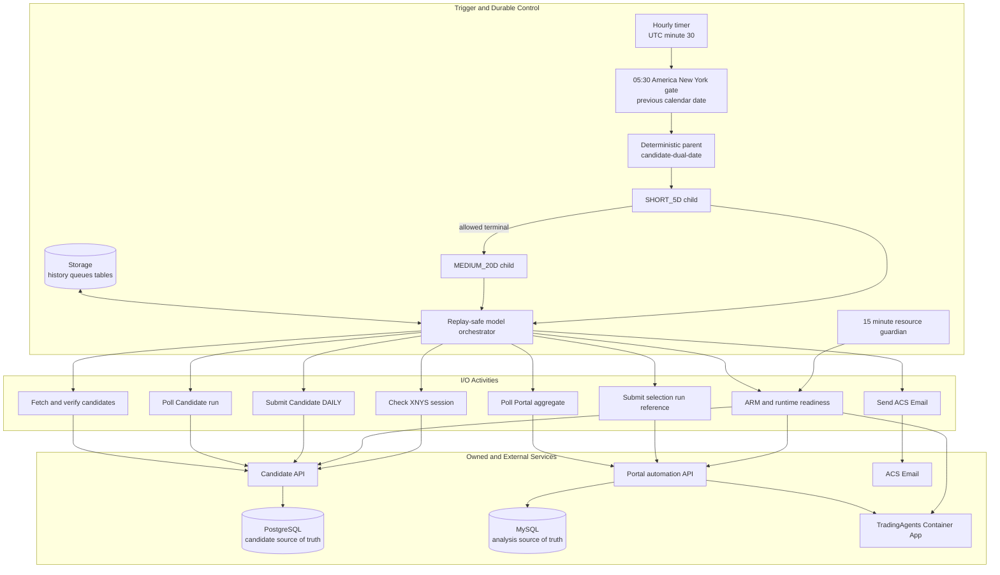
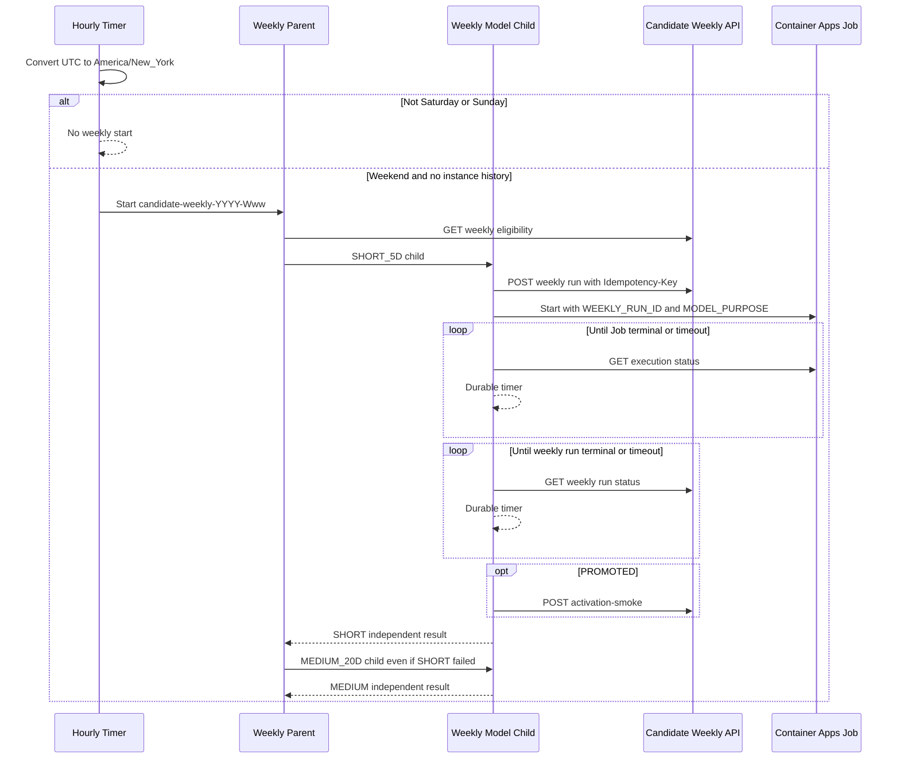
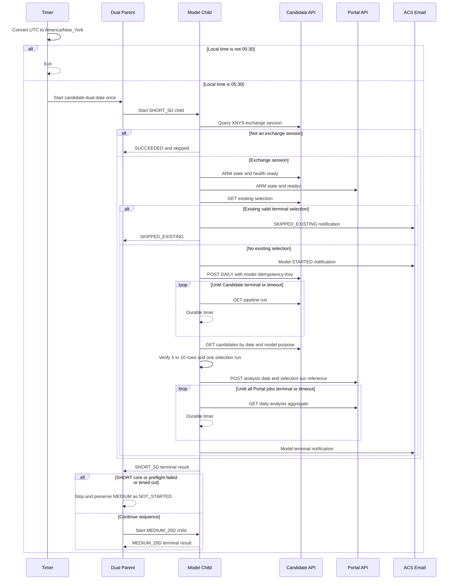
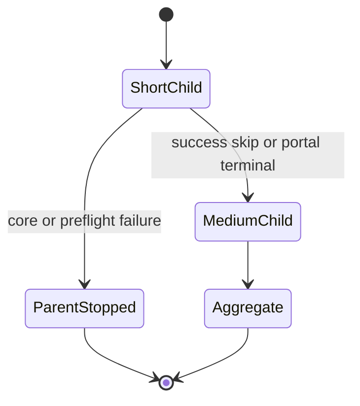

# Durable Functions 오케스트레이터 아키텍처

갱신일: 2026-10-16

이 문서는 Candidate Engine의 일일 실행과 외부 분석 시스템 전달을 조정하는
`orchestrator/`의 기준 설계다. 오케스트레이터는 수집·전처리·모델 점수·후보 선정
알고리즘을 소유하지 않는다. Candidate API를 통해 해당 파이프라인을 시작하고 검증된
selection run을 외부 Portal에 전달하는 control plane이다.

Linux FC1과 private Storage Durable backend는 기존 일일 배포 기준선이다. 주간 API
client, New York 주말 gate, deterministic weekly parent/model, Container Apps Job
start/status와 독립 model 결과는 구현되고 focused test로 검증됐다. 주간 코드는 아직
Azure에 배포되지 않았고 실제 API·Job·RBAC·KQL E2E 증거도 없다.

## 책임과 경계

| 영역 | 오케스트레이터 책임 | 비책임 |
|---|---|---|
| 일정 | 05:30 ET gate, 날짜별 dual 부모와 모델별 child | 거래 세션 원장 생성 |
| 주간 일정 | New York 주말 hourly gate, ISO week parent와 모델별 child | XNYS 원장·manifest 생성 |
| 주간 학습 조정 | weekly API 접수·상태, Container Apps Job start/status, activation smoke | 학습·promotion·active pointer 계산 |
| guardian | 15분마다 readiness와 승인된 제한 복구 | pipeline 시작·terminal 재실행 |
| 사전 점검 | Candidate·Portal ARM/runtime readiness, TradingAgents readiness | SKU·firewall·secret 변경 |
| Candidate 실행 | 멱등 DAILY 접수, 상태 polling, 후보 계약 검증 | 수집·특징·모델·선정 계산 |
| Portal 전달 | selection run 참조 일괄 제출, 집계 polling | 후보 row 복제, 분석 실행·저장 |
| 상태·알림 | Durable state, terminal summary, ACS Email, Azure Monitor | Candidate/Portal 업무 데이터 저장 |

Candidate 결과의 단일 원본은 PostgreSQL이고, 외부 분석 job·결과의 단일 원본은 Portal
MySQL이다. 오케스트레이터 Storage에는 Durable 실행 이력과 task state만 저장한다.

## 논리 컴포넌트

`dual_model_parent`와 `daily_orchestrator`에는 네트워크 호출, 현재 시스템 시각 조회,
random ID 생성과 직접
로깅을 두지 않는다. 외부 I/O는 activity에 격리하고 대기에는 durable timer를 사용해
history replay가 외부 요청을 반복하지 않도록 한다.

## 주간 재학습 제어 흐름

ID는 `candidate-weekly-{YYYY-Www}`와
`candidate-weekly-{YYYY-Www}-{SHORT_5D|MEDIUM_20D}`로 결정적이다. 주말의 첫 hourly
tick이 parent를 만들며 completed history도 재시작하지 않는다. 두 모델은 계산 자원
때문에 순차 실행하지만 성공 조건은 독립적이다. SHORT 실패·timeout은 MEDIUM을
차단하지 않는다.

Job/promotion 제한 시간에는 child가 `TIMED_OUT`으로 끝나며 orchestrator가 assignment를
변경하지 않는다. active assignment는 Candidate PostgreSQL이 소유하므로 기존 incumbent가
유지된다. Job override의 업무 입력은 `weekly_run_id`, `model_purpose`에 대응하는 두 env
값뿐이며 secret·DB 설정은 기존 runtime environment 계약에서 가져온다.

## 일일 제어 흐름

타이머는 UTC 기준 매시 30분 실행되지만 `America/New_York` 변환 결과가 정확히
05:30일 때만 진행한다. 대상일은 현지 직전 달력 날짜이며, Candidate의 XNYS session
조회 결과가 비거래일이면 외부 분석을 시작하지 않는다. 이 구조는 DST 전환과 주말·휴장
판정을 서로 분리한다.

별도 `resource_guardian_timer`는 15분마다 readiness와 승인된 start/replica/private
Storage 복구를 수행한다. guardian은 부모 orchestration을 시작하지 않는다.

## 상태 모델

Candidate의 `PARTIAL_SUCCESS`는 terminal 상태지만 성공으로 간주하지 않는다. Candidate
단계는 `SUCCEEDED`만 다음 단계로 진행한다. Portal의 `completed` job도 `has_result=true`
여야 성공으로 집계한다. 비거래일은 `SUCCEEDED`, `skipped=true`,
`reason=not_exchange_session`으로 구분한다.

각 model child 내부 상태는 session check, preflight, Candidate polling, 후보 검증,
Portal polling 순서다. terminal 상태는 `SUCCEEDED`, `SKIPPED_EXISTING`,
`PARTIAL_FAILED`, `TIMED_OUT`, `FAILED`다.

부모는 `SHORT_5D`의 core·Candidate·preflight `FAILED` 또는 `TIMED_OUT`에서
`MEDIUM_20D`를 `NOT_STARTED`로 보존하고 중단한다. SHORT의 Portal 단계 실패·timeout,
`PARTIAL_FAILED`, `SKIPPED_EXISTING`에서는 MEDIUM을 계속한다. 부모 최종 상태는 두
child 결과 중 `FAILED`, `TIMED_OUT`, `PARTIAL_FAILED` 우선순위로 집계한다.

## 멱등성과 재실행

세 계층이 중복 실행을 막는다.

1. Timer starter는 `candidate-dual-YYYY-MM-DD` parent가 이미 있으면 새 instance를
   시작하지 않는다.
2. 각 child ID는 `candidate-daily-YYYY-MM-DD-{model_purpose}`다.
3. Candidate 제출 전에 날짜·모델이 정확히 일치하는 완전한 terminal selection을
   검사한다. 존재하면 `SKIPPED_EXISTING`이며 Candidate POST와 Portal batch를 생략한다.
4. Candidate 제출은 모델 목적을 포함한 날짜 기반 `Idempotency-Key`를 사용한다.
   같은 key와 canonical payload는 기존 `process_run_id`를 반환하고 다른 payload는
   `409`로 거부한다.
5. Portal에는 후보별 요청을 반복하지 않고 하나의 `selection_run_id`를 한 번 제출한다.
   이후에는 반환된 `daily_analysis_id`의 집계만 조회한다.

운영자가 같은 날짜를 다시 처리해야 한다면 기존 Durable instance와 Candidate
idempotency record를 함께 고려한 명시적 재실행 절차가 필요하다. 모델 목적을 바꿔 같은
key를 재사용하는 방식은 payload 충돌이므로 허용하지 않는다.

주간 flow는 별도로 Durable weekly parent/model deterministic ID와 Candidate
`weekly_training_run` row를 사용한다. 같은 week/purpose/policy/manifest 접수는 DB
unique key가 소유하며 Durable state 자체를 업무 acceptance 원장으로 사용하지 않는다.

## 외부 계약과 검증

| 대상 | 인증 | 요청·검증 |
|---|---|---|
| Candidate API | `X-API-Key` | session 조회, readiness, DAILY 접수, run polling, candidate 조회 |
| Candidate weekly API | `X-API-Key`, POST `Idempotency-Key` | eligibility, weekly 접수·상태, activation smoke |
| Candidate training Job | 관리 ID·`DefaultAzureCredential` | manual Job start와 execution status |
| Azure Resource Manager | 관리 ID·`DefaultAzureCredential` | Candidate·Portal App Service가 `RUNNING`인지 확인 |
| Portal API | `Authorization: Bearer` | selection run 일괄 접수와 `daily_analysis_id` 집계 조회 |
| TradingAgents | 서비스 readiness endpoint | `/readyz`의 `status=ready` 확인 |
| ACS Email | 관리 ID·Email Sender RBAC | 시작과 terminal summary 전송 |

모든 외부 URL은 credential·query·fragment가 없는 HTTPS base URL이어야 한다. HTTP
redirect를 따르지 않고 JSON object만 허용하며 응답은 최대 2 MiB로 제한한다. Candidate
후보는 다음을 모두 만족해야 Portal로 전달된다.

- `price_session_date`가 대상일과 일치
- 설정된 `model_purpose`와 일치
- 5~10개이며 `selected_count`와 실제 개수가 일치
- position이 1부터 연속이고 ticker·instrument가 중복되지 않음
- 모든 row가 하나의 `selection_run_id`에 속함
- selection status가 `SUCCEEDED` 또는 명시적 `SHORTFALL`

Candidate API의 기본 조회 모델은 `MEDIUM_20D`다. 일일 부모는 `SHORT_5D` 다음
`MEDIUM_20D`를 독립 실행한다. 인증된 단일 모델 endpoint는 one-off 진단 경로이며
모델 간 자동 fallback은 없다.

## Azure 배포 토폴로지

`infra/orchestrator.bicep`이 소유하는 리소스는 다음과 같다.

- Linux Flex Consumption FC1 Function App과 system-assigned managed identity
- Durable state와 배포 package용 Storage Account·Blob container
- Key Vault와 secret reference, Application Insights·Log Analytics
- Azure Communication Services, Email Service와 Azure Managed Domain
- exception·failed request metric alert와 기존 Action Group 연결
- Storage Blob/Queue/Table, Key Vault secrets, App Insights publisher, Email Sender RBAC

Candidate·Portal App Service, TradingAgents Container App, PostgreSQL, Portal MySQL과 기존
Action Group은 템플릿의 소유 범위 밖이다. Function 관리 ID에는 Candidate·Portal
App Service 범위의 `Reader`를 별도로 부여한다. secret 값은 Bicep에 넣지 않고 배포 후
Key Vault에 주입한다.

배포된 Durable/FC1 Storage는 `publicNetworkAccess=Disabled`,
`defaultAction=Deny`, 공유 키·익명 Blob 차단을 유지한다. Function은 West US 3
FC1 위임 subnet에 통합되고 Blob·Queue·Table private endpoint와 private DNS link를
통해 관리 ID로 Storage data plane에 접근한다. preflight는 public access를 열지 않고
private 연결 실패 시 fail closed한다. Durable Task Scheduler는 사용하지 않는다.

## 관측성과 실패 처리

- Application Insights와 Log Analytics가 Function request·exception telemetry를 받는다.
- exception count와 failed request count가 5분 창에서 0보다 크면 기존 Action Group으로
  alert를 보낸다.
- Candidate 기본 timeout은 120분, Portal 기본 timeout은 360분, poll 간격은 60초다.
- Email 실패는 업무 terminal state를 덮어쓰지 않으며 `sent=false`와 오류 타입만
  반환한다.
- 예외 메시지, secret, API 원문 payload를 terminal summary에 포함하지 않는다.
- allowlist JSON trace는 `emit_pipeline_telemetry` activity에서 기록한다.
  `pipeline.parent.*`, `pipeline.model.*`, `pipeline.model.skipped_existing`,
  `pipeline.guardian.*`, `pipeline.email.terminal`을 날짜·부모·child·업무 ID로
  correlation한다. 운영 query는 [telemetry KQL runbook](orchestrator-telemetry-runbook.md)을
  따른다.
- telemetry allowlist는 `iso_week`, `weekly_run_id`, `job_execution_name`을 허용하되
  secret, resource ID, raw payload와 예외 메시지를 계속 제외한다. weekly lifecycle에서
  emitter activity를 예약하는 연결과 Azure 수집 검증은 아직 완료되지 않았으므로
  weekly KQL의 빈 결과를 정상 실행 증거로 간주하지 않는다.

## 구현 매핑

| 구현 | 역할 |
|---|---|
| `orchestrator/function_app.py` | hourly daily/weekly gate, 15분 guardian, parent/child와 activity 등록 |
| `orchestrator/scheduler.py` | DST-aware 05:30·New York 주말 gate와 deterministic ID |
| `orchestrator/workflow.py` | 일일·주간 SHORT 후 MEDIUM 순차 parent와 replay-safe child |
| `orchestrator/clients.py` | Candidate·weekly·Portal·Job ARM·ACS 외부 계약과 검증 |
| `orchestrator/guardian.py` | 15분 readiness·제한 복구와 실패 알림 |
| `orchestrator/telemetry.py` | allowlist 구조화 trace |
| `orchestrator/settings.py` | 환경 설정과 HTTPS/resource ID fail-closed 검증 |
| `infra/orchestrator.bicep` | FC1, state, identity, secrets, telemetry, email, alerts |
| `tests/orchestrator/` | 일일·주간 순서, gate, guardian, 중복 skip, Email·telemetry 계약 검증 |

상위 시스템 경계는 [프로젝트 전체 아키텍처](architecture-diagram.md), 실제 실행·배포
방법은 [오케스트레이터 README](../../../../../orchestrator/README.md)를 따른다.