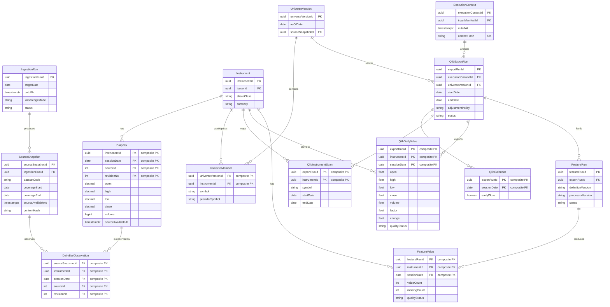

# Qlib Historical Data Schema and Readiness Review

이 문서는 PostgreSQL에 적재된 historical reconstruction 데이터를 Qlib 특징 계산과 모델 학습에 사용하기 위한 현재 스키마, export 계약, 품질 기준을 정의한다. 현재 물리 테이블과 아직 구현되지 않은 Qlib 파생 스키마를 명확히 구분한다.

## Current Dataset

검토 시점의 적재 범위는 2025-10-09~2026-10-08이다. 본 실행 123일과 manual retry 1일을 포함해 전체 251개 XNYS 세션이 적재됐다.

| Metric | Current value | Qlib assessment |
|---|---:|---|
| Trading sessions | 251 | 1년 prototype 가능, 본 학습 기간으로는 짧음 |
| Logical Massive bars | 126,233 | 일봉 횡단면 입력으로 사용 가능 |
| Expected Massive bars | 126,237 | provider 원본 결측 4건 |
| Average daily coverage | 99.9968% | 양호 |
| Minimum daily coverage | 99.6024% | 양호, 결측 사유 보존 필요 |
| Bars with VWAP and adjustment status | 125,730 | 503 rows 보완 필요 |
| SPY benchmark sessions | 250/251 | 1 session 보완 필요 |
| Distinct observed instruments | 540 | ticker와 구성 변경을 포함하므로 span 필요 |
| Median sessions per instrument | 251 | 양호 |
| Minimum sessions per instrument | 1 | 신규·변경 instrument warm-up 제외 필요 |
| Missing adjusted close | 126,233, 100% | unadjusted 원천임을 명시, 학습 전 adjustment factor 필수 |
| Zero-volume rows | 0 | 양호 |
| Raw returns over 20% | 64 | split·ticker change·outlier 검토 필요 |
| Maximum absolute raw return | 400.68% | raw close를 그대로 특징 계산에 사용하면 안 됨 |
| Temporal violations | 0 | 통과 |
| Duplicate semantic revisions | 0 | OHLCV·VWAP·adjustment status 기준 통과 |
| Wikipedia universe versions | 86, 501~503 members | 공식 historical membership가 아니므로 생존편향 존재 |

## Qlib Suitability Verdict

### Suitable now

- source cutoff가 보존된 일별 OHLCV 조회
- provider 간 값 비교와 수집 품질 검증
- adjustment와 universe 문제에 민감하지 않은 파이프라인 smoke test
- Alpha158 handler의 컬럼·shape·결측 처리 검증
- SEC·news·corporate action을 이용한 별도 event feature 실험

### Not suitable yet

- raw close 기반 Alpha158 전체 특징 학습
- total-return label과 split 전후 수익률 학습
- 생존편향 없는 S&P 500 historical model training
- 신뢰 가능한 train/validation/test 분할을 요구하는 LightGBM 성능 평가
- benchmark 필수 차감 label. 현재 v2는 개별 종목 raw 5-session return을 사용하고 SPY는 optional 평가 series로 분리함

### Required gates before model training

| Gate | Required condition | Current |
|---|---|---|
| Price adjustment | split·dividend factor가 모든 bar에 결정적으로 적용됨 | 미구현 |
| Point-in-time universe | 날짜별 공식 편입·편출과 ticker 유효기간 | Wikipedia reconstruction |
| Calendar | 버전이 고정된 XNYS session·early-close dataset | 라이브러리 계산만 사용 |
| History length | 최소 3년 권장, 1년은 smoke·prototype 전용 | 1년 완료 |
| Feature warm-up | 최소 60 session 이전 행 제외 | 정책 미구현 |
| Labels | 미래 가격을 입력 특징에서 격리하고 purge·embargo 적용 | 미구현 |
| Missingness | 일자 coverage 99% 이상, 결측 사유 코드 보존 | 통과 |
| Temporal integrity | 모든 source availability가 run cutoff 이하 | 통과 |
| Duplicate integrity | logical payload 중복 revision 0 | 통과 |
| Outliers | adjustment 후 20% 초과 수익률 검토·flag | raw 기준 64건 |

## Current Physical Historical Schema

| Schema.table | Historical role | Important columns | Qlib use |
|---|---|---|---|
| `ops.ingestion_run` | 날짜별 지식 cutoff | `target_date`, `cutoff_at`, `knowledge_mode`, `status` | export 기준 시점 |
| `ops.source_snapshot` | 원본·파생 snapshot lineage | `dataset_code`, `coverage_start`, `coverage_end`, `source_available_at`, `content_hash` | 재현 가능한 원천 |
| `ops.input_manifest` | 실행 입력 집합 | `input_manifest_id`, `manifest_hash` | export input identity |
| `ops.execution_context` | cutoff·코드·config identity | `execution_context_id`, `cutoff_at`, `context_hash` | feature run identity |
| `ref.instrument` | 증권 identity | `instrument_id`, `issuer_id`, `share_class`, `currency` | Qlib instrument key |
| `ref.instrument_identifier` | ticker 유효기간 | `id_type`, `id_value`, `valid_from`, `valid_to`, `revision_no` | symbol export |
| `ref.universe_version` | 구성 snapshot | `universe_version_id`, `as_of_date`, `source_snapshot_id` | instrument span 입력 |
| `ref.universe_member` | version별 증권 구성 | `universe_version_id`, `instrument_id`, `symbol`, `provider_symbol` | 종목군 |
| `market.daily_bar` | revisioned OHLCV·VWAP | `instrument_id`, `session_date`, `source_id`, `revision_no`, OHLCV, `vwap`, adjustment status, `source_available_at` | Qlib raw field |
| `market.benchmark_daily_bar` | revisioned SPY benchmark | `benchmark_code`, `session_date`, OHLCV, `vwap`, `return_basis` | 상대수익 평가 |
| `market.daily_bar_observation` | snapshot별 bar 관찰 | snapshot·bar composite key, `observed_at` | cutoff-safe revision 선택 |
| `market.corporate_action` | 배당·분할 revision | `action_type`, `effective_date`, `cash_amount`, `split_from`, `split_to`, `source_available_at` | adjustment factor |
| `event.event_revision` | news·earnings revision | `published_at`, `scheduled_at`, `source_available_at`, `payload_hash` | optional event feature |
| `fundamental.sec_filing` | filing availability | `(issuer_id, accession_no)`, `accepted_at`, `form_type` | fundamental cutoff |
| `fundamental.fact` | normalized SEC fact | `concept`, `period_start`, `period_end`, `value_numeric`, `source_available_at` | optional fundamental feature |

## Target Qlib Export Schema

아래 `analytics.qlib_*` 엔터티는 목표 계약이며 현재 DB에 생성되지 않았다.

| Entity | Key | Required fields | Purpose |
|---|---|---|---|
| `qlib_export_run` | `export_run_id` | execution context, universe version, range, adjustment policy, Qlib/exporter version, status | 재현 가능한 export |
| `qlib_calendar` | `(export_run_id, session_date)` | session date, open/close, early-close flag | `calendars/day.txt` |
| `qlib_instrument_span` | `(export_run_id, instrument_id)` | symbol, start date, end date, membership source | `instruments/all.txt` |
| `qlib_daily_value` | `(export_run_id, instrument_id, session_date)` | adjusted OHLCV, factor, change, quality status | Qlib feature binaries |
| `feature_run` | `feature_run_id` | export run, definition version, processor version, stage, code hash | Alpha158 계산 실행 |
| `feature_value` | `(feature_run_id, instrument_id)` | session date와 158-value array 또는 columnar artifact URI | 계산 결과 |
| `label_run` | `label_run_id` | label definition, horizon, entry/exit rule, purge policy | label 실행 |
| `daily_label` | `(label_run_id, instrument_id, anchor_session_date)` | value, entry/exit dates, quality status | supervised target |

## Qlib Field Contract

| Qlib field | Source | Transformation |
|---|---|---|
| `$open` | `market.daily_bar.open` | `raw_open * factor` |
| `$high` | `market.daily_bar.high` | `raw_high * factor` |
| `$low` | `market.daily_bar.low` | `raw_low * factor` |
| `$close` | `market.daily_bar.close` | `raw_close * factor` |
| `$volume` | `market.daily_bar.volume` | split policy에 따라 inverse factor 적용 여부를 고정 |
| `$factor` | corporate action chain | 기준일 1.0인 누적 factor |
| `$change` | adjusted close | 이전 유효 session 대비 수익률 |
| calendar | versioned XNYS calendar | 휴장일 제외, early close 보존 |
| instruments | point-in-time universe | ticker valid span과 membership span의 교집합 |

원시 가격과 조정 가격을 덮어쓰지 않는다. factor 계산 결과는 adjustment policy version과 corporate-action manifest를 참조해야 한다.

## Qlib Storage Layout

PostgreSQL export 결과는 Qlib binary dataset으로 변환한다.

```text
qlib_data/
├── calendars/day.txt
├── instruments/all.txt
└── features/
    └── <symbol>/
        ├── open.day.bin
        ├── high.day.bin
        ├── low.day.bin
        ├── close.day.bin
        ├── volume.day.bin
        ├── factor.day.bin
        └── change.day.bin
```

각 artifact는 `export_run_id`, row count, minimum/maximum session, schema hash, content hash를 manifest에 기록한다.

## Entity Relationships

<!-- mermaid-checked: every attribute is `<type> <name> [<key>] ["<description>"]` with at most one of PK/FK/UK, no \n in descriptions, no {} in descriptions, every relationship label is double-quoted -->


## Data Volume for One Year

실제 1년 데이터는 251개 session, 540개 관찰 instrument, 126,233개 logical bar다. 날짜별 reconstructed universe 합계는 126,237개였고 provider 원본 결측은 4건이다.

Alpha158을 EAV로 저장하지 않는다. 약 500종목, 251 session, 158 feature이면 약 2천만 scalar value이므로 columnar artifact 또는 고정 길이 array를 사용한다.

## Final Review Rule

1년 데이터는 pipeline과 feature engineering 검증에는 충분하지만, 운영 모델의 train/validation/test와 시장 regime 다양성을 위해서는 최소 3년, 권장 5년을 확보한다. 모델 학습 전에는 corporate action factor, 공식 point-in-time universe, versioned calendar, benchmark 결측 1건, VWAP·상태 결측 503건, purge·embargo label 정책을 해결해야 한다.
