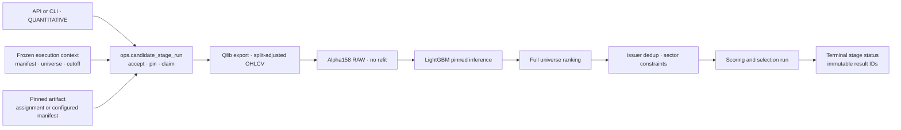

# 정량 후보 파이프라인 아키텍처·상세 설계

기준: [공통 하네스](../../../../../PROJECT-HARNESS.md).
이 문서는 후보 점수·선정까지의 정량 경로다. 외부 agent 분석과 주문은 포함하지 않는다.
전체 연결은 [전체 아키텍처](./architecture-diagram.md), 다른 분기는
[LLM](./llm-pipeline-architecture.md)과 [Fusion](./fusion-pipeline-architecture.md)을 따른다.

## 1. 현행 점검과 구현 목표

기존 Backend의 `run_candidate_inference`는 고정 artifact 추론을 수행한다.
반면 레거시 `train-model`, `score-date`, `select-date`, `run-candidates` CLI는
동일 학습 workflow로 연결돼 추론 전용 실행과 혼동하기 쉽다.
기존 CLI 의미를 바꾸지 않고 독립 stage 실행을 추가한다.

구현 순서는 현행 점검 → 이 설계 문서 확정 → 구현·검증 → 배포다.
설계 목표와 실제 배포 검증은 문서 마지막의 검증·배포 기록으로 구분한다.

## 2. 아키텍처

LLM 설정·Azure OpenAI 인증·Fusion·외부 제출을 호출하지 않는다.
일일 DAG는 공통 context 준비 뒤 동일 정량 추론 로직을 계속 사용한다.
독립 API는 수집·학습·processor fit·주간 승격을 시작하지 않는다.

## 3. 입력·출력 계약

- `stage=QUANTITATIVE`, `target_session`, `execution_context_id`는 필수다.
- `model_purpose`는 `MEDIUM_20D` 기본값, 명시적 `SHORT_5D`도 지원한다.
- context cutoff는 대상 session의 versioned 의사결정 시각과 일치해야 한다.
- 유효하지 않은 거래일, 알 수 없는 context·끊긴 manifest는 실행 전에 거절한다.
- artifact는 수락 시 active assignment 또는 명시적으로 설정된 manifest에 고정한다.
  실행·재시도 중 최신 assignment를 다시 골라 모델을 바꾸지 않는다.
- 결과는 `selection_run_id`, `scoring_run_id`, `model_version_id`, 후보 수,
  context·model purpose를 포함한다. stage run ID는 selection run ID와 별개다.
- 정량 기존 API `/api/v1/candidates`와 점수 의미는 바뀌지 않는다.

## 4. 파라미터와 설계 근거

설정 원본:
[feature](../../../../../config/analytics/feature_alpha158_v1.yaml),
[MEDIUM model](../../../../../config/analytics/model_lightgbm_20d_v1.yaml),
[MEDIUM selection](../../../../../config/analytics/selection_medium_20d_v1.yaml).

| 구분 | 값 | 설계 방법·의미 |
|---|---|---|
| 특징 | Alpha158 RAW 158차원 | 학습·추론 feature 이름·순서·차원과 hash 대조 |
| 최대 lookback | 60 sessions | calendar에서 계산, 결측 forward fill 금지 |
| MEDIUM label | D+20 close / D+1 open - 1 | 조정가격 raw 개별 종목 수익률 |
| SHORT label | D+5 close / D+1 open - 1 | 별도 purpose·artifact·label 유지 |
| learning rate | 0.03 | 기존 versioned 학습 설정 유지, 일일 추론에서 튜닝하지 않음 |
| leaves / depth | 31 / 6 | 모델 복잡도 제한 |
| min leaf samples | 20 | 과도한 작은 잎 방지 |
| feature / bagging fraction | 0.8 / 0.8 | 기존 학습 sampling 설정, 추론에는 적용하지 않음 |
| bagging frequency | 1 | 기존 boosting sampling 주기 유지 |
| L1 / L2 | 0.1 / 1.0 | 기존 정규화 |
| rounds / early stopping | 300 / 30 | 주간 학습에만 사용 |
| seed | 42 | 학습 재현 설정과 artifact hash 보존 |
| training threads | 4 | 학습 리소스 설정, 고정 일일 추론은 1 thread |
| deterministic / force_col_wise | true / true | 학습 계산 경로 재현 설정 |
| MEDIUM 수량 | 정확히 20 | 양수 예측만 요구하지 않음 |
| sector cap | 2 → 부족 시 4 | soft 완화 한 번, hard gate는 불변 |
| 정렬 | score DESC, instrument_id ASC | 전체 순위와 최종 position 구분 |
| 레거시 SHORT | 5~10 | 수량·API·외부 계약 보존 |

walk-forward는 최소 train 100, validation 40, test 40, step 20 sessions와
label exit purge를 유지한다. 초기 설정을 최적값으로 주장하지 않는다.
변경 실험은 별도 config/model version과 같은 cutoff·universe·비용의 out-of-sample
비교로 검증한다. SPY는 optional 비교값이고 모델 필수 입력이 아니다.
평가는 Top5/10, round-trip 비용10bps, MEDIUM 중첩 cohort allocation0.05를 유지한다.
후보20개 수량 계약이 Top20 성능의 검증 완료를 의미하지는 않는다.

## 5. 독립 실행·상태·재시도

- `POST /api/v1/candidate-stage-runs`: `X-API-Key`, `Idempotency-Key` 필수.
- `GET /api/v1/candidate-stage-runs/{id}`: 실행 상태·계약 hash·결과 ID 조회.
- `POST /api/v1/candidate-stage-runs/{id}/retry`: 실패·SHORTFALL만 새 시도 ID로 재시도.
- CLI: `candidate-engine run-stage --stage QUANTITATIVE --date ... --execution-context-id ...`
  및 `show-stage`, `retry-stage`.
- 동일 key·동일 요청은 기존 stage를 재사용한다. 같은 key의 다른 요청은 409다.
- `PENDING → RUNNING → SUCCEEDED|SHORTFALL|FAILED`.
  API 재시작으로 중단된 요청은 `FAILED/INTERRUPTED`로 남기고 자동 성공·무한 재시도하지 않는다.
- 재시도는 원래 context·artifact·policy hash를 유지한다. 설정이 바뀌었으면 새 요청이 필요하다.
- 같은 입력의 동시 stage 실행은 잠금·DB 제약으로 차단한다.
- 수집·일일 실행과 독립 stage는 공통 수락 잠금으로 충돌을 막는다.
  Quant/LLM 독립 분기는 병렬 실행할 수 있지만 같은 context의 Qlib export는 잠금으로 직렬화한다.
- 실패해도 기존 scoring·selection·다른 branch의 결과는 삭제하지 않는다.

API의 BackgroundTasks는 영속 큐가 아니다. process 중단은 명시적 실패·재시도 계약으로
처리하며 오래 실행될 수 있다는 제한을 숨기지 않는다.
독립 CLI 실행은 API 재시작 복구 대상과 분리한다.

## 6. 검증·배포

최소 검증: 모델 hash·purpose·context 불일치, 미래 학습 데이터, 특징 순서·차원,
거래일·가격 gate, rank 결정성, 20개/SHORT 수량, 원자 저장, 동일 key 충돌,
동시 claim, API 재시작과 retry lineage, LLM 비호출.

새 stage schema migration과 앱 최소 권한을 먼저 적용하고 Backend를 배포한다.
기존 일일 DAG·외부 분석 worker·UI·SKU·네트워크는 변경하지 않는다.
운영 실행 승인과 데이터·LLM 호출을 분리하며 검증에는 기본 mock을 사용한다.

## 7. 구현·검증 증거

공통 stage schema·API/CLI와 고정 artifact 추론 연결을 구현했다.
전체 테스트533건, 신규 stage 모듈 타입 검사·Ruff와 격리 PostgreSQL의24개 migration,
상태 전이·멱등성·retry·중단 복구·terminal 보호가 통과했다.
운영 결과는 [운영 점검·배포 증거](../../../../../DAILY-PIPELINE-RUNBOOK.md)에서 로컬 검증과 구분한다.
