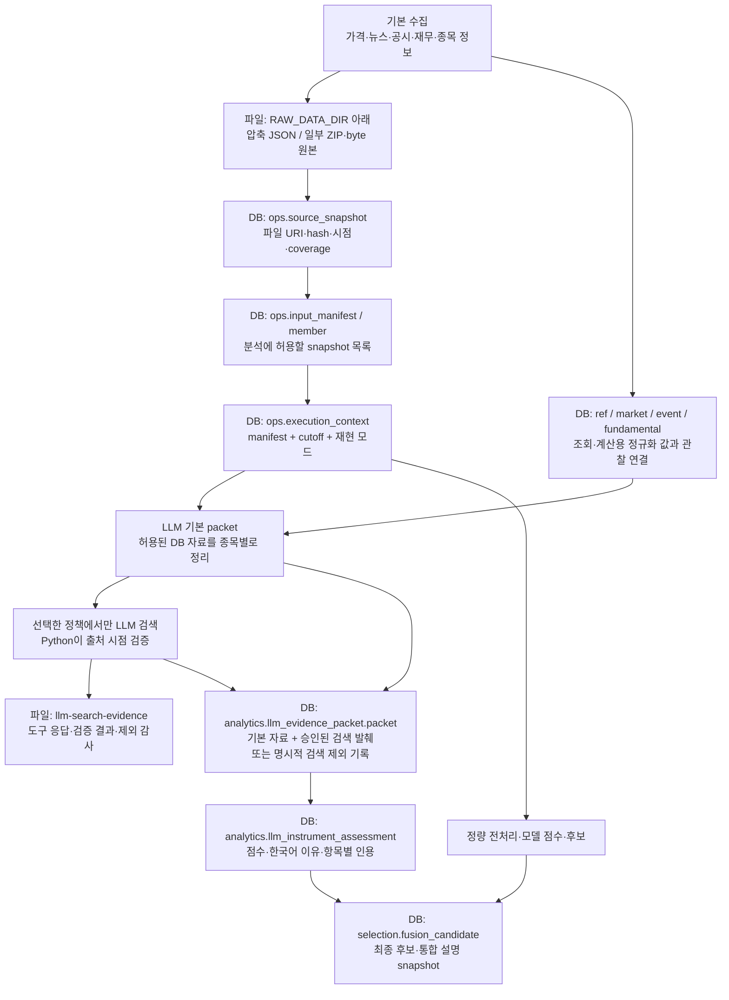

# 매니페스트·스냅샷과 데이터 저장 위치 쉬운 설명

작성일: 2026-10-18. 현재 저장소 코드와 SQL 기준 설명이다.
운영 설정은 같은 날 Candidate App Service에서 필요한 비밀 아닌 항목만 읽어 확인했다.
이 문서를 작성하면서 데이터를 새로 수집하거나 LLM을 호출하거나 DB에 적재하지 않았다.

## 1. 먼저 세 문장으로 이해하기

1. **스냅샷(snapshot)**은 “수집한 자료의 특정 버전을 보관한 것”이다.
2. **매니페스트(manifest)**는 “이번 분석에 사용해도 되는 스냅샷들의 확정 목록”이다.
3. **실행 컨텍스트(execution context)**는 그 목록에 “언제까지 알려진 정보를 쓸지, 어떤 코드·설정으로 분석할지”를 묶은 실행 기준이다.

도서관에 비유하면 다음과 같다.

| 프로젝트 용어 | 쉬운 비유 | 실제 역할 |
|---|---|---|
| 원본 파일 | 보관 중인 책의 특정 판본 | 실제 데이터 내용 보존 |
| 원천 스냅샷 | 그 판본의 도서 카드 | 파일 위치·내용 hash·공개/수집 시각 기록 |
| 입력 매니페스트 | 이번 과제에서 사용할 수 있는 책 목록 | 허용된 스냅샷 고정 |
| 실행 컨텍스트 | 과제의 기준일·규칙이 적힌 표지 | 매니페스트·cutoff·재현 모드·코드/설정 버전 연결 |
| LLM evidence packet | 허용된 책에서 뽑은 종목별 자료집 | 평가 모델에 제공한 구체적 입력 내용 보존 |
| 평가 결과 | 자료집을 보고 쓴 답안 | 점수·이유·불확실성·인용 기록 |

**매니페스트가 데이터 본문을 담는 것은 아니다.** 본문은 원본 파일과 DB 행에 있고,
매니페스트는 이번 분석에서 접근 가능한 버전을 지정한다.

## 2. 전체 저장 구조 한눈에 보기



그림에서 검색은 **항상 실행되는 단계가 아니다**. DB-only 정책은 검색을 거치지 않는다.
검색 보강을 선택한 실행도 검증에 실패한 내용까지 평가 입력에 넣지는 않는다.

## 3. 처음 수집한 데이터는 어디에 저장되나?

### 3.1 첫 번째: 수집 원본 파일

기본 JSON 수집은 [RawSnapshotWriter](src/sp500_candidate_engine/raw_store.py)가 저장한다.

| 구분 | 저장 위치 |
|---|---|
| 로컬 기본값 | 저장소 루트에서 실행하면 `data\raw` |
| 환경변수로 지정한 경우 | `RAW_DATA_DIR`의 값 |
| 현재 운영 Candidate 앱 설정 | `/home/candidate-engine/data/raw` |
| 기본 파일명 규칙 | `<RAW_DATA_DIR>\<대상 날짜>\<dataset>-<SHA-256>.json.gz` |

상대 경로는 실행 프로세스의 현재 디렉터리를 기준으로 한다.
운영의 `/home/...`는 **Azure App Service 안의 Linux 경로**이며 사용자 PC의 폴더가 아니다.
로컬 파일과 운영 파일이 자동으로 서로 복사되는 구조도 아니다.

로컬 경로를 예시로 쓰면 다음과 같다. `<hash>`는 실제로는 긴 SHA-256 문자열이다.

```text
data\raw\2026-10-16\massive_grouped_daily-<hash>.json.gz
data\raw\2026-10-16\massive_news-<hash>.json.gz
data\raw\2026-10-16\sp500_universe-<hash>.json.gz
```

- `.json.gz`는 JSON을 gzip으로 압축한 파일이다.
- 파일의 날짜 폴더는 writer에 전달한 **대상 날짜**다. 모든 경우에 다운로드한 날짜라는 뜻은 아니다.
- 내용은 collector가 writer에 넘긴 JSON이다. 정렬·표현을 통일한 뒤 압축하므로
  네트워크에서 받은 HTTP 응답의 모든 byte·header를 그대로 보관한 것과는 다르다.
- 일부 payload는 정제되거나 backfill용으로 파생된 데이터다.
  따라서 파일 이름의 `raw`만 보고 “수집 전 원문 전체”라고 해석하면 안 된다.
- SEC 일괄 수집 등은 `write_bytes()`로 ZIP도 남긴다.
  예: `sec_submissions_bulk-<hash>.zip`, `sec_companyfacts_bulk-<hash>.zip`.

JSON 파일 이름의 hash는 **압축 전 canonical JSON**의 SHA-256이다.
따라서 `.json.gz` 파일 자체의 hash와 바로 비교하는 값은 아니다.
ZIP 등 byte 저장은 입력 byte의 hash를 사용한다.

이 writer는 **파일시스템에 저장**한다. raw 데이터가 자동으로 Azure Blob에 올라간다고
가정하면 안 된다. 운영 경로의 영속 저장·백업 상태는 별도로 확인해야 한다.
모델 artifact의 Blob 저장과도 다른 경로다.

### 3.2 두 번째: 원본 파일을 가리키는 DB 스냅샷 기록

DB의 `ops.source_snapshot`은 원본 파일을 찾고 버전을 확인하기 위한 카드다.

| 주요 항목 | 쉬운 의미 |
|---|---|
| `source_snapshot_id` | 이 스냅샷의 고유 번호 |
| `dataset_code` | 가격·뉴스 등 어떤 종류의 자료인지 |
| `storage_uri` | 원본 파일의 실제 주소 |
| `content_hash` | 데이터 내용의 지문 |
| `byte_size` | 저장된 파일 크기 |
| `coverage_start / coverage_end` | 어느 날짜 범위를 다루는지 |
| `source_available_at` | 원천 자료의 이용 가능 시점 |
| `fetched_at` | 시스템이 자료를 가져온 시점 |
| `snapshot_kind / parent_snapshot_id` | 전체본인지 변경분인지, 어떤 이전 버전에 연결되는지 |

현재 파일 writer는 `file:` URI를 만든다. `storage_uri`에 주소가 있다고 해서
DB 안에 압축 원본 파일 자체가 들어 있다는 뜻은 아니다.
운영 서버가 만든 `file:` 주소는 그 서버의 파일을 가리키므로 PC에서 바로 열 수 있는 웹 URL도 아니다.

**DB만 백업하고 raw 파일을 잃어버리면, 스냅샷 카드만 있고 원본 책은 없는 상태가 된다.**

### 3.3 세 번째: 조회·계산하기 편하게 정리한 DB 행

같은 수집 자료에서 필요한 값을 꺼내 PostgreSQL 테이블에도 저장한다.

| 자료 종류 | 주요 저장 테이블 |
|---|---|
| 기업·종목·유니버스·거래일 | `ref.issuer`, `ref.instrument`, `ref.universe_member`, `ref.exchange_session` 등 |
| 주가·거래량 | `market.daily_bar` |
| 분할·배당 | `market.corporate_action` |
| 기본 수집 뉴스·실적 일정 | `event.market_event`, `event.event_revision` |
| SEC 공시 정보 | `fundamental.sec_filing` |
| SEC 재무 수치 | `fundamental.fact` |

원본 파일은 수집 내용 확인용이고, DB 행은 검색·계산·분석용이다.
뉴스 DB에 제목·URL·metadata가 있다고 해서 모든 기사 본문이 보관된 것은 아니다.
SEC 공시 metadata와 실제 공시 본문도 구별해야 한다.

`*_observation` 테이블은 **이 DB 행 또는 revision을 어떤 스냅샷에서 관찰했는지** 연결한다.
동일한 사실을 다시 수집했다고 똑같은 내용의 revision을 무조건 늘리지는 않는다.
조회는 허용된 snapshot의 관찰 연결까지 확인한다.

실제 기본 수집 경로는 **원본 파일을 먼저 쓰고, 그 파일의 URI/hash와 정규화 값을 DB에 기록**한다.
파일 쓰기와 DB 적재 전체가 하나의 원자적 거래는 아니다.
따라서 파일이 존재해도 이후 DB 적재가 실패했거나 완료되지 않았을 수 있다.

## 4. 스냅샷은 왜 필요한가?

“10월 16일 자료”라는 말만으로는 어느 버전인지 알 수 없기 때문이다.

예를 들어 공급자가 같은 날짜의 거래량을 나중에 정정했다고 가정하자.

1. 처음 수집한 내용은 원본 파일 A와 스냅샷 A로 남는다.
2. 정정된 내용을 받으면 다른 hash의 파일 B와 해당 버전 기록으로 구분한다.
3. 같은 자연키·동일 내용은 기존 revision을 재사용하고, 내용 변경은 별도 revision으로 다룬다.
4. 과거 분석은 그 분석에 고정된 입력 목록을 따른다. 나중에 생긴 B를 자동으로 끼워 넣지 않는다.

**여기서 snapshot은 DB 전체 백업이나 Azure 디스크 snapshot을 뜻하지 않는다.**
분석 원천 데이터의 버전을 추적하기 위한 프로젝트 개념이다.

`FULL`은 해당 coverage의 전체본, `DELTA`는 이전 본에 이어지는 변경분이다.
DELTA만 임의로 읽지 않고 기준 FULL·부모 연결·우선순위를 검증한다.

## 5. 매니페스트는 어디에 있고 무엇을 고정하나?

### 5.1 DB 입력 매니페스트

| 테이블 | 역할 |
|---|---|
| `ops.input_manifest` | 입력 목록의 ID와 `manifest_hash` |
| `ops.input_manifest_member` | 목록에 포함된 `source_snapshot_id`, dataset, 우선순위·계보 역할 |

예를 들어 이번 분석의 목록이 아래와 같다고 생각하면 된다.

```text
입력 목록 M
  - 가격: 스냅샷 P
  - 종목 구성: 스냅샷 U
  - 기본 수집 뉴스: 스냅샷 N
  - 공시·재무: 스냅샷 F
```

실제 DB에는 이 목록이 두 테이블의 행으로 저장된다.
**정상 분석마다 `input-manifest.json`이라는 파일을 반드시 만드는 구조는 아니다.**
운영·과거 재구성 경로에 따라 한 dataset에 여러 snapshot이 들어갈 수도 있다.

`manifest_hash`는 고정한 목록의 식별·무결성 확인에 사용한다.
hash가 같다고 데이터가 시장의 진실이라는 뜻은 아니며, 어떤 내용을 고정했는지 확인하는 장치다.

### 5.2 실행 컨텍스트: 목록만으로 부족한 시간 규칙까지 묶기

`ops.execution_context`가 매니페스트에 다음 조건을 붙인다.

- `cutoff_at`: 이 시점까지 이용 가능한 정보만 쓴다는 경계.
- `knowledge_mode`: 당시 관찰 자료만 재생할지, 나중에 확보한 과거 자료로 재구성할지.
- `code_version / config_version`: 어떤 코드·설정 기준으로 실행했는지.
- `context_hash`: 이 실행 기준의 식별·무결성 확인.

DB에 cutoff 이전 날짜의 자료가 있어도 **매니페스트에 포함되지 않았으면 임의로 읽지 않는다.**
반대로 목록에 있어도 시점·관찰·계보 검증을 통과해야 실제 입력으로 사용할 수 있다.

| 모드 | 의미 |
|---|---|
| `OPERATIONAL_REPLAY` | cutoff 전에 공개됐고, 시스템도 cutoff까지 실제 관찰한 자료로 재생 |
| `HISTORICAL_RECONSTRUCTION` | 나중에 가져온 과거 자료로 재구성 가능. 이후 공개된 미래 사실을 허용하는 것은 아님 |

이 차이를 기록해야 “오늘 다시 계산한 과거 결과”를 “그날 실제로 만든 결과”와 혼동하지 않는다.

## 6. LLM으로 추가 보완한 정보는 어디에 저장되나?

**검색 원응답 파일, 승인된 입력 발췌, 모델의 평가 결과가 서로 다른 곳에 저장된다.**

### 6.1 검색 도구의 원응답·검증 증적: 별도 파일

기본 서비스가 검색 보강을 생성하는 경로는 다음을 사용한다.

```text
로컬 기본:
  data\raw\llm-search-evidence\<artifact hash>.json

운영 RAW_DATA_DIR 설정에서 계산되는 기본 경로:
  /home/candidate-engine/data/raw/llm-search-evidence/<artifact hash>.json
```

이 파일에는 상황에 따라 다음이 들어간다.

- 검색 도구 응답의 JSON, 모델이 생성한 검색 발췌와 제공된 URL 인용·tool trace.
- 검색 요청 hash, 검색 context 식별값, 실제 관찰 시각.
- 기간 검색의 `source_pages`: Python이 읽은 인용 페이지의 날짜 판정 결과.
- 검증 거부 시 `<artifact hash>.json.admission.json` 형태의 상태·이유 기록.
- 선택적 보강 정책에서 외부 자료를 제외한 경우 별도의 hash 기반 감사 JSON.

기간 검색에서 Python은 인용 페이지를 가져와 날짜를 읽지만,
**현재 이 경로는 가져온 HTML 본문 전체를 자동 보관하지 않는다.**
`source_pages`에 승인/거부·이유·날짜 라벨·정밀도·파서 버전 등을 남긴다.
따라서 이 JSON이 “인용 페이지의 완전한 과거 사본”은 아니다.

이 파일 저장은 기본 수집용 `ops.source_snapshot`을 새로 만드는 절차와 별개다.
검색 응답이 파일에 남았다는 사실만으로 평가 사용 승인을 의미하지도 않는다.

### 6.2 승인된 보강 내용: LLM 입력 packet의 JSONB

정상 LLM 서비스의 DB 저장 단계까지 완료되면 다음 위치에 남는다.

```text
analytics.llm_evidence_packet
  키: llm_ranking_run_id + instrument_id
  packet (JSONB)
    filings[*].search_evidence
    llm_search_manifest_hash
```

쉽게 말하면 **“이번 실행에서 이 종목을 평가할 때 사용한 자료집” 안에 검색 보강 부록을 붙이는 것**이다.
JSONB는 DB 한 컬럼 안에 구조화된 JSON을 넣어 보관하는 방식이다.

`search_evidence`에는 승인된 발췌(`facts`), URL, 날짜/정밀도, 취득 시각,
`tool_response_hash`, `evidence_hash`, 파일을 찾는 `artifact_key` 등이 들어간다.
`packet_hash`는 보강을 포함한 자료집 전체의 내용을 식별한다.

중요한 구분은 다음과 같다.

- **새 뉴스 원천 테이블에 보강 기사를 전부 적재하는 구조가 아니다.**
  기본 `event.event_revision`이나 `fundamental.fact`에 검색 요약을 사실 행으로 삽입하지 않는다.
- `filings[*]` 아래 보관된다고 그 뉴스가 SEC가 제출한 공시로 바뀌는 것도 아니다.
  기존 공시 entity와 연결하는 저장 구조이며, 기사 공개일과 연결 공시의 접수일은 별개다.
- 기존 `llm_evidence_link.source_snapshot_id`는 **DB 원천의 스냅샷**을 가리킨다.
  외부 뉴스 HTML 파일의 스냅샷 ID가 아니다.
- 검색 보강은 `source_layer=LLM_SEARCH_VERIFIED`와 `search_evidence_hash`로 구분한다.
  DB 자료 인용은 `DB_PACKET` 계층이다.
- `llm_search_manifest_hash`는 승인 검색 증거 목록의 hash다.
  **새 `ops.input_manifest` 행을 뜻하지 않으며, 기본 매니페스트를 덮어쓰지 않는다.**

### 6.3 검증을 통과하지 못한 보강 내용

미래 자료·날짜 미확인·당일 시각 부재 등의 거부 내용은 승인된 발췌로 넣지 않는다.

| 정책 | 승인된 외부 발췌가 없을 때 |
|---|---|
| 보강 필수 v4/v5 | 실행을 차단한다. 무보강 성공으로 바꾸지 않는다. |
| 명시적으로 선택한 선택적 보강 v6 | 검증 실패 자료를 평가에서 빼고, 제외 감사 기록 후 DB 비가격 자료로 평가할 수 있다. |

v6의 제외 표시는 packet의 `llm_search_omission`에 저장한다.
별도 감사 파일과 사유 코드, 외부 뉴스 미사용에 대한 정보 부족 표시를 연결한다.
artifact 변조·누락이나 인증·설정 오류까지 무조건 무시하는 것은 아니다.

### 6.4 평가 모델의 점수·설명: 별도 DB 테이블

| 저장 위치 | 저장하는 것 |
|---|---|
| `analytics.llm_instrument_assessment` | 점수·항목별 점수·한국어 이유·불확실성·항목별 인용·결측 사유 |
| `analytics.llm_call_attempt` | 평가 호출/재시도 상태·입출력 hash·토큰 수·`response_output` JSONB 등 |
| `selection.llm_preselection_candidate` | 독립 LLM 후보 목록·순위·점수·이유 코드 |
| `selection.llm_preselection_evidence` | 후보와 evidence link 연결 |
| `selection.fusion_candidate.candidate`의 `explanation` | 새 Fusion 실행에 저장하는 통합 설명 snapshot |

**자료가 말한 사실과 모델이 내린 해석은 다르다.**
검색 발췌는 출처가 연결된 모델 요약이고, `rationale` 등은 평가 해석이다.
어느 쪽도 저장됐다는 이유만으로 검증된 재무 원천값이 되는 것은 아니다.

`response_output`은 코드가 보관한 모델 출력이며 HTTP 통신 전체를 byte 단위로 저장한 것은 아니다.
일반 실행에서 프롬프트 전문이 늘 `prompt-01.txt`로 저장되는 것도 아니다.
입력 packet·prompt 버전·요청/응답 hash·저장된 출력과 단건 검증용 요청 파일을 구분해야 한다.

### 6.5 파일 저장과 DB 적재는 완료 시점도 다르다

검색 증적 파일은 검색·검증 단계에서 먼저 생길 수 있다.
packet·호출 기록·평가·후보는 서비스의 DB 저장 transaction에서 기록한다.
보강 단계에서 먼저 실패하거나 DB transaction이 실패하면 파일만 남을 수 있다.

반대로 DB에 저장된 검색 발췌만 있어도 외부 artifact가 사라지면 완전한 재검증이 어려워진다.
기존 검색을 재생할 때는 저장한 artifact의 존재·hash·context를 확인한다.
새로 검색한 결과로 오래된 증적을 조용히 대체하지 않는다.

## 7. “DB에 저장하지 말고 시험 실행”했던 결과는?

VLO처럼 **DB 미적재 단건 검증**을 요청한 실행은 위의 정상 DB 저장 절차와 다르다.

- 시험 코드가 지정한 `data\output\...` 아래 요청·응답·판정 JSON 등을 남길 수 있다.
- 이 경로의 `tool-evidence`는 시험에서 지정한 artifact 디렉터리다.
  기본 서비스의 `data\raw\llm-search-evidence`와 반드시 같지 않다.
- 파일 이름은 시험 도구마다 다르다. `candidate-citations.json`, `request-01.json` 등은
  모든 운영 실행에 보장된 공통 파일명이 아니다.
- 승인된 내용이 파일에 있어도 **그 시험이 DB 적재를 하지 않았다면 packet 테이블에 자동으로 생기지 않는다.**
- `data\output`은 기존 Git 제외 대상이다. Git에 코드가 있다고 이 실행 증적도 백업된 것은 아니다.

특정 결과가 어디에 있는지 판단할 때는 “정상 후보 실행인지, DB 미적재 시험인지”부터 확인해야 한다.

## 8. VLO를 예로 한 가상 흐름

다음은 저장 구조를 설명하기 위한 예시이며 실제 VLO의 실적·뉴스·점수를 주장하는 것은 아니다.
10월 16일 데이터 분석의 cutoff가 **10월 17일 뉴욕 05:30**으로 고정됐다고 가정한다.

1. 가격·기본 뉴스·공시 등을 수집해 raw 파일과 정규화 DB 행을 만든다.
2. 해당 파일과 버전을 `ops.source_snapshot`으로 식별한다.
3. 이번에 허용할 스냅샷 목록 M과 cutoff를 실행 컨텍스트 C에 고정한다.
4. C가 허용한 DB 자료에서 VLO 자료집을 만든다.
5. 검색 보강 정책을 선택했다면 LLM이 부족한 사업·산업·사건 맥락을 검색한다.
6. Python이 인용 URL·페이지 공개일을 읽는다.
   - 10월 16일 이전 또는 당일 공개 자료: cutoff 날짜의 전일 이전이므로 일자 기준 판정.
   - 10월 17일 공개 자료: 뉴욕 05:30 이전 시각이 확인돼야 한다.
   - 10월 17일 06:00 공개 자료: 거부.
7. 도구 응답·날짜 판정은 별도 파일, 승인된 발췌는 VLO packet의 부록에 넣는다.
8. 평가 모델은 승인된 자료집만 받아 이유·점수·인용을 만든다.
9. 정상 DB 저장이 완료되면 packet·평가·후보를 해당 run ID로 조회할 수 있다.

**“10월 16일 후보”와 “공개일 판정 기준이 되는 cutoff 날짜”는 같은 말이 아니다.**
또한 오래된 기사라도 페이지 전체의 과거 revision이나 요약의 사실성이 완전히 입증되는 것은 아니다.
현재 기간 검색의 날짜 판정은 그러한 한계가 있는 별도 승인 규칙이다.

## 9. 이름이 비슷해서 혼동하기 쉬운 것

| 이름 | 무엇인가? | 무엇이 아닌가? |
|---|---|---|
| `ops.source_snapshot` | 기본 수집 원본 버전의 DB metadata | DB 전체 백업, 모든 기사 HTML 사본 |
| `ops.input_manifest` | 사용할 기본 snapshot 목록의 identity | 원본 데이터 본문 |
| `llm_search_manifest_hash` | packet에 붙인 승인 검색 증거 목록의 hash | 새로운 기본 수집 매니페스트 |
| `manifest.json` 모델 파일 | 배포·로딩할 모델 artifact의 파일/계약 정보 | 이번 분석에 허용된 시장 데이터 목록 |
| Fusion 설명 snapshot | 후보 생성 시 고정한 설명 결과 | 기본 수집 raw snapshot |
| `content_hash / packet_hash / evidence_hash` | 각각 원본 내용·입력 자료집·검색 증거의 지문 | 서로 바꿔 써도 되는 하나의 hash, 진실성 보증 |

## 10. 지금 운영 상태와 구현 구조를 구분하기

2026-10-18 운영 Candidate 앱의 비밀 아닌 설정을 읽어 확인한 값은 다음과 같다.

| 항목 | 확인값 |
|---|---|
| `RAW_DATA_DIR` | `/home/candidate-engine/data/raw` |
| `LLM_PRESELECTION_ENABLED` | `true` |
| `LLM_PRESELECTION_POLICY_PATH` | `config/llm_preselection/policy_event_v2.yaml` |

즉 **확인 시점 앱 기본 정책은 DB-only v2**다.
10월23일 재확인에서도 같은 기본 정책·한국어 event prompt를 유지했다.
Fusion v2 설명/회사명 조회와 동일 근거·항목·layer의 서로 다른 이유를 결합하는
서버 투영은 운영 배포됐다. 결합 요약은 bounded이며 전체 원래 이유는 immutable
assessment에 남는다. 기존 결과 JSONB를 조회 때 덮어쓰거나 추가 LLM 호출하지 않는다.
검색 보강 코드·설정 파일이 저장소에 있다고 모든 운영 실행에서 사용됐다는 뜻은 아니다.
v4/v5/v6를 선택한 경로와 개별 run의 저장 내용은 별도로 확인해야 한다.
이 문서는 특정 과거 run의 DB 행이나 raw 파일의 현재 존재 여부를 전수 점검한 보고서는 아니다.

## 11. 필요한 것을 찾을 때 보는 곳

| 알고 싶은 것 | 확인할 곳 |
|---|---|
| 처음 수집한 내용 | `ops.source_snapshot.storage_uri`가 가리키는 raw 파일 |
| 실제 분석에서 허용한 원천 버전 | 해당 context의 `ops.input_manifest_member` |
| 실제 LLM 평가에 제공한 종목 자료집 | run·instrument가 일치하는 `analytics.llm_evidence_packet.packet` |
| 그 자료집의 검색 보강 | `filings[*].search_evidence` |
| 검색 도구가 반환한 응답과 날짜 판정 | `artifact_key`가 가리키는 검색 증적 JSON |
| 외부 자료를 사용하지 않은 이유 | `llm_search_omission`과 연결 감사 파일, 평가 정보 부족 표시 |
| 왜 그 점수가 나왔는지 | `analytics.llm_instrument_assessment` |
| 최종 Fusion 설명 | `selection.fusion_candidate.candidate -> 'explanation'` |
| DB 미적재 시험 결과 | 시험이 지정한 `data\output\...` 파일 |

동일 날짜에 여러 실행이 있을 수 있으므로 날짜·ticker만으로 찾지 않는다.
`execution_context_id`, `llm_ranking_run_id`, `instrument_id`, Fusion run ID를 함께 확인한다.

백업도 **DB + raw 파일 + 검색 증적 파일 + 필요한 모델 artifact**를 나눠 생각해야 한다.
파일 경로·hash가 남아 있는 것과 실제 파일을 복구할 수 있는 것은 별개다.

## 12. 설명을 확인한 코드·SQL

- 원본 파일 쓰기: [raw_store.py](src/sp500_candidate_engine/raw_store.py)
- 로컬 기본 저장 경로: [config.py](src/sp500_candidate_engine/config.py)
- 운영 저장 경로 설정: [backend-appservice.bicep](infra/backend-appservice.bicep)
- 기본 수집의 파일 → DB 기록: [production_pipeline.py](src/sp500_candidate_engine/production_pipeline.py)
- SEC ZIP·backfill 원본 기록: [batch_pipeline.py](src/sp500_candidate_engine/batch_pipeline.py)
- snapshot·manifest·context 저장: [database.py](src/sp500_candidate_engine/database.py), [production_repository.py](src/sp500_candidate_engine/production_repository.py)
- 시점·manifest 제한 조회: [source_repository.py](src/sp500_candidate_engine/analytics/source_repository.py)
- 검색 증적·승인/제외 packet 구성: [external_enrichment.py](src/sp500_candidate_engine/llm_preselection/external_enrichment.py)
- 인용 페이지의 날짜 판정 기록: [source_dates.py](src/sp500_candidate_engine/llm_preselection/source_dates.py)
- 검색 발췌의 필드·검증 계약: [enrichment_contract.py](src/sp500_candidate_engine/llm_preselection/enrichment_contract.py)
- 정상 서비스의 artifact 경로·DB 저장 transaction: [service.py](src/sp500_candidate_engine/llm_preselection/service.py)
- packet·평가·호출·후보 DB 적재: [repository.py](src/sp500_candidate_engine/llm_preselection/repository.py)
- Fusion 설명 저장: [fusion/repository.py](src/sp500_candidate_engine/fusion/repository.py)
- 모델 파일 manifest 로딩: [model_artifacts.py](backend/app/services/model_artifacts.py)
- 기본 스키마: [001_mvp_schema.sql](sql/001_mvp_schema.sql)
- LLM 스키마: [022_llm_preselection.sql](sql/022_llm_preselection.sql)
- 전체 테이블·ER 참고: [SELECTION-DATABASE-ER.md](SELECTION-DATABASE-ER.md)
- 기준 하네스: [PROJECT-HARNESS.md](PROJECT-HARNESS.md)
