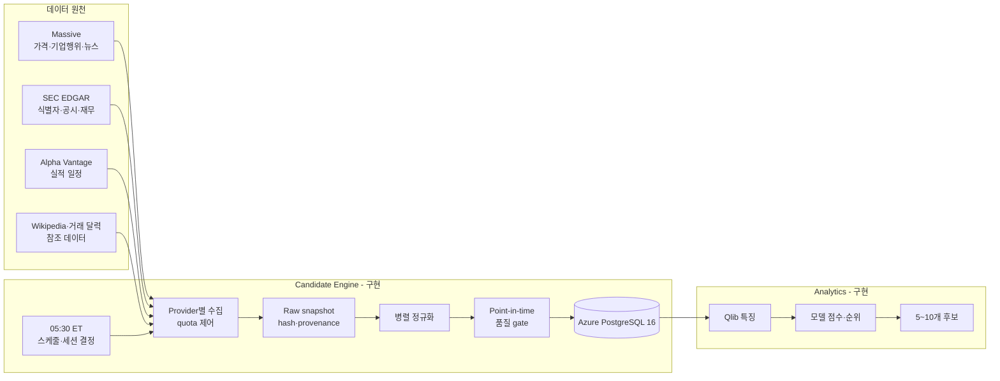
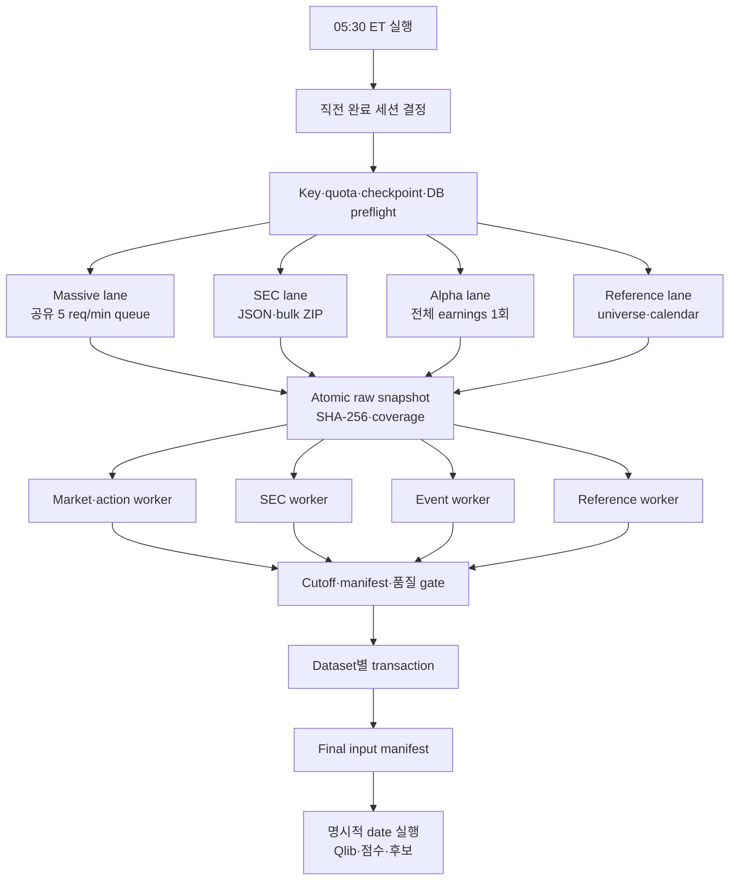
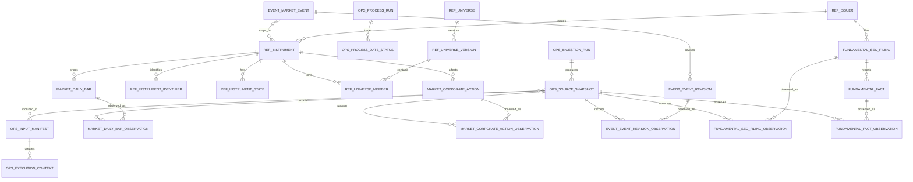

# S&P 500 Candidate Engine

미국 거래일마다 S&P 500에서 후속 분석할 5~10개 종목을 선정하기 위한 데이터 수집·후보 선정 엔진입니다.

production 데이터 수집, point-in-time provenance, Qlib export·Alpha158, walk-forward 모델 평가, 일일 점수와 5~10개 후보 선정까지 구현했습니다.

프로젝트의 전체 범위는 `수집 -> 전처리 -> 모델 점수 -> 후보 선정`까지입니다. TradingAgents를 포함한 후보 이후 분석은 별도 프로젝트에서 구현합니다. 공통 무결성·시점·재현성 규칙은 [PROJECT-HARNESS.md](PROJECT-HARNESS.md)를 기준으로 합니다.

## 현재 상태

2026-10-09 세션을 대상으로 실제 provider key와 Azure PostgreSQL을 사용해 production 수집과 명시적 shadow 후보 실행을 완료했습니다.

| 데이터 | 결과 |
|---|---:|
| S&P 500 universe | 503증권, 500기업 |
| Massive 일봉 | 503개 |
| 미래 일봉 | 0개 |
| Massive corporate actions | 99개 |
| Massive news | 291개 |
| Alpha Vantage earnings | 467개 |
| SEC instrument states | 503개 |
| Production source snapshots | 7개 |
| ACTIVE production 품질 이슈 | 0개 |
| Qlib historical export | 252 sessions, 126,736 rows |
| Alpha158 | 158 features |
| 일일 score | 503개 |
| 후보 | 10개, SHADOW model |

Production identifiers:

```text
ingestion_run_id     8496d161-8f00-4ff5-ad3f-e1ae9cd92b20
input_manifest_id    5cefeecc-2651-5e15-a89e-3d68302ce217
execution_context_id 7f56908c-23bb-596c-926f-211d136207aa
latest_export_run_id de126b50-f254-5235-8c4f-f97a70ba0017
latest_scoring_run_id d3aa7fc9-db71-5875-aa67-7cd99771197e
latest_selection_run_id 1e5c0aa7-f8e0-57ae-88aa-1417a573d0c1
```

## 데이터 원천

| Provider | 용도 | 현재 구현 |
|---|---|---|
| Massive Stocks Basic | EOD OHLCV·VWAP, SPY benchmark, dividends, splits, news | 구현·실제 적재 |
| SEC EDGAR | ticker, CIK, exchange, submissions/companyfacts bulk | reference 구현·적재, bulk downloader 구현 |
| Alpha Vantage | 전체 earnings calendar | 구현·실제 적재 |
| Wikipedia revision | prototype S&P 500 universe | 구현·실제 적재 |
| NYSE/Nasdaq | calendar, early close, halts | 미구현 |

NYSE/Nasdaq 공식 원천은 거래 달력·조기 폐장·거래정지를 서로 다른 문서와 피드로 제공해 안정적인 수집·과거 재현 정책 검증이 아직 필요합니다. 현재는 `exchange_calendars`의 XNYS 세션을 기준선으로 사용하며 공식 collector는 구현하지 않았습니다.

주요 제한:

- Massive Stocks Basic: 분당 5회, EOD, 가격 과거 2년
- Massive 무료 범위: dividend·news 과거 이력 제한
- Alpha Vantage 무료 key: 하루 25회
- Alpha earnings: ticker 없이 전체 목록을 하루 1회 요청
- SEC: 무료 JSON·bulk ZIP, 연락처 User-Agent 필요
- SEC facts: concept·unit·duration·fiscal period 정규화가 필요
- 역사적 S&P 구성·GICS는 S&P DJI 계약 없이는 충족되지 않음

상세 내용은 [데이터 원천·라이선스 카탈로그](.github/modernize/assessment/engines/facts/data-source-license-catalog.md)를 참고하세요.

## 전체 아키텍처



상세 설계:

- [전체 아키텍처](.github/modernize/assessment/engines/facts/architecture-diagram.md)
- [일 1회 수집 파이프라인](.github/modernize/assessment/engines/facts/ingestion-pipeline.md)
- [데이터 아키텍처](.github/modernize/assessment/engines/facts/data-architecture.md)
- [프로젝트 공통 하네스](PROJECT-HARNESS.md)

## 일일 파이프라인

기본 스케줄은 매일 `05:30 America/New_York`입니다.

### 수집 파이프라인 아키텍처



1. 마지막 완료 미국 거래 세션 결정
2. key·quota·checkpoint·DB preflight
3. 공급자별 병렬 lane 시작
4. Massive 내부 요청을 하나의 5회/분 queue로 순차화
5. raw snapshot atomic 저장과 SHA-256
6. dataset별 병렬 정규화
7. 조정 상태가 명시된 종목 bar와 `PRICE_RETURN` SPY benchmark revision 저장
8. cutoff·manifest·품질 gate
9. dataset transaction과 final manifest
10. 명시적으로 선택한 date에 Qlib export·feature·score·candidate 실행

기간 backfill은 9단계에서 종료하며 후보를 자동 생성하지 않습니다.

Massive grouped daily endpoint를 우선 사용합니다. 사용할 수 없으면 ticker별 503회 fallback이며 최소 약 101분이 걸립니다.

## Point-in-Time 원칙

- 모든 실행은 `source_snapshot`, `input_manifest`, `execution_context`로 추적합니다.
- 논리 데이터 revision과 snapshot observation을 분리합니다.
- 같은 값은 중복 revision으로 저장하지 않습니다.
- 변경된 provider payload만 새 snapshot으로 저장합니다.
- 미래 session과 cutoff 이후 데이터는 fail closed합니다.
- `OPERATIONAL_REPLAY`와 `HISTORICAL_RECONSTRUCTION`을 구분합니다.
- 동일 수집일 재실행은 변경분만 추가합니다.

## PostgreSQL

대상:

```text
Azure Database for PostgreSQL Flexible Server 16
database: candidate_engine
authentication: Microsoft Entra
```

논리 스키마:

| Schema | 책임 |
|---|---|
| `ops` | ingestion run, snapshot, manifest, context, quality |
| `ref` | issuer, instrument, identifier, state, universe |
| `market` | daily bar, observation, corporate action |
| `event` | news, earnings, revision, instrument mapping |
| `fundamental` | SEC filing·fact와 snapshot observation |
| `analytics` | Qlib export, feature·label, model, score |
| `selection` | 5~10개 candidate batch와 reason |

### 데이터 스키마 ER 다이어그램

아래 다이어그램은 현재 적재 경로의 핵심 테이블과 provenance 관계를 표시합니다. `analytics`와 `selection`은 논리 스키마만 예약되어 있어 제외했습니다.



Migration은 [sql/](sql/)에 있으며 파일명 순서대로 적용됩니다.

`market.daily_bar`는 OHLCV와 함께 provider VWAP, 가격 조정 상태, 거래량 조정 상태를 보존합니다. `market.benchmark_daily_bar`는 동일 거래일의 SPY를 별도 series로 저장하며 현재 수익률 기준은 배당 미포함 `PRICE_RETURN`입니다.

## 설치

Python 3.11 이상이 필요합니다. 현재 개발 환경은 Python 3.13입니다.

```powershell
python -m venv .venv
.\.venv\Scripts\python.exe -m ensurepip --upgrade
.\.venv\Scripts\python.exe -m pip install -e ".[dev]"
```

해결된 의존성 버전은 [requirements.lock](requirements.lock)에 기록합니다.

## 환경 설정

```powershell
Copy-Item .env.example .env
```

`.env`에 다음 값을 입력합니다.

```dotenv
AZURE_CREDENTIAL_MODE=azure_cli

MASSIVE_API_KEY=<real-key>
ALPHA_VANTAGE_API_KEY=<real-key>

MARKET_DATA_PROVIDER=massive
CORPORATE_ACTION_PROVIDER=massive
NEWS_DATA_PROVIDER=massive
IDENTIFIER_DATA_PROVIDER=sec_edgar
EARNINGS_CALENDAR_PROVIDER=alpha_vantage
FUNDAMENTALS_DATA_PROVIDER=sec_edgar
```

`.env`는 Git에서 제외됩니다. 키를 코드, 로그, README에 저장하지 마세요.

## 명령

설정 상태 확인, 실제 키는 출력하지 않습니다.

```powershell
.\.venv\Scripts\python.exe -m sp500_candidate_engine `
  --env-file .env check-config
```

공급자 제한 사전 검증:

```powershell
.\.venv\Scripts\python.exe -m sp500_candidate_engine `
  --env-file .env check-source-harness `
  --date 2026-10-08 `
  --massive-requests 4
```

Provider connectivity probe:

```powershell
.\.venv\Scripts\python.exe -m sp500_candidate_engine `
  --env-file .env probe-providers --date 2026-10-08
```

3개월 backfill dry-run 계획, 네트워크나 DB를 변경하지 않습니다.

```powershell
.\.venv\Scripts\python.exe -m sp500_candidate_engine `
  --env-file .env plan-backfill `
  --start 2026-07-09 `
  --end 2026-10-08
```

일일 production process 실행:

```powershell
.\.venv\Scripts\python.exe -m sp500_candidate_engine `
  --env-file .env run-daily --date 2026-10-09
```

수집 성공 후 같은 명시적 date의 후보까지 실행:

```powershell
.\.venv-alpha158\Scripts\python.exe -m sp500_candidate_engine `
  --env-file .env run-daily --date 2026-10-09 --with-candidates
```

기존 export로 특정 date 후보만 멱등 실행:

```powershell
.\.venv-alpha158\Scripts\python.exe -m sp500_candidate_engine `
  --env-file .env run-candidates --date 2026-10-09
```

Historical Qlib export와 Alpha158 검증:

```powershell
.\.venv-alpha158\Scripts\python.exe -m sp500_candidate_engine `
  --env-file .env export-qlib --start 2025-10-09 --end 2026-10-09

.\.venv-alpha158\Scripts\python.exe -m sp500_candidate_engine `
  --env-file .env build-features `
  --export-run-id de126b50-f254-5235-8c4f-f97a70ba0017
```

재현 가능한 notebook 환경과 비대화형 실행은 [notebooks/README.md](notebooks/README.md)를 참고하세요.

Backfill 실행, 1차 전체 완료 후 실패 날짜를 자동 재처리합니다.

```powershell
.\.venv\Scripts\python.exe -m sp500_candidate_engine `
  --env-file .env run-backfill `
  --start 2026-07-09 `
  --end 2026-10-08
```

Backfill 포함 데이터:

- Massive grouped daily price
- Massive range dividend·split
- Massive 주 단위 news pagination
- SEC submissions/companyfacts bulk normalization
- 날짜별 05:30 ET cutoff derived snapshots
- 날짜별 reconstruction manifest

Alpha historical earnings는 당시 revision을 증명할 수 없어 제외합니다.

이전 process의 실패 날짜를 지정 범위에서 다시 처리:

```powershell
.\.venv\Scripts\python.exe -m sp500_candidate_engine `
  --env-file .env retry-backfill `
  --process-run-id <uuid> `
  --start 2026-07-09 `
  --end 2026-10-08
```

진행 상태 확인:

```powershell
.\.venv\Scripts\python.exe -m sp500_candidate_engine `
  --env-file .env show-process `
  --process-run-id <uuid>
```

Migration:

```powershell
.\.venv\Scripts\python.exe -m sp500_candidate_engine `
  --env-file .env migrate
```

Production collection:

```powershell
.\.venv\Scripts\python.exe -m sp500_candidate_engine `
  --env-file .env collect-production --date 2026-10-08
```

Prototype historical collection:

```powershell
.\.venv\Scripts\python.exe -m sp500_candidate_engine `
  --env-file .env collect `
  --date 2026-10-01 `
  --mode historical-reconstruction
```

Cutoff 검증:

```powershell
.\.venv\Scripts\python.exe -m sp500_candidate_engine `
  --env-file .env verify-cutoff `
  --date 2026-10-01 `
  --mode historical-reconstruction
```

특정 날짜 삭제:

```powershell
.\.venv\Scripts\python.exe -m sp500_candidate_engine `
  --env-file .env reset-date --date 2026-10-01
```

## 실행 로그

`logs/<서울 실행일>.log`에 단계별 JSON 한 줄을 기록합니다.

일일·backfill process는 별도로 `logs/processes/<process_run_id>.jsonl` 한 파일을 사용합니다. 파일은 실행 중에도 flush되며 장시간 range download·SEC parse 단계에는 60초 heartbeat를 기록합니다.

필드:

- `pipeline_started_at`
- `collection_date`
- `pipeline_name`
- `status`
- `duration_ms`
- `failure_reason`
- `details`

Process 로그의 날짜별 줄:

- process start time
- collection date
- duration
- collected count와 dataset별 count
- success/failure
- failure reason
- retry required
- retry status
- completed
- completed/success/failed progress

모든 초기 날짜 처리가 끝난 뒤 `RETRY_CHECK` 줄을 기록하고, 실패 날짜를 재처리할 때 같은 파일에 날짜별 `RETRY` 줄을 추가합니다.

## Backfill 실행 결과

2026-10-10에 로컬 backfill과 manual retry를 통해 `2025-10-09`~`2026-10-08` 251거래일을 적재했고, 2026-10-11에 2026-10-09 production session을 추가했습니다. 기존 raw snapshot enrichment는 API 재호출 없이 VWAP·조정 상태와 SPY benchmark를 추가했습니다.

| 항목 | 결과 |
|---|---:|
| 기간 | `2025-10-09`~`2026-10-09` |
| XNYS 거래일 | 252 |
| Qlib export rows | 126,736 |
| 날짜별 universe 기준 예상 bars | 126,237 |
| 평균 일별 coverage | 99.9968% |
| VWAP·조정 상태 반영 | 125,730/126,233 |
| SPY `PRICE_RETURN` benchmark | 252/252 |
| Corporate actions | 1,537 |
| News events | 31,252 |
| SEC filings | 8,452 |
| SEC facts | 50,582 |
| 미래 누수 | 0 |
| semantic duplicate revisions | 0 |

기존 OHLCV는 덮어쓰지 않고 enrichment revision을 추가했습니다. revision 1의 `UNKNOWN` 상태와 revision 2의 `UNADJUSTED`·VWAP 보강은 서로 다른 semantic payload이며 완전 동일 revision 중복은 0입니다. provider 원본 결측은 HOLX(2026-04-07), VMRK(2026-08-17), PSKY·WBD(2026-10-06) 4건입니다.

로그와 raw payload는 Git에 올리지 않습니다.

## 테스트

```powershell
.\.venv\Scripts\python.exe -m pytest
.\.venv\Scripts\python.exe -m ruff check src tests
.\.venv\Scripts\python.exe -m ruff format --check src tests
```

현재 테스트는 provider limit, 미래 데이터 차단, Qlib export·feature·label, walk-forward, scoring, selection, parser, key 비노출, 일자별 로그와 가격 precision을 포함합니다.

## 저장소 구조

```text
.
├── src/sp500_candidate_engine/
│   ├── collectors/
│   │   ├── massive.py
│   │   ├── sec.py
│   │   ├── alpha_vantage.py
│   │   ├── wikipedia.py
│   │   └── yahoo.py
│   ├── production_pipeline.py
│   ├── production_repository.py
│   ├── analytics/
│   ├── selection/
│   ├── candidate_pipeline.py
│   ├── source_harness.py
│   ├── temporal.py
│   └── database.py
├── sql/
├── config/analytics/
├── notebooks/
├── tests/
├── CHANGELOG.md
├── AGENTS.md
├── .github/modernize/assessment/engines/facts/
└── us_stock_pipeline_agent_brief.md
```

모든 사용자 요청 변경은 [CHANGELOG.md](CHANGELOG.md)에 항목별 한 줄로 누적한다.

## 아직 남은 작업

- 공식 NYSE/Nasdaq calendar collector
- Nasdaq halt collector
- dataset checkpoint cursor 실제 전진
- staging COPY·set-based merge 성능 최적화
- Massive Basic 2년보다 오래된 가격 backfill
- 공식 point-in-time S&P constituent·GICS
- 3~5년 가격을 이용한 복수 regime 모델 검증
- 양의 out-of-sample Rank IC를 만족하는 champion 모델
- 약 4주의 20-session live shadow 관찰

## 라이선스 주의

- Massive 데이터의 내부 저장, 비표시 분석, 파생 특징, ML·백테스트 권리를 계약에서 확인해야 합니다.
- Alpha Vantage 데이터 저장·상업 이용·재배포는 플랜 terms를 확인해야 합니다.
- SEC filing 안의 제3자 저작물은 별도 권리가 있을 수 있습니다.
- Wikipedia 원문 재배포에는 CC BY-SA 조건이 적용될 수 있습니다.
- Yahoo 경로는 prototype 전용이며 production 신규 수집에 사용하지 않습니다.

## 현재 판정

현재 데이터는 **명시적 session에 대해 일일 정량 후보를 생성할 수 있는 SHADOW MVP**입니다.

아직 충족하지 못한 핵심 연구 요구사항:

- 3~5년 연속 가격
- 생존편향 없는 과거 S&P 구성·GICS
- SEC 전체 taxonomy·custom concept와 원문 XBRL 확장
- 과거 earnings revision
- 양의 out-of-sample Rank IC
- 운영 champion 승격
- 20-session live shadow 완료
