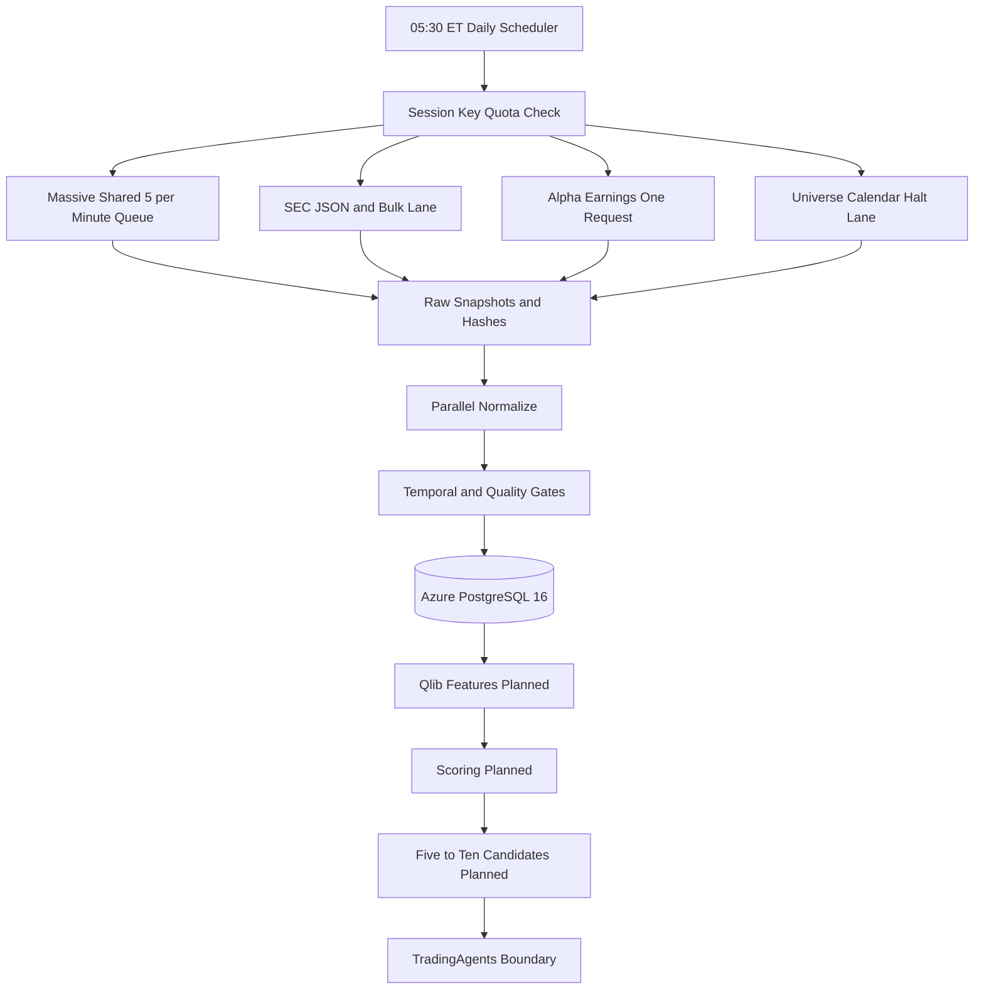

# S&P 500 Candidate Engine

미국 거래일마다 S&P 500에서 후속 분석할 5~10개 종목을 선정하기 위한 데이터 수집·후보 선정 엔진입니다.

현재 구현 범위는 production 데이터 수집, point-in-time provenance, PostgreSQL 적재까지입니다. Qlib 특징·점수와 최종 후보 선정은 다음 단계입니다.

## 현재 상태

2026-10-08 세션을 대상으로 실제 provider key와 Azure PostgreSQL을 사용해 production pipeline을 실행했습니다.

| 데이터 | 결과 |
|---|---:|
| S&P 500 universe | 503증권, 500기업 |
| Massive 일봉 | 503개 |
| 미래 일봉 | 0개 |
| Massive corporate actions | 99개 |
| Massive news | 291개 |
| Alpha Vantage earnings | 467개 |
| SEC instrument states | 503개 |
| Production source snapshots | 7개 |
| ACTIVE production 품질 이슈 | 0개 |

Production identifiers:

```text
ingestion_run_id     8496d161-8f00-4ff5-ad3f-e1ae9cd92b20
input_manifest_id    5cefeecc-2651-5e15-a89e-3d68302ce217
execution_context_id 7f56908c-23bb-596c-926f-211d136207aa
```

## 데이터 원천

| Provider | 용도 | 현재 구현 |
|---|---|---|
| Massive Stocks Basic | EOD OHLCV, dividends, splits, news | 구현·실제 적재 |
| SEC EDGAR | ticker, CIK, exchange, submissions/companyfacts bulk | reference 구현·적재, bulk downloader 구현 |
| Alpha Vantage | 전체 earnings calendar | 구현·실제 적재 |
| Wikipedia revision | prototype S&P 500 universe | 구현·실제 적재 |
| NYSE/Nasdaq | calendar, early close, halts | 미구현 |

주요 제한:

- Massive Stocks Basic: 분당 5회, EOD, 가격 과거 2년
- Massive 무료 범위: dividend·news 과거 이력 제한
- Alpha Vantage 무료 key: 하루 25회
- Alpha earnings: ticker 없이 전체 목록을 하루 1회 요청
- SEC: 무료 JSON·bulk ZIP, 연락처 User-Agent 필요
- SEC facts: concept·unit·duration·fiscal period 정규화가 필요
- 역사적 S&P 구성·GICS는 S&P DJI 계약 없이는 충족되지 않음

상세 내용은 [데이터 원천·라이선스 카탈로그](.github/modernize/assessment/engines/facts/data-source-license-catalog.md)를 참고하세요.

## 아키텍처

<!-- mermaid-checked: no \n, no em-dash/en-dash, no {} in labels, arrows are -->|"label"|, ids unique -->


전체 설계:

- [전체 아키텍처](.github/modernize/assessment/engines/facts/architecture-diagram.md)
- [일 1회 수집 파이프라인](.github/modernize/assessment/engines/facts/ingestion-pipeline.md)
- [데이터 아키텍처](.github/modernize/assessment/engines/facts/data-architecture.md)

## 일일 파이프라인

기본 스케줄은 매일 `05:30 America/New_York`입니다.

1. 마지막 완료 미국 거래 세션 결정
2. key·quota·checkpoint·DB preflight
3. 공급자별 병렬 lane 시작
4. Massive 내부 요청을 하나의 5회/분 queue로 순차화
5. raw snapshot atomic 저장과 SHA-256
6. dataset별 병렬 정규화
7. cutoff·manifest·품질 gate
8. dataset transaction과 final manifest
9. Qlib·후보 단계, 아직 미구현

Massive grouped daily endpoint를 우선 사용합니다. 사용할 수 없으면 ticker별 503회 fallback이며 최소 약 101분이 걸립니다.

## Point-in-Time 원칙

- 모든 실행은 `source_snapshot`, `input_manifest`, `execution_context`로 추적합니다.
- 논리 데이터 revision과 snapshot observation을 분리합니다.
- 같은 값은 중복 revision으로 저장하지 않습니다.
- 변경된 provider payload만 새 snapshot으로 저장합니다.
- 미래 session과 cutoff 이후 데이터는 fail closed합니다.
- `OPERATIONAL_REPLAY`와 `HISTORICAL_RECONSTRUCTION`을 구분합니다.
- 동일 수집일 재실행은 변경분만 추가합니다.

## PostgreSQL

대상:

```text
Azure Database for PostgreSQL Flexible Server 16
database: candidate_engine
authentication: Microsoft Entra
```

논리 스키마:

| Schema | 책임 |
|---|---|
| `ops` | ingestion run, snapshot, manifest, context, quality |
| `ref` | issuer, instrument, identifier, state, universe |
| `market` | daily bar, observation, corporate action |
| `event` | news, earnings, revision, instrument mapping |
| `fundamental` | SEC filing·fact, 테이블만 구현 |
| `analytics` | Qlib run, 미구현 |
| `selection` | candidate batch, 미구현 |

Migration은 [sql/](sql/)에 있으며 파일명 순서대로 적용됩니다.

## 설치

Python 3.11 이상이 필요합니다. 현재 개발 환경은 Python 3.13입니다.

```powershell
python -m venv .venv
.\.venv\Scripts\python.exe -m ensurepip --upgrade
.\.venv\Scripts\python.exe -m pip install -e ".[dev]"
```

해결된 의존성 버전은 [requirements.lock](requirements.lock)에 기록합니다.

## 환경 설정

```powershell
Copy-Item .env.example .env
```

`.env`에 다음 값을 입력합니다.

```dotenv
AZURE_CREDENTIAL_MODE=azure_cli

MASSIVE_API_KEY=<real-key>
ALPHA_VANTAGE_API_KEY=<real-key>

MARKET_DATA_PROVIDER=massive
CORPORATE_ACTION_PROVIDER=massive
NEWS_DATA_PROVIDER=massive
IDENTIFIER_DATA_PROVIDER=sec_edgar
EARNINGS_CALENDAR_PROVIDER=alpha_vantage
FUNDAMENTALS_DATA_PROVIDER=sec_edgar
```

`.env`는 Git에서 제외됩니다. 키를 코드, 로그, README에 저장하지 마세요.

## 명령

설정 상태 확인, 실제 키는 출력하지 않습니다.

```powershell
.\.venv\Scripts\python.exe -m sp500_candidate_engine `
  --env-file .env check-config
```

공급자 제한 사전 검증:

```powershell
.\.venv\Scripts\python.exe -m sp500_candidate_engine `
  --env-file .env check-source-harness `
  --date 2026-10-08 `
  --massive-requests 4
```

Provider connectivity probe:

```powershell
.\.venv\Scripts\python.exe -m sp500_candidate_engine `
  --env-file .env probe-providers --date 2026-10-08
```

3개월 backfill dry-run 계획, 네트워크나 DB를 변경하지 않습니다.

```powershell
.\.venv\Scripts\python.exe -m sp500_candidate_engine `
  --env-file .env plan-backfill `
  --start 2026-07-09 `
  --end 2026-10-08
```

일일 production process 실행:

```powershell
.\.venv\Scripts\python.exe -m sp500_candidate_engine `
  --env-file .env run-daily --date 2026-10-08
```

Backfill 실행, 1차 전체 완료 후 실패 날짜를 자동 재처리합니다.

```powershell
.\.venv\Scripts\python.exe -m sp500_candidate_engine `
  --env-file .env run-backfill `
  --start 2026-07-09 `
  --end 2026-10-08
```

Backfill 포함 데이터:

- Massive grouped daily price
- Massive range dividend·split
- Massive 주 단위 news pagination
- SEC submissions/companyfacts bulk normalization
- 날짜별 05:30 ET cutoff derived snapshots
- 날짜별 reconstruction manifest

Alpha historical earnings는 당시 revision을 증명할 수 없어 제외합니다.

이전 process의 실패 날짜를 지정 범위에서 다시 처리:

```powershell
.\.venv\Scripts\python.exe -m sp500_candidate_engine `
  --env-file .env retry-backfill `
  --process-run-id <uuid> `
  --start 2026-07-09 `
  --end 2026-10-08
```

진행 상태 확인:

```powershell
.\.venv\Scripts\python.exe -m sp500_candidate_engine `
  --env-file .env show-process `
  --process-run-id <uuid>
```

Migration:

```powershell
.\.venv\Scripts\python.exe -m sp500_candidate_engine `
  --env-file .env migrate
```

Production collection:

```powershell
.\.venv\Scripts\python.exe -m sp500_candidate_engine `
  --env-file .env collect-production --date 2026-10-08
```

Prototype historical collection:

```powershell
.\.venv\Scripts\python.exe -m sp500_candidate_engine `
  --env-file .env collect `
  --date 2026-10-01 `
  --mode historical-reconstruction
```

Cutoff 검증:

```powershell
.\.venv\Scripts\python.exe -m sp500_candidate_engine `
  --env-file .env verify-cutoff `
  --date 2026-10-01 `
  --mode historical-reconstruction
```

특정 날짜 삭제:

```powershell
.\.venv\Scripts\python.exe -m sp500_candidate_engine `
  --env-file .env reset-date --date 2026-10-01
```

## 실행 로그

`logs/<서울 실행일>.log`에 단계별 JSON 한 줄을 기록합니다.

일일·backfill process는 별도로 `logs/processes/<process_run_id>.jsonl` 한 파일을 사용합니다. 파일은 실행 중에도 flush되므로 완료된 날짜와 현재 DB heartbeat를 확인할 수 있습니다.

필드:

- `pipeline_started_at`
- `collection_date`
- `pipeline_name`
- `status`
- `duration_ms`
- `failure_reason`
- `details`

Process 로그의 날짜별 줄:

- process start time
- collection date
- duration
- collected count와 dataset별 count
- success/failure
- failure reason
- retry required
- retry status
- completed
- completed/success/failed progress

모든 초기 날짜 처리가 끝난 뒤 `RETRY_CHECK` 줄을 기록하고, 실패 날짜를 재처리할 때 같은 파일에 날짜별 `RETRY` 줄을 추가합니다.

로그와 raw payload는 Git에 올리지 않습니다.

## 테스트

```powershell
.\.venv\Scripts\python.exe -m pytest
.\.venv\Scripts\python.exe -m ruff check src tests
.\.venv\Scripts\python.exe -m ruff format --check src tests
```

현재 테스트는 provider limit, 미래 데이터 차단, parser, key 비노출, 일자별 로그, 가격 precision을 포함합니다.

## 저장소 구조

```text
.
├── src/sp500_candidate_engine/
│   ├── collectors/
│   │   ├── massive.py
│   │   ├── sec.py
│   │   ├── alpha_vantage.py
│   │   ├── wikipedia.py
│   │   └── yahoo.py
│   ├── production_pipeline.py
│   ├── production_repository.py
│   ├── source_harness.py
│   ├── temporal.py
│   └── database.py
├── sql/
├── tests/
├── CHANGELOG.md
├── AGENTS.md
├── .github/modernize/assessment/engines/facts/
└── us_stock_pipeline_agent_brief.md
```

모든 사용자 요청 변경은 [CHANGELOG.md](CHANGELOG.md)에 항목별 한 줄로 누적한다.

## 아직 남은 작업

- 공식 NYSE/Nasdaq calendar collector
- Nasdaq halt collector
- dataset checkpoint cursor 실제 전진
- staging COPY·set-based merge 성능 최적화
- Massive Basic 2년보다 오래된 가격 backfill
- 공식 point-in-time S&P constituent·GICS
- Qlib Alpha158·LightGBM
- 5~10개 후보 selection
- TradingAgents downstream integration

## Azure Backfill VM

배포 계획은 [.azure/deployment-plan.md](.azure/deployment-plan.md)에 있습니다.

선택 구성:

- Korea Central
- Existing resource group `rg-ai-project`
- Ubuntu 24.04
- Standard_B4ms
- 64 GB Standard SSD
- Password SSH
- System-assigned managed identity
- Auto-shutdown schedule 없음

배포 스크립트:

- [deploy-vm.ps1](scripts/azure/deploy-vm.ps1)
- [upload_and_bootstrap.py](scripts/azure/upload_and_bootstrap.py)
- [bootstrap-vm.sh](scripts/azure/bootstrap-vm.sh)

VM password와 배포 출력은 `.azure/*.tmp`에 저장하며 Git에서 제외합니다.

## 라이선스 주의

- Massive 데이터의 내부 저장, 비표시 분석, 파생 특징, ML·백테스트 권리를 계약에서 확인해야 합니다.
- Alpha Vantage 데이터 저장·상업 이용·재배포는 플랜 terms를 확인해야 합니다.
- SEC filing 안의 제3자 저작물은 별도 권리가 있을 수 있습니다.
- Wikipedia 원문 재배포에는 CC BY-SA 조건이 적용될 수 있습니다.
- Yahoo 경로는 prototype 전용이며 production 신규 수집에 사용하지 않습니다.

## 현재 판정

현재 데이터는 **일일 후보 선정의 시장·이벤트 입력을 시작할 수 있는 production MVP**입니다.

아직 충족하지 못한 핵심 연구 요구사항:

- 3~5년 연속 가격
- 생존편향 없는 과거 S&P 구성·GICS
- SEC filings/facts
- 과거 earnings revision
- Qlib 특징·점수
- 최종 후보 5~10개
