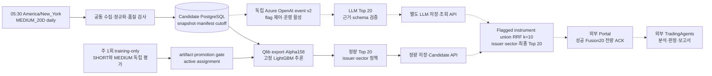
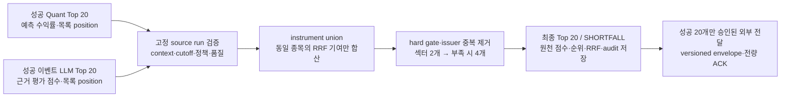

# S&P 500 Candidate Engine

미국 거래일마다 수집한 point-in-time 데이터로 후속 분석 후보를 선정하는 엔진입니다.
데일리 정규 실행은 **MEDIUM_20D Fusion 전용**입니다. 공통 수집 후 독립 정량·LLM 후보
각 20개를 원천으로 RRF 최종 20개를 생성합니다. **성공한 최종 Fusion 20개 전체를 외부에 전달**하며
기존 SHORT_5D 5~10개 경로는 별도로 유지합니다. 후보는 매수 추천이나 주문이 아닙니다.

공통 범위·무결성·시점·재현성 규칙은 [PROJECT-HARNESS.md](PROJECT-HARNESS.md)를
우선합니다. 이 문서의 설계 계약은 운영 배포 완료를 의미하지 않습니다.

## 구현·운영 기준 — 2026-10-17

- 정량·LLM·Fusion의 독립 실행 API/CLI, 단계별 상태·고정 계약·재시도와 기존 일일 DAG가
  구현·배포됐습니다. PostgreSQL migration은 [024](sql/024_candidate_stage_runs.sql)까지 적용했습니다.
- 코드·설정 예제의 안전한 기본값은 LLM·Fusion·외부 전달 비활성입니다. **현재 승인된 운영은
  이벤트 LLM v2·Fusion k=10·`fusion-top20-v1` 전달이 활성화**돼 있습니다.
- 운영에서 세 독립 경로가 고정 context의 성공 20개 결과를 각각 재사용했고,
  인증·멱등 요청·성공 실행 retry 차단과 새 LLM 호출 0건을 확인했습니다.
- 전체 테스트 **533건**, Ruff, 신규 stage 모듈 타입 검사와 격리 PostgreSQL의
  24개 migration·재시도·rollback·중단 복구 검증이 통과했습니다.
  이는 투자 성능·새 champion 승격·매일 20개 생성 보장을 뜻하지 않습니다.
- 일일 gate는 **05:30 America/New_York**입니다. 2026-10-17은 **18:30 KST**에
  직전 10월16일 거래 세션을 처리합니다. DST에 따라 한국 시각이 달라집니다.
  예정된 실행의 성공 여부는 실제 run으로 확인해야 합니다.
- 실행·재시도 계약은 [오케스트레이터 가이드](orchestrator/README.md),
  오류 조회는 [Telemetry·KQL 런북](.github/modernize/assessment/engines/facts/orchestrator-telemetry-runbook.md)을 따릅니다.
- 로컬 체크리스트 `DAILY-FUSION-2026-10-19-CHECKLIST.md`는
  10/19 비거래일 skip과 10/20의 10/19 거래 세션 처리·최종 20개·전량 ACK를 구분합니다.
  신규 타이머의 Fusion 비활성 차단은 로컬 변경이며 이번 작업에서 배포하지 않았습니다.
- 신규 후보 근거 snapshot·v2 설명/결과 통합 조회와 과거일 LLM cutoff 강제 하네스는
  로컬 구현이며 아직 운영에 배포하지 않았습니다. 추가 DDL·요약용 LLM 호출은 없습니다.
  로컬 회귀 649건·Ruff·관련 모듈 타입 검사와 격리 PostgreSQL의 설명 조회·JSONB hash
  왕복·미래 수정본 차단·원자적 rollback·기존 handoff/ACK를 검증했습니다.
- 이벤트 LLM의 로컬 prompt는 `llm-event-preselection-v3-ko`로 변경했습니다.
  질문·재질의와 요약·인용 이유·결측 사유는 한국어이며 JSON 식별자와 원문은 보존합니다.
  한글이 없는 자연어 응답은 검증 실패로 처리하고 기존 재시도 한도를 적용합니다.
  운영 배포는 별도이며 단건 확인 요청은 DB 읽기 전용·결과 미적재로 수행합니다.
- 별도 LLM 검색 v4 정책(`config/llm_preselection/policy_event_search_v4.yaml`)은
  Azure OpenAI native `web_search`가 추가 자료를 취득합니다. 서버의 SEC 추가 다운로드 방식은
  제거했습니다. 검색에는 공개 회사 metadata만 보내고 전체 DB packet은 보내지 않습니다.
  전체 검색 출처·자료 공개일·과거 원문 버전을 검증한 문단만 별도 평가 대화에 전달합니다.
  모델 이름·버전은 재현성 기록일 뿐 자료 승인/차단 조건이 아닙니다.
  [LLM 전용 하네스](src/sp500_candidate_engine/llm_preselection/LLM-HARNESS.md)에 따라
  미래/현재/버전 미확인 출처가 섞이면 검색 전체를 거부하고 점수를 만들지 않습니다.
  일반 뉴스는 날짜 표기만으로 승인하지 않으며 기존 v2·운영 설정은 유지합니다.
- 기간 필터가 필요한 [v5 Bing Grounding 정책](config/llm_preselection/policy_event_period_v5.yaml)은
  실제 tool 설정에 `freshness`를 고정합니다. LLM만 전일 이전 자료는 NY 일자 판정,
  당일 자료는 NY 05:30 이전의 시각 검증을 적용합니다. 수집·정량 규칙은 유지합니다.
  [10월16일 VLO 실측 보고서](VLO-2026-10-16-PERIOD-SEARCH-VALIDATION.md)에
  승인 리소스 생성·기간 검색 성공·후보 출처 확보와 원문 검증 미충족에 따른 평가 사용 0건을 기록했습니다.
  v4 코드·정책은 로컬 변경이며 이번 문서 푸시나 운영 활성화와 구분합니다.
- 주간 모델 업데이트 메일은 운영에 별도 활성화했습니다. 시작·모델별 결과·최종 요약을
  승인된 단일 수신처에 보내며 일일 파이프라인·리소스 가디언 메일은 계속 비활성입니다.
- 기존 SHORT_5D 후보·선정 근거와 연결 분석 리포트는 2026-10-17 삭제했습니다.
  이는 데이터 정리이며 SHORT 실행 기능·모델·점수·주간 재학습을 제거한 것은 아닙니다.

## 범위와 결과 계약

```text
수집 -> 전처리 -> 모델 점수 -> 후보 선정·검증 -> 저장·조회 API
```

- Candidate PostgreSQL이 원천·점수·후보·실행 기록의 단일 원본입니다.
- Portal과 TradingAgents는 외부 소비자입니다. 분석 실행, agent prompt·memory,
  매수·매도 판정, MySQL 분석 상태와 보고서 Blob은 이 저장소의 책임이 아닙니다.
- Durable Functions는 일정·멱등 API 호출·상태 확인을 담당하는 control plane입니다.
- 기존 `SHORT_5D`의 명시적 API·수동 실행과 5~10개 레거시 정책은 유지합니다.
  이를 일일 MEDIUM 또는 최종 전달 수량 20개와 혼동하지 않습니다.

| 결과 | 개수 | 점수 의미 | 실행·조회 계약 |
|---|---:|---|---|
| 정량 `MEDIUM_20D` | 정확히 20 | `PREDICTED_20D_RETURN` | 기본 일일 추론, `/api/v1/candidates` |
| 레거시 `SHORT_5D` | 5~10 | `PREDICTED_5D_RETURN` | 명시적 목적 선택, 동일 API |
| 독립 `LLM_PRESELECTION` | 성공 시 정확히 20 | `LLM_EVIDENCE_SCORE` | 기본 OFF·운영 event v2 ON, `/api/v1/llm-preselections` |
| RRF `FUSION` | 성공 시 정확히 20 | k=10 목록 순위 RRF | 기본 OFF·승인 운영 ON, `/api/v1/fusion-selections` |
| 외부 후보 전달 | 성공 Fusion 20개 | 실제 Fusion run 참조 | 기본 OFF·승인 운영 `fusion-top20-v1` ON, 전량 ACK 검증 |

`20D`는 **예측 기간 20거래일**이며 후보 개수와 별개입니다. MEDIUM 선정 정책은
[selection_medium_20d_v1.yaml](config/analytics/selection_medium_20d_v1.yaml)의
`medium-20d-top20-v1`입니다. 양수 예측만 고르지 않고 전체 적격 universe에
issuer 중복 제거와 sector cap을 적용합니다. hard gate를 완화해 수량을 채우거나
20개 미만을 성공 결과로 표시하지 않습니다.

후보 수 변경은 모델 재학습이나 예측값 변경이 아닙니다. Top-5/10 평가 지표와
과거 10개 후보 검증 기록은 그대로 유효하며 20개 성능으로 바꿔 해석하지 않습니다.

## 전체 시스템 아키텍처

전체 연동 구조는 아래에 유지합니다. `candidate_engine`이 이 저장소의 구현 범위이며,
Portal·TradingAgents와 외부 데이터·분석 저장소·UI는 연동 맥락을 보여주는 외부 영역입니다.
외부 영역의 표시는 이 저장소에서 해당 기능을 구현·배포한다는 뜻이 아닙니다.

```mermaid
flowchart LR
    subgraph CandidateScope["PROJECT SCOPE · candidate_engine"]
        subgraph Inputs["S&P 500 Universe and Source Data"]
            Reference["Wikipedia and SEC<br/>S&P 500 · GICS · CIK · ticker · exchange"]
            Massive["Massive<br/>OHLCV · VWAP · SPY · actions · news"]
            Sec["SEC EDGAR<br/>filings · normalized XBRL"]
            Alpha["Alpha Vantage<br/>earnings calendar · estimate · reported EPS"]
        end

        Collect["Shared Collection and Normalization<br/>quality gates · cutoff fence"]
        DataSpine[("Candidate PostgreSQL<br/>immutable snapshot · manifest · execution context")]
        subgraph Quantitative["Independent Quantitative Pipeline"]
            Export["Qlib Export<br/>adjusted OHLCV · calendar · span"]
            Features["Alpha158 RAW<br/>158 features · max 60 sessions"]
            Model["Pinned LightGBM Artifact<br/>daily MEDIUM_20D · legacy SHORT_5D"]
            QuantTop["Quant Top 20<br/>issuer · sector policy"]
        end
        subgraph LlmPipeline["Independent LLM Pipeline · flagged"]
            Evidence["Event v2 · non-price evidence<br/>news · SEC · earnings · actions"]
            AzureOpenAI["Azure OpenAI · per-instrument citations<br/>supported-criteria weighted scoring"]
            LlmTop["LLM Top 20<br/>schema · source validation"]
        end
        QuantApi["Quant Store and Candidate API"]
        LlmApi["Separate LLM Store and API"]
        Fusion["Flagged · instrument union · RRF k=10<br/>issuer · hard gates · sector 2/4"]
        FinalApi["Final Top 20 API<br/>SHORTFALL explicit · not an order"]

        Reference --> Collect
        Massive --> Collect
        Sec --> Collect
        Alpha --> Collect
        Collect --> DataSpine
        DataSpine --> Export --> Features --> Model --> QuantTop --> QuantApi
        DataSpine -.-> Evidence
        Evidence -.-> AzureOpenAI
        AzureOpenAI -.-> LlmTop
        LlmTop -.-> LlmApi
        QuantApi -.-> Fusion
        LlmApi -.-> Fusion
        Fusion -.-> FinalApi

        Durable["Python Durable Functions<br/>05:30 ET daily · idempotent control plane"]
        Operations["Private Storage · Key Vault<br/>App Insights · weekly-only ACS Email"]
        Weekly["Weekly Training-only<br/>SHORT and MEDIUM · promotion gate"]
        Registry["Immutable Artifacts<br/>active assignment · generation CAS"]
        Operations --> Durable
        Durable --> Collect
        Durable --> Weekly
        Weekly --> Registry --> Model
    end

    subgraph External["EXTERNAL · Portal and TradingAgents"]
        Portal["Portal and Analysis API<br/>selection validation · idempotent dispatch"]
        subgraph Agents["TradingAgents · Agents Layer"]
            Analysts["Analysts<br/>market · fundamentals · news · sentiment"]
            Debate["Bull and Bear<br/>evidence debate"]
            Research["Research Manager<br/>debate synthesis"]
            Trader["Trader<br/>proposal"]
            Risk["Risk and Portfolio<br/>final rating"]
            Analysts --> Debate --> Research --> Trader --> Risk
        end
        subgraph ExternalData["External Data and State"]
            YFinance["yfinance<br/>OHLCV · fundamentals · news"]
            Macro["FRED and Polymarket<br/>macro · prediction"]
            MySQL[("MySQL<br/>analysis jobs · decisions")]
            Blob[("Private Blob<br/>analysis reports")]
        end
        PortalUi["Portal UI<br/>DailyAnalysis · job status · reports"]
        Portal --> Analysts
        YFinance --> Analysts
        Macro --> Analysts
        Risk --> MySQL
        Risk --> Blob
        MySQL --> PortalUi
        Blob --> PortalUi
    end

    FinalApi -.->|"flagged versioned handoff · 20 candidates"| Portal
```



독립 LLM, 이벤트 정책, RRF·최종 20개 전달 어댑터는 구현·운영 배포됐습니다.
기본값과 현재 승인된 운영 설정은 위 표처럼 구분합니다. Fusion을 비활성화한 환경의
수동·호환 MEDIUM은 `parallel_preselection`에서 종료하고 외부로 전달하지 않습니다.
신규 정규 타이머는 Fusion 비활성 시 시작을 차단합니다.
외부 분석 데이터는 Candidate manifest와 별도이며 이 저장소가 그 시점을 통제하지 않습니다.
전체 시스템 구조를 제거하지 않고 아래 후보 파이프라인 상세도와 함께 관리합니다.
상세 기준은 [전체 아키텍처 문서](.github/modernize/assessment/engines/facts/architecture-diagram.md)를
참고하세요.

## 후보 파이프라인 아키텍처

정량·LLM·Fusion은 기존 일일 자동 흐름을 유지하면서 각각 단독 실행할 수 있습니다.
독립 실행은 **기존 고정 context에서 한 단계만** 수행하며 수집·학습·다른 분기·외부 전송을
자동 시작하지 않습니다. 실행 상태와 실패 후 재시도는 사업 결과 run과 별도로 보존합니다.

- [정량 아키텍처·상세 설계](.github/modernize/assessment/engines/facts/quantitative-pipeline-architecture.md)
- [LLM 아키텍처·상세 설계](.github/modernize/assessment/engines/facts/llm-pipeline-architecture.md)
- [Fusion 아키텍처·상세 설계](.github/modernize/assessment/engines/facts/fusion-pipeline-architecture.md)
- [수집·학습·세 후보 경로·외부 전달 전체 연결](.github/modernize/assessment/engines/facts/architecture-diagram.md)

`POST /api/v1/candidate-stage-runs`, `GET /api/v1/candidate-stage-runs/{id}`,
`POST /api/v1/candidate-stage-runs/{id}/retry`는 모두 서버 API key를 요구합니다.
CLI는 `run-stage`, `show-stage`, `retry-stage`이며 기존 학습 CLI와 의미를 분리합니다.
운영 도입에는 [migration 024](sql/024_candidate_stage_runs.sql)가 필요합니다.
요청·결과·재시도 예시는 [Backend 가이드](backend/README.md)를 따릅니다.



실선은 기본 정량 경로이며 점선은 설정으로 제어하는 LLM·Fusion·최종
20개 전달 경로입니다. 현재 운영에서는 활성화돼 있으며 공통 context 준비 후 Qlib export·모델
검증과 독립적으로 병렬 실행합니다. 두 중간 목록 40개를 그대로 외부에 전달하지 않습니다.

### 구현 경계

| 구성 | 위치 | 책임 |
|---|---|---|
| 공통 수집 | [production_pipeline.py](src/sp500_candidate_engine/production_pipeline.py) | 공급자 수집·정규화·snapshot |
| 일일 배치 | [batch_pipeline.py](src/sp500_candidate_engine/batch_pipeline.py) | 수집 후 후보 실행·결과 집계 |
| 고정 정량 추론 | [pipeline_execution.py](backend/app/services/pipeline_execution.py) | artifact 검증·Qlib·점수·20개 선정 |
| 독립 LLM | [llm_preselection/](src/sp500_candidate_engine/llm_preselection/) | evidence·평가·재정렬·저장·단독 실행 |
| LLM 정책 | [config/llm_preselection/](config/llm_preselection/) | windows·rubric·token·retry 설정 |
| 병렬 조정 | [daily_preselection.py](src/sp500_candidate_engine/daily_preselection.py) | 형제 pipeline 실행·실패 격리 |
| 정확한 RRF·저장 | [fusion/](src/sp500_candidate_engine/fusion/) | MEDIUM 전용·원천 run 고정·union 제한·SHORTFALL·멱등 저장 |
| 독립 실행 제어 | [candidate_stages.py](backend/app/services/candidate_stages.py) | 한 단계 수락·고정 계약·상태·재시도·타 단계 비호출 |
| 외부 control plane | [orchestrator/](orchestrator/) | timer·접수·poll·후보 검증·전달 경계 |

LLM 기본 설정은 `LLM_PRESELECTION_ENABLED=false`입니다. 정량 Top 20 완료는
LLM 결과 유무에 의존하지 않습니다. LLM을 활성화한 병렬 실행은 한쪽만 성공하면
`PARTIAL_SUCCESS`, 양쪽 모두 성공하지 못하면 `FAILED`로 집계하고 성공한 결과는
보존합니다. 실패한 LLM을 과거 결과나 정량 목록으로 대체하지 않습니다.

**자동 전달 경계:** 신규 정규 타이머는 `FUSION_ENABLED=true`가 필수이며,
비활성·누락이면 명시적으로 실패합니다. 기존 수동·호환 MEDIUM 실행의
`FUSION_ENABLED=false` 경로는 제출 0개로 종료합니다.
Fusion만 활성화하면 성공 최종 20개를 저장·조회하지만 전송은 하지 않습니다.
별도 `FUSION_EXTERNAL_DELIVERY_ENABLED`와 수신처 계약 확인이 모두 필요하며,
실패·SHORTFALL·중간 Quant/LLM 목록은 전달하지 않습니다. 상세 활성화 조건과 ACK는
[Backend 가이드](backend/README.md) 및 [오케스트레이터 가이드](orchestrator/README.md)를 따릅니다.
ACK는 외부 접수 확인이지 분석 보고서 완료가 아닙니다. 포털의 진행·결과 연결은
같은 날짜의 정량 ID가 아니라 **실제로 전달한 Fusion ID**를 기준으로 해야 합니다.

## 일일 실행과 주간 재학습

### 일일 control plane

1. UTC 매시 30분 timer가 뉴욕 현지 `05:30`일 때만 직전 달력 날짜의
   `candidate-daily-YYYY-MM-DD-medium_20d`를 시작합니다. DST는 timezone으로 처리합니다.
   신규 정규 실행은 Fusion 활성·정책/hash를 고정하며 비활성이면 시작하지 않습니다.
2. Candidate XNYS session 조회에서 비거래일이면 외부 실행 없이 skip합니다.
3. readiness를 확인하고 날짜·모델별 유효한 정량 20개가 이미 있어도 정규 실행을
   완료로 간주하지 않습니다. 같은 원천 Quant run·Fusion 정책/hash의 성공 Fusion이
   있어야 다음 전달 단계로 재개합니다. 비활성 수동·호환 경로만 `SKIPPED_EXISTING`을 사용합니다.
4. MEDIUM은 `top20-v1` suffix가 있는 `Idempotency-Key`로 DAILY를 접수합니다.
   같은 key·payload는 같은 run, 다른 payload는 충돌로 처리합니다.
5. 공통 수집 후 고정 artifact로 추론하고 정량 20개를 저장·검증합니다.
   DAILY API는 모델 학습이나 processor fit을 실행하지 않습니다.
6. Fusion 활성 시 신규 이벤트 LLM run과 공통 identity를 대조해 RRF를 저장합니다.
   전달은 별도 플래그와 수신 계약으로 제어하고 전량 ACK에서 종료합니다.
   기존 SHORT 명시 실행의 Portal 분석·poll 경로는 변경하지 않습니다.

15분 resource guardian은 readiness와 승인된 제한 복구만 수행하며 일일 실행을
시작하지 않습니다. 메일은 `ORCHESTRATOR_EMAIL_ENABLED`로 제어하며 비활성 시
`SKIPPED`를 기록합니다. SKU·replica·리소스 중지는 별도 사용자 승인 없이 변경하지 않습니다.

### 주 1회 training-only

- New York 주말 gate와 ISO week 멱등 run으로 SHORT·MEDIUM을 각각 평가합니다.
- 학습과 일일 추론은 분리하며 weekly job은 production 후보를 생성하지 않습니다.
- expanding purged walk-forward, 성숙 label, train-only fit을 적용합니다.
- challenger가 절대·상대 promotion gate를 통과할 때만 immutable artifact와
  generation CAS active assignment를 갱신합니다. 실패·reject는 incumbent를 유지합니다.
- DAILY는 assignment를 실행별로 pin하고 hash·schema·model purpose·horizon을 검증합니다.
- 주간 전용 `ORCHESTRATOR_WEEKLY_EMAIL_ENABLED`와 별도 수신처로 시작·두 모델 결과·
  최종 요약을 최대 4회 발송합니다. 운영은 주간만 ON이며 공통 파이프라인·guardian 메일은 OFF입니다.
  주소는 운영 설정에만 보관하며 비적격·이미 접수된 주차는 메일 없이 skip합니다.

상세 계약은 [주간 재학습 설계](weekly_retraining_model_design.md)와
[모델 변경 이력](MODEL_CHANGELOG.md)을 참고하세요.

## 데이터 원천과 수집

| 원천 | 용도 | 제한·주의 |
|---|---|---|
| Massive Stocks Basic | EOD OHLCV·VWAP·SPY·split·dividend·news | 공유 5회/분, 가격 약 2년, 콘텐츠 권리 확인 |
| SEC EDGAR | CIK·ticker·exchange·submissions·companyfacts | User-Agent 필수, fact concept·unit·기간 정규화 |
| Alpha Vantage | 전체 earnings calendar | 하루 전체 목록 1회, 무료 key 25회/일 |
| Wikipedia revision | prototype S&P 500·GICS | 공식 과거 구성·분류 이력이 아님 |
| `exchange_calendars` | XNYS session 기준선 | 공식 NYSE/Nasdaq calendar·halt collector는 후속 과제 |

공급자별 quota가 독립인 lane은 병렬 실행합니다. Massive는 collector 전체가 limiter를
공유하며 grouped daily 미지원 시 ticker fallback으로 약 101분 이상 걸릴 수 있습니다.
raw snapshot atomic write와 content hash, dataset transaction, temporal·quality gate,
final manifest를 거쳐 후보 입력을 확정합니다.

기간 BACKFILL은 수집에서 종료하고 후보를 자동 생성하지 않습니다. 역사적 earnings는
당시 revision을 증명할 수 없으면 제외합니다. 현재 구성원 목록을 과거 구성원으로
간주하지 않으며 결측 가격·거래량을 forward fill하지 않습니다.

데이터 권리·범위는 [원천·라이선스 카탈로그](.github/modernize/assessment/engines/facts/data-source-license-catalog.md),
수집 흐름은 [수집 파이프라인](.github/modernize/assessment/engines/facts/ingestion-pipeline.md)을 따릅니다.

## 모델·LLM·Fusion

같은 고정 context에서 **모델은 가격 기반 정량 후보**, **LLM은 비가격 evidence 기반 후보**를
독립적으로 선정하고, **Fusion은 두 성공 목록을 순위로 통합**합니다.
세 결과는 별도 run으로 저장하며 점수의 단위와 의미를 섞지 않습니다.

| 항목 | 입력·평가 | 결과 |
|---|---|---|
| [모델](#모델) | 조정가격·Alpha158·고정 LightGBM | 예상 수익률 기반 정량 Top 20 |
| [LLM](#llm) | 뉴스·공시·재무·이벤트의 근거 기반 rubric | `LLM_EVIDENCE_SCORE` Top 20 |
| [Fusion](#fusion) | 같은 context의 정량·이벤트 LLM Top 20 순위 | RRF·적격성·분산 제약을 반영한 최종 Top 20 |

### 모델

모델의 학습·평가·등록과 일일 고정 모델 추론을 구분합니다. 주간 재학습에서만
label과 walk-forward 평가를 사용하며, 일일 추론은 등록된 artifact로 점수를 계산합니다.

```mermaid
flowchart LR
    Context["Execution Context<br/>immutable manifest · cutoff · universe"] --> Source["Manifest-scoped OHLCV · VWAP<br/>corporate actions · session calendar"]
    Source --> Adjust["Split Adjustment<br/>price factor · volume · lineage validation"]
    Adjust --> Export["Qlib Export<br/>calendar · instrument spans · binaries"]
    Export --> Features["Alpha158 RAW<br/>158 features · max 60 sessions"]

    subgraph Training["Weekly Training-only · SHORT and MEDIUM"]
        Labels["Mature Labels<br/>D+1 open to D+5 or D+20 close"]
        Split["Expanding Purged Walk-forward<br/>time split · train-only processor fit"]
        Baselines["Momentum and Ridge<br/>comparison baselines"]
        LightGBM["Qlib LightGBM<br/>purpose-specific model"]
        Evaluate["IC · Rank IC · Top-5/10 return<br/>cost · drawdown · coverage"]
        Promotion["Absolute and Relative Promotion Gates<br/>reject keeps incumbent"]
        Registry["Immutable Artifact Registry<br/>hash · schema · purpose · horizon"]
        Assignment["Active Assignment<br/>generation CAS · rollback history"]
        Labels --> Split
        Split --> Baselines
        Split --> LightGBM
        Baselines --> Evaluate
        LightGBM --> Evaluate
        Evaluate --> Promotion --> Registry --> Assignment
    end

    Adjust --> Labels
    Features --> Split

    subgraph DailyInference["Daily Inference · no training or processor refit"]
        Pin["Pin and Validate Artifact<br/>context · purpose · hash · generation"]
        Predict["LightGBM Prediction<br/>raw 20D return · legacy 5D return"]
        Rank["Full Eligible Universe Ranking<br/>finite score · deterministic tie-break"]
        Policy["Issuer Deduplication · Sector Cap<br/>MEDIUM 2 then 4 · hard gates unchanged"]
        QuantResult["MEDIUM Quant Top 20<br/>SHORT legacy 5 to 10 · shortfall explicit"]
        QuantStore["Scoring Run · Selection Run<br/>positions · reasons · model lineage"]
        Pin --> Predict --> Rank --> Policy --> QuantResult --> QuantStore
    end

    Assignment --> Pin
    Features --> Predict
    Context --> Pin
```



예측 기간과 후보 개수, Top-5/10 평가 지표는 서로 다른 계약으로 유지합니다.
전처리·label·score·선정 계약의 상세는
[모델 아키텍처 문서](.github/modernize/assessment/engines/facts/model-architecture.md)를 따릅니다.

**Alpha158·LightGBM 선정 기준**

- split-adjusted OHLCV·VWAP, 거래 session, point-in-time membership과 factor lineage를 사용합니다.
- Alpha158 RAW 158차원, 최대 lookback 60 sessions이며 필요 이력이 없으면 적격으로 만들지 않습니다.
- SHORT label은 `D+5 adjusted close / D+1 adjusted open - 1`,
  MEDIUM label은 `D+20 adjusted close / D+1 adjusted open - 1`입니다.
- 예측값은 raw 가격 수익률이며 확률·confidence·SPY 초과수익률이 아닙니다.
- 뉴스·실적·SEC fact는 현재 Alpha158 모델 입력에 자동 포함되지 않습니다.
- IC·Rank IC, Top-5/10 raw·net return, 비용·drawdown 평가를 유지합니다.
  후보 수 20개 변경만으로 Top-20 성능이 검증됐다고 주장하지 않습니다.

정량 후보는 전체 적격 universe를 점수 내림차순·instrument ID 동점 순으로 순회하면서
issuer 중복과 섹터 제한을 반영해 선정합니다. 전체 점수 순위와 선정 목록 `position`은
다를 수 있습니다. 예측값·순위·percentile·선정 reason code를 저장하며,
개별 특징의 SHAP 기여도는 현재 후보 결과에 포함하지 않습니다.

### LLM

LLM은 정량 특징·예측값을 입력받는 후처리 모델이 아니라 동일 context의 독립 후보
선정 경로입니다. 코드 기본값은 비활성이고 승인된 운영은
[이벤트 정책 v2](config/llm_preselection/policy_event_v2.yaml)를 사용합니다.

```mermaid
flowchart LR
    Context["고정 context·manifest·cutoff"] --> Evidence["비가격 evidence<br/>뉴스·SEC 공시/재무·실적·기업행위"]
    Evidence --> Screening["최근 7일 이벤트 선별<br/>최대 90 issuer + 무이벤트 대조 최대 10"]
    Screening --> Policy{"선택한 LLM 정책"}
    Policy -->|"v2 · 운영"| Assessment["Azure OpenAI 항목별 평가<br/>동일 종목 citation·strict JSON"]
    Policy -->|"v4 · 로컬"| Search["Native web_search<br/>공개 회사 metadata만 전달"]
    Search --> Admission["전체 출처·공개 시점·원문 버전 검증<br/>하나라도 미확인 시 전체 실패"]
    Admission --> Clean["승인 인용만 새 평가 대화로<br/>검색 추론·response ID 제외"]
    Clean --> Assessment
    Assessment --> Score["근거 있는 최소 3개 항목<br/>가중치 재정규화·결측 보존"]
    Score --> Result["LLM Top 20<br/>점수·항목별 이유·evidence 저장"]
```



이벤트 screening은 유형별 1점이며 평가 pool을 정하는 단계입니다. 실적 일정은
cutoff까지 알려진 전후 7일 일정을 포함하고, screening 점수를 최종 LLM 점수에 더하지 않습니다.
평가 입력에서는 가격·Alpha158·정량 점수를 제외합니다.
v4는 별도 정책 선택·artifact 보존·운영 검증이 필요한 로컬 확장입니다.
검색 발췌는 원문 자체나 사실성 보장이 아니며 미승인·미확보 자료를 성공으로 대체하지 않습니다.

| 평가 항목 | 가중치 |
|---|---:|
| 실적 `earnings` | 25 |
| 사업 `business` | 25 |
| 이벤트 `event` | 20 |
| 재무 `financial` | 15 |
| 산업 `industry` | 15 |

근거 있는 최소 3개 항목의 가중치만 재정규화하고, 근거 없는 항목은 null과 결측 사유를
보존합니다. 총점은 서버가 계산하며 예상 수익률·확률·confidence가 아닙니다.
v2는 계산된 점수·instrument ID 순으로 유효한 상위 20개를 선정합니다.

기존 v1은 별도 호환 정책으로 유지합니다. manifest로 제한한 뉴스 30일, 실적 2회, SEC filing 1년,
facts 8분기, 기업행위 1년, 가격 60 sessions와 당시 종목 metadata를 사용합니다.
전체 적격 universe를 배치별 strict JSON으로 평가하고 상위 pool을 정확히 20개로
재정렬합니다. v1의 가격 입력·재정렬을 비가격 v2와 혼동하지 않습니다.
raw payload·기사 전문·외부 웹 검색·외부 지식·투자 의견은 입력·평가에서 제외합니다.

Entra 인증 Azure OpenAI를 사용합니다. 응답 schema·source evidence ID를 검증하고
timeout·408/429/5xx 등 제한된 오류만 retry합니다. deployment·API·prompt·policy·
evidence version과 입력·출력 hash·token 사용량을 보존하며 성공한 동일 입력은 재사용합니다.
RPM/TPM·timeout·제한 재시도·context별 성공 배치 재사용과 원문 응답 감사를 지원합니다.

### Fusion

Fusion은 **성공한 정량 Top 20과 이벤트 LLM Top 20을 통합하는 MEDIUM_20D 전용 후보
선정 단계**입니다. 두 원천은 같은 execution context·manifest·universe·거래 session·
cutoff여야 하며, 실제 사용한 source run ID와 정책/hash를 고정합니다.



**점수 통합 방식: Reciprocal Rank Fusion**

```text
RRF = Σ 1 / (k + 원천 Top 20 목록의 position), k = 10

예: 정량 후보 3위 + LLM 후보 2위
    = 1/(10+3) + 1/(10+2)
    = 25/156 ≈ 0.160256
```

예상 수익률과 LLM rubric 점수를 직접 더하지 않습니다. RRF 입력은 **원천 후보 목록의
position**이며 정량 전체 universe 순위와 구분합니다. 한 목록에만 있는 종목은
해당 목록의 기여 하나만 사용하고, 다른 목록 미포함을 0점이나 부정 평가로 해석하지 않습니다.

- 후보 pool은 두 목록의 instrument union으로 제한합니다. 동일 instrument의 기여만
  합산하고, 같은 issuer의 다른 share class는 합산하지 않은 채 적격 RRF 최고 하나를 남깁니다.
- 동점은 `instrument_id ASC`로 결정합니다. 모든 hard gate를 유지하고 섹터당 2개,
  부족할 때 4개까지 한 번 완화합니다.
- 20개를 못 채우면 `SHORTFALL`입니다. 원천 후순위·과거 결과·다른 모델로 채우지 않으며
  SHORT Fusion은 지원하지 않습니다.
- 최종 후보에는 양쪽 원천 포함 여부·예측값/LLM 점수·원천 순위·정확한 RRF 분자/분모·
  reason code·evidence 참조를 저장합니다. 원천 결과와 최종 결과·선정/제외 audit를 보존합니다.
- 조회는 `/api/v1/fusion-selections`를 사용합니다. 외부 전달은 성공 최종 20개 전체와
  실제 Fusion run ID를 기준으로 하며, 계약/hash·후보 identity의 전량 ACK를 검증합니다.

정책은 [fusion_v1.yaml](config/analytics/fusion_v1.yaml), 상세는
[Fusion 아키텍처](.github/modernize/assessment/engines/facts/fusion-pipeline-architecture.md)와
[구현 지침](<Agent Implementation Instructions — Hybrid Candidate Selection with RRF.md>)을 따릅니다.
신규 Fusion은 정량 기준·점수 반영 LLM 근거·정확한 RRF 기여를 기존 JSONB에 함께 저장합니다.
`GET /api/v2/fusion-selections/{fusion_run_id}/explanations`는 정확한 run의 typed snapshot을
반환합니다. 과거 미저장 결과는 `NOT_RECORDED`이며 조회 때 새 설명을 만들지 않습니다.
v1 조회·`fusion-top20-v1` hash와 ACK는 그대로 유지합니다.
계약과 가상 예시는 [결과 스키마 샘플](RESULT-SCHEMA.sample.md)의 8~12절을 따릅니다.

## Point-in-time·저장 계약

- 모든 분석 조회는 `execution_context_id`와 `input_manifest_member`에 고정합니다.
- `source_available_at <= cutoff_at`; `OPERATIONAL_REPLAY`는 observation도 cutoff 이하여야 합니다.
- `HISTORICAL_RECONSTRUCTION`은 당시 운영 입력 재현으로 표현하지 않습니다.
- FULL/DELTA lineage 모호성, 미래 누수, artifact 불일치는 fail closed합니다.
- 원본·revision·기존 후보 run을 덮어쓰지 않습니다. 새 정책은 새 identity를 사용합니다.
- 후보와 reason은 단일 transaction으로 저장하며 position·instrument·rank 중복을 허용하지 않습니다.

Azure PostgreSQL 16+를 Microsoft Entra 인증으로 사용합니다.

| Schema | 책임 |
|---|---|
| `ops` | ingestion·snapshot·manifest·context·quality·process |
| `ref` | issuer·instrument·state·identifier·universe |
| `market` | daily bar·benchmark·corporate action·observation |
| `event` | news·earnings·revision·instrument mapping |
| `fundamental` | SEC filing·fact·observation |
| `analytics` | export·feature·label·model·score·LLM evidence/assessment |
| `selection` | 정량·레거시·LLM Top 20·Fusion run/candidate/audit·reason |

[sql/](sql/)의 migration을 순서대로 적용합니다. 20개 허용 제약과 LLM schema는
[022_llm_preselection.sql](sql/022_llm_preselection.sql), 신규 이벤트 정책과 Fusion은
[023_hybrid_fusion.sql](sql/023_hybrid_fusion.sql)에 있습니다.
독립 실행 제어는 [024_candidate_stage_runs.sql](sql/024_candidate_stage_runs.sql)입니다.
현재 운영은 024까지 적용했으며 이후 schema 적용은 별도 승인 작업입니다.
문서 수정만으로 과거 10개 결과나 immutable 원천 run이 변경되지 않습니다.
상세 관계는 [데이터 아키텍처](.github/modernize/assessment/engines/facts/data-architecture.md)를 참고하세요.

## 설치와 환경 설정

기본 Python 요구사항은 3.11+입니다. Qlib analytics는 manifest의 제한에 따라
Python 3.11 또는 3.12를 사용합니다.

```powershell
python -m venv .venv
.\.venv\Scripts\python.exe -m pip install -e ".[analytics,backend,dev]"
Copy-Item .env.example .env
```

기존 환경파일이 있다면 덮어쓰지 않습니다. 로컬 엔진·독립 LLM은 루트 `.env`,
API 전용 설정은 `backend/.env`, Azure는 App Settings와 관리 ID를 사용합니다.
필수 Azure/DB/provider 설정과 선택 LLM 설정은 [.env.example](.env.example)을 따릅니다.
tenant/client ID·client secret은 로컬 서비스 계정 인증에만 사용하고 값은 로그·문서·Git에 남기지 않습니다.
Azure OpenAI client는 custom temperature를 강제하지 않고 strict JSON을 요구합니다.

## 실행과 조회

### 운영용 고정 모델 DAILY API

아래는 요청 계약입니다. 인증 헤더와 base URL은 실제 환경에서 안전하게 주입합니다.

```json
{
  "mode": "DAILY",
  "date": "2026-10-15",
  "with_candidates": true,
  "model_purpose": "MEDIUM_20D"
}
```

- `POST /api/v1/pipeline-runs`: `X-API-Key`·`Idempotency-Key`, `202 + process_run_id`.
- `GET /api/v1/pipeline-runs/{process_run_id}`: 실행 상태 확인.
- `GET /api/v1/candidates?date=2026-10-15&model_purpose=MEDIUM_20D&limit=20`:
  대상일 최신 성공 정량 run. `selected_count`, `requested_count`, 실제 row 수를 함께 확인합니다.
- `GET /api/v1/llm-preselections?date=2026-10-15`: 별도 LLM 결과. 정량 응답과 섞지 않습니다.
- `GET /api/v1/fusion-selections?date=2026-10-15`: 별도 최종 통합 결과.
- `GET /api/v1/fusion-selections/{fusion_run_id}/handoff`: 성공20개만 versioned envelope 조회.
- `POST /api/v1/candidate-stage-runs`: 기존 context에서 한 단계만 실행.
  `GET /{stage_run_id}`로 상태·결과 ID를 조회하고 `POST /{stage_run_id}/retry`로
  실패·SHORTFALL을 명시적 재시도합니다. 모두 해당 stage API prefix와 서버 인증을 사용합니다.

API 조회 기본 목적은 MEDIUM이며 해당 결과가 없다고 SHORT로 fallback하지 않습니다.
조회 watermark·cursor·CORS·배포 및 단일 worker 제약은 [Backend 가이드](backend/README.md)를 따릅니다.

### CLI

```powershell
# 설정 이름·구성 상태 확인, 비밀값 출력 금지
.\.venv\Scripts\python.exe -m sp500_candidate_engine --env-file .env check-config

# 수집만 실행
.\.venv\Scripts\python.exe -m sp500_candidate_engine --env-file .env run-daily --date 2026-10-15

# 기존 export 기반 MEDIUM 연구 workflow: 학습·평가를 포함할 수 있어 DAILY API와 구분
.\.venv\Scripts\python.exe -m sp500_candidate_engine --env-file .env run-candidates `
  --date 2026-10-15 --horizon-sessions 20 --decision-cutoff 2026-10-16T09:30:00+00:00

# LLM 단독 실행: 활성 설정·인증·고정 context 필요
.\.venv\Scripts\python.exe -m sp500_candidate_engine.llm_preselection `
  --date 2026-10-15 --execution-context-id <context-uuid>

# 고정 context의 여러 날짜 LLM만 병렬 실행: 수집·Quant·Fusion·외부 리포트 실행 없음
candidate-engine backfill-llm-candidates `
  --session-context "2026-10-15=<context-uuid-15>" `
  --session-context "2026-10-16=<context-uuid-16>"

# 학습·수집 없는 독립 후보 단계 실행 / 상태 / 명시적 재시도
candidate-engine run-stage --stage QUANTITATIVE --date 2026-10-15 --execution-context-id <context-uuid> --model-purpose MEDIUM_20D --idempotency-key <unique-key>
candidate-engine run-stage --stage LLM_PRESELECTION --date 2026-10-15 --execution-context-id <context-uuid> --idempotency-key <unique-key>
candidate-engine run-stage --stage FUSION --date 2026-10-15 --execution-context-id <context-uuid> --quant-selection-run-id <quant-uuid> --llm-preselection-run-id <llm-uuid> --idempotency-key <unique-key>
candidate-engine show-stage --stage-run-id <stage-uuid>
candidate-engine retry-stage --stage-run-id <failed-stage-uuid> --idempotency-key <new-key>

# Backfill 사전 계획 / 수집 / 재시도
.\.venv\Scripts\python.exe -m sp500_candidate_engine --env-file .env plan-backfill --start 2026-07-15 --end 2026-10-15
.\.venv\Scripts\python.exe -m sp500_candidate_engine --env-file .env run-backfill --start 2026-07-15 --end 2026-10-15
.\.venv\Scripts\python.exe -m sp500_candidate_engine --env-file .env retry-backfill `
  --process-run-id <uuid> --start 2026-07-15 --end 2026-10-15

# 실행 조회 / export / migration
.\.venv\Scripts\python.exe -m sp500_candidate_engine --env-file .env show-process --process-run-id <uuid>
.\.venv\Scripts\python.exe -m sp500_candidate_engine --env-file .env export-qlib --start 2024-10-16 --end 2026-10-15
.\.venv\Scripts\python.exe -m sp500_candidate_engine --env-file .env migrate
```

CLI `run-daily --with-candidates`와 `run-candidates`의 기본 horizon은 레거시 5입니다.
수집/LLM backfill의 날짜 병렬도는 `BACKFILL_MAX_CONCURRENCY=2`,
LLM 날짜별 DB 조회는 `LLM_DB_READ_WORKERS=4`, 검색은 `LLM_SEARCH_CONCURRENCY=3`이
기본입니다. DB worker는 별도 read-only 연결로 동일 PostgreSQL snapshot을 읽으며
LLM backfill 날짜들은 provider RPM/TPM limiter를 공유합니다. 날짜별 DB 연결은 조회 worker
외에 snapshot parent·중복 실행 방지 연결도 사용합니다. 모두 1로 설정하면 순차 실행합니다.
수집 backfill은 취득·원본 파일 저장을 병렬화하되 universe/identifier의 최초 관찰 lineage를
보존하도록 DB 반영은 날짜순으로 유지합니다.
한 날짜의 실패는 다른 날짜를 취소하지 않습니다. LLM 명령은 날짜순이 아닌 입력 순서대로
결과를 출력하고 하나라도 실패하면 전체 처리 후 종료 코드 1을 반환합니다. 실패한 날짜의
동일 context만 다시 지정해 재시도하며, DB SKU는 자동 변경하지 않습니다.

일일 고정 MEDIUM 추론은 위 API 계약을 사용합니다. 연구 CLI는 `--horizon-sessions 20`을
명시하며 자동 학습 없는 운영 추론으로 오인하지 않습니다.
노트북 실행은 [notebooks/README.md](notebooks/README.md)를 참고하세요.

## 로그·테스트

단계 로그는 `logs/<서울 실행일>.log`, process 로그는
`logs/processes/<process_run_id>.jsonl`입니다. 날짜·단계·상태·duration·count·
failure·retry·heartbeat를 기록하며 secret·token·raw payload는 기록하지 않습니다.

```powershell
.\.venv\Scripts\python.exe -m pytest
.\.venv\Scripts\python.exe -m ruff check src backend orchestrator tests
```

핵심 검증은 cutoff/manifest, corporate-action lineage, feature 차원, label purge,
artifact 목적·hash, 정확히 20개 선정·shortfall, SHORT 레거시 보존, 멱등성, 병렬 실패 격리입니다.
테스트 통과·API smoke·운영 배포·모델 투자 성능은 서로 다른 검증입니다.

## 배포와 후속 작업

- Backend·Durable 배포 절차는 [backend/README.md](backend/README.md)와
  [orchestrator/README.md](orchestrator/README.md)를 따릅니다. 문서 수정은 배포 명령이 아닙니다.
- 정량 20개 코드·정책·DB 제약과 orchestration 검증을 함께 배포해야 합니다.
- LLM은 Azure OpenAI RBAC·고정 context canary·전체 universe shadow 검증 후 별도 활성화합니다.
- RRF·전달 어댑터는 기본 비활성입니다. 운영 migration·배포와 Portal 수용·재전달 검증을
  완료한 현재 승인 운영에서는 활성화돼 있습니다. 다른 환경은 동일한 승인·검증 없이 켜지 않습니다.
- 선정 근거 요약·versioned 설명 조회·과거일 LLM 하네스는
  [결과 스키마 샘플](RESULT-SCHEMA.sample.md)의 8~12절에 맞춰 로컬 구현했습니다.
  **운영 배포와 포털/UI 연동은 별도**입니다. 과거일 정보 경계는 해당 run의 cutoff이며
  재구성 모드도 cutoff 후 공개 정보는 허용하지 않습니다.
- 공식 point-in-time S&P/GICS, 공식 calendar·halt, 장기 가격·복수 regime 검증,
  champion promotion·live shadow 관찰은 별도 데이터·연구 과제입니다.
- 무료 플랜·기사 전문·공시 제3자 콘텐츠·재배포 권리를 확인해야 합니다.

## 문서와 저장소 안내

- [공통 하네스](PROJECT-HARNESS.md), [구현 지시서](us_stock_pipeline_agent_brief.md)
- [전체 아키텍처](.github/modernize/assessment/engines/facts/architecture-diagram.md)
- [모델 아키텍처](.github/modernize/assessment/engines/facts/model-architecture.md)
- [오케스트레이터 아키텍처](.github/modernize/assessment/engines/facts/orchestrator-architecture.md)
- [Telemetry·KQL runbook](.github/modernize/assessment/engines/facts/orchestrator-telemetry-runbook.md)
- [모델 변경 이력](MODEL_CHANGELOG.md), [변경 로그](CHANGELOG.md)
- [정량 상세](.github/modernize/assessment/engines/facts/quantitative-pipeline-architecture.md),
  [LLM 상세](.github/modernize/assessment/engines/facts/llm-pipeline-architecture.md),
  [Fusion 상세](.github/modernize/assessment/engines/facts/fusion-pipeline-architecture.md)
- [결과 스키마·선정 근거 샘플](RESULT-SCHEMA.sample.md)
- [후보 테이블 설명·선정 근거 저장 위치·ER 다이어그램](SELECTION-DATABASE-ER.md)
- [오케스트레이터 실행·배포 가이드](orchestrator/README.md)
- `plan.md`, `*.plan.md`, `*-plan.md`, `*_plan.md` 등 계획 파일과 `plans/`는
  [.gitignore](.gitignore)에 따라 로컬에만 유지합니다. 아키텍처·상세 설계·운영 runbook은 공유 문서입니다.

```text
src/sp500_candidate_engine/
  collectors/          공통 원천 수집
  analytics/           Qlib·Alpha158·모델·시점 제한 조회
  selection/           정량 선정 정책·저장
  fusion/              고정 원천 run 통합·정확한 RRF·audit
  llm_preselection/    독립 LLM pipeline·evidence·ranker·저장
  daily_preselection.py  병렬 조정
backend/               API·고정 모델 DAILY 실행
orchestrator/          Durable control plane
config/analytics/      정량·재학습 versioned 설정
config/llm_preselection/  LLM 전용 정책
sql/                   migration
tests/                 계약·회귀 테스트
notebooks/             연구용 workflow
infra/                 Azure IaC
```

모든 사용자 요청 변경은 [CHANGELOG.md](CHANGELOG.md)에 항목별 한 줄로 기록합니다.
