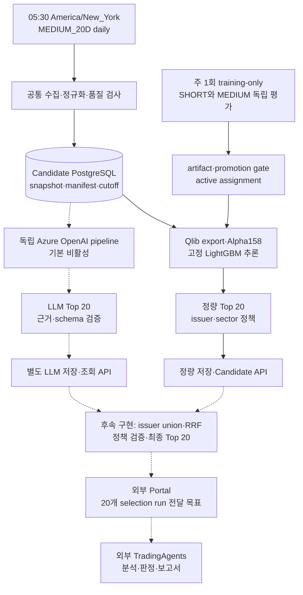
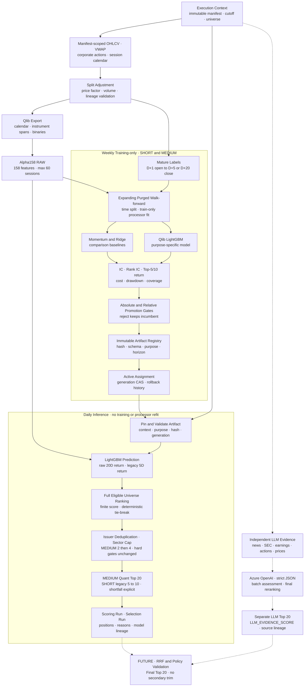

# S&P 500 Candidate Engine

미국 거래일마다 수집한 point-in-time 데이터로 후속 분석 후보를 선정하는 엔진입니다.
일일 기본 경로는 **MEDIUM_20D 정량 후보 20개**이며, 별도 LLM 후보 20개와
최종 통합 후보 20개로 확장하는 구조입니다. **TradingAgents에 전달할 후보 수는
기존 5~10개에서 20개로 변경합니다.** 후보는 매수 추천이나 주문이 아닙니다.

공통 범위·무결성·시점·재현성 규칙은 [PROJECT-HARNESS.md](PROJECT-HARNESS.md)를
우선합니다. 이 문서의 설계 계약은 운영 배포 완료를 의미하지 않습니다.

## 범위와 결과 계약

```text
수집 -> 전처리 -> 모델 점수 -> 후보 선정·검증 -> 저장·조회 API
```

- Candidate PostgreSQL이 원천·점수·후보·실행 기록의 단일 원본입니다.
- Portal과 TradingAgents는 외부 소비자입니다. 분석 실행, agent prompt·memory,
  매수·매도 판정, MySQL 분석 상태와 보고서 Blob은 이 저장소의 책임이 아닙니다.
- Durable Functions는 일정·멱등 API 호출·상태 확인을 담당하는 control plane입니다.
- 기존 `SHORT_5D`의 명시적 API·수동 실행과 5~10개 레거시 정책은 유지합니다.
  이를 일일 MEDIUM 또는 향후 최종 전달 수량 20개와 혼동하지 않습니다.

| 결과 | 개수 | 점수 의미 | 실행·조회 계약 |
|---|---:|---|---|
| 정량 `MEDIUM_20D` | 정확히 20 | `PREDICTED_20D_RETURN` | 기본 일일 추론, `/api/v1/candidates` |
| 레거시 `SHORT_5D` | 5~10 | `PREDICTED_5D_RETURN` | 명시적 목적 선택, 동일 API |
| 독립 `LLM_PRESELECTION` | 정확히 20 | `LLM_EVIDENCE_SCORE` | feature flag 기본 비활성, `/api/v1/llm-preselections` |
| 향후 RRF 통합 결과 | 목표 20 | 별도 fusion 순위 | 설계 단계, 아직 미구현 |
| 외부 TradingAgents 전달 | 20 | 선정 run 참조 | 변경된 목표 계약, 자동 전달 전 별도 연동 검증 필요 |

`20D`는 **예측 기간 20거래일**이며 후보 개수와 별개입니다. MEDIUM 선정 정책은
[selection_medium_20d_v1.yaml](config/analytics/selection_medium_20d_v1.yaml)의
`medium-20d-top20-v1`입니다. 양수 예측만 고르지 않고 전체 적격 universe에
issuer 중복 제거와 sector cap을 적용합니다. hard gate를 완화해 수량을 채우거나
20개 미만을 성공 결과로 표시하지 않습니다.

후보 수 변경은 모델 재학습이나 예측값 변경이 아닙니다. Top-5/10 평가 지표와
과거 10개 후보 검증 기록은 그대로 유효하며 20개 성능으로 바꿔 해석하지 않습니다.

## 전체 시스템 아키텍처

전체 연동 구조는 아래에 유지합니다. `candidate_engine`이 이 저장소의 구현 범위이며,
Portal·TradingAgents와 외부 데이터·분석 저장소·UI는 연동 맥락을 보여주는 외부 영역입니다.
외부 영역의 표시는 이 저장소에서 해당 기능을 구현·배포한다는 뜻이 아닙니다.

```mermaid
flowchart LR
    subgraph CandidateScope["PROJECT SCOPE · candidate_engine"]
        subgraph Inputs["S&P 500 Universe and Source Data"]
            Reference["Wikipedia and SEC<br/>S&P 500 · GICS · CIK · ticker · exchange"]
            Massive["Massive<br/>OHLCV · VWAP · SPY · actions · news"]
            Sec["SEC EDGAR<br/>filings · normalized XBRL"]
            Alpha["Alpha Vantage<br/>earnings calendar · estimate · reported EPS"]
        end

        Collect["Shared Collection and Normalization<br/>quality gates · cutoff fence"]
        DataSpine[("Candidate PostgreSQL<br/>immutable snapshot · manifest · execution context")]
        subgraph Quantitative["Independent Quantitative Pipeline"]
            Export["Qlib Export<br/>adjusted OHLCV · calendar · span"]
            Features["Alpha158 RAW<br/>158 features · max 60 sessions"]
            Model["Pinned LightGBM Artifact<br/>daily MEDIUM_20D · legacy SHORT_5D"]
            QuantTop["Quant Top 20<br/>issuer · sector policy"]
        end
        subgraph LlmPipeline["Independent LLM Pipeline · optional · default OFF"]
            Evidence["Manifest-fenced Evidence<br/>news · SEC · earnings · actions · prices"]
            AzureOpenAI["Azure OpenAI<br/>batch evaluation · final ranking"]
            LlmTop["LLM Top 20<br/>schema · source validation"]
        end
        QuantApi["Quant Store and Candidate API"]
        LlmApi["Separate LLM Store and API"]
        Fusion["FUTURE · issuer union · RRF<br/>risk · sector validation"]
        FinalApi["FUTURE · Final Top 20 API<br/>no secondary trim · not an order"]

        Reference --> Collect
        Massive --> Collect
        Sec --> Collect
        Alpha --> Collect
        Collect --> DataSpine
        DataSpine --> Export --> Features --> Model --> QuantTop --> QuantApi
        DataSpine -.-> Evidence
        Evidence -.-> AzureOpenAI
        AzureOpenAI -.-> LlmTop
        LlmTop -.-> LlmApi
        QuantApi -.-> Fusion
        LlmApi -.-> Fusion
        Fusion -.-> FinalApi

        Durable["Python Durable Functions<br/>05:30 ET daily · idempotent control plane"]
        Operations["Private Storage · Key Vault<br/>App Insights · ACS Email flag"]
        Weekly["Weekly Training-only<br/>SHORT and MEDIUM · promotion gate"]
        Registry["Immutable Artifacts<br/>active assignment · generation CAS"]
        Operations --> Durable
        Durable --> Collect
        Durable --> Weekly
        Weekly --> Registry --> Model
    end

    subgraph External["EXTERNAL · Portal and TradingAgents"]
        Portal["Portal and Analysis API<br/>selection validation · idempotent dispatch"]
        subgraph Agents["TradingAgents · Agents Layer"]
            Analysts["Analysts<br/>market · fundamentals · news · sentiment"]
            Debate["Bull and Bear<br/>evidence debate"]
            Research["Research Manager<br/>debate synthesis"]
            Trader["Trader<br/>proposal"]
            Risk["Risk and Portfolio<br/>final rating"]
            Analysts --> Debate --> Research --> Trader --> Risk
        end
        subgraph ExternalData["External Data and State"]
            YFinance["yfinance<br/>OHLCV · fundamentals · news"]
            Macro["FRED and Polymarket<br/>macro · prediction"]
            MySQL[("MySQL<br/>analysis jobs · decisions")]
            Blob[("Private Blob<br/>analysis reports")]
        end
        PortalUi["Portal UI<br/>DailyAnalysis · job status · reports"]
        Portal --> Analysts
        YFinance --> Analysts
        Macro --> Analysts
        Risk --> MySQL
        Risk --> Blob
        MySQL --> PortalUi
        Blob --> PortalUi
    end

    FinalApi -.->|"future selection run batch · 20 candidates"| Portal
```



독립 LLM 경로는 구현됐지만 기본 비활성이며, RRF 통합과 최종 20개 자동 전달은
후속 구현입니다. 현재 MEDIUM은 후보 저장 후 `parallel_preselection`에서 종료합니다.
외부 분석 데이터는 Candidate manifest와 별도이며 이 저장소가 그 시점을 통제하지 않습니다.
전체 시스템 구조를 제거하지 않고 아래 후보 파이프라인 상세도와 함께 관리합니다.
상세 기준은 [전체 아키텍처 문서](.github/modernize/assessment/engines/facts/architecture-diagram.md)를
참고하세요.

## 후보 파이프라인 아키텍처



실선은 기본 정량 경로입니다. 점선 LLM 경로는 구현된 선택 기능이며 RRF·최종
20개 전달은 후속 설계입니다. LLM 활성화 시 공통 context 준비 후 Qlib export·모델
검증과 독립적으로 병렬 실행합니다. 두 중간 목록 40개를 그대로 외부에 전달하지 않습니다.

### 구현 경계

| 구성 | 위치 | 책임 |
|---|---|---|
| 공통 수집 | [production_pipeline.py](src/sp500_candidate_engine/production_pipeline.py) | 공급자 수집·정규화·snapshot |
| 일일 배치 | [batch_pipeline.py](src/sp500_candidate_engine/batch_pipeline.py) | 수집 후 후보 실행·결과 집계 |
| 고정 정량 추론 | [pipeline_execution.py](backend/app/services/pipeline_execution.py) | artifact 검증·Qlib·점수·20개 선정 |
| 독립 LLM | [llm_preselection/](src/sp500_candidate_engine/llm_preselection/) | evidence·평가·재정렬·저장·단독 실행 |
| LLM 정책 | [config/llm_preselection/](config/llm_preselection/) | windows·rubric·token·retry 설정 |
| 병렬 조정 | [daily_preselection.py](src/sp500_candidate_engine/daily_preselection.py) | 형제 pipeline 실행·실패 격리 |
| 외부 control plane | [orchestrator/](orchestrator/) | timer·접수·poll·후보 검증·전달 경계 |

LLM 기본 설정은 `LLM_PRESELECTION_ENABLED=false`입니다. 정량 Top 20 완료는
LLM 결과 유무에 의존하지 않습니다. LLM을 활성화한 병렬 실행은 한쪽만 성공하면
`PARTIAL_SUCCESS`, 양쪽 모두 성공하지 못하면 `FAILED`로 집계하고 성공한 결과는
보존합니다. 실패한 LLM을 과거 결과나 정량 목록으로 대체하지 않습니다.

**자동 전달 경계:** 현재 MEDIUM workflow는 `parallel_preselection`에서 종료하고
`submitted_candidates=0`으로 Portal 제출을 건너뜁니다. 이번 문서의 20개 전달 계약이
그 차단을 해제하거나 외부 시스템을 배포한 것은 아닙니다. 최종 통합·전달 활성화 시
Portal의 20개 수용, 날짜·목적·run·position·중복 검증과 멱등 처리를 함께 검증해야 합니다.

## 일일 실행과 주간 재학습

### 일일 control plane

1. UTC 매시 30분 timer가 뉴욕 현지 `05:30`일 때만 직전 달력 날짜의
   `candidate-daily-YYYY-MM-DD-medium_20d`를 시작합니다. DST는 timezone으로 처리합니다.
2. Candidate XNYS session 조회에서 비거래일이면 외부 실행 없이 skip합니다.
3. readiness를 확인하고 날짜·모델별 유효한 정량 20개가 이미 있으면
   `SKIPPED_EXISTING`으로 신규 제출을 생략합니다. 과거 10개 결과는 새 20개 완료 조건이 아닙니다.
4. MEDIUM은 `top20-v1` suffix가 있는 `Idempotency-Key`로 DAILY를 접수합니다.
   같은 key·payload는 같은 run, 다른 payload는 충돌로 처리합니다.
5. 공통 수집 후 고정 artifact로 추론하고 정량 20개를 저장·검증합니다.
   DAILY API는 모델 학습이나 processor fit을 실행하지 않습니다.
6. MEDIUM은 후보 저장 경계에서 종료합니다. 기존 SHORT 명시 실행의 Portal 경로는
   레거시로 유지하며 새 20개 전달 계약의 구현 완료 증거로 간주하지 않습니다.

15분 resource guardian은 readiness와 승인된 제한 복구만 수행하며 일일 실행을
시작하지 않습니다. 메일은 `ORCHESTRATOR_EMAIL_ENABLED`로 제어하며 비활성 시
`SKIPPED`를 기록합니다. SKU·replica·리소스 중지는 별도 사용자 승인 없이 변경하지 않습니다.

### 주 1회 training-only

- New York 주말 gate와 ISO week 멱등 run으로 SHORT·MEDIUM을 각각 평가합니다.
- 학습과 일일 추론은 분리하며 weekly job은 production 후보를 생성하지 않습니다.
- expanding purged walk-forward, 성숙 label, train-only fit을 적용합니다.
- challenger가 절대·상대 promotion gate를 통과할 때만 immutable artifact와
  generation CAS active assignment를 갱신합니다. 실패·reject는 incumbent를 유지합니다.
- DAILY는 assignment를 실행별로 pin하고 hash·schema·model purpose·horizon을 검증합니다.

상세 계약은 [주간 재학습 설계](weekly_retraining_model_design.md)와
[모델 변경 이력](MODEL_CHANGELOG.md)을 참고하세요.

## 데이터 원천과 수집

| 원천 | 용도 | 제한·주의 |
|---|---|---|
| Massive Stocks Basic | EOD OHLCV·VWAP·SPY·split·dividend·news | 공유 5회/분, 가격 약 2년, 콘텐츠 권리 확인 |
| SEC EDGAR | CIK·ticker·exchange·submissions·companyfacts | User-Agent 필수, fact concept·unit·기간 정규화 |
| Alpha Vantage | 전체 earnings calendar | 하루 전체 목록 1회, 무료 key 25회/일 |
| Wikipedia revision | prototype S&P 500·GICS | 공식 과거 구성·분류 이력이 아님 |
| `exchange_calendars` | XNYS session 기준선 | 공식 NYSE/Nasdaq calendar·halt collector는 후속 과제 |

공급자별 quota가 독립인 lane은 병렬 실행합니다. Massive는 collector 전체가 limiter를
공유하며 grouped daily 미지원 시 ticker fallback으로 약 101분 이상 걸릴 수 있습니다.
raw snapshot atomic write와 content hash, dataset transaction, temporal·quality gate,
final manifest를 거쳐 후보 입력을 확정합니다.

기간 BACKFILL은 수집에서 종료하고 후보를 자동 생성하지 않습니다. 역사적 earnings는
당시 revision을 증명할 수 없으면 제외합니다. 현재 구성원 목록을 과거 구성원으로
간주하지 않으며 결측 가격·거래량을 forward fill하지 않습니다.

데이터 권리·범위는 [원천·라이선스 카탈로그](.github/modernize/assessment/engines/facts/data-source-license-catalog.md),
수집 흐름은 [수집 파이프라인](.github/modernize/assessment/engines/facts/ingestion-pipeline.md)을 따릅니다.

## 정량 모델과 독립 LLM

### 모델 아키텍처

모델의 학습·평가·등록과 일일 고정 모델 추론을 구분합니다. 주간 재학습에서만
label과 walk-forward 평가를 사용하며, 일일 추론은 등록된 artifact로 점수를 계산합니다.



LLM 경로는 정량 특징·예측값을 입력받는 후처리 모델이 아니라 동일 context를 사용하는
독립 후보 선정 경로이며 기본 비활성입니다. RRF는 후속 설계입니다. 예측 기간과
후보 개수, Top-5/10 평가 지표는 서로 다른 계약으로 유지합니다.
전처리·label·score·선정 계약의 상세는
[모델 아키텍처 문서](.github/modernize/assessment/engines/facts/model-architecture.md)를 따릅니다.

### Alpha158·LightGBM

- split-adjusted OHLCV·VWAP, 거래 session, point-in-time membership과 factor lineage를 사용합니다.
- Alpha158 RAW 158차원, 최대 lookback 60 sessions이며 필요 이력이 없으면 적격으로 만들지 않습니다.
- SHORT label은 `D+5 adjusted close / D+1 adjusted open - 1`,
  MEDIUM label은 `D+20 adjusted close / D+1 adjusted open - 1`입니다.
- 예측값은 raw 가격 수익률이며 확률·confidence·SPY 초과수익률이 아닙니다.
- 뉴스·실적·SEC fact는 현재 Alpha158 모델 입력에 자동 포함되지 않습니다.
- IC·Rank IC, Top-5/10 raw·net return, 비용·drawdown 평가를 유지합니다.
  후보 수 20개 변경만으로 Top-20 성능이 검증됐다고 주장하지 않습니다.

### LLM evidence

별도 LLM pipeline은 manifest로 제한한 뉴스 30일, 실적 2회, SEC filing 1년,
facts 8분기, 기업행위 1년, 가격 60 sessions와 당시 종목 metadata를 사용합니다.
전체 적격 universe를 배치별 strict JSON으로 평가하고 상위 pool을 정확히 20개로
재정렬합니다. raw payload·기사 전문·외부 웹 검색·외부 지식·투자 의견은 입력·평가에서 제외합니다.

Entra 인증 Azure OpenAI를 사용합니다. 응답 schema·source evidence ID를 검증하고
timeout·408/429/5xx 등 제한된 오류만 retry합니다. deployment·API·prompt·policy·
evidence version과 입력·출력 hash·token 사용량을 보존하며 성공한 동일 입력은 재사용합니다.

[RRF 설계서](<Agent Implementation Instructions — Hybrid Candidate Selection with RRF.md>)는
후속 통합 목표입니다. 이벤트 screening·평가 rubric 등 제안은 현재 LLM 구현과 같다고
간주하지 않으며, 최종 20개 병합·API·외부 전달은 별도 구현·검증이 필요합니다.

## Point-in-time·저장 계약

- 모든 분석 조회는 `execution_context_id`와 `input_manifest_member`에 고정합니다.
- `source_available_at <= cutoff_at`; `OPERATIONAL_REPLAY`는 observation도 cutoff 이하여야 합니다.
- `HISTORICAL_RECONSTRUCTION`은 당시 운영 입력 재현으로 표현하지 않습니다.
- FULL/DELTA lineage 모호성, 미래 누수, artifact 불일치는 fail closed합니다.
- 원본·revision·기존 후보 run을 덮어쓰지 않습니다. 새 정책은 새 identity를 사용합니다.
- 후보와 reason은 단일 transaction으로 저장하며 position·instrument·rank 중복을 허용하지 않습니다.

Azure PostgreSQL 16+를 Microsoft Entra 인증으로 사용합니다.

| Schema | 책임 |
|---|---|
| `ops` | ingestion·snapshot·manifest·context·quality·process |
| `ref` | issuer·instrument·state·identifier·universe |
| `market` | daily bar·benchmark·corporate action·observation |
| `event` | news·earnings·revision·instrument mapping |
| `fundamental` | SEC filing·fact·observation |
| `analytics` | export·feature·label·model·score·LLM evidence/assessment |
| `selection` | 정량 Top 20·레거시 결과·별도 LLM Top 20·reason |

[sql/](sql/)의 migration을 순서대로 적용합니다. 20개 허용 제약과 LLM schema는
[022_llm_preselection.sql](sql/022_llm_preselection.sql)에 있습니다. 신규 코드·schema의
운영 적용은 별도 배포 작업이며 문서 수정만으로 기존 10개 결과가 변경되지 않습니다.
상세 관계는 [데이터 아키텍처](.github/modernize/assessment/engines/facts/data-architecture.md)를 참고하세요.

## 설치와 환경 설정

기본 Python 요구사항은 3.11+입니다. Qlib analytics는 manifest의 제한에 따라
Python 3.11 또는 3.12를 사용합니다.

```powershell
python -m venv .venv
.\.venv\Scripts\python.exe -m pip install -e ".[analytics,backend,dev]"
Copy-Item .env.example .env
```

기존 환경파일이 있다면 덮어쓰지 않습니다. 로컬 엔진·독립 LLM은 루트 `.env`,
API 전용 설정은 `backend/.env`, Azure는 App Settings와 관리 ID를 사용합니다.
필수 Azure/DB/provider 설정과 선택 LLM 설정은 [.env.example](.env.example)을 따릅니다.
tenant/client ID·client secret은 로컬 서비스 계정 인증에만 사용하고 값은 로그·문서·Git에 남기지 않습니다.
Azure OpenAI client는 custom temperature를 강제하지 않고 strict JSON을 요구합니다.

## 실행과 조회

### 운영용 고정 모델 DAILY API

아래는 요청 계약입니다. 인증 헤더와 base URL은 실제 환경에서 안전하게 주입합니다.

```json
{
  "mode": "DAILY",
  "date": "2026-10-15",
  "with_candidates": true,
  "model_purpose": "MEDIUM_20D"
}
```

- `POST /api/v1/pipeline-runs`: `X-API-Key`·`Idempotency-Key`, `202 + process_run_id`.
- `GET /api/v1/pipeline-runs/{process_run_id}`: 실행 상태 확인.
- `GET /api/v1/candidates?date=2026-10-15&model_purpose=MEDIUM_20D&limit=100`:
  대상일 최신 성공 정량 run. `selected_count`, `requested_count`, 실제 row 수를 함께 확인합니다.
- `GET /api/v1/llm-preselections?date=2026-10-15`: 별도 LLM 결과. 정량 응답과 섞지 않습니다.

API 조회 기본 목적은 MEDIUM이며 해당 결과가 없다고 SHORT로 fallback하지 않습니다.
조회 watermark·cursor·CORS·배포 및 단일 worker 제약은 [Backend 가이드](backend/README.md)를 따릅니다.

### CLI

```powershell
# 설정 이름·구성 상태 확인, 비밀값 출력 금지
.\.venv\Scripts\python.exe -m sp500_candidate_engine --env-file .env check-config

# 수집만 실행
.\.venv\Scripts\python.exe -m sp500_candidate_engine --env-file .env run-daily --date 2026-10-15

# 기존 export 기반 MEDIUM 연구 workflow: 학습·평가를 포함할 수 있어 DAILY API와 구분
.\.venv\Scripts\python.exe -m sp500_candidate_engine --env-file .env run-candidates `
  --date 2026-10-15 --horizon-sessions 20 --decision-cutoff 2026-10-16T09:30:00+00:00

# LLM 단독 실행: 활성 설정·인증·고정 context 필요
.\.venv\Scripts\python.exe -m sp500_candidate_engine.llm_preselection `
  --date 2026-10-15 --execution-context-id <context-uuid>

# Backfill 사전 계획 / 수집 / 재시도
.\.venv\Scripts\python.exe -m sp500_candidate_engine --env-file .env plan-backfill --start 2026-07-15 --end 2026-10-15
.\.venv\Scripts\python.exe -m sp500_candidate_engine --env-file .env run-backfill --start 2026-07-15 --end 2026-10-15
.\.venv\Scripts\python.exe -m sp500_candidate_engine --env-file .env retry-backfill `
  --process-run-id <uuid> --start 2026-07-15 --end 2026-10-15

# 실행 조회 / export / migration
.\.venv\Scripts\python.exe -m sp500_candidate_engine --env-file .env show-process --process-run-id <uuid>
.\.venv\Scripts\python.exe -m sp500_candidate_engine --env-file .env export-qlib --start 2024-10-16 --end 2026-10-15
.\.venv\Scripts\python.exe -m sp500_candidate_engine --env-file .env migrate
```

CLI `run-daily --with-candidates`와 `run-candidates`의 기본 horizon은 레거시 5입니다.
일일 고정 MEDIUM 추론은 위 API 계약을 사용합니다. 연구 CLI는 `--horizon-sessions 20`을
명시하며 자동 학습 없는 운영 추론으로 오인하지 않습니다.
노트북 실행은 [notebooks/README.md](notebooks/README.md)를 참고하세요.

## 로그·테스트

단계 로그는 `logs/<서울 실행일>.log`, process 로그는
`logs/processes/<process_run_id>.jsonl`입니다. 날짜·단계·상태·duration·count·
failure·retry·heartbeat를 기록하며 secret·token·raw payload는 기록하지 않습니다.

```powershell
.\.venv\Scripts\python.exe -m pytest
.\.venv\Scripts\python.exe -m ruff check src backend orchestrator tests
```

핵심 검증은 cutoff/manifest, corporate-action lineage, feature 차원, label purge,
artifact 목적·hash, 정확히 20개 선정·shortfall, SHORT 레거시 보존, 멱등성, 병렬 실패 격리입니다.
테스트 통과·API smoke·운영 배포·모델 투자 성능은 서로 다른 검증입니다.

## 배포와 후속 작업

- Backend·Durable 배포 절차는 [backend/README.md](backend/README.md)와
  [orchestrator/README.md](orchestrator/README.md)를 따릅니다. 문서 수정은 배포 명령이 아닙니다.
- 정량 20개 코드·정책·DB 제약과 orchestration 검증을 함께 배포해야 합니다.
- LLM은 Azure OpenAI RBAC·고정 context canary·전체 universe shadow 검증 후 별도 활성화합니다.
- RRF 통합과 최종 20개 전달은 별도 설계·구현·Portal 수용 검증·재실행 검증을 거칩니다.
- 공식 point-in-time S&P/GICS, 공식 calendar·halt, 장기 가격·복수 regime 검증,
  champion promotion·live shadow 관찰은 별도 데이터·연구 과제입니다.
- 무료 플랜·기사 전문·공시 제3자 콘텐츠·재배포 권리를 확인해야 합니다.

## 문서와 저장소 안내

- [공통 하네스](PROJECT-HARNESS.md), [구현 지시서](us_stock_pipeline_agent_brief.md)
- [전체 아키텍처](.github/modernize/assessment/engines/facts/architecture-diagram.md)
- [모델 아키텍처](.github/modernize/assessment/engines/facts/model-architecture.md)
- [오케스트레이터 아키텍처](.github/modernize/assessment/engines/facts/orchestrator-architecture.md)
- [Telemetry·KQL runbook](.github/modernize/assessment/engines/facts/orchestrator-telemetry-runbook.md)
- [모델 변경 이력](MODEL_CHANGELOG.md), [변경 로그](CHANGELOG.md)

```text
src/sp500_candidate_engine/
  collectors/          공통 원천 수집
  analytics/           Qlib·Alpha158·모델·시점 제한 조회
  selection/           정량 선정 정책·저장
  llm_preselection/    독립 LLM pipeline·evidence·ranker·저장
  daily_preselection.py  병렬 조정
backend/               API·고정 모델 DAILY 실행
orchestrator/          Durable control plane
config/analytics/      정량·재학습 versioned 설정
config/llm_preselection/  LLM 전용 정책
sql/                   migration
tests/                 계약·회귀 테스트
notebooks/             연구용 workflow
infra/                 Azure IaC
```

모든 사용자 요청 변경은 [CHANGELOG.md](CHANGELOG.md)에 항목별 한 줄로 기록합니다.
