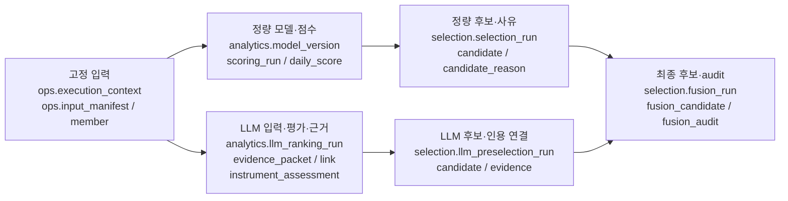
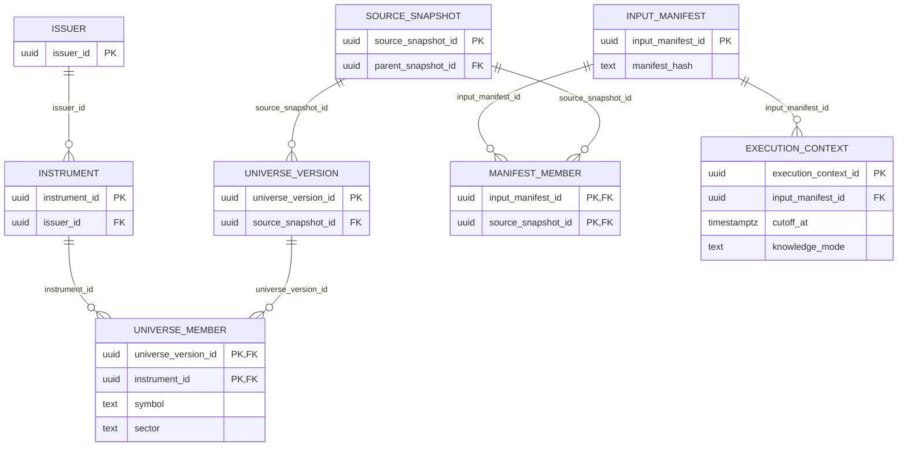
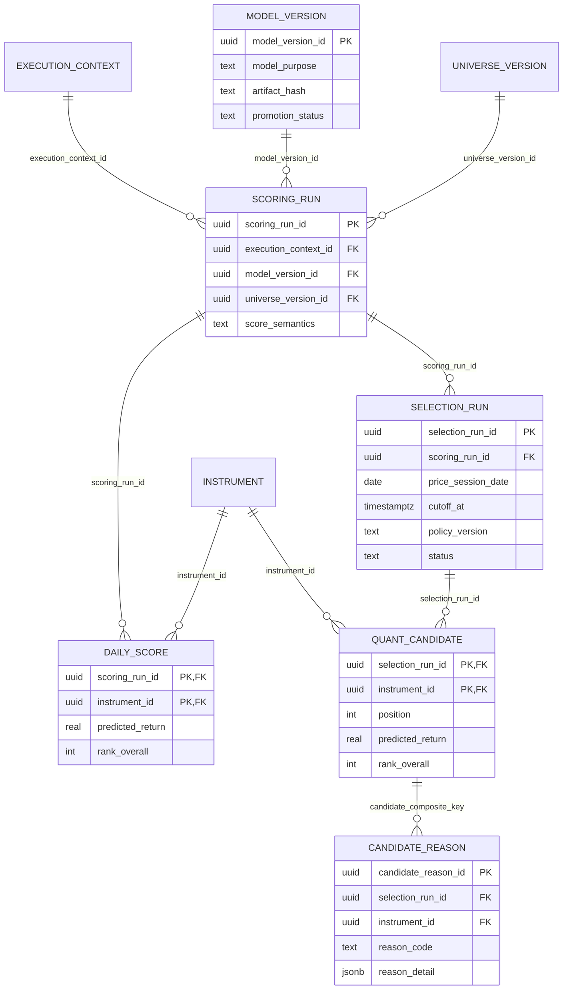
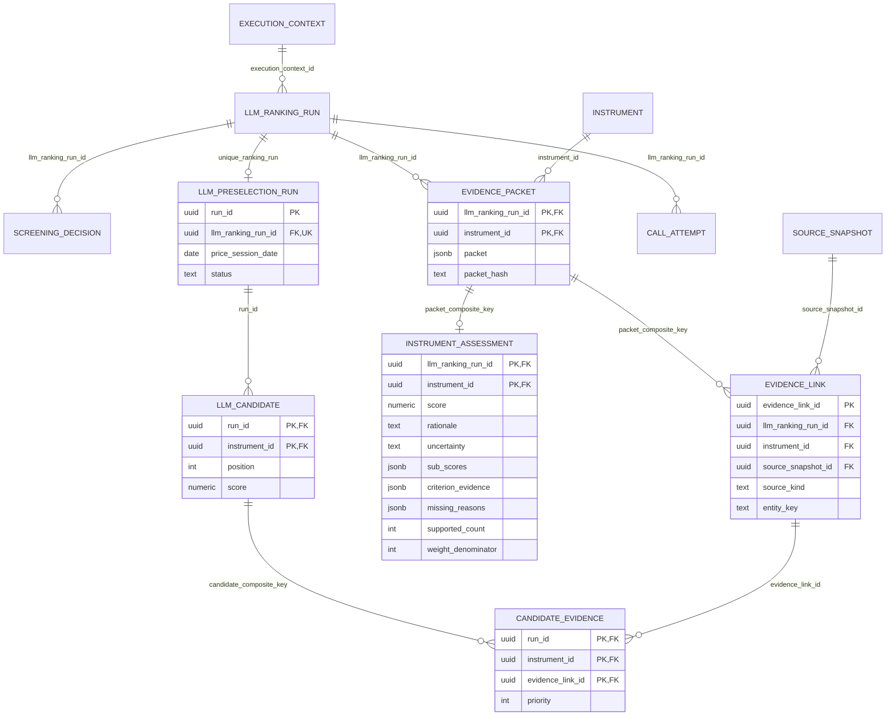
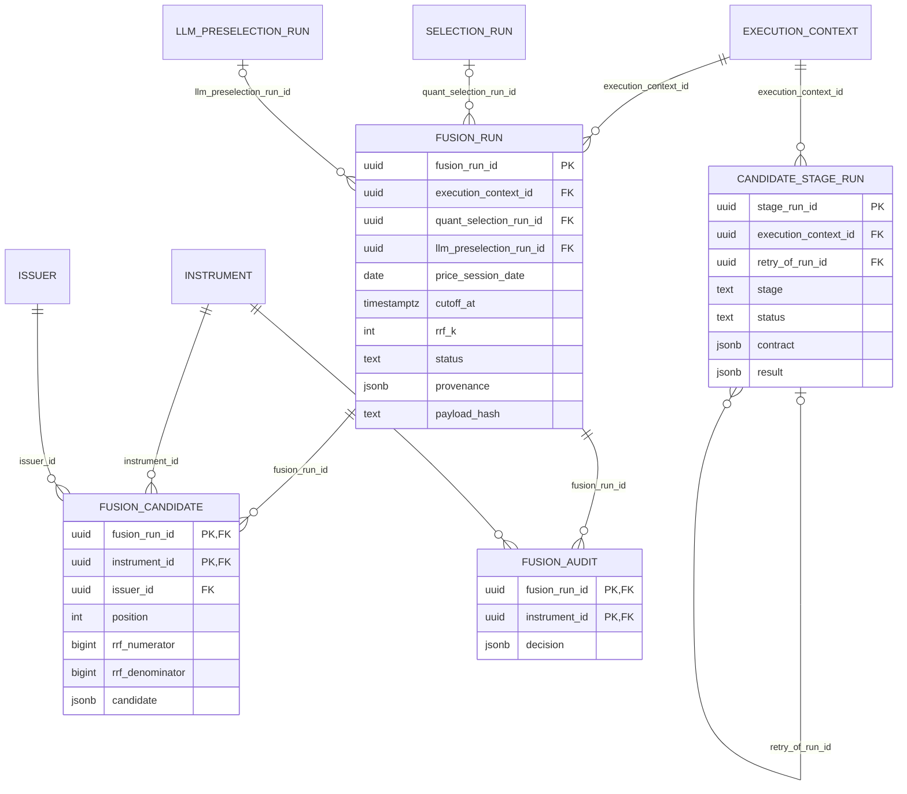

# 후보 종목 DB 테이블 설명과 ER 다이어그램

작성일: 2026-10-17. 저장소 SQL migration `001`~`024`와 현재 저장·조회 구현 기준이다.
아래는 후보 선정과 근거 추적에 필요한 핵심 테이블의 논리 구조이며, 모든 컬럼을 나열한
전체 DB 사전은 아니다. DB 변경이나 migration 실행은 하지 않았다.

## 1. 전체 구조

핵심 식별자는 ticker가 아니라 `instrument_id`다. `issuer_id`는 발행 기업이고
동일 기업의 서로 다른 주식은 별도 instrument다. 날짜만으로 결과를 조합하지 않고
정확한 run ID와 `execution_context_id`, `cutoff_at`을 함께 사용한다.

## 2. 공통 입력·종목 식별 테이블

| 테이블 | 기본키 | 주요 컬럼·관계 | 역할 |
|---|---|---|---|
| `ref.issuer` | `issuer_id` | 기업 식별 정보 | 발행 기업. issuer 중복 제거의 기준 |
| `ref.instrument` | `instrument_id` | `issuer_id` FK | 개별 증권·주식 식별자 |
| `ref.universe_version` | `universe_version_id` | `universe_id`, `source_snapshot_id` FK | 특정 시점의 분석 universe 버전 |
| `ref.universe_member` | `(universe_version_id, instrument_id)` | 양쪽 FK; `symbol`, `security_name`, `sector` | 해당 universe에서의 종목명·ticker·섹터 |
| `ops.source_snapshot` | `source_snapshot_id` | 수집 run·source FK, `parent_snapshot_id`, 원본 hash·시각 | 수집 원본의 immutable 식별·계보 |
| `ops.input_manifest` | `input_manifest_id` | `manifest_hash` | 분석에 사용할 원천 집합의 identity |
| `ops.input_manifest_member` | `(input_manifest_id, source_snapshot_id)` | 양쪽 FK | 분석에 허용된 snapshot 목록 |
| `ops.execution_context` | `execution_context_id` | `input_manifest_id` FK, `cutoff_at`, `knowledge_mode` | 정량·LLM·Fusion이 공유하는 시점 고정 계약 |

그림의 `MANIFEST_MEMBER`는 `ops.input_manifest_member`에 해당한다.

## 3. 정량 모델·후보·선정 사유

| 테이블 | 기본키 | 주요 컬럼·관계 | 역할 |
|---|---|---|---|
| `analytics.model_version` | `model_version_id` | 학습 export·feature·processor·label run FK; `model_purpose`, `return_policy`, `label_semantics`, `artifact_hash`, `promotion_status` | 고정 모델 artifact와 학습·평가 provenance |
| `analytics.scoring_run` | `scoring_run_id` | context·export·model·universe FK; `score_semantics`, `config_hash`, `status` | 특정 입력·모델로 수행한 추론 run |
| `analytics.daily_score` | `(scoring_run_id, instrument_id)` | 양쪽 FK; `score`, `predicted_return`, `rank_overall`, `score_percentile`, `rank_sector`, `prediction_horizon`, `quality_status` | 전체 점수 산정 대상 종목의 점수·순위 |
| `selection.selection_run` | `selection_run_id` | `scoring_run_id` FK; 거래일·cutoff·정책/hash·요청/선정 수·상태·멱등 key | 정량 후보 선정 실행 |
| `selection.candidate` | `(selection_run_id, instrument_id)` | 양쪽 FK; `position`, `score`, `predicted_return`, 전체/섹터 순위·percentile·품질 | 제약 적용 후 선정된 정량 후보 |
| `selection.candidate_reason` | `candidate_reason_id` | 후보 복합 FK; 선택적 `event_revision_id` FK; `reason_code`, `priority`, `reason_fingerprint`, `reason_detail` JSONB | 후보별 선정 사유와 상세 정보 |

`QUANT_CANDIDATE`는 `selection.candidate`다. `daily_score` 전체 순위와
`candidate.position`은 섹터·issuer 제약 때문에 다를 수 있다.
현재 MEDIUM은 성공 시 20개, SHORT 레거시는 5~10개다. 초기 `015`의 개수 제약만
보면 현재와 다르므로 후속 `022` migration까지 함께 읽어야 한다.

## 4. LLM 입력·평가·선정 근거

| 테이블 | 기본키 | 주요 컬럼·관계 | 역할 |
|---|---|---|---|
| `analytics.llm_ranking_run` | `llm_ranking_run_id` | context FK; 거래일/cutoff·정책/hash·prompt/deployment/API/evidence 버전·`window_config`·`input_hash`·상태 | 독립 LLM 평가 실행 identity |
| `analytics.llm_screening_decision` | `(llm_ranking_run_id, issuer_id)` | ranking·issuer·instrument FK; `decision` JSONB | EVENT/CONTROL 구분·유형 점수·screening 입력 증적 |
| `analytics.llm_evidence_packet` | `(llm_ranking_run_id, instrument_id)` | ranking·instrument FK; `packet` JSONB, `packet_hash`, section/missing/truncated 정보 | LLM에 실제 제공한 고정 입력 |
| `analytics.llm_evidence_link` | `evidence_link_id` | packet 복합 FK·snapshot FK; `source_kind`, `entity_key`, 공개/관찰/이벤트 시각 | 종목별 evidence와 실제 원천 연결 |
| `analytics.llm_call_attempt` | `llm_call_attempt_id` | ranking FK·선택적 원본 cache attempt FK; stage/batch/attempt·입출력 hash·상태·token 수·`response_output` JSONB | 모델 호출·재시도·응답 감사 |
| `analytics.llm_instrument_assessment` | `(llm_ranking_run_id, instrument_id)` | packet 복합 FK; `score`, `sub_scores`, `rationale`, `uncertainty`, `criterion_evidence`, `missing_reasons`, `supported_count`, `weight_denominator` | 종목별 평가 점수와 실제 선정 근거 |
| `selection.llm_preselection_run` | `run_id` | `llm_ranking_run_id` UNIQUE FK; 거래일/cutoff·정책·선정 수·상태 | 최종 독립 LLM 후보 run |
| `selection.llm_preselection_candidate` | `(run_id, instrument_id)` | run·instrument FK; `position`, `score`, `first_stage_rank`, `final_rank`, 품질·이유 코드·종목명·섹터 | 독립 LLM 후보 목록 |
| `selection.llm_preselection_evidence` | `(run_id, instrument_id, evidence_link_id)` | 후보 복합 FK·evidence link FK; `priority` | 선정 후보에 연결된 evidence 목록 |

그림의 `SCREENING_DECISION`, `EVIDENCE_PACKET`, `EVIDENCE_LINK`,
`CALL_ATTEMPT`, `INSTRUMENT_ASSESSMENT`는 위 표의 `analytics.llm_*`,
`LLM_CANDIDATE`와 `CANDIDATE_EVIDENCE`는 `selection.llm_preselection_*`에 해당한다.

중요한 구분:

- `criterion_evidence`는 JSONB 안의 항목별 이유와 evidence ID다. JSON 내부 ID에는
  SQL FK가 없으므로 애플리케이션에서 참조 정합성을 검증한다.
- `llm_preselection_evidence`는 후보에 연결된 전체 evidence다. screening evidence,
  packet 전체 항목, 실제 채점에 사용한 citation이 모두 같은 집합인 것은 아니다.
- `entity_key`는 `source_kind`별 원본 식별자이며 모든 원천 테이블에 대한 직접 FK는 아니다.
- 뉴스 등은 `event.event_revision`, 공시는 `fundamental.sec_filing`,
  재무값은 `fundamental.fact`로 추적한다. 실제 입력 내용은 고정 packet에도 보존한다.

## 5. Fusion 최종 후보·통합 근거

| テーブル | 기본키 | 주요 컬럼·관계 | 역할 |
|---|---|---|---|
| `selection.fusion_run` | `fusion_run_id` | context FK; 정량·LLM 원천 run nullable FK; 거래일/cutoff·정책/hash·`rrf_k`·선정/union 수·상태·`provenance` JSONB·payload hash | 두 원천을 고정한 최종 통합 실행 |
| `selection.fusion_candidate` | `(fusion_run_id, instrument_id)` | run·instrument·issuer FK; `position`, `rrf_numerator`, `rrf_denominator`, `candidate` JSONB | 최종 후보 결과와 선택적 통합 설명 snapshot |
| `selection.fusion_audit` | `(fusion_run_id, instrument_id)` | run·instrument FK; `decision` JSONB | union 후보별 선정·제외 사유, 원천 순위·RRF 감사 |
| `ops.candidate_stage_run` | `stage_run_id` | context·retry 원본 FK; `stage`, 요청/계약/입력 hash·상태·`result` JSONB·실패 코드 | 독립 단계의 실행·재시도 제어. 실제 선정 run과 별개 |

Fusion 성공은 정확히 20개다. 같은 run 내 `issuer_id`와 `position`은 각각 UNIQUE다.
실패 run은 원천 ID가 없을 수 있지만 성공 run은 정량·LLM 원천 ID가 모두 필요하다.
RRF는 원천 후보 목록의 `position`으로 계산하며 전체 점수 순위를 사용하지 않는다.
`candidate_stage_run.result` 내부의 사업 결과 ID는 JSON 값이며 각각의 결과 테이블을
가리키는 SQL FK가 아니다.

## 6. 선정 근거가 실제 저장되는 위치

| 필요한 정보 | 실제 저장 위치 | 주의점 |
|---|---|---|
| 정량 점수·전체 순위 | `analytics.daily_score`, `selection.candidate` | 전체 점수 순위와 선정 목록 순위 구분 |
| 정량 선정 사유 | `selection.candidate_reason.reason_code / reason_detail` | v1은 임의 detail JSON 전체를 노출하지 않음 |
| LLM 종합 평가 이유 | `analytics.llm_instrument_assessment.rationale` | DB에 있어도 API schema/projection이 누락하면 응답에 없음 |
| LLM 불확실성 | `analytics.llm_instrument_assessment.uncertainty` | 점수나 투자위험 보장이 아님 |
| LLM 항목별 점수·이유 | 동일 테이블의 `sub_scores`, `criterion_evidence`, `missing_reasons` | `supported_count`, `weight_denominator`로 산식 확인 |
| 실제 뉴스·재무 입력 | `analytics.llm_evidence_packet.packet` | 원천 전체가 아니라 실제 모델에 제공한 고정 입력 |
| 원천 추적 | `analytics.llm_evidence_link`, `selection.llm_preselection_evidence` | snapshot/entity/시각과 실제 scored citation 구분 |
| Fusion 원천 점수·RRF·포함 여부 | `selection.fusion_candidate.candidate` | 분자/분모는 별도 컬럼에도 저장 |
| 새 통합 설명 snapshot | `selection.fusion_candidate.candidate -> 'explanation'` | 별도 테이블·컬럼이 아니라 기존 JSONB의 선택적 키 |
| 설명 버전·설정/출력 hash | `selection.fusion_run.provenance` | snapshot 무결성과 함께 검증 |
| 선정/제외 감사 | `selection.fusion_audit.decision` | 최종 선정 후보 외 union 탈락 후보도 추적 |

**2026-10-16 VLO 직접 조회 결과:** LLM `rationale`, `uncertainty=HIGH`, 9개
`criterion_evidence`는 DB에 있다. 반면 해당 과거 Fusion 후보 JSONB에는 `explanation`
키가 없고 run provenance에도 설명 버전이 없다. 즉 **원천 근거는 저장돼 있지만
당시 통합 설명 snapshot은 저장되지 않았다.** API 응답 누락과 DB 미저장을 구분해야 한다.

LLM 관련 핵심 기록과 Fusion 결과에는 UPDATE/DELETE 차단 trigger가 적용된다.
과거 결과를 덮어써 설명을 추가하지 않고, 새 run snapshot 또는 정확한 원천 결과를
읽는 versioned 응답으로 구분한다.

## 7. 기준 파일

- 공통 입력·종목: [`sql/001_mvp_schema.sql`](sql/001_mvp_schema.sql)
- 정량 점수: [`sql/014_models_scores.sql`](sql/014_models_scores.sql),
  [`sql/016_forward_return_model.sql`](sql/016_forward_return_model.sql),
  [`sql/018_multi_model_support.sql`](sql/018_multi_model_support.sql)
- 정량 선정: [`sql/015_selection.sql`](sql/015_selection.sql)
- LLM·Top 20 확장: [`sql/022_llm_preselection.sql`](sql/022_llm_preselection.sql)
- 항목별 LLM 근거·Fusion: [`sql/023_hybrid_fusion.sql`](sql/023_hybrid_fusion.sql)
- 독립 단계 제어: [`sql/024_candidate_stage_runs.sql`](sql/024_candidate_stage_runs.sql)
- 통합 설명 저장: [`src/sp500_candidate_engine/fusion/repository.py`](src/sp500_candidate_engine/fusion/repository.py)
- 결과·근거 조회: [`backend/app/repositories/fusions.py`](backend/app/repositories/fusions.py)

이 문서는 API 수정 완료나 운영 배포 완료를 의미하지 않는다.
