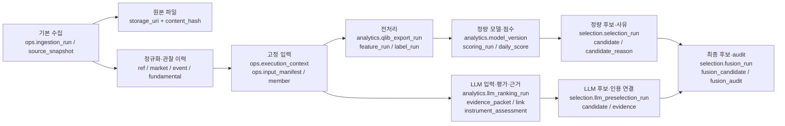
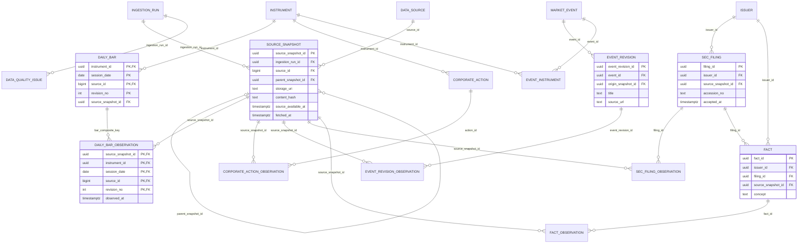
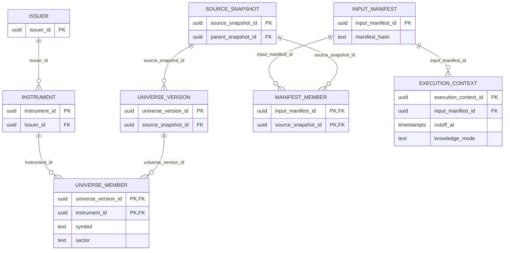
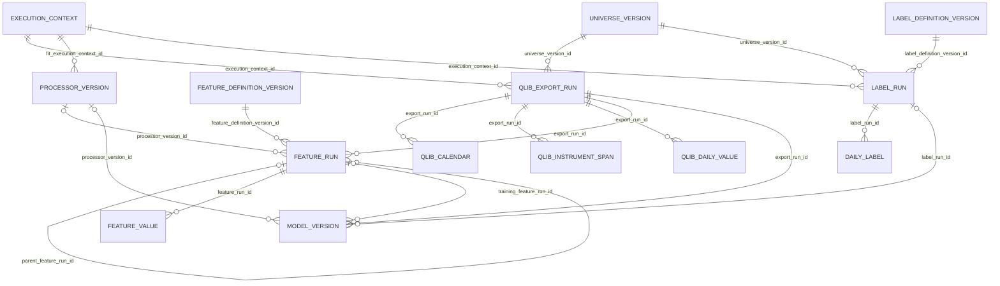
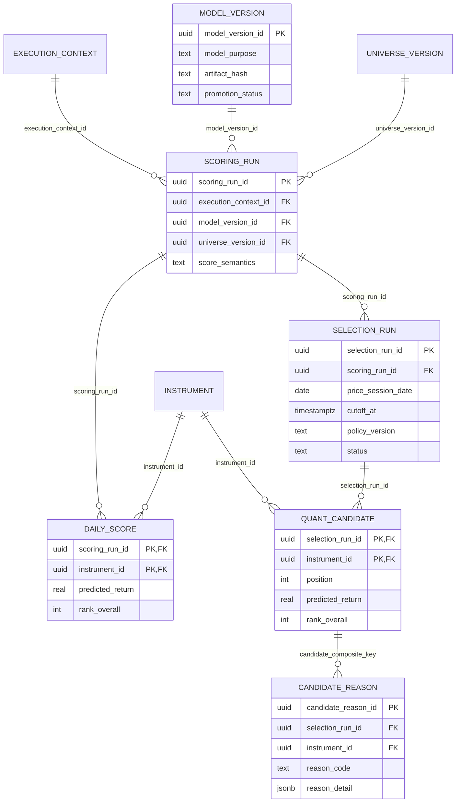
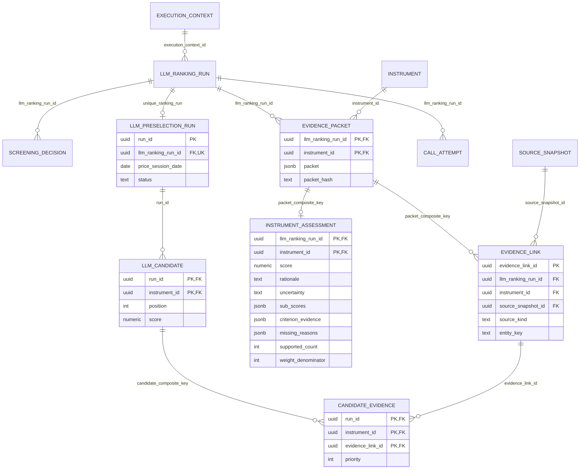
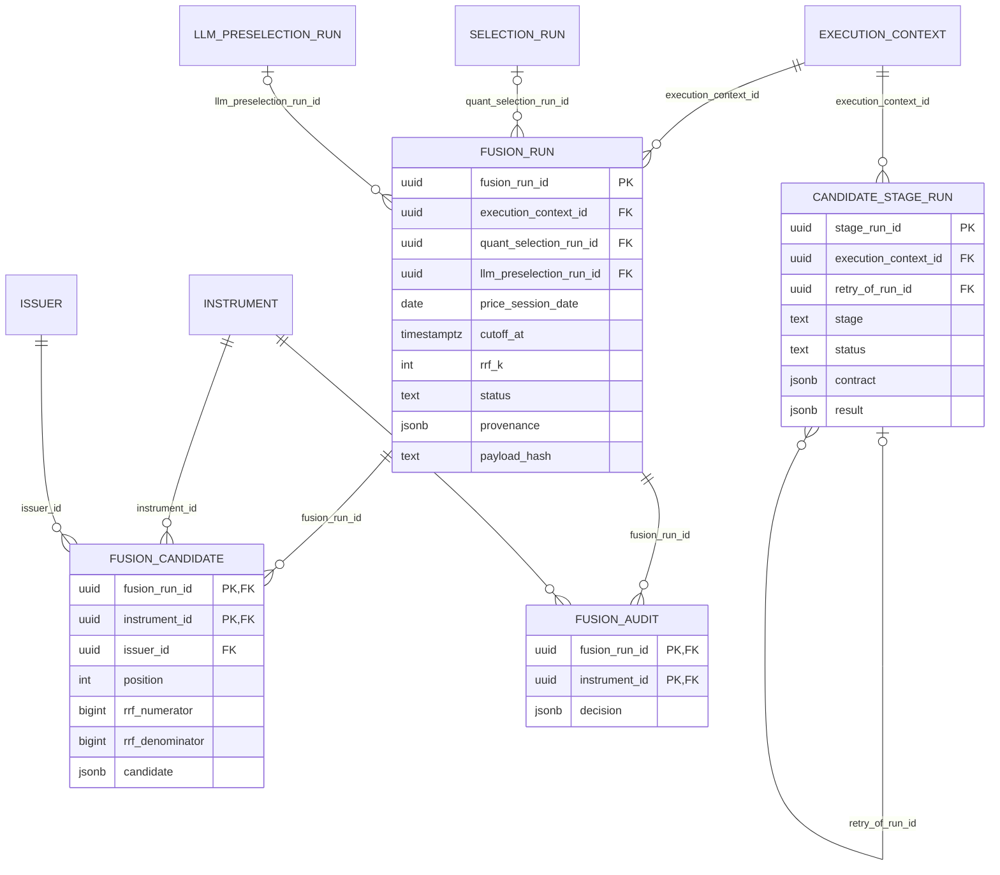

# 후보 종목 DB 테이블 설명과 ER 다이어그램

작성일: 2026-10-17. 갱신일: 2026-10-18. 저장소 SQL migration `001`~`024`와 현재 저장·조회 구현 기준이다.
아래는 후보 선정과 근거 추적에 필요한 핵심 테이블의 논리 구조이며, 모든 컬럼을 나열한
전체 DB 사전은 아니다. DB 변경이나 migration 실행은 하지 않았다.

용어를 처음 접한다면 [매니페스트·스냅샷과 저장 위치 쉬운 설명](DATA-STORAGE-GUIDE.md)을
먼저 읽으면 된다. 원본 파일·DB 행·허용 입력 목록·LLM 검색 증적과 실제 평가 입력의 차이를 설명한다.

## 1. 전체 구조

핵심 식별자는 ticker가 아니라 `instrument_id`다. `issuer_id`는 발행 기업이고
동일 기업의 서로 다른 주식은 별도 instrument다. 날짜만으로 결과를 조합하지 않고
정확한 run ID와 `execution_context_id`, `cutoff_at`을 함께 사용한다.

물리 저장은 **원본 파일**, **정규화 DB 행**, **분석 입력·결과 DB 행과 artifact**로
나뉜다. 원본 전체를 매 후보 행에 복사하지 않는다. 정규 데일리는 공통 수집 이후
같은 context의 독립 Quant Top 20·LLM Top 20을 보존하고 최종 Fusion Top 20을 만든다.

### 1.1 기본 수집과 정규화 저장

| 수집 정보 | 정규화 테이블·주요 키 | 저장 내용 |
|---|---|---|
| 공급자·수집 실행 | `ops.data_source(source_id)`, `ops.ingestion_run(ingestion_run_id)` | dataset·대상일·cutoff·설정 hash·성공/실패·수집/삽입 건수 |
| 원본 snapshot | `ops.source_snapshot(source_snapshot_id)` | 수집 run·공급자 FK, FULL/DELTA·부모 snapshot·coverage·공개/수집 시각·원본 URI/hash/크기 |
| 기업·종목 식별 | `ref.issuer`, `ref.instrument`, `ref.instrument_identifier`, `ref.instrument_state` | 기업과 증권 분리, ticker 등 식별자의 유효기간, snapshot별 거래 상태 |
| 분석 universe | `ref.universe`, `ref.universe_version`, `ref.universe_member` | universe 버전과 당시 구성 종목·ticker·섹터 |
| 거래 달력 | `ref.exchange_session(calendar_version, exchange_mic, session_date)` | 거래소 개장/폐장 시각·조기 폐장·원천 snapshot |
| 일별 가격·거래량 | `market.daily_bar(instrument_id, session_date, source_id, revision_no)` | OHLCV·adjusted close·VWAP·조정 상태·공개/관찰 시각·품질 |
| 가격 관찰 연결 | `market.daily_bar_observation` | 위 가격 복합키와 `source_snapshot_id`를 연결 |
| 기업행위 | `market.corporate_action`, `market.corporate_action_observation` | 분할·배당·revision 및 이를 실제 관찰한 snapshot |
| 벤치마크 가격 | `market.benchmark_daily_bar(benchmark_code, session_date, source_id, revision_no)` | 벤치마크 OHLCV·수익률/조정 기준·snapshot |
| 뉴스·실적 일정·이벤트 | `event.market_event(event_id)`, `event.event_revision(event_revision_id)` | 공급자 이벤트 identity와 제목·URL·예정/공개/관찰 시각·status의 revision |
| 이벤트 관찰·종목 연결 | `event.event_revision_observation`, `event.event_instrument` | revision을 관찰한 snapshot과 이벤트 대상 instrument |
| SEC 공시 | `fundamental.sec_filing(filing_id)`, `fundamental.sec_filing_observation` | issuer·accession·form·회계기간·접수 시각·문서 URL·snapshot 관찰 연결 |
| 재무 수치 | `fundamental.fact(fact_id)`, `fundamental.fact_observation` | filing·issuer·taxonomy/concept·단위·기간·수치·context hash·snapshot 관찰 연결 |
| 수집 품질·진행 관리 | `ops.data_quality_issue`, `ops.ingestion_checkpoint` | 품질 규칙·severity·ACTIVE/RESOLVED와 재개용 cursor. cursor 자체는 분석 근거가 아님 |

기본 JSON 수집 원본은 `RawSnapshotWriter`가 설정된 raw 디렉터리 아래
`날짜\dataset-content_hash.json.gz`로 저장한다. hash는 압축 전 canonical JSON의
SHA-256이고, DB에는 실제 파일 URI와 hash·압축 파일 크기를 저장한다.
달력 등 byte 원본은 별도 확장자로 보존할 수도 있다. URI가 있다는 것과 파일에
실제로 접근할 수 있다는 것은 별개이므로 DB만 백업해서는 원본이 보존되지 않는다.

`*_observation`은 **한 원천 행/revision이 어느 snapshot에서 관찰됐는지**를 나타내는
다대다 연결이다. 동일 가격·공시를 다시 관찰해도 매 수집마다 같은 내용의 revision을
새로 만들 필요는 없다. 분석에서는 원천 행의 최초 snapshot만 보거나 최신 행을
무조건 읽지 않고, manifest에 허용된 snapshot의 관찰 연결과 시점 제약을 함께 확인한다.

ER은 주요 수집 연결만 표시한다. 원천 행의 `source_snapshot_id`/`origin_snapshot_id` 직접 FK와 각
observation의 FK는 별개이며, 모든 원천별 컬럼·FK는 SQL을 기준으로 확인한다.

## 2. 공통 입력·종목 식별 테이블

| 테이블 | 기본키 | 주요 컬럼·관계 | 역할 |
|---|---|---|---|
| `ref.issuer` | `issuer_id` | 기업 식별 정보 | 발행 기업. issuer 중복 제거의 기준 |
| `ref.instrument` | `instrument_id` | `issuer_id` FK | 개별 증권·주식 식별자 |
| `ref.universe_version` | `universe_version_id` | `universe_id`, `source_snapshot_id` FK | 특정 시점의 분석 universe 버전 |
| `ref.universe_member` | `(universe_version_id, instrument_id)` | 양쪽 FK; `symbol`, `security_name`, `sector` | 해당 universe에서의 종목명·ticker·섹터 |
| `ops.source_snapshot` | `source_snapshot_id` | 수집 run·source FK, `parent_snapshot_id`, 원본 hash·시각 | 수집 원본의 immutable 식별·계보 |
| `ops.input_manifest` | `input_manifest_id` | `manifest_hash` | 분석에 사용할 원천 집합의 identity |
| `ops.input_manifest_member` | `(input_manifest_id, source_snapshot_id)` | 양쪽 FK | 분석에 허용된 snapshot 목록 |
| `ops.execution_context` | `execution_context_id` | `input_manifest_id` FK, `cutoff_at`, `knowledge_mode` | 정량·LLM·Fusion이 공유하는 시점 고정 계약 |

그림의 `MANIFEST_MEMBER`는 `ops.input_manifest_member`에 해당한다.

### 2.1 고정 입력 이후 전처리·특징·라벨

| 테이블 | 주요 키·연결 | 저장 내용 |
|---|---|---|
| `analytics.qlib_export_run` | `export_run_id`; context·universe FK | 대상 기간·조정 정책·버전·상태·export artifact URI/hash |
| `analytics.qlib_calendar` | `(export_run_id, session_date)` | export에서 실제 사용한 거래 일정 |
| `analytics.qlib_instrument_span` | `(export_run_id, instrument_id)` | export 종목과 유효 시작/종료일 |
| `analytics.qlib_daily_value` | `(export_run_id, instrument_id, session_date)` | 조정된 OHLCV·factor·VWAP·change·품질 |
| `analytics.feature_definition_version` | `feature_definition_version_id` | 특징 순서·차원·수식 hash·lookback·handler 설정 |
| `analytics.processor_version` | `processor_version_id`; fit context FK | 학습 기간·processor 설정·fit artifact URI/hash |
| `analytics.feature_run` | `feature_run_id`; export·정의·processor·부모 feature FK | RAW/PROCESSED 구분·계보·상태 |
| `analytics.feature_value` | `(feature_run_id, instrument_id, session_date)` | 순서가 고정된 특징 배열·결측 bitmap/count·품질 |
| `analytics.label_definition_version` | `label_definition_version_id` | 진입/종료·벤치마크·기업행위·경계 정책 |
| `analytics.label_run`, `analytics.daily_label` | `label_run_id`; context·universe·정의 FK; 일별 값은 run·instrument·anchor 복합키 | anchor/entry/exit 거래일과 실현 수익률·benchmark·학습 label |

수집 가격은 `market.daily_bar`, 분석용 조정가격은 `analytics.qlib_daily_value`,
모델 입력은 `analytics.feature_value`다. 라벨은 학습·평가용 미래 관측 결과이며
일일 예측 점수나 LLM 입력 근거와 구분한다. Qlib binary·processor·모델 파일은
artifact에, 그 파일의 identity와 실행 계보·구조화된 값은 DB에 남긴다.

## 3. 정량 모델·후보·선정 사유

| 테이블 | 기본키 | 주요 컬럼·관계 | 역할 |
|---|---|---|---|
| `analytics.model_version` | `model_version_id` | 학습 export·feature·processor·label run FK; `model_purpose`, `return_policy`, `label_semantics`, `artifact_hash`, `promotion_status` | 고정 모델 artifact와 학습·평가 provenance |
| `analytics.scoring_run` | `scoring_run_id` | context·export·model·universe FK; `score_semantics`, `config_hash`, `status` | 특정 입력·모델로 수행한 추론 run |
| `analytics.daily_score` | `(scoring_run_id, instrument_id)` | 양쪽 FK; `score`, `predicted_return`, `rank_overall`, `score_percentile`, `rank_sector`, `prediction_horizon`, `quality_status` | 전체 점수 산정 대상 종목의 점수·순위 |
| `selection.selection_run` | `selection_run_id` | `scoring_run_id` FK; 거래일·cutoff·정책/hash·요청/선정 수·상태·멱등 key | 정량 후보 선정 실행 |
| `selection.candidate` | `(selection_run_id, instrument_id)` | 양쪽 FK; `position`, `score`, `predicted_return`, 전체/섹터 순위·percentile·품질 | 제약 적용 후 선정된 정량 후보 |
| `selection.candidate_reason` | `candidate_reason_id` | 후보 복합 FK; 선택적 `event_revision_id` FK; `reason_code`, `priority`, `reason_fingerprint`, `reason_detail` JSONB | 후보별 선정 사유와 상세 정보 |

`QUANT_CANDIDATE`는 `selection.candidate`다. `daily_score` 전체 순위와
`candidate.position`은 섹터·issuer 제약 때문에 다를 수 있다.
현재 MEDIUM은 성공 시 20개, SHORT 레거시는 5~10개다. 초기 `015`의 개수 제약만
보면 현재와 다르므로 후속 `022` migration까지 함께 읽어야 한다.

주간 학습은 `analytics.weekly_training_run`, 승격 여부와 gate 결과는
`analytics.model_promotion_decision`에 남긴다. 현재 활성 모델은
`analytics.active_model_assignment`가 purpose별 model/artifact/generation을 가리키며,
변경·rollback 이력은 `analytics.active_model_assignment_history`에 보존한다.
새 모델을 학습했다고 곧바로 활성 모델이 되는 것은 아니다. 과거 후보의 모델은
현재 활성 assignment가 아니라 해당 `scoring_run.model_version_id`로 확인한다.

## 4. LLM 입력·평가·선정 근거

| 테이블 | 기본키 | 주요 컬럼·관계 | 역할 |
|---|---|---|---|
| `analytics.llm_ranking_run` | `llm_ranking_run_id` | context FK; 거래일/cutoff·정책/hash·prompt/deployment/API/evidence 버전·`window_config`·`input_hash`·상태 | 독립 LLM 평가 실행 identity |
| `analytics.llm_screening_decision` | `(llm_ranking_run_id, issuer_id)` | ranking·issuer·instrument FK; `decision` JSONB | EVENT/CONTROL 구분·유형 점수·screening 입력 증적 |
| `analytics.llm_evidence_packet` | `(llm_ranking_run_id, instrument_id)` | ranking·instrument FK; `packet` JSONB, `packet_hash`, section/missing/truncated 정보 | LLM에 실제 제공한 고정 입력 |
| `analytics.llm_evidence_link` | `evidence_link_id` | packet 복합 FK·snapshot FK; `source_kind`, `entity_key`, 공개/관찰/이벤트 시각 | 종목별 evidence와 실제 원천 연결 |
| `analytics.llm_call_attempt` | `llm_call_attempt_id` | ranking FK·선택적 원본 cache attempt FK; stage/batch/attempt·입출력 hash·상태·token 수·`response_output` JSONB | 모델 호출·재시도·응답 감사 |
| `analytics.llm_instrument_assessment` | `(llm_ranking_run_id, instrument_id)` | packet 복합 FK; `score`, `sub_scores`, `rationale`, `uncertainty`, `criterion_evidence`, `missing_reasons`, `supported_count`, `weight_denominator` | 종목별 평가 점수와 실제 선정 근거 |
| `selection.llm_preselection_run` | `run_id` | `llm_ranking_run_id` UNIQUE FK; 거래일/cutoff·정책·선정 수·상태 | 최종 독립 LLM 후보 run |
| `selection.llm_preselection_candidate` | `(run_id, instrument_id)` | run·instrument FK; `position`, `score`, `first_stage_rank`, `final_rank`, 품질·이유 코드·종목명·섹터 | 독립 LLM 후보 목록 |
| `selection.llm_preselection_evidence` | `(run_id, instrument_id, evidence_link_id)` | 후보 복합 FK·evidence link FK; `priority` | 선정 후보에 연결된 evidence 목록 |

그림의 `SCREENING_DECISION`, `EVIDENCE_PACKET`, `EVIDENCE_LINK`,
`CALL_ATTEMPT`, `INSTRUMENT_ASSESSMENT`는 위 표의 `analytics.llm_*`,
`LLM_CANDIDATE`와 `CANDIDATE_EVIDENCE`는 `selection.llm_preselection_*`에 해당한다.

중요한 구분:

- `criterion_evidence`는 JSONB 안의 항목별 이유와 evidence ID다. JSON 내부 ID에는
  SQL FK가 없으므로 애플리케이션에서 참조 정합성을 검증한다.
- `llm_preselection_evidence`는 후보에 연결된 전체 evidence다. screening evidence,
  packet 전체 항목, 실제 채점에 사용한 citation이 모두 같은 집합인 것은 아니다.
- `entity_key`는 `source_kind`별 원본 식별자이며 모든 원천 테이블에 대한 직접 FK는 아니다.
- 뉴스 등은 `event.event_revision`, 공시는 `fundamental.sec_filing`,
  재무값은 `fundamental.fact`로 추적한다. 실제 입력 내용은 고정 packet에도 보존한다.

## 5. Fusion 최종 후보·통합 근거

| 테이블 | 기본키 | 주요 컬럼·관계 | 역할 |
|---|---|---|---|
| `selection.fusion_run` | `fusion_run_id` | context FK; 정량·LLM 원천 run nullable FK; 거래일/cutoff·정책/hash·`rrf_k`·선정/union 수·상태·`provenance` JSONB·payload hash | 두 원천을 고정한 최종 통합 실행 |
| `selection.fusion_candidate` | `(fusion_run_id, instrument_id)` | run·instrument·issuer FK; `position`, `rrf_numerator`, `rrf_denominator`, `candidate` JSONB | 최종 후보 결과와 선택적 통합 설명 snapshot |
| `selection.fusion_audit` | `(fusion_run_id, instrument_id)` | run·instrument FK; `decision` JSONB | union 후보별 선정·제외 사유, 원천 순위·RRF 감사 |
| `ops.candidate_stage_run` | `stage_run_id` | context·retry 원본 FK; `stage`, 요청/계약/입력 hash·상태·`result` JSONB·실패 코드 | 독립 단계의 실행·재시도 제어. 실제 선정 run과 별개 |

Fusion 성공은 정확히 20개다. 같은 run 내 `issuer_id`와 `position`은 각각 UNIQUE다.
실패 run은 원천 ID가 없을 수 있지만 성공 run은 정량·LLM 원천 ID가 모두 필요하다.
RRF는 원천 후보 목록의 `position`으로 계산하며 전체 점수 순위를 사용하지 않는다.
`candidate_stage_run.result` 내부의 사업 결과 ID는 JSON 값이며 각각의 결과 테이블을
가리키는 SQL FK가 아니다.

## 6. 선정 근거가 실제 저장되는 위치

| 필요한 정보 | 실제 저장 위치 | 주의점 |
|---|---|---|
| 정량 점수·전체 순위 | `analytics.daily_score`, `selection.candidate` | 전체 점수 순위와 선정 목록 순위 구분 |
| 정량 선정 사유 | `selection.candidate_reason.reason_code / reason_detail` | v1은 임의 detail JSON 전체를 노출하지 않음 |
| LLM 종합 평가 이유 | `analytics.llm_instrument_assessment.rationale` | DB에 있어도 API schema/projection이 누락하면 응답에 없음 |
| LLM 불확실성 | `analytics.llm_instrument_assessment.uncertainty` | 점수나 투자위험 보장이 아님 |
| LLM 항목별 점수·이유 | 동일 테이블의 `sub_scores`, `criterion_evidence`, `missing_reasons` | `supported_count`, `weight_denominator`로 산식 확인 |
| 실제 뉴스·재무 입력 | `analytics.llm_evidence_packet.packet` | 원천 전체가 아니라 실제 모델에 제공한 고정 입력 |
| 승인된 검색 보강 | 위 packet의 `filings[*].search_evidence`, `llm_search_manifest_hash` | 외부 검색 증적·발췌. 원천 DB 수집 행과 구분 |
| 검색 제외 사유 | 위 packet의 `llm_search_omission` | 허용된 optional 정책에서만 검색 미반영·정보 공백·감사 artifact를 기록 |
| 원본 검색·검증 감사 | raw 디렉터리의 `llm-search-evidence\*.json`, `*.json.admission.json` | content-addressed 검색 응답·admission 기록. PostgreSQL 원본 payload 컬럼이 아님 |
| 원천 추적 | `analytics.llm_evidence_link`, `selection.llm_preselection_evidence` | snapshot/entity/시각과 실제 scored citation 구분 |
| Fusion 원천 점수·RRF·포함 여부 | `selection.fusion_candidate.candidate` | 분자/분모는 별도 컬럼에도 저장 |
| 새 통합 설명 snapshot | `selection.fusion_candidate.candidate -> 'explanation'` | 별도 테이블·컬럼이 아니라 기존 JSONB의 선택적 키 |
| 설명 버전·설정/출력 hash | `selection.fusion_run.provenance` | snapshot 무결성과 함께 검증 |
| 선정/제외 감사 | `selection.fusion_audit.decision` | 최종 선정 후보 외 union 탈락 후보도 추적 |

**과거 run과 재생성 run 구분:** 최초 점검한 2026-10-16 VLO의 과거 Fusion run에는
LLM 원천 근거가 있지만 통합 `explanation` snapshot은 없었다. 이후 10월 15·16일의
새 성공 run에는 `candidate-explanation-v3` snapshot이 저장됐다. 날짜가 같아도
run이 다르면 기록 상태가 다르므로 과거 점검을 현재 전체 데이터에 적용하면 안 된다.

LLM 관련 핵심 기록과 Fusion 결과에는 UPDATE/DELETE 차단 trigger가 적용된다.
과거 결과를 덮어써 설명을 추가하지 않고, 새 run snapshot 또는 정확한 원천 결과를
읽는 versioned 응답으로 구분한다.

### 6.1 기간검색 근거가 응답에 도달하는 경로

1. 수집 snapshot과 manifest로 고정한 SEC 공시를 검색의 연결 기준으로 사용한다.
2. 검색 응답과 admission 감사는 content-addressed 파일에 보존한다. 승인된 발췌와
   출처·공개 시점·hash·artifact identity는 packet의 `filings[*].search_evidence`에
   추가한다. 외부 뉴스마다 새 `ops.source_snapshot`·`event_revision`을 만드는 구조가 아니다.
3. 별도 평가 대화에서 실제 채점한 인용은 `llm_instrument_assessment.criterion_evidence`에
   남고, Fusion이 검증된 평가 항목·이유·출처를 후보 JSONB의 `explanation.llm.evidence`로 투영한다.
4. `/api/v2/fusion-selections/{run_id}/explanations`는 저장된 snapshot을 검증해 반환한다.
   증적에는 `summary`, `criterion`, `source_url`과 `external_source`가 포함된다.
   후자의 `verification_method`는 `NATIVE_SEARCH_PINNED_ARCHIVE` 또는
   `PERIOD_SEARCH_SOURCE_DATES`다. URL·hash·artifact·공개 일자/정밀도·취득 시각도 유지한다.

`PERIOD_SEARCH_SOURCE_DATES`에서는 **검색 뉴스의 게시일**과 **연결 SEC 공시의 접수일**
(`parent_accepted_at`)이 다르다. `source_local_date`는 검색 자료의 뉴욕 기준 공개일이고,
`source_date_precision`은 이전 날짜의 `DAY` 또는 cutoff 당일의 `TIMESTAMP`다.
기간검색 witness의 `source_available_at`은 admission에서 고정한 LLM cutoff 상한이지
모든 뉴스의 실제 게시 시각이 같다는 뜻이 아니다. `retrieved_at`은 검색을 실제 수행한
시각으로 역사 재구성에서는 나중일 수 있다. 미래 게시 자료나 당일 시각 불명 자료는
허용하지 않는다. `source_snapshot_id`는 연결 원천 snapshot이며 외부 뉴스 전체의
수집 snapshot으로 오해하면 안 된다.

### 6.2 근거 조회 상태와 배포 호환성

| 상태 | 의미 | 처리 |
|---|---|---|
| `RECORDED` | 해당 run에 설명 snapshot과 버전·hash가 있고 검증 성공 | 저장된 정량·LLM 인용·Fusion 기여를 반환 |
| `NOT_RECORDED` | 설명 저장 계약 이전의 과거 run | 설명은 null. 조회 중 생성하거나 과거 결과를 수정하지 않음 |
| HTTP 500 무결성 오류 | 새 계약인데 snapshot 누락·변조·잘못된 증적 또는 reader의 계약 미지원 | 로그와 오류를 반환. 근거를 조용히 버리거나 `NOT_RECORDED`로 위장하지 않음 |

통합 v2 후보 조회의 `selection_reasons`는 `STORED_SNAPSHOT`과
`PINNED_SOURCE_RESULTS`를 구분한다. 원천 결과의 rationale을 읽을 수 있다고 해서
전용 설명 snapshot이 `RECORDED`라는 뜻은 아니다. 기존 v1 후보/handoff는 설명 필드를
제외하는 기존 계약을 유지한다.

10월 15·16일의 신규 snapshot은 DB에 있어도 배포된 reader가
`PERIOD_SEARCH_SOURCE_DATES`를 모르면 전체 설명 응답이 실패할 수 있다.
2026-10-18 사용자 승인으로 두 검증 방식을 지원하는 **근거 조회 호환 수정만**
Candidate Backend에 배포했다. 10월 15·16일 각 20개 설명이 `RECORDED`이고
v2 목록도 정상 반환하며, 기존 후보 결과·운영 설정과 Candidate/Portal 플랜의
B2·인스턴스 수는 유지됐다. 다른 세션의 진행 중 변경과 주간 오케스트레이터 수정은
이번 배포에 포함하지 않았다. 새 테이블이나 migration은 필요하지 않다.

## 7. 기준 파일

- 공통 입력·종목: [`sql/001_mvp_schema.sql`](sql/001_mvp_schema.sql)
- 수집·정규화·관찰 연결: [`sql/005_bar_observation_and_quality_state.sql`](sql/005_bar_observation_and_quality_state.sql),
  [`sql/006_production_collectors.sql`](sql/006_production_collectors.sql),
  [`sql/008_fundamental_observations.sql`](sql/008_fundamental_observations.sql),
  [`sql/009_sec_filing_identity.sql`](sql/009_sec_filing_identity.sql),
  [`sql/010_market_bar_enrichment.sql`](sql/010_market_bar_enrichment.sql)
- 거래 달력·전처리: [`sql/011_reference_calendar.sql`](sql/011_reference_calendar.sql),
  [`sql/012_qlib_export.sql`](sql/012_qlib_export.sql),
  [`sql/013_analytics_features_labels.sql`](sql/013_analytics_features_labels.sql)
- 정량 점수: [`sql/014_models_scores.sql`](sql/014_models_scores.sql),
  [`sql/016_forward_return_model.sql`](sql/016_forward_return_model.sql),
  [`sql/018_multi_model_support.sql`](sql/018_multi_model_support.sql)
- 정량 선정: [`sql/015_selection.sql`](sql/015_selection.sql)
- LLM·Top 20 확장: [`sql/022_llm_preselection.sql`](sql/022_llm_preselection.sql)
- 항목별 LLM 근거·Fusion: [`sql/023_hybrid_fusion.sql`](sql/023_hybrid_fusion.sql)
- 독립 단계 제어: [`sql/024_candidate_stage_runs.sql`](sql/024_candidate_stage_runs.sql)
- 주간 학습·활성 모델: [`sql/021_weekly_retraining.sql`](sql/021_weekly_retraining.sql)
- 원본 파일 저장: [`src/sp500_candidate_engine/raw_store.py`](src/sp500_candidate_engine/raw_store.py)
- 검색 보강 저장·감사: [`src/sp500_candidate_engine/llm_preselection/external_enrichment.py`](src/sp500_candidate_engine/llm_preselection/external_enrichment.py)
- 통합 설명 저장: [`src/sp500_candidate_engine/fusion/repository.py`](src/sp500_candidate_engine/fusion/repository.py)
- 설명·기간검색 증적 계약: [`src/sp500_candidate_engine/fusion/explanations.py`](src/sp500_candidate_engine/fusion/explanations.py)
- 결과·근거 조회: [`backend/app/repositories/fusions.py`](backend/app/repositories/fusions.py)

배포 상태는 6.2절의 확인 범위에 한정한다. 테이블 설명이 전체 기능의 운영 활성화를 의미하지 않는다.
