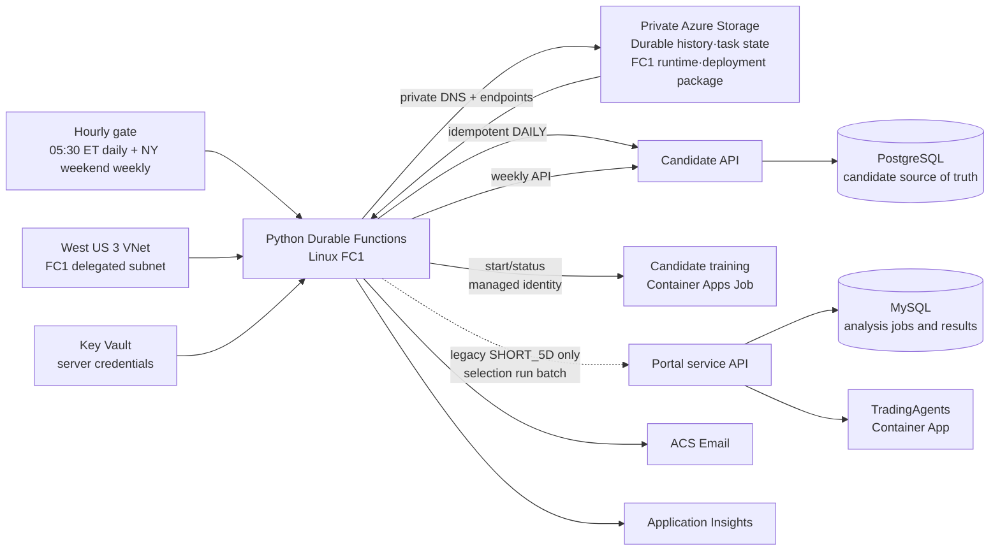

# Candidate 일일·주간 Durable Functions 오케스트레이터

이 디렉터리는 Candidate Engine의 운영 실행을 시작하고 외부 포털에 검증된 후보를
전달하는 독립 Azure Functions 앱이다. Candidate Engine의 수집·전처리·모델 점수·후보
선정 내부 계약은 변경하지 않으며, 외부 분석 결과나 상태를 Candidate 데이터베이스에
저장하지 않는다.

상태 전이, 멱등성, 외부 계약, RBAC와 배포 경계의 기준 설계는
[오케스트레이터 아키텍처](../.github/modernize/assessment/engines/facts/orchestrator-architecture.md)를
따른다.
Application Insights/Log Analytics 운영 조회는
[텔레메트리 KQL 런북](../.github/modernize/assessment/engines/facts/orchestrator-telemetry-runbook.md)을
따른다.

private Storage 기반 FC1 일일 실행 기준선은 기존 배포 상태다. 주간 재학습 API client,
New York 주말 gate, weekly parent/model orchestration, Container Apps Job start/status와
focused test는 코드로 구현·검증됐다. **주간 변경은 Azure에 배포하거나 실제 Job/API
E2E로 검증하지 않았다.** 아래에서 코드 검증과 배포 상태를 구분한다.

## Azure 구성



`infra/orchestrator.bicep`은 FC1 Function App, Durable state와 FC1 host/runtime·배포에
사용하는 Storage, Key Vault·Application Insights·Log Analytics·ACS Email 및 alert를
소유한다. Durable orchestration history와 task state는 표준 Azure Storage backend에
저장한다. Candidate·Portal App Service, TradingAgents
Container App, PostgreSQL, 포털 MySQL은 기존 외부 리소스이며 이 템플릿이 생성하거나
수정하지 않는다.

## 실행 흐름

코드의 안전한 기본값과 현재 운영 설정을 구분한다. 승인된2026-10-17 운영은
event v2·Fusion·전량 handoff가 활성화됐고 단독 stage 제어는 Candidate Backend에
배포됐다. 오늘 gate·실제 고정 input·ACK·오류 재시도는
[운영 점검서](../DAILY-PIPELINE-RUNBOOK.md)를 따른다.

1. 타이머는 매시 30분(UTC)에 실행되고 `America/New_York` 현지 시각 05:30에만
   직전 달력 날짜의 `MEDIUM_20D` 단일 `daily_orchestrator`를 시작한다.
   instance ID는 `candidate-daily-YYYY-MM-DD-medium_20d`이며 활성 instance는
   재사용한다. terminal instance는 정기 시각에 재시작할 수 있지만 기존 selection
   검사가 업무 중복을 막는다. 전환 전 dual 부모가 활성 상태이면 새 실행을 시작하지 않는다.
   기존 dual orchestration과 `SHORT_5D` 수동·API 모델 선택은 호환 경로로 유지한다.
2. Candidate `exchange-sessions` 조회로 XNYS 거래일인지 확인한다.
3. `DefaultAzureCredential`로 Candidate/Portal App Service, Candidate PostgreSQL,
   Portal MySQL을 읽고 중지 상태이면 `start`한다. TradingAgents Container App은
   배포 설정의 최소 replica와 실행 상태를 복원한다. 오케스트레이터 Storage는
   public network access 차단, 공유 키·익명 Blob 차단, `defaultAction=Deny`를 배포
   계약으로 복원한다. 허용된 변경이 resource-level `ReadOnly` lock에 막힌 경우에만 해당
   lock을 제거하고 동일한 level·notes·owners로 `finally`에서 복원한다. 이후 모든
   ARM 상태와 Storage Blob·Queue·Table data plane, Candidate `/health/ready`,
   Portal·TradingAgents `/readyz`를 다시 확인한다. 복구가 끝나지 않으면 STARTED
   알림이나 pipeline 제출 전에 실패한다. 배포 인프라는
   `TRADINGAGENTS_API_URL`을 필수로 설정하며 TradingAgents `/readyz`도
   `status=ready`인지 확인한다.
   TradingAgents의 `minReplicas`는 `TRADINGAGENTS_MIN_REPLICAS` 이상이면 정상이며,
   하한 미만일 때만 늘린다. 가디언은 이미 하한 이상인 replica 설정을 축소하지 않는다.
   2026-10-16 사용자 승인으로 운영 TradingAgents는 `minReplicas=1`, `maxReplicas=1`로
   고정했으며 `ANALYSIS_WORKER_COUNT=3`은 변경하지 않았다.
4. 날짜와 모델 목적 기반 `Idempotency-Key`로 Candidate `DAILY` 실행을 한 번 제출하고 Durable
   timer로 상태를 확인한다. 제출 전 같은 날짜·모델의 완전한 terminal selection을
   조회하며, 있으면 `SKIPPED_EXISTING`으로 종료하고 Candidate POST와 Portal batch를
   모두 생략한다. Candidate API는 canonical 요청 hash를 저장해 같은 key·payload에는
   원래 run을 반환하고 다른 payload에는 `409`를 반환한다. MEDIUM_20D 완료 후 정량
   후보가 정확히 20개인지 날짜·순위·식별자·중복을 검증한다. 기존 10개 결과는 완료로
   인정하지 않으며 MEDIUM 제출 key의 `top20-v1` suffix로 기존 10개 요청과 구분한다.
   정량 Top 20 완료는 LLM 결과 유무에 의존하지 않는다. LLM 파이프라인은 별도이며
   `LLM_PRESELECTION_ENABLED`를 활성화할 때만 병렬 실행한다.
5. 기본 `FUSION_ENABLED=false`이면 MEDIUM은 `parallel_preselection`에서 제출 0개로 종료한다.
   Fusion 활성 시에는 신규 이벤트 LLM 정책과 정량 Top 20을 병합하고 별도 API에서
   고정 run을 검증한다. 외부 전달은 추가 플래그·수신처 계약이 모두 충족될 때만 실행한다.
   레거시 SHORT_5D 명시 실행은 기존 Portal batch·분석 poll 계약을 유지한다.
   신규 최종 전달 계약은 기존 5~10개에서 **20개**로 변경하며, 최종 Top 20을
   다시 축소하지 않는다. 이는 문서 목표이며 현재 MEDIUM 제출 차단을 해제하지 않는다.
6. Candidate/Portal 제한 시간을 넘으면 `TIMED_OUT`으로 끝난다. 정기 일일 실행은
   `MEDIUM_20D` 정량 Top 20을 생성하며 SHORT 실행이나 LLM 결과에 의존하지 않는다. 외부 I/O와 이메일은
   activity에서만 실행되어 orchestrator replay가 부작용을 반복하지 않는다.
7. `resource_guardian_timer`는 15분마다 같은 readiness와 승인된 start/replica/private
   Storage 복구 계약을 독립 실행한다. 실패 시 제한된 guardian Email과 telemetry를
   남기지만 Durable 부모를 시작하거나 기존 terminal 실행을 재시작하지 않는다.

## 주간 재학습 흐름

매시 timer는 일일 gate와 독립적으로 UTC 시각을 `America/New_York`로 변환한다. 현지
토요일·일요일 tick이면 해당 ISO week의 parent를 검토한다. 첫 tick에서만 시작하도록
완료 상태를 포함해 같은 instance history가 하나라도 있으면 재시작하지 않는다.

- parent ID: `candidate-weekly-{YYYY-Www}`
- model child ID: `candidate-weekly-{YYYY-Www}-{MODEL_PURPOSE}`
- 순서: `SHORT_5D` terminal 후 `MEDIUM_20D`
- 독립성: SHORT의 실패·timeout도 MEDIUM 시작을 막지 않으며 model별 결과를 보존

parent는 Candidate API의 weekly eligibility를 먼저 확인한 뒤 각 child가 다음 계약을
수행한다.

1. `GET /api/v1/pipeline-runs/weekly/eligibility`
2. `POST /api/v1/pipeline-runs/weekly`에 `Idempotency-Key`와 `model_purpose` 전달
3. 관리 ID로 manual Container Apps Job 시작
4. Job execution과 `GET /api/v1/pipeline-runs/weekly/{weekly_run_id}` 상태 polling
5. 승격된 run에
   `POST /api/v1/pipeline-runs/weekly/{weekly_run_id}/activation-smoke`

Job override에 전달하는 업무 입력은 `WEEKLY_RUN_ID`, `MODEL_PURPOSE` 두 개뿐이다.
기본 주간 제한 시간은 720분, poll 간격은 60초다. Job 또는 promotion polling이
제한 시간을 넘으면 child는 `TIMED_OUT`으로 종료하고 active assignment를 변경하지
않는다. 따라서 PostgreSQL의 기존 incumbent가 유지된다. orchestrator는 timeout을
성공이나 승격으로 해석하지 않는다.

주간 API row가 접수의 authoritative owner이며 응답에는 allowlist된 run ID, purpose,
상태와 status URL만 사용한다. 모델 assignment의 실제 promotion/rollback은 Candidate
backend 계약이고 Durable history가 active pointer를 대신하지 않는다.

모델 종결 상태는 `SUCCEEDED`, `SKIPPED_EXISTING`, `PARTIAL_FAILED`, `TIMED_OUT`,
`FAILED`다. 비거래일은 `SUCCEEDED`와 `skipped=true`로 기록한다.
신규 실행은 모델별 `STARTED`와 terminal Email을 보내며 제목은
`[candidate-orchestrator] {MODEL_PURPOSE} {YYYY-MM-DD} {STATE}`다.
`SKIPPED_EXISTING`은 STARTED 없이 terminal Email만 보낸다.
`ORCHESTRATOR_EMAIL_ENABLED=false`이면 ACS Email 호출을 생략하고 email telemetry를
`SKIPPED`로 기록한다. 파이프라인 실행은 이메일 발송 여부와 독립적으로 계속된다.
기본값은 코드에서 `true`이며, Bicep 기본값과 로컬 예시는 발송하지 않도록 설정한다.
2026-10-16 운영 Function App에도 `false`를 적용하고 변경 코드를 배포했다.
guardian 경고 메일도 같은 설정을 따르며 일일·주간 실행과 guardian 자체는 유지한다.

아래 인증된 수동 HTTP starter는 단일 모델 진단·one-off 호환 경로로 유지되며,
`SHORT_5D` 또는 `MEDIUM_20D`를 명시적으로 선택한다. 모델 간 fallback은 수행하지 않는다.
Candidate 후보 row는 PostgreSQL에만 남고 Portal에는 복제하지 않는다. Portal MySQL은
외부 분석의 일괄 실행, 개별 job 상태와 결과만 영속화한다.

Candidate backend에는 `SHORT_5D`와 `MEDIUM_20D`별 schema v2 manifest path와
SHA-256을 별도 설정한다. 요청의 model purpose와 artifact purpose, model/label config,
registry row가 모두 일치해야 하며 다른 purpose의 artifact를 대신 사용하지 않는다.

## 인증된 수동 실행

`POST /api/orchestrations/manual`은 Function auth key가 필요하며 JSON body는
`target_date`와 `model_purpose`만 허용한다. 날짜는 완료된 과거 날짜의 엄격한
`YYYY-MM-DD`, 모델 목적은 `SHORT_5D` 또는 `MEDIUM_20D`여야 한다.

```powershell
Invoke-RestMethod `
  -Method Post `
  -Uri "https://<function-app>.azurewebsites.net/api/orchestrations/manual" `
  -Headers @{ "x-functions-key" = $env:ORCHESTRATOR_FUNCTION_KEY } `
  -ContentType "application/json" `
  -Body '{"target_date":"2026-10-09","model_purpose":"SHORT_5D"}'
```

응답은 Durable instance ID와 management/status URI를 `202`로 반환한다. URI의
`code` query secret은 제거되므로 이후 요청도 key를 URL이나 body에 넣지 말고
`x-functions-key` header로 전달해야 한다. 같은 날짜·모델 목적 요청은 기존
인스턴스를 재사용한다.

날짜별 dual 수동 endpoint는 제공하지 않는다. 05:30 ET timer는 `MEDIUM_20D`만
실행하며, 위 endpoint에서는 기존처럼 `SHORT_5D`와 `MEDIUM_20D`를 명시할 수 있다.
주간 재학습은 두 모델을 계속 독립적으로 학습·평가한다.

## 외부 포털 계약

### Fusion Top 20 전달

어댑터는 구현됐지만 `FUSION_ENABLED=false`,
`FUSION_EXTERNAL_DELIVERY_ENABLED=false`가 기본값이다. 운영 활성화 전에
Backend migration 023·event policy v2·Fusion 및 수신처의 전량 수용·멱등성을 검증한다.
`FUSION_EXTERNAL_CONTRACT_VERSION=fusion-top20-v1`은 검증 후 명시적으로 설정한다.
수신처 자체의 구현·배포는 이 저장소 밖의 의존 작업이다.

- Backend와 동일한 `FUSION_POLICY_VERSION=daily-medium-20d-rrf:1`,
  `RRF_K=10`, `FUSION_SECTOR_CAP=2`, `FUSION_RELAXED_SECTOR_CAP=4`를 사용한다.
  유효 설정 hash를 Durable input에 고정하고 activity에서 정책 변경을 차단한다.
- 성공 Fusion을 Quant selection run ID·날짜·정책/version/hash에 고정해 조회한다.
  원천 두 목록만 완료됐다고 Fusion·전달을 건너뛰지 않는다. 이미 성공한 Fusion은
  `FUSION_READY`로 전달 단계에 재진입하며 전체 후보를 다시 계산하지 않는다.
- `GET /api/v1/fusion-selections/{run_id}/handoff`의 `fusion-top20-v1` envelope를
  검증한다. 원천 run·context·cutoff·목록 순위·정확한 RRF·issuer/instrument 중복과
  20개 연속 position 및 canonical payload hash를 확인한다.
- 기본 수신 경로는 `POST /api/automation/candidate-handoffs`이며
  `FUSION_EXTERNAL_HANDOFF_PATH`로 versioned 수신 endpoint를 지정한다.
  기존 Portal 인증 헤더와 계약·Fusion run·수신처·payload를 구분한
  `Idempotency-Key`를 사용하고 원문 evidence나 secret은 보내지 않는다.
- ACK는 `contract_version`, `selection_run_id`, `payload_hash`,
  `status=ACCEPTED|REUSED`, `accepted_count=20`, `accepted_candidates`를 반환한다.
  `accepted_candidates`는 position 순서의
  `{instrument_id, issuer_id, position}` 20개와 정확히 일치해야 한다.
  HTTP 성공만으로는 완료가 아니며 일부 수락·다른 identity·hash는 실패다.
- 전달 timeout·408/429/5xx는 같은 payload·key로 최대 3회 재시도한다.
  대기는 Durable timer를 사용하며 I/O는 activity에서만 실행한다.
  전달 실패 후 재시작해도 같은 key를 사용하므로 수신처는 재사용을 보장해야 한다.
- 후보 생성 요청이 terminal 실패했다면 이전 key를 무한 재조회하지 않고
  이전 process run에 묶인 제한된 retry key로 재개한다. Source branch의 성공 결과는
  Backend가 동일 context에서 재사용한다.
- `SHORTFALL`, `FAILED`, 중간 Quant/LLM 목록은 전달하지 않는다.
  성공한 최종 20개를 5~10개로 줄이지 않는다. 전달 성공은 ACK까지이며 외부
  분석 job·보고서·비용·재평가를 새 Fusion 경로의 완료 조건으로 사용하지 않는다.

### 레거시 SHORT 전달

기존 SHORT 명시 경로는 다음 5~10개 계약을 그대로 유지한다.

- `Authorization: Bearer <token>`을 두 API에 전달
- `POST /api/automation/candidate-analyses`: `analysis_date`, `selection_run_id`,
  `model_purpose` JSON을 한 번 접수하고 `daily_analysis_id` 및 5~10개 `jobs` 집계 반환
- `GET /api/automation/candidate-analyses/{daily_analysis_id}`: 같은 집계를 반환
- 작업 상태는 `pending`, `running`, `completed`, `failed`이며 오케스트레이터 결과는
  포털이 반환한 모든 작업의 `decision`, `has_result`, 안전한 `error` 요약을 보존

## 배포 전제 조건

주간 flow를 배포하려면 기존 일일 전제 조건에 더해
`CANDIDATE_TRAINING_JOB_RESOURCE_ID`를 정확한 manual Container Apps Job resource ID로
설정하고 Function 관리 ID에 Job read/start/execution read 최소 권한을 부여해야 한다.
Candidate weekly API와 training image/module entrypoint
(`python -m sp500_candidate_engine.analytics.weekly_job`)도 먼저 배포돼 있어야 한다.
이 저장소에서 수행한 것은 local focused test와 Ruff 검증까지이며 이 설정·RBAC·image와
실제 Azure 실행은 아직 검증하지 않았다.

- 조직 정책이 Key Vault public access를 차단하고 Function에는 Key Vault private
  endpoint가 없으므로 runtime secret은 Bicep `@secure()` parameter로 전달해 encrypted
  Function App Settings에 저장한다. parameter 파일은 ignored 임시 파일로 만들고 배포 직후
  삭제한다. 발신자와 쉼표 구분 수신자 주소를 소스·로그에 기록하지 않는다.
- Candidate와 Portal App Service, Candidate PostgreSQL flexible server, Portal MySQL
  flexible server의 정확한 HTTPS URL·ARM resource ID와 각 DB의 배포된
  `publicNetworkAccess`(`Enabled` 또는 `Disabled`)를 입력한다. 오케스트레이터 관리
  ID에 네 기존 리소스 범위의 `Reader`를 별도로 부여해야 한다. 템플릿이 소유하지
  않는 다른 resource group의 역할 할당은 자동화하지 않는다.
- 자동 복구는 중지된 App Service·DB의 시작, TradingAgents의 배포된 최소 replica와
  실행 상태 복원, Storage의 `publicNetworkAccess=Disabled`,
  `allowSharedKeyAccess=false`, `allowBlobPublicAccess=false`와 배포된 network
  default action 복원으로 제한한다. SKU·DB firewall·secret·데이터는 변경하지 않는다.
  STARTED 이메일에는 resource ID나 ARM payload 없이 검사 범주와 수행한 안전한
  remediation 이름만 포함한다.
- 포털 자동화 API와 멱등 계약은 포털 배포에서 먼저 제공해야 한다.
- 운영 배포에서는 비어 있지 않은 HTTPS `tradingAgentsApiUrl` 파라미터가 필수다.
  로컬 격리 테스트에서만 `TRADINGAGENTS_API_URL`을 생략할 수 있다.
- Azure Managed Domain과 Communication Service 연결은 Bicep이 생성한다. 관리 ID의
  Communication and Email Service Owner 역할 전파와 Key Vault secret 생성이 끝난 뒤
  코드를 배포한다. 현재 구독에는 더 좁은 Email Sender built-in role이 제공되지 않아
  배포 가능한 Communication 전용 built-in role을 사용한다.
- FC1 코드 ZIP은 출력된 배포 컨테이너에 업로드해야 한다. 저장소는 공유 키와 익명
  Blob 접근을 막고 `AzureWebJobsStorage__accountName`과 `managedidentity` credential을
  사용한다. Function의 system-assigned identity에는 Storage Blob·Queue·Table data
  역할이 있으며, 같은 Storage가 표준 Durable backend와 FC1 runtime·배포에 사용된다.
- FC1 Storage는 `publicNetworkAccess=Disabled`, `defaultAction=Deny`를 유지한다.
  West US 3 VNet의 `/24` FC1 통합 subnet은 `Microsoft.App/environments`에
  위임하며 별도 `/24` subnet의 Blob·Queue·Table private endpoint와 각
  `privatelink.*.core.windows.net` private DNS zone/link를 사용한다. Function의
  모든 outbound traffic은 VNet으로 라우팅하고 identity 기반 Blob·Queue·Table URI와
  배포 Blob container를 private DNS로 해석한다. preflight는 public access를
  활성화하지 않으며 private data plane 연결이 불가하면 fail closed한다.
  `ORCHESTRATOR_STORAGE_RESOURCE_ID`,
  `ORCHESTRATOR_STORAGE_CONTAINER_NAME`, `ORCHESTRATOR_STORAGE_PUBLIC_NETWORK_ACCESS`
  설정은 실제 private-only 배포 리소스와 같아야 한다.
- 관리 ID에는 built-in Contributor 대신 다음 `Actions`만 가진 custom role을 해당
  resource scope에 부여하는 것이 최소 권한 계약이다.
  - App Service: `Microsoft.Web/sites/read`, `Microsoft.Web/sites/start/action`
  - PostgreSQL: `Microsoft.DBforPostgreSQL/flexibleServers/read`,
    `Microsoft.DBforPostgreSQL/flexibleServers/start/action`
  - MySQL: `Microsoft.DBforMySQL/flexibleServers/read`,
    `Microsoft.DBforMySQL/flexibleServers/start/action`
  - TradingAgents: `Microsoft.App/containerApps/read`,
    `Microsoft.App/containerApps/write`, `Microsoft.App/containerApps/start/action`
  - Storage: `Microsoft.Storage/storageAccounts/read`,
    `Microsoft.Storage/storageAccounts/write`
  - 일시 lock 처리: `Microsoft.Authorization/locks/read`,
    `Microsoft.Authorization/locks/delete`, `Microsoft.Authorization/locks/write`
  Storage data plane 확인에는 기존 Storage Blob Data Owner, Storage Queue Data
  Contributor, Storage Table Data Contributor를 유지한다. custom role은 `assignableScopes`
  를 위 리소스 또는 공통 resource group보다 넓게 잡지 않는다.
- 템플릿과 Function 설정은 Durable Task Scheduler를 사용하지 않는다. 표준 Storage
  backend와 `host.json` task hub를 사용한다. 과거 DTS 리소스가 남아 있다면 이 작업에서
  삭제하지 않고 사용 중이 아님을 확인한 뒤 별도 승인된 정리 작업으로만 폐기한다.
- `alertActionGroupResourceId`는 운영팀이 소유한 기존 Action Group의 전체 resource
  ID다. 주소를 이 템플릿이나 소스에 기록하지 않는다.

## 로컬 실행

`local.settings.example.json`을 `local.settings.json`으로 복사해 로컬 값만 넣은 뒤
`orchestrator` 디렉터리에서 의존성을 설치하고 Azure Functions Core Tools v4의
`func start`를 실행한다. 먼저 Azurite를 실행해야 하며, 예제의
`AzureWebJobsStorage=UseDevelopmentStorage=true`가 Functions host runtime과
`host.json`의 `CandidateDailyOrchestrator` task hub 상태를 함께 저장한다.

## Telemetry와 KQL

orchestrator와 guardian은 allowlist된 correlation/lifecycle 필드만 JSON trace로
기록한다. Durable workflow의 event는 `emit_pipeline_telemetry` activity를 통해
기록하므로 replay가 logging side effect를 반복하지 않는다. `pipeline.parent.*`,
`pipeline.model.*`, `pipeline.model.skipped_existing`, `pipeline.guardian.*`,
`pipeline.email.terminal`을 `parent_instance_id`, `model_instance_id`,
`target_session`, `model_purpose`와 함께 조회할 수 있다.

telemetry allowlist에는 주간 correlation용 `iso_week`, `weekly_run_id`,
`job_execution_name`도 포함된다. secret, API 원문 payload, resource ID와 예외 메시지는
허용하지 않는다. 현재 weekly parent/model 코드는 위 필드를 받을 수 있는 안전한
telemetry schema까지 구현했지만 weekly 전용 lifecycle event를
`emit_pipeline_telemetry` activity로 내보내는 연결과 Azure 수집 증거는 아직 없다.
따라서 런북의 weekly KQL은 배포 후 event 연결·수집 검증 체크로 사용하며 빈 결과를
성공 증거로 해석하지 않는다.

배포 후 dual 상태, 실행 시간, 중복 skip, guardian 복구, 실패, Email 전달을 확인하는
KQL은 [텔레메트리 KQL 런북](../.github/modernize/assessment/engines/facts/orchestrator-telemetry-runbook.md)에
있다. KQL 검증과 dual/weekly E2E는 아직 배포 후 운영 검증 항목이다.
