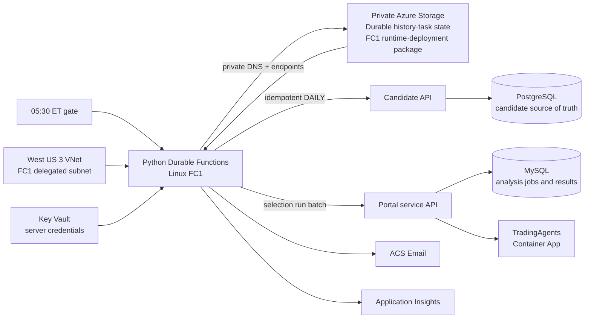

# Candidate 일일 Durable Functions 오케스트레이터

이 디렉터리는 Candidate Engine의 운영 실행을 시작하고 외부 포털에 검증된 후보를
전달하는 독립 Azure Functions 앱이다. Candidate Engine의 수집·전처리·모델 점수·후보
선정 내부 계약은 변경하지 않으며, 외부 분석 결과나 상태를 Candidate 데이터베이스에
저장하지 않는다.

상태 전이, 멱등성, 외부 계약, RBAC와 배포 경계의 기준 설계는
[오케스트레이터 아키텍처](../.github/modernize/assessment/engines/facts/orchestrator-architecture.md)를
따른다.

## Azure 구성



`infra/orchestrator.bicep`은 FC1 Function App, Durable state와 FC1 host/runtime·배포에
사용하는 Storage, Key Vault·Application Insights·Log Analytics·ACS Email 및 alert를
소유한다. Durable orchestration history와 task state는 표준 Azure Storage backend에
저장한다. Candidate·Portal App Service, TradingAgents
Container App, PostgreSQL, 포털 MySQL은 기존 외부 리소스이며 이 템플릿이 생성하거나
수정하지 않는다.

## 실행 흐름

1. 타이머는 매시 30분(UTC)에 실행되고 `America/New_York` 현지 시각 05:30에만
   직전 달력 날짜를 `MEDIUM_20D`로 시작한다. 모든 Durable 인스턴스 ID는
   `candidate-daily-YYYY-MM-DD-{model_purpose}` 형식이므로 날짜가 같아도
   `SHORT_5D` one-off와 충돌하지 않는다.
2. Candidate `exchange-sessions` 조회로 XNYS 거래일인지 확인한다.
3. `DefaultAzureCredential`로 Candidate/Portal App Service, Candidate PostgreSQL,
   Portal MySQL을 읽고 중지 상태이면 `start`한다. TradingAgents Container App은
   배포 설정의 최소 replica와 실행 상태를 복원한다. 오케스트레이터 Storage는
   public endpoint, 공유 키·익명 Blob 차단, network default action을 배포 계약으로
   복원한다. 허용된 변경이 resource-level `ReadOnly` lock에 막힌 경우에만 해당
   lock을 제거하고 동일한 level·notes·owners로 `finally`에서 복원한다. 이후 모든
   ARM 상태와 Storage Blob·Queue·Table data plane, Candidate `/health/ready`,
   Portal·TradingAgents `/readyz`를 다시 확인한다. 복구가 끝나지 않으면 STARTED
   알림이나 pipeline 제출 전에 실패한다. 배포 인프라는
   `TRADINGAGENTS_API_URL`을 필수로 설정하며 TradingAgents `/readyz`도
   `status=ready`인지 확인한다.
4. 날짜와 모델 목적 기반 `Idempotency-Key`로 Candidate `DAILY` 실행을 한 번 제출하고 Durable
   timer로 상태를 확인한다. Candidate API는 canonical 요청 hash를 저장해 같은
   key·payload에는 원래 run을 반환하고 다른 payload에는 `409`를 반환한다. 완료 후
   5~10개 후보의 날짜·순위·식별자·중복을 검증한다.
5. 검증된 후보 5~10개가 공유하는 `selection_run_id`와 `model_purpose`를 포털 자동화
   API에 한 번 제출한다. 포털 집계의 개별 작업은 재제출하지 않으며 일부 실패는
   `PARTIAL_FAILED`, 전부 실패는 `FAILED`가 된다.
6. Candidate/Portal 제한 시간을 넘으면 `TIMED_OUT`으로 끝난다. 외부 I/O와 이메일은
   activity에서만 실행되어 orchestrator replay가 부작용을 반복하지 않는다.

종결 상태는 `SUCCEEDED`, `PARTIAL_FAILED`, `TIMED_OUT`, `FAILED`다. 비거래일은
`SUCCEEDED`와 `skipped=true`로 기록한다.

타이머의 모델 목적은 항상 `MEDIUM_20D`다. `SHORT_5D`는 아래 인증된 수동 HTTP
starter에서 명시적으로 선택하는 one-off 경로이며, 중기 후보 부재 시 자동 fallback하지 않는다.
Candidate 후보 row는 PostgreSQL에만 남고 Portal에는 복제하지 않는다. Portal MySQL은
외부 분석의 일괄 실행, 개별 job 상태와 결과만 영속화한다.

## 인증된 수동 실행

`POST /api/orchestrations/manual`은 Function auth key가 필요하며 JSON body는
`target_date`와 `model_purpose`만 허용한다. 날짜는 완료된 과거 날짜의 엄격한
`YYYY-MM-DD`, 모델 목적은 `SHORT_5D` 또는 `MEDIUM_20D`여야 한다.

```powershell
Invoke-RestMethod `
  -Method Post `
  -Uri "https://<function-app>.azurewebsites.net/api/orchestrations/manual" `
  -Headers @{ "x-functions-key" = $env:ORCHESTRATOR_FUNCTION_KEY } `
  -ContentType "application/json" `
  -Body '{"target_date":"2026-10-09","model_purpose":"SHORT_5D"}'
```

응답은 Durable instance ID와 management/status URI를 `202`로 반환한다. URI의
`code` query secret은 제거되므로 이후 요청도 key를 URL이나 body에 넣지 말고
`x-functions-key` header로 전달해야 한다. 같은 날짜·모델 목적 요청은 기존
인스턴스를 재사용한다.

## 외부 포털 계약

배포 전에 포털이 다음 서버 간 계약을 제공해야 한다.

- `Authorization: Bearer <token>`을 두 API에 전달
- `POST /api/automation/candidate-analyses`: `analysis_date`, `selection_run_id`,
  `model_purpose` JSON을 한 번 접수하고 `daily_analysis_id` 및 5~10개 `jobs` 집계 반환
- `GET /api/automation/candidate-analyses/{daily_analysis_id}`: 같은 집계를 반환
- 작업 상태는 `pending`, `running`, `completed`, `failed`이며 오케스트레이터 결과는
  포털이 반환한 모든 작업의 `decision`, `has_result`, 안전한 `error` 요약을 보존

## 배포 전제 조건

- 조직 정책이 Key Vault public access를 차단하고 Function에는 Key Vault private
  endpoint가 없으므로 runtime secret은 Bicep `@secure()` parameter로 전달해 encrypted
  Function App Settings에 저장한다. parameter 파일은 ignored 임시 파일로 만들고 배포 직후
  삭제한다. 발신자와 쉼표 구분 수신자 주소를 소스·로그에 기록하지 않는다.
- Candidate와 Portal App Service, Candidate PostgreSQL flexible server, Portal MySQL
  flexible server의 정확한 HTTPS URL·ARM resource ID와 각 DB의 배포된
  `publicNetworkAccess`(`Enabled` 또는 `Disabled`)를 입력한다. 오케스트레이터 관리
  ID에 네 기존 리소스 범위의 `Reader`를 별도로 부여해야 한다. 템플릿이 소유하지
  않는 다른 resource group의 역할 할당은 자동화하지 않는다.
- 자동 복구는 중지된 App Service·DB의 시작, TradingAgents의 배포된 최소 replica와
  실행 상태 복원, Storage의 `publicNetworkAccess=Disabled`,
  `allowSharedKeyAccess=false`, `allowBlobPublicAccess=false`와 배포된 network
  default action 복원으로 제한한다. SKU·DB firewall·secret·데이터는 변경하지 않는다.
  STARTED 이메일에는 resource ID나 ARM payload 없이 검사 범주와 수행한 안전한
  remediation 이름만 포함한다.
- 포털 자동화 API와 멱등 계약은 포털 배포에서 먼저 제공해야 한다.
- 운영 배포에서는 비어 있지 않은 HTTPS `tradingAgentsApiUrl` 파라미터가 필수다.
  로컬 격리 테스트에서만 `TRADINGAGENTS_API_URL`을 생략할 수 있다.
- Azure Managed Domain과 Communication Service 연결은 Bicep이 생성한다. 관리 ID의
  Communication and Email Service Owner 역할 전파와 Key Vault secret 생성이 끝난 뒤
  코드를 배포한다. 현재 구독에는 더 좁은 Email Sender built-in role이 제공되지 않아
  배포 가능한 Communication 전용 built-in role을 사용한다.
- FC1 코드 ZIP은 출력된 배포 컨테이너에 업로드해야 한다. 저장소는 공유 키와 익명
  Blob 접근을 막고 `AzureWebJobsStorage__accountName`과 `managedidentity` credential을
  사용한다. Function의 system-assigned identity에는 Storage Blob·Queue·Table data
  역할이 있으며, 같은 Storage가 표준 Durable backend와 FC1 runtime·배포에 사용된다.
- FC1 Storage는 `publicNetworkAccess=Disabled`, `defaultAction=Deny`를 유지한다.
  West US 3 VNet의 `/24` FC1 통합 subnet은 `Microsoft.App/environments`에
  위임하며 별도 `/24` subnet의 Blob·Queue·Table private endpoint와 각
  `privatelink.*.core.windows.net` private DNS zone/link를 사용한다. Function의
  모든 outbound traffic은 VNet으로 라우팅하고 identity 기반 Blob·Queue·Table URI와
  배포 Blob container를 private DNS로 해석한다. preflight는 public access를
  활성화하지 않으며 private data plane 연결이 불가하면 fail closed한다.
  `ORCHESTRATOR_STORAGE_RESOURCE_ID`,
  `ORCHESTRATOR_STORAGE_CONTAINER_NAME`, `ORCHESTRATOR_STORAGE_PUBLIC_NETWORK_ACCESS`
  설정은 실제 private-only 배포 리소스와 같아야 한다.
- 관리 ID에는 built-in Contributor 대신 다음 `Actions`만 가진 custom role을 해당
  resource scope에 부여하는 것이 최소 권한 계약이다.
  - App Service: `Microsoft.Web/sites/read`, `Microsoft.Web/sites/start/action`
  - PostgreSQL: `Microsoft.DBforPostgreSQL/flexibleServers/read`,
    `Microsoft.DBforPostgreSQL/flexibleServers/start/action`
  - MySQL: `Microsoft.DBforMySQL/flexibleServers/read`,
    `Microsoft.DBforMySQL/flexibleServers/start/action`
  - TradingAgents: `Microsoft.App/containerApps/read`,
    `Microsoft.App/containerApps/write`, `Microsoft.App/containerApps/start/action`
  - Storage: `Microsoft.Storage/storageAccounts/read`,
    `Microsoft.Storage/storageAccounts/write`
  - 일시 lock 처리: `Microsoft.Authorization/locks/read`,
    `Microsoft.Authorization/locks/delete`, `Microsoft.Authorization/locks/write`
  Storage data plane 확인에는 기존 Storage Blob Data Owner, Storage Queue Data
  Contributor, Storage Table Data Contributor를 유지한다. custom role은 `assignableScopes`
  를 위 리소스 또는 공통 resource group보다 넓게 잡지 않는다.
- 템플릿은 더 이상 Durable Task Scheduler와 task hub를 관리하지 않는다. 이미 배포된
  DTS 리소스는 이 변경에서 삭제하지 않으며 사용 중이 아님을 확인한 뒤 별도 승인된
  정리 작업으로 폐기한다.
- `alertActionGroupResourceId`는 운영팀이 소유한 기존 Action Group의 전체 resource
  ID다. 주소를 이 템플릿이나 소스에 기록하지 않는다.

## 로컬 실행

`local.settings.example.json`을 `local.settings.json`으로 복사해 로컬 값만 넣은 뒤
`orchestrator` 디렉터리에서 의존성을 설치하고 Azure Functions Core Tools v4의
`func start`를 실행한다. 먼저 Azurite를 실행해야 하며, 예제의
`AzureWebJobsStorage=UseDevelopmentStorage=true`가 Functions host runtime과
`host.json`의 `CandidateDailyOrchestrator` task hub 상태를 함께 저장한다.
